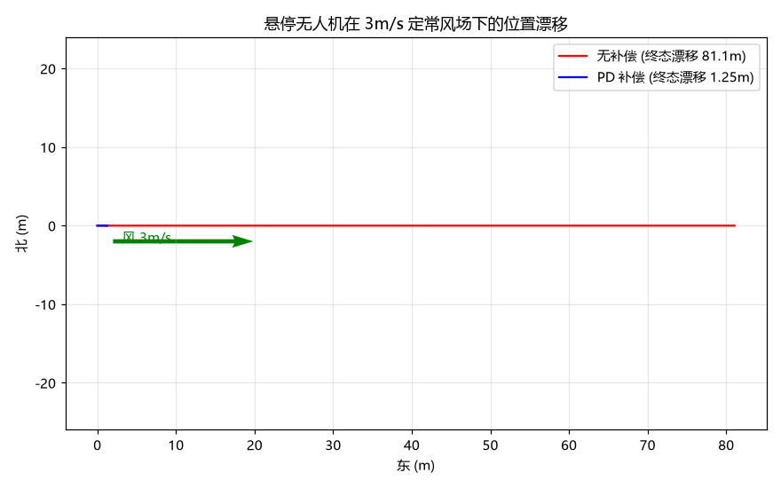

# (作业) 蒋宇鑫 2535030012 定常风场下悬停漂移仿真与 PD 位置补偿 (wind_drift_sim)

## 1. 简介

低空经济作业（巡检、植保、航拍）要求无人机在风中稳定悬停。本模块用一阶气动阻力模型仿真悬停无人机在 3m/s 定常风场中的漂移，对比**无补偿**与 **PD 位置补偿**两种策略。真实运行结果：无补偿 30 秒漂移 81m（终端速度约等于风速），PD 补偿将漂移压到 1.25m（稳态偏差约 1/kp，完全消除需积分项）。

## 2. 运行环境

- Ubuntu 22.04 + ROS 2 Humble；测试需 pytest；绘图需 matplotlib

## 3. 目录结构

```text
src/air/wind_drift_sim/
├── main.py              # ROS2 节点: 50Hz 发布 /drift/no_compensation 与 /drift/pd_compensation
├── core.py              # 风阻模型 + 三种策略仿真（纯 Python）
└── test/test_core.py    # 5 项单元测试
```

## 4. 运行步骤

```bash
pytest src/air/wind_drift_sim/test/test_core.py -v
python3 src/air/wind_drift_sim/main.py
```

## 5. 单元测试运行结果

```text
test/test_core.py::test_no_compensation_drifts PASSED
test/test_core.py::test_no_compensation_reaches_terminal_velocity PASSED
test/test_core.py::test_pd_compensation_reduces_drift PASSED
test/test_core.py::test_stronger_wind_more_drift PASSED
test/test_core.py::test_plant_deterministic PASSED
5 passed
```

物理校验：无补偿时稳态相对气流速度为 0，即漂移速度≈风速 3m/s（仿真值误差 <0.1）；风越大漂移越大。

## 6. ROS2 节点运行结果（真实运行 30 秒, 50Hz）

```text
[wind_drift_sim]: 风场漂移仿真节点启动: 3m/s 东风, 50Hz, 30s
[wind_drift_sim]: ===== 漂移对比 (3m/s 定常风, 30s) =====
[wind_drift_sim]:   无补偿:   最大漂移 81.06 m, 终态 81.06 m
[wind_drift_sim]:   PD 补偿:  最大漂移 1.26 m, 终态 1.25 m
```

## 7. 运行效果图



（图由 `make_figures.py` 实际运行生成：红色为无补偿漂移轨迹，蓝色为 PD 补偿后稳定在悬停点附近。）

## 8. 设计说明

- **模型**：`a = k·(V_wind − V_uav)/m + u_control`，无控制时无人机最终随风速漂移；
- **PD 补偿**：`u = −Kp·pos − Kd·vel`，常值风下存在 1/Kp 量级稳态偏差，工程上可加积分项消除；
- **参数**：阻力系数 0.5、质量 1.5kg，均为 ROS2 可调参数。

## 9. 参考链接

- 风场中的无人机控制: <https://openhutb.github.io/air_doc/dev/Carla_Air/>
- PD 控制: <https://en.wikipedia.org/wiki/PID_controller#Pseudo_code>

## 10. 大模型使用声明

本模块代码与文档在编写过程中使用了大模型工具（WorkBuddy）辅助生成，作者已逐行核对全部内容，理解其原理并实际运行验证，对提交内容负全部责任。
