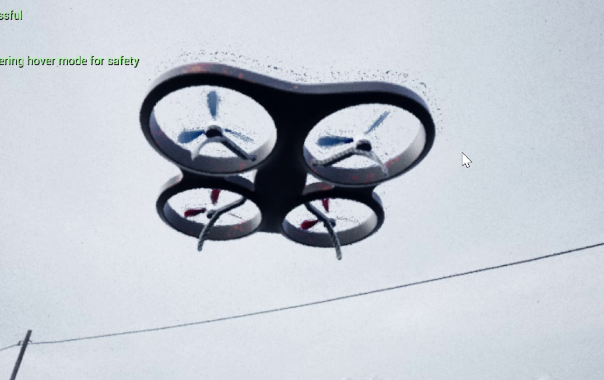
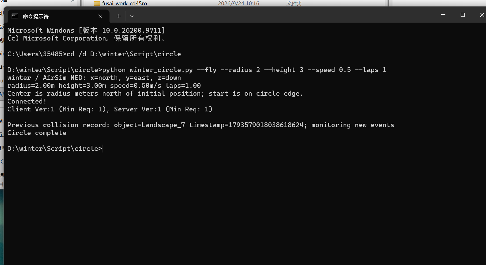

# winter 场景无人机圆周飞行

本实验把 MAVROS 绕圈教程的控制思路适配到 Unreal Engine 4.27 的 winter/AirSim 场景，使用 Python RPC 实现起飞、定高、圆周跟踪与悬停。本示例直接连接 AirSim，不需要 ROS master 或 MAVROS。

## 环境与代码

- 已有 winter 场景、AirSim 插件，多旋翼 Drone1。
- Python 环境能够执行 `python -c "import airsim"`。
- 源码：仓库 `src/air/winter_circle/winter_circle.py`。
- 配置参考：`src/air/winter_circle/config/settings.example.json`，不要直接覆盖已有 AirSim 配置。

## 启动

在 UE4.27 中打开 winter.uproject，选择场景并点击 Play。默认地址 127.0.0.1:41451；不要同时启动 Blocks 占用同一端口。无人机应已着地，并停止其他控制器。

从仓库根目录运行：

```bash
# 仅显示参数，不连接、不起飞
python src/air/winter_circle/winter_circle.py
# 实际运行，完成后悬停
python src/air/winter_circle/winter_circle.py --fly --radius 2 --height 3 --speed 0.5 --laps 1
```

添加 `--land` 在正常完成后降落；添加 `--clockwise` 改为从上方看顺时针。Ctrl+C 会尝试悬停。虚拟机远程连接时添加 `--host <Windows主机IP>`，以实际网络为准。

## 参数与轨迹

| 参数 | 默认值 | 含义 |
| --- | --- | --- |
| --vehicle | Drone1 | settings 中飞行器名 |
| --radius | 2 | 圆半径，米 |
| --height | 3 | 相对初始位置升高距离，米 |
| --speed | 0.5 | 水平合速度上限，米/秒 |
| --laps | 1 | 目标圈数 |
| --port | 41451 | AirSim RPC 端口 |

圆心为初始位置向北偏移一个半径，因此起始位置就在圆周上。前三秒逐渐增加切向速度，累计实际极角判断圈数。yaw 固定为零，绕圈不等于机头持续转向。

## 接口和坐标

| MAVROS 教程接口 | AirSim 适配 |
| --- | --- |
| local_position/pose | getMultirotorState |
| OFFBOARD、解锁 | enableApiControl、armDisarm |
| 起飞与高度控制 | takeoffAsync、moveToZAsync |
| setpoint_velocity/cmd_vel | moveByVelocityZAsync |

程序在 NED 世界系计算：x 北、y 东、z 向下。目标 z=初始 z-height；ENU→NED 的通用向量变换为 (east,north,up)→(north,east,-up)。全程在 NED 中计算时无需重复转换。

设距离圆心为 d，径向单位向量为 u，径向修正为 0.5(R-d)u，切向速度为 omega*R*(-u_y,u_x)，两者相加后限幅。高度由 AirSim 定高速度接口跟踪。

## 碰撞与运行边界

历史接地信息可能保存在碰撞记录中。脚本记录初始时间戳，只对本次运行的新碰撞停止任务，并输出碰撞物体。若出现 `New collision`，检查物体名称和起飞空间，不要关闭碰撞保护。

定高误差、路径越界、任务超时、控制循环延迟也会终止绕圈并尝试悬停。通信断开不能保证悬停指令送达。没有自主避障和地形跟随，height 不是沿途离地高度，winter 坡地应选空旷位置。

## 验证记录与运行效果

已检查 Python 语法、无飞行参数预览、坐标转换、合速度限幅、历史/新增碰撞分支。简化平面运动积分完成一圈，最大半径误差约 0.0063 米；该结果属于数学离线检查，不代表 AirSim 实测误差。

用户提供的终端截图显示：半径 2 米、高度差 3 米、速度 0.5 米/秒、圈数 1，已连接 AirSim，旧 Landscape_7 碰撞记录被识别为历史事件，最终输出 Circle complete。该记录支持脚本达到圈数完成条件；没有轨迹日志，无法量化真实半径和高度误差。

实测时记录命令、圈数、运行日志，并附完整绕圈视频或连续截图；不要将单张场景图片作为绕圈完成证据。

## 来源

参考用户提供 tutorials.tar 中 tutorial_basic/src/circle_node.cpp 的控制思路。Python 适配由 OpenAI Codex 辅助编写，原始源码及许可归属以原材料为准。

## 用户实测材料（2026-11-02）



上图取自用户录屏第 10 秒，可见 winter 场景中的无人机。画面出现 entering hover mode for safety 提示；单帧不能证明完整圆形轨迹或定位精度。



终端记录包含实际命令与 Circle complete。录屏与终端截图分别作为运行画面和程序完成记录，不作为定量轨迹评估。

<video controls preload="metadata" width="100%">
  <source src="../../img/air/winter_circle/winter_circle_demo.mp4" type="video/mp4">
  浏览器不支持视频播放，请下载视频查看。
</video>

[下载原始运行录屏](../img/air/winter_circle/winter_circle_demo.mp4)
