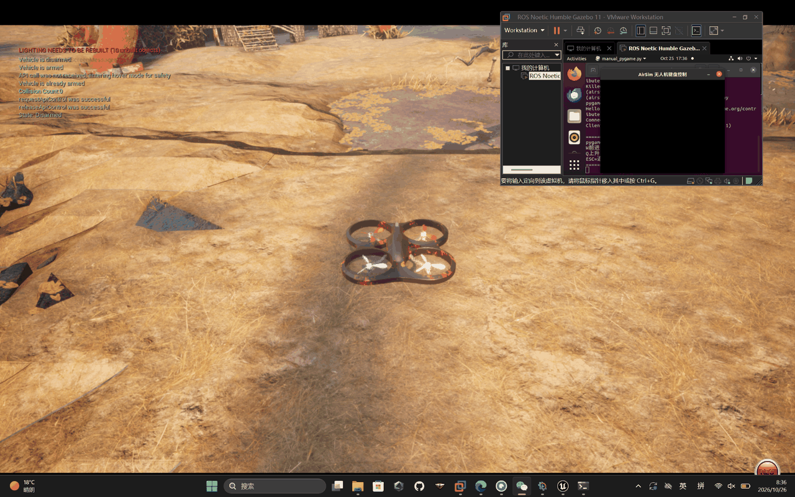

# AirSim 无人机键盘遥控与机载云台控制模块

## 功能说明

基于 **pygame** 实现 AirSim 无人机的手动遥控与机载云台相机预览：

- 不用 `keyboard` 库，避免 Linux 下需要 root 权限；
- 键盘控制无人机全向飞行与偏航，实时预览机载相机画面；
- 键盘调节云台俯仰/偏航角度；
- 封装为标准 ROS 2 Python 功能包，可用 `ros2 run` 启动。

## 控制按键

| 按键 | 功能 | 说明 |
| --- | --- | --- |
| `W` / `S` | 前进 / 后退 | NED 的 x 轴 |
| `A` / `D` | 左移 / 右移 | NED 的 y 轴 |
| `Q` / `E` | 上升 / 下降 | NED 的 z 轴（向上为负） |
| `Z` / `X` | 左转 / 右转 | 偏航角速度 |
| `I` / `K` | 云台向上 / 向下俯仰 | 俯仰限制 ±90° |
| `J` / `L` | 云台向左 / 向右偏航 | 归一化到 ±180° |
| 方向键 | 同 `I` / `K` / `J` / `L` | 云台别名 |
| `ESC` | 退出 | 自动降落并释放 API 控制权 |

## 运行环境

- 操作系统：Ubuntu 20.04 虚拟机
- ROS 2：Foxy（Python 3.8）
- 仿真器：AirSim 1.8.1（Unreal，AbandonedPark 场景）
- Python 依赖：`pygame`、`airsim`、`numpy`

> `airsim` 不在 rosdep 中，需要用 `pip3 install airsim` 安装；`pygame`、`numpy` 也可用 `python3-pygame` / `python3-numpy` 安装。

## 安装与编译

```bash
cd ~/ros2_ws
pip3 install pygame airsim numpy
colcon build --packages-select airsim_drone_gimbal_teleop
source install/setup.bash
```

## 运行步骤

1. Windows 端启动 AirSim 仿真器，确认无人机处于就绪状态并开放 RPC 端口（默认 41451）；
2. Ubuntu 端连上同一网络，启动节点：

```bash
# 本机仿真（AirSim 与 ROS 在同一台机器）
ros2 run airsim_drone_gimbal_teleop drone_gimbal_teleop

# 跨虚拟机：AirSim 在 Windows，节点在 Ubuntu
ros2 run airsim_drone_gimbal_teleop drone_gimbal_teleop --ip 192.168.1.10 --takeoff
```

3. 在 pygame 窗口中用上表按键飞行与调节云台，按 `ESC` 退出并自动降落。

## 参数

| 参数 | 默认值 | 说明 |
| --- | --- | --- |
| `--ip` | `127.0.0.1` | AirSim 主机 IP |
| `--port` | `41451` | AirSim RPC 端口 |
| `--camera` | `0` | 相机名称 |
| `--fps` | `30` | 画面刷新率 |
| `--width` / `--height` | `640` / `480` | 预览窗口大小 |
| `--duration` | `0.1` | 单条速度指令持续时间（秒） |
| `--takeoff` | 关闭 | 启动时先起飞 |
| `--altitude` | `3.0` | 起飞高度（米） |

## 运行效果



## 实现说明

- 每帧读取按键，按 `command_from_actions()` 换算成 AirSim 的 NED 速度
  （`W` → `vx > 0`，`Q` → `vz < 0`），再用 `moveByVelocityAsync()` 下发；
  松开按键即停止，不会一直漂移；
- 云台姿态用 `simSetCameraPose()` 设置，俯仰限制在 ±90°，偏航归一化到 `(-180, 180]`；
- 相机画面用 `simGetImages()` 获取，`display_array()` 只做 x/y 轴转置
  （`(H, W, 3) → (W, H, 3)`）后交给 `pygame.surfarray`；不能用 `np.rot90`，
  那会把画面逆时针转 90°，预览方向就错了；
- `ESC` / `Ctrl+C` 都会走 `finally` 分支：`landAsync()` → `armDisarm(False)` → `enableApiControl(False)`；
  窗口初始化失败（例如没有 `DISPLAY`）、起飞异常等同样会触发，避免飞机保持解锁并占用 API 控制权。

## 常见问题

- **连不上 AirSim**：确认仿真器已启动、`--ip` 是 Windows 主机在虚拟机网络中的地址、防火墙放行 41451；
- **窗口没有画面**：确认 `settings.json` 里相机名称是 `0`（默认前置相机），或用 `--camera` 指定；
- **一启动就坠机**：无人机可能还停在地面，加 `--takeoff` 让节点先起飞到 `--altitude`。

## 本地测试

不需要 AirSim / pygame 也能验证按键映射与云台逻辑：

```bash
python3 tests/test_airsim_drone_gimbal_teleop_local.py
```
