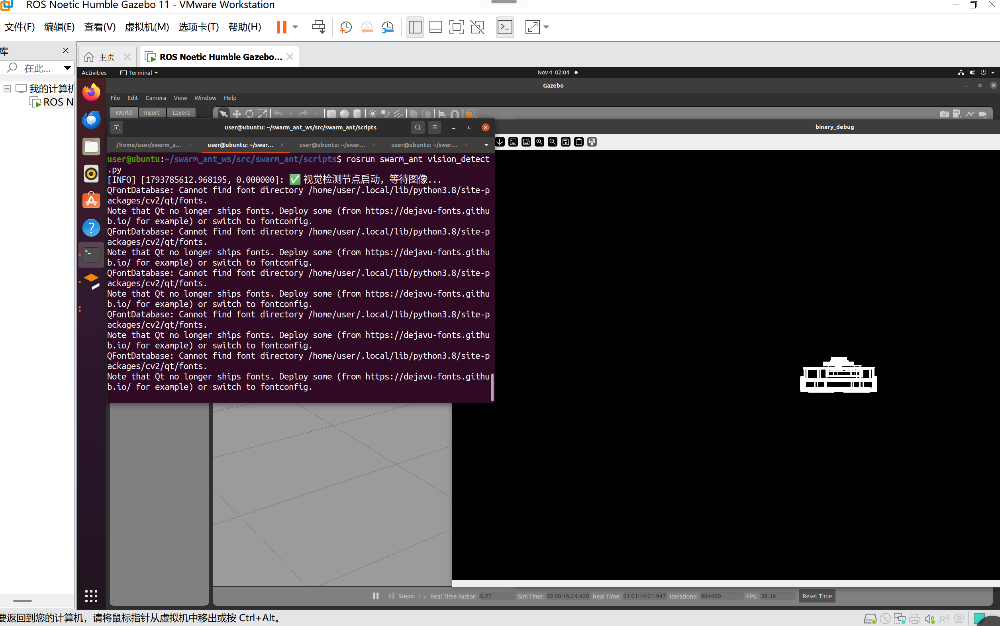
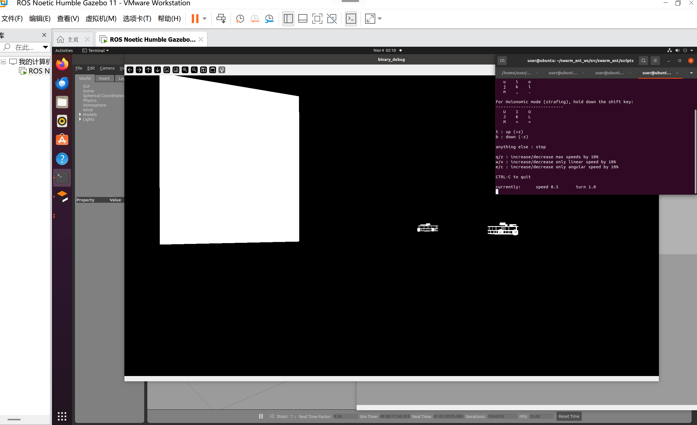

# 机器视觉驱动的多机器人蚁群编队

基于 ROS 2 Humble 的视觉目标识别与编队跟随实验：从相机图像中识别红色标记，解算其像素坐标，
再用比例控制生成速度指令，让机器人朝标记方向跟随。

## 功能说明

1. `vision_detect_node.py`：订阅 `/camera/image_raw`，对红色标记做 HSV 阈值分割
   （覆盖 `[0,10]` 与 `[170,180]` 两段，两段 mask 取并集），取最大轮廓质心，
   向 `/leader_target` 发布 `geometry_msgs/PointStamped`（x、y 为像素坐标，z 为轮廓面积）。
2. `swarm_control_node.py`：订阅 `/leader_target`，以图像中心 x = 320 为基准计算偏差，
   向 `/cmd_vel` 发布 `geometry_msgs/Twist`；目标面积过小时输出零速度。
3. `swarm_bringup.launch.py`：一键启动上面两个节点。

## 前置条件（重要）

`swarm_bringup.launch.py` **只启动两个算法节点，不启动 Gazebo、不 spawn 机器人**。
`/camera/image_raw` 需要由仿真或实车提供，推荐先用带相机的 TurtleBot3 waffle 仿真：

```bash
export TURTLEBOT3_MODEL=waffle
ros2 launch turtlebot3_gazebo turtlebot3_world.launch.py
```

确认话题存在后再启动本实验：

```bash
ros2 topic list | grep camera        # 应能看到 /camera/image_raw
```

若使用 burger 模型（无相机）或自建 world，需自行添加相机传感器或 remap 话题。

## 编译与运行

```bash
cd ~/ros2_ws
colcon build --packages-select ant_colony_swarm
source install/setup.bash
ros2 launch ant_colony_swarm swarm_bringup.launch.py
```

## 话题与参数

| 名称 | 类型 | 说明 |
| --- | --- | --- |
| `/camera/image_raw` | `sensor_msgs/Image` | 输入图像，需由外部仿真提供 |
| `/leader_target` | `geometry_msgs/PointStamped` | 视觉节点输出的目标像素坐标与面积 |
| `/cmd_vel` | `geometry_msgs/Twist` | 控制节点输出的速度指令 |

比例系数直接写在节点里：`kp_ang = 0.003`、`kp_lin = 0.0015`，图像中心 `img_center = 320`。

## 已知限制

- 当前只有一路 `/cmd_vel`，实际是**单机器人视觉跟随**；多机器人编队（每台机器人独立命名空间与话题）
  为后续工作。
- 红色阈值固定为 `H ∈ [0,10] ∪ [170,180]`、`S, V ≥ 120`，光照变化较大时需要手动调参。
- 图像中心固定为 320，只适配 640×480 的相机输出。

## 运行效果





## 目录结构

```text
src/chap8/ant_colony_swarm/
├── ant_colony_swarm/
│   ├── __init__.py
│   ├── swarm_control_node.py
│   └── vision_detect_node.py
├── launch/
│   └── swarm_bringup.launch.py
├── resource/
│   └── ant_colony_swarm
├── package.xml
├── setup.cfg
└── setup.py
```
