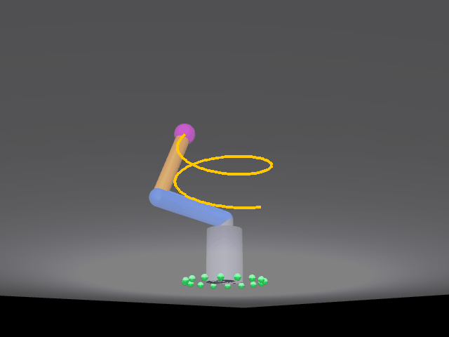

# 三自由度机械臂空间螺旋线仿真

基于 MuJoCo 的三自由度机械臂（肩方位 yaw、肩俯仰 shoulder、肘俯仰 elbow）在三维空间中沿圆柱螺旋线运动的仿真演示。程序用解析空间逆运动学实时解算三个关节角，把关节角直接写入 `qpos` 后做前向计算，末端严格落在螺旋线上，逐帧渲染并合成动态效果图。

功能包源码位于仓库的 src/mujoco_arm_3d 目录。



## 功能特点

- **空间逆运动学**：由末端位置先求水平方位角，再在臂平面内用两连杆解析解求肩角与肘角；方位角做解缠处理，保证多圈连续旋转不跳变。
- **末端严格跟随轨迹**：逆解直接写入 `qpos`（`qvel` 清零）后 `mj_forward`，216 帧逐帧对比末端跟随误差 **0.0 mm**；同时保留 PD 位置控制路径作对照（环境变量 `ARM3D_PD=1` 启用）。
- **轨迹可视化**：DLT 相机标定反解 3×4 投影矩阵（平均重投影误差 1.5 px），把末端世界坐标精确投影成像素，叠加的黄色螺旋线与画面里的末端球基本重合（末帧偏差 4 px）。
- **物理时间对齐**：每帧 21 个 2 ms 物理子步，与 1/24 s 的帧间隔对齐，避免末端速度只有轨迹速度的 14%。

## 环境准备

```bash
pip install mujoco pillow numpy
```

无图形界面的虚拟机（如 Ubuntu 无显卡环境）使用 osmesa 后端：

```bash
export MUJOCO_GL=osmesa
```

## 运行

```bash
python3 main.py                        # 生成 demo_arm3d.gif 效果图
python3 verify_arm3d.py ik             # IK 数值精度验证
python3 verify_arm3d.py gui            # glfw 实时渲染验证（弹出窗口）
```

PD 控制对照路径（可选）：

```bash
ARM3D_PD=1 ARM3D_KP=40 ARM3D_KD=12 python3 main.py
```

## 验证结果

| 项 | 结果 |
|---|---|
| IK 数值精度 | 螺旋线 8 个空间点 逆解→正解互查，最大误差 **0.0000 mm** |
| 末端跟随误差 | 216 帧逐帧对比，首帧 / 末帧 / 最大均为 **0.0 mm** |
| 相机标定 | 10 个标定点，平均重投影误差 **1.54 px**；末帧投影与末端球实测偏差 **4.04 px** |
| 效果图 | 216 帧 / 9.0 秒 / 640×480 / 1.72 MB，脚本直接输出（非录屏、非倒放） |

## 参数

半径 0.20 m，螺旋高度 0.32 → 0.56 m，1.5 圈，总时长 9.0 s，24 FPS，每帧 21 个 2 ms 物理子步。
