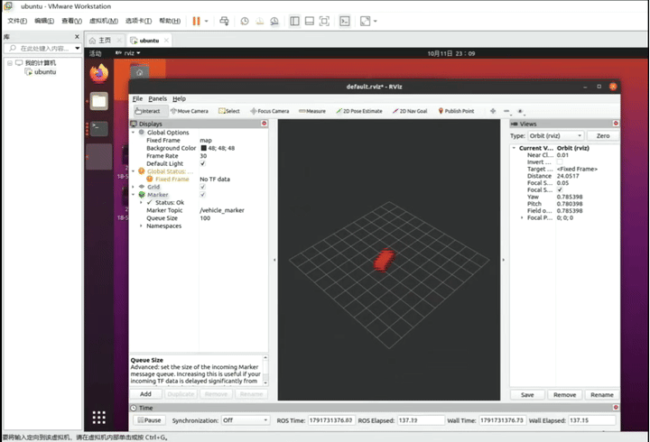

# 基于 ROS 的无人车自动画圆仿真

## 运行环境
- Ubuntu 20.04
- ROS Noetic
- Python 3.8

##文件结构
```
src/
└── auto_circle_sim/
├── package.xml
├── CMakeLists.txt
├── launch/
│   └── auto_circle_sim.launch
├── rviz/
│   └── auto_circle.rviz
└── scripts/
└── main.py
```
## 依赖安装
1. 安装 pynput：
   pip install pynput
2. 安装 ROS Noetic（Ubuntu 环境）。

## 运行步骤
1. 打开终端，进入工作空间，输入 `source devel/setup.bash`
2. 输入 `roslaunch auto_circle_sim auto_circle_sim.launch`
3. rviz 会自动打开并加载 Marker 显示，
4. 观察红色方块自动画出圆形轨迹


## 运行结果


## 大模型声明
代码由本人参考 ROS 官方文档和课程资料编写，未使用大模型生成。
