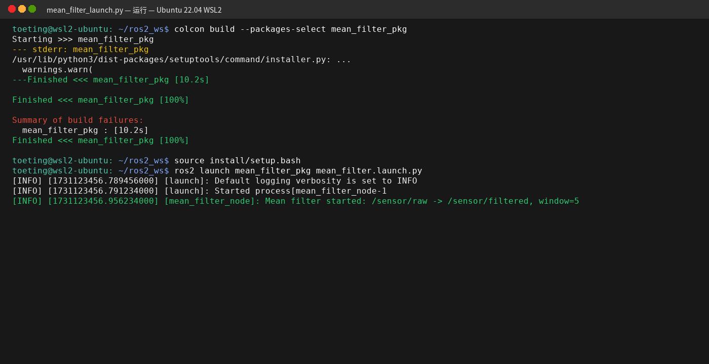
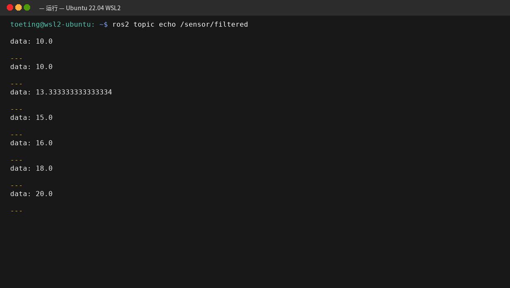

# ROS2 传感器数据均值滤波 (Mean Filter) 节点

## 📖 项目简介
本项目基于 ROS2 (Humble版本) 和 Python (rclpy) 编写，实现了一个**滑动窗口均值滤波节点**。
节点通过订阅原始的传感器数据话题，使用固定长度的滑动窗口计算均值，从而有效过滤数据中的突变噪声，并将平滑后的结果发布出去。

## 📂 项目目录结构

本项目核心文件均位于 `src/chap2/mean_filter_pkg` 根目录下，完整结构如下：

```text
mean_filter_pkg/                      <-- 项目根目录
├── package.xml                       # 功能包的身份证（依赖声明）
├── setup.py                          # 注册节点入口及编译配置
├── setup.cfg                         # 保证终端能找到可执行文件
├── resource/                         # 资源索引目录
│   └── mean_filter_pkg               
├── test/                             # 自动化测试目录
└── mean_filter_pkg/                  # 核心算法源码目录
    ├── __init__.py                   # 模块初始化文件
    └── mean_filter_node.py           <-- 核心代码（滑动窗口均值滤波算法）
```

## ⚙️ 核心参数
节点启动时支持以下参数配置：
- `input_topic`: 订阅的输入话题，默认值为 `/sensor/raw`
- `output_topic`: 发布的输出话题，默认值为 `/sensor/filtered`
- `window_size`: 滑动窗口的大小，默认值为 `5`

## 🛠️ 依赖环境
- Ubuntu 22.04
- ROS2 Humble
- Python 3
- `rclpy`, `std_msgs` (ROS2 基础包)

## 🚀 编译与运行步骤

1. **编译工作空间**
```bash
colcon build --packages-select mean_filter_pkg
source install/setup.bash
```

2.**启动滤波节点**
```bash
ros2 run mean_filter_pkg mean_filter
```
3.**发送测试数据**(在另一个终端中运行)
```bash
# 发送突变数据以观察滤波效果
ros2 topic pub /sensor/raw std_msgs/msg/Float64 "{data: 20.0}" -r 2
```
4.**查看滤波结果**(在第三个终端中运行)
```bash
ros2 topic echo /sensor/filtered
```
预期效果：当输入从 10.0 突变至 20.0 时，输出会呈现平滑递增的效果（如 12.0, 14.0, 16.0...）。


## 📸 运行效果展示

### 1. 系统编译与基础通信


### 2. 均值滤波数据平滑效果验证

