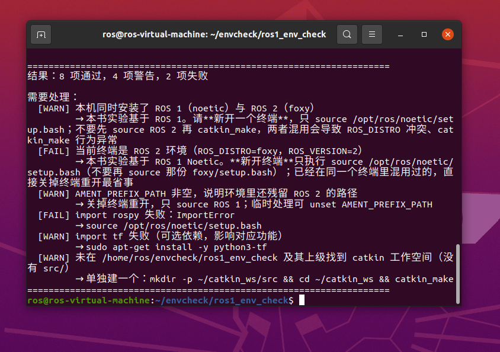
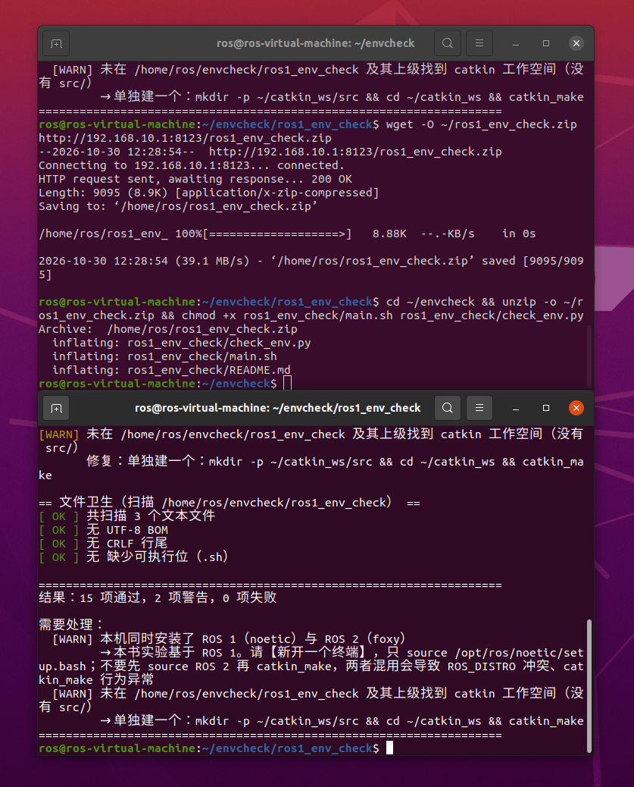

# ROS 1 环境自检与常见问题排查

> 所属模块：`src/chap2/ros1_env_check`
> 依赖：Python 3.6+（**不需要 ROS 也能运行**）
> 适用：Ubuntu 20.04 + ROS Noetic；同样适用于 **ROS 1 与 ROS 2 共存的机器**

## 1. 为什么需要环境自检

跟着本书跑模块时，"跑不起来"的原因里，**环境问题**和**代码问题**大约各占一半，
但环境问题的报错往往指向别处：

| 现象 | 看起来像 | 实际原因 |
|---|---|---|
| `ModuleNotFoundError: No module named 'rospy'` | 代码缺依赖 | 当前终端没 `source /opt/ros/noetic/setup.bash` |
| `ImportError: No module named 'lateral_control_benchmark'` | 包没装好 | 没 `source devel/setup.bash`，或包未加 `catkin_python_setup()` |
| `RLException: ... is neither a launch file in package ...` | launch 文件写错 | 包没编译成功，`devel` 里没有该包 |
| `bash: ./run.sh: /bin/bash^M: bad interpreter` | 脚本内容有问题 | 文件是 **CRLF** 行尾（从 Windows 拷过来） |
| `mkdocs.yml` 报奇怪的 YAML 解析错误 | 配置写错 | 文件开头有不可见的 **UTF-8 BOM** |
| `catkin_make` 在别的包上失败 | 本模块有问题 | 工作空间里有其他包缺依赖（如 `turtlebot3_gazebo` 缺 `sdformat-9.8`） |

`ros1_env_check` 把上述检查集中到一处，一次性告诉你**缺什么、怎么修**。

## 2. 快速开始

```bash
cd src/chap2/ros1_env_check

# 检查当前终端与环境
./main.sh

# 额外扫描某个目录的文件卫生（BOM / CRLF / 可执行位）
python3 check_env.py --scan .

# 只把问题打出来
python3 check_env.py --quiet

# 把警告也算失败（适合放进 CI）
python3 check_env.py --strict
```

输出形如：

```
== ROS 环境 ==
[ OK ] /opt/ros 下已安装：foxy、noetic
[WARN] 本机同时安装了 ROS 1（noetic）与 ROS 2（foxy）
       修复：本书实验基于 ROS 1。请**新开一个终端**，只 source /opt/ros/noetic/setup.bash；
             不要先 source ROS 2 再 catkin_make，两者混用会导致 ROS_DISTRO 冲突、catkin_make 行为异常
[ OK ] 当前终端为 ROS 1 环境：ROS_DISTRO=noetic
[ OK ] rosversion -d = noetic

== Python 与依赖 ==
[ OK ] Python 3.8.10（满足 >= 3.6）
[ OK ] import rospy 正常
[ OK ] import numpy 正常

== 工作空间 ==
[ OK ] 工作空间根目录：/home/user/catkin_ws
[ OK ] 存在 src/
[ OK ] devel 的 Python 包路径已生效（source devel/setup.bash 已执行）
```

退出码：`0` 表示通过，`1` 表示有 FAIL（加 `--strict` 时 WARN 也算失败）。

## 3. ROS 1 与 ROS 2 共存时最容易踩的坑

Ubuntu 20.04 上常见 **Noetic + Foxy** 双版本共存。这时 `source` 错一个就会出问题：

```bash
# ❌ 错误：同一个终端里先 source 了 ROS 2
source /opt/ros/foxy/setup.bash
source /opt/ros/noetic/setup.bash      # 后 source 也清不掉已混入的路径
cd ~/catkin_ws && catkin_make
```

典型报错：

```
ROS_DISTRO was set to 'foxy' before. Please make sure that the environment does not mix paths
```

后果是 `catkin_make` 行为异常、`rospy` 导入失败、节点启动即退出。
**正确做法：关掉终端重开**，只 source ROS 1：

```bash
# ✅ 正确：干净终端里只 source ROS 1
source /opt/ros/noetic/setup.bash
cd ~/catkin_ws
catkin_make
source devel/setup.bash
```

需要切回 ROS 2 做别的实验时，**再开一个终端**，不要试图在同一个终端里来回切换。
自检脚本会检查 `ROS_DISTRO`、`ROS_VERSION`、`AMENT_PREFIX_PATH`、`COLCON_PREFIX_PATH`，
把"混用"这个状态直接指出来。

> 同时装了 ROS 2 时，`$HOME/.bashrc` 里若写了 `source /opt/ros/foxy/setup.bash`，
> 每开一个新终端都会自动加载。做本书实验前建议先注释掉那一行，用完再打开。

## 4. 三类文件卫生问题

`--scan` 会检查 BOM、CRLF 与可执行位。这三类问题都源于 **Windows 与 Linux 之间来回拷文件**，
在课程作业里非常常见。

### 4.1 UTF-8 BOM

BOM 是文件最前面的三个字节 `EF BB BF`，多数编辑器把它显示成不可见字符。

* **危害**：`mkdocs.yml`、`launch` 文件、shell 脚本开头的 BOM 会引发难以定位的解析错误；
  今天已有多位同学的 PR 因为 `mkdocs.yml` 带 BOM 被打回。
* **修复**：用编辑器另存为「UTF-8 无 BOM」。命令行可用：

```bash
# 去掉单个文件的 BOM（sed 会原地改写，先备份）
sed -i '1s/^\xEF\xBB\xBF//' mkdocs.yml

# 批量检查哪些文件带 BOM
grep -rlI $'\xEF\xBB\xBF' docs src | head
```

### 4.2 CRLF 行尾

* **危害**：shell 脚本会报 `/bin/bash^M: bad interpreter`；Python 部分场景会报 `SyntaxError`；
  git 里会出现整文件的"伪修改"。
* **修复**：

```bash
# 递归转成 LF（先确认没有需要保留 CRLF 的文件）
find . -type f \( -name '*.sh' -o -name '*.py' -o -name '*.md' \) -exec sed -i 's/\r$//' {} +
```

仓库里也可以统一设置：`git config core.autocrlf false`，然后重新检出。

### 4.3 脚本缺少可执行位

* **危害**：`roslaunch` 与直接执行都要求脚本可执行，否则报找不到可执行文件。
* **修复**：

```bash
chmod +x run.sh
# 注意：Windows 上无法保存该权限位，需要用 git 显式记录
git update-index --chmod=+x run.sh
```

## 5. 检查项清单

| 分组 | 检查内容 | 失败后果 |
|---|---|---|
| ROS 环境 | `ROS_DISTRO`、`ROS_VERSION`、`/opt/ros` 已装版本、`rosversion`、`ROS_MASTER_URI` | 任何 ROS 命令都不可用 |
| ROS 2 残留 | `AMENT_PREFIX_PATH`、`COLCON_PREFIX_PATH` | `catkin_make` 行为异常 |
| Python | 版本 ≥ 3.6，`rospy`、`numpy` 必装，`yaml`/`matplotlib`/`catkin_pkg`/`tf` 可选 | 运行期才报错 |
| 工作空间 | 含 `src/` 的工作空间根、`build/`、`devel/`、`devel` 是否在 `sys.path`、包数量 | `roslaunch` 找不到包 |
| 文件卫生 | BOM、CRLF、`.sh` 可执行位 | 脚本无法执行或解析失败 |

## 6. 运行效果

在 Ubuntu 20.04 + **Noetic 与 Foxy 共存**的虚拟机上实测。

### 6.1 终端里选错版本时（ROS_DISTRO=foxy）

```
[WARN] 本机同时安装了 ROS 1（noetic）与 ROS 2（foxy）
[FAIL] 当前终端是 ROS 2 环境（ROS_DISTRO=foxy，ROS_VERSION=2）
       → 本书实验基于 ROS 1 Noetic。请【新开终端】只执行 source /opt/ros/noetic/setup.bash
[WARN] AMENT_PREFIX_PATH 非空，说明环境里还残留 ROS 2 的路径
[FAIL] import rospy 失败：ImportError
```



*图 1　两种 ROS 都装了、但当前终端 source 的是 Foxy 时的输出。脚本没有笼统地报"ROS 不可用"，
而是明确指出「本机同时装了 noetic 与 foxy」「当前终端是 ROS 2 环境」，
并给出切回 ROS 1 的具体命令。这正是 `ROS_DISTRO was set to 'noetic' before` 这类警告的根源。*

### 6.2 切到干净终端后（ROS_DISTRO=noetic）

```
== 文件卫生（扫描 /home/ros/envcheck/ros1_env_check） ==
[ OK ] 共扫描 3 个文本文件
[ OK ] 无 UTF-8 BOM
[ OK ] 无 CRLF 行尾
[ OK ] 无缺少可执行位（.sh）

结果：15 项通过，2 项警告，0 项失败
```



*图 2　新开终端并 `source /opt/ros/noetic/setup.bash` 后重跑，**0 项失败**：
`rospy` 可导入、`rosversion` 正常、BOM / CRLF / 可执行位三项文件卫生检查全部通过。
剩下两条 WARN 都不是缺陷：一条是"本机同时装了 ROS 1 与 ROS 2"（环境事实，
保留它是为了提醒别混用），另一条是"当前目录不在 catkin 工作空间内"——
因为示例是把模块解压到 `~/envcheck` 单独运行；放进 `~/catkin_ws/src` 后该项会变成 OK。*

## 7. 已知限制

1. **可执行位检查只在 Linux/macOS 生效**。Windows 没有 POSIX 权限位，`os.access` 的 `X_OK`
   在 Windows 上只检查文件是否存在，会产生假阴性，因此脚本在 Windows 上显式跳过该项。
2. **只在 `/opt/ros` 下查找已安装发行版**。源码编译或装在自定义路径的 ROS 不会被列出，
   但 `ROS_DISTRO` 的判断仍然有效。
3. **自检通过不代表模块能编译**：环境自检只覆盖"环境类"问题，
   `catkin_make` 与 `roslaunch` 仍需单独执行。

