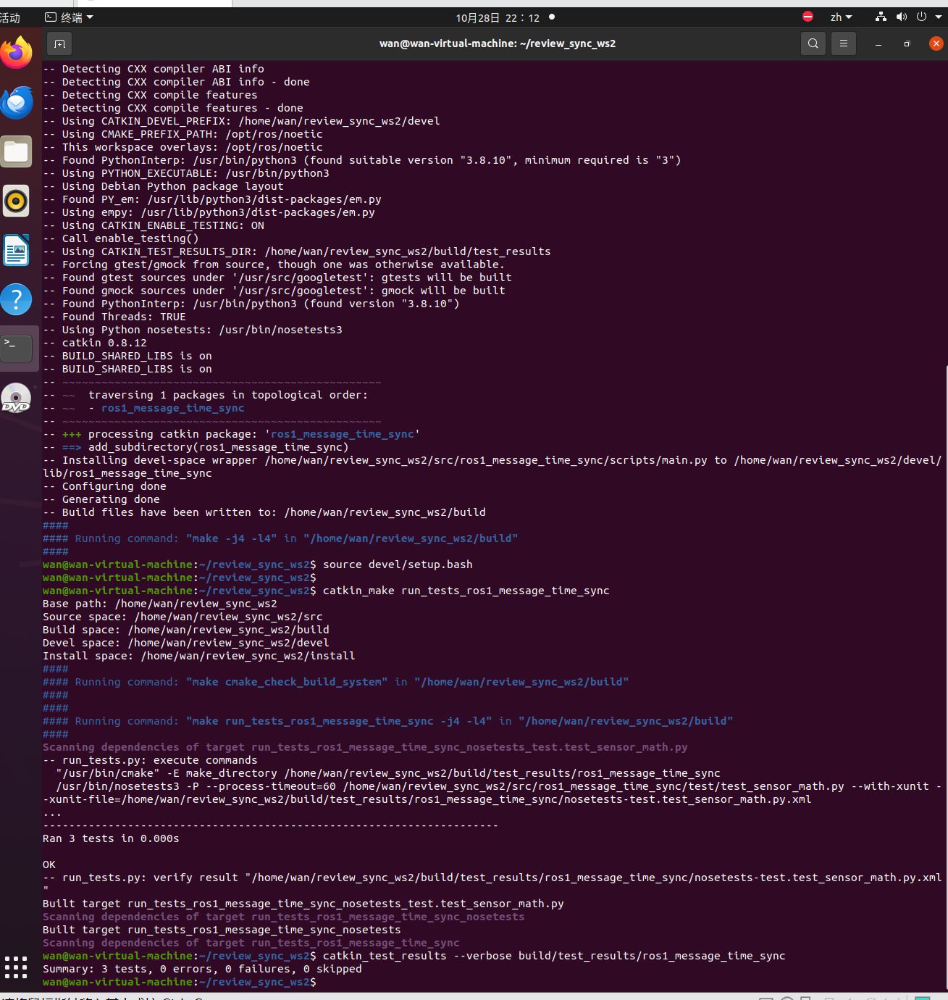
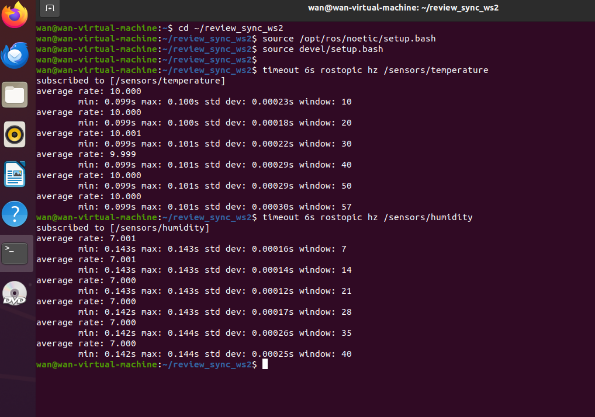
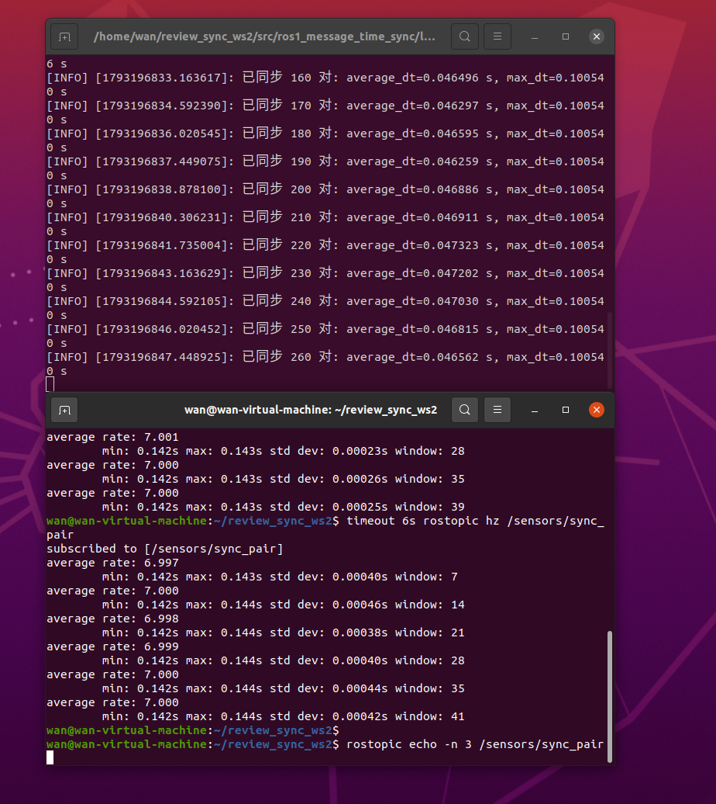

# ROS Noetic 多传感器话题时间同步

本实验以不同频率生成模拟温度与湿度消息，使用
`message_filters.ApproximateTimeSynchronizer` 根据消息头时间戳进行近似同步。
同步成功的一对数据会重新发布到 `/sensors/sync_pair`。

源码位置：`src/chap2/ros1_message_time_sync/`

## 1. 实验目标

- 使用 `sensor_msgs/Temperature` 和 `sensor_msgs/RelativeHumidity`；
- 为消息设置 ROS 时间戳；
- 比较不同频率话题的消息头时间戳；
- 使用近似时间同步器配对消息；
- 检查同步输出的时间差和频率。

## 2. 数据流

```text
10 Hz 模拟温度 ─┐
                 ├─ ApproximateTimeSynchronizer ─ /sensors/sync_pair
7 Hz 模拟湿度 ──┘
```

两路输入的时间戳不同，因此使用近似同步而不是要求时间完全相等。

## 3. 运行环境

| 项目 | 说明 |
| --- | --- |
| 操作系统 | Ubuntu 20.04 |
| ROS | ROS Noetic |
| Python | Python 3.8 |
| 依赖 | `rospy`、`message_filters`、`sensor_msgs`、`std_msgs` |

本实验不依赖 Gazebo、硬件传感器或外部数据。

## 4. 构建

```bash
mkdir -p ~/ros1_ws/src
cp -r <仓库路径>/src/chap2/ros1_message_time_sync ~/ros1_ws/src/
cd ~/ros1_ws
source /opt/ros/noetic/setup.bash
catkin_make
source devel/setup.bash
```

## 5. 启动

```bash
roslaunch ros1_message_time_sync main.launch
```

节点会同时创建两个发布器、两个 `message_filters.Subscriber` 和一个
`ApproximateTimeSynchronizer`。

## 6. 查看结果

新开终端：

```bash
source /opt/ros/noetic/setup.bash
source ~/ros1_ws/devel/setup.bash

rostopic hz /sensors/temperature
rostopic hz /sensors/humidity
rostopic hz /sensors/sync_pair
rostopic echo /sensors/sync_pair
```

默认发布频率分别为：

| 话题 | 频率 |
| --- | ---: |
| `/sensors/temperature` | 约 10 Hz |
| `/sensors/humidity` | 约 7 Hz |
| `/sensors/sync_pair` | 约 7 Hz |

同步消息示例：

```text
data: "temperature_c=23.421 humidity_percent=51.536
timestamp_diff_sec=0.028000 temperature_seq=42 humidity_seq=30"
```

初始化终端每累计 10 对数据会打印一次平均时间差和最大时间差。

## 7. 参数调整

默认参数位于 `config/params.yaml`：

| 参数 | 默认值 | 说明 |
| --- | ---: | --- |
| `temperature_rate_hz` | `10.0` | 温度发布频率 |
| `humidity_rate_hz` | `7.0` | 湿度发布频率 |
| `sync_slop_sec` | `0.14` | 允许的最大时间差 |
| `sync_queue_size` | `30` | 同步队列长度 |
| `temperature_period_sec` | `20.0` | 温度变化周期 |
| `humidity_period_sec` | `30.0` | 湿度变化周期 |

减小 `sync_slop_sec` 会减少可配对的数据；将其增大到超过采样间隔时，
同步器更容易配对，但两路数据的时间一致性会变差。

## 8. 实测结果

测试环境：Ubuntu 20.04.6、ROS Noetic 1.17.4、Python 3.8.10。

构建和测试通过：

- `catkin_make` 成功；
- 测试结果：3 tests，0 errors，0 failures，0 skipped。



三路话题的实测频率如下：

| 话题 | 实测频率 |
| --- | ---: |
| `/sensors/temperature` | 9.999–10.001 Hz |
| `/sensors/humidity` | 7.000–7.001 Hz |
| `/sensors/sync_pair` | 6.997–7.000 Hz |



节点启动后持续输出同步日志。累计到 260 对时，平均时间差为 0.0466 s，
最大时间差为 0.1005 s，均小于 `sync_slop_sec=0.14 s`：



三组同步消息如下：

```text
temperature_c=23.453 humidity_percent=52.531 timestamp_diff_sec=0.057391
temperature_c=23.427 humidity_percent=52.609 timestamp_diff_sec=0.000153
temperature_c=23.411 humidity_percent=52.679 timestamp_diff_sec=0.043115
```

本实验使用程序生成的模拟数据，尚未使用真实温湿度传感器或 Gazebo。

## 9. 测试

```bash
cd ~/ros1_ws
source /opt/ros/noetic/setup.bash
source devel/setup.bash
catkin_make run_tests_ros1_message_time_sync
catkin_test_results build/test_results/ros1_message_time_sync
```

测试覆盖周期函数的基础值、峰值、谷值、有效范围和非正周期检查。

## 10. 常见问题

| 现象 | 原因 | 处理 |
| --- | --- | --- |
| 找不到 `message_filters` | 未加载 Noetic 环境 | source `/opt/ros/noetic/setup.bash` |
| `/sensors/sync_pair` 没有数据 | `sync_slop_sec` 过小或队列过短 | 检查输入话题频率并适当增加参数 |
| 输入正常但配对频率低 | 两路数据时间差超过 slop | 根据采样周期调整 `sync_slop_sec` |
| 修改 YAML 后参数未生效 | 节点没有重启 | 重新执行 `roslaunch` |

## 11. 小结

多传感器消息只有在时间戳足够接近时才能组合使用。精确同步适合固定采样时钟，
`ApproximateTimeSynchronizer` 则适合本实验这种频率不同、时间戳不完全对齐的输入。
