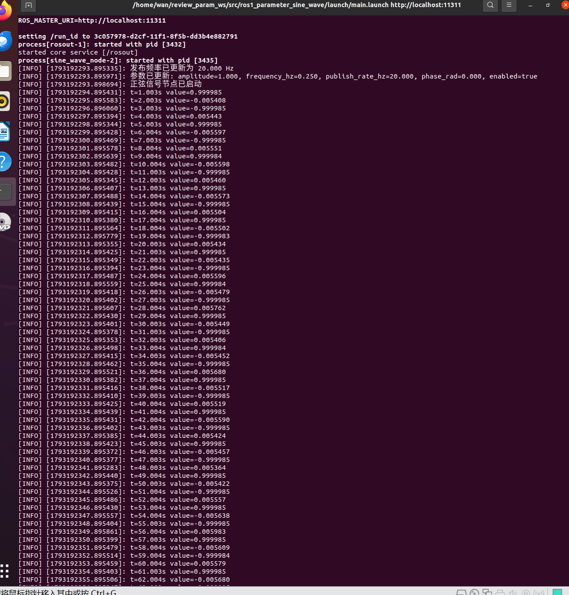
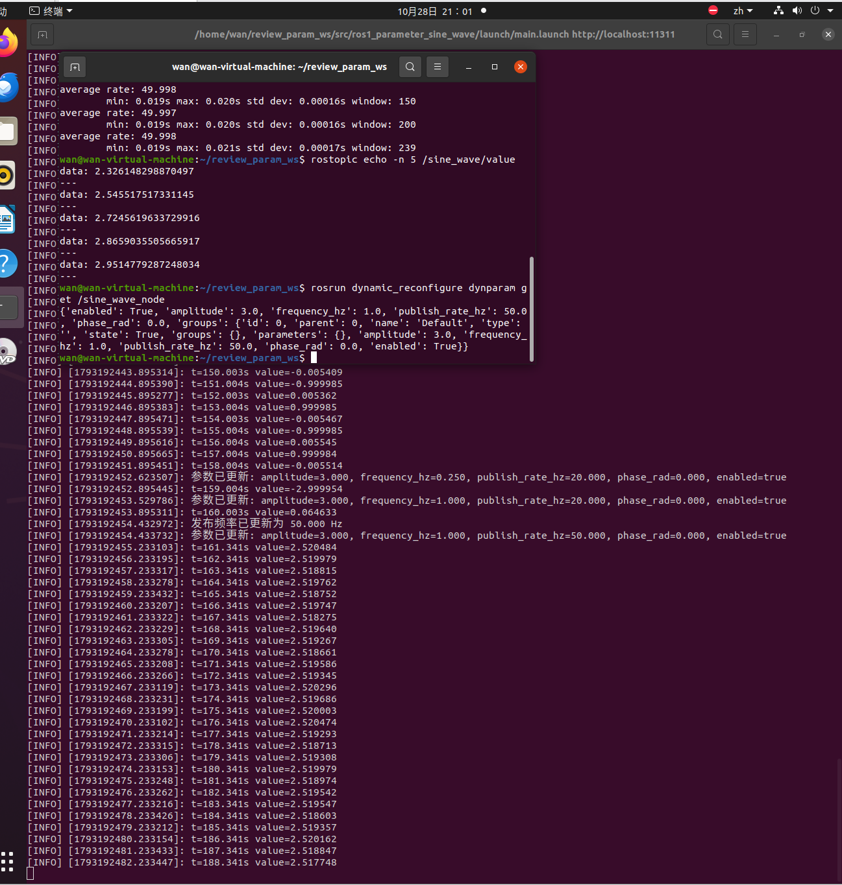
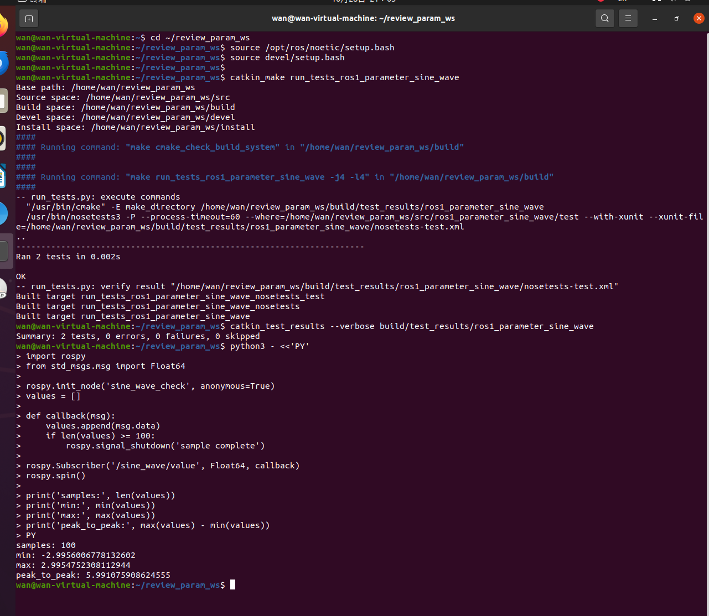

# ROS Noetic 运行参数热更新：正弦信号

本实验通过一个持续发布正弦信号的 ROS Noetic 节点，演示
`dynamic_reconfigure` 的使用。节点启动后可以动态调整幅值、频率、相位和消息
发布频率，不需要重启程序。

源码位置：`src/chap2/ros1_parameter_sine_wave/`

## 1. 实验目标

- 使用 `rospy` 创建发布者；
- 使用动态参数服务器生成参数回调；
- 在参数变化时更新节点状态以及发布定时器；
- 使用 `dynparam`、`rostopic` 验证参数和话题；
- 比较普通启动参数与运行时动态参数的区别。

## 2. 节点结构

| 文件 | 作用 |
| --- | --- |
| `scripts/main.py` | 节点入口、动态参数回调、正弦计算与消息发布 |
| `cfg/Params.cfg` | 参数名称、默认值和取值范围 |
| `launch/main.launch` | 使用 launch 启动模块 |
| `src/ros1_parameter_sine_wave/math_utils.py` | 正弦值计算函数 |
| `test/test_math_utils.py` | 正弦关键采样点测试 |

数据流如下：

```text
dynparam 修改参数
    ↓
Params.cfg 参数服务器
    ↓
dynamic_reconfigure 回调
    ↓
定时器计算正弦值
    ↓
/sine_wave/value (std_msgs/Float64)
```

## 3. 运行环境

| 项目 | 说明 |
| --- | --- |
| 操作系统 | Ubuntu 20.04 |
| ROS | ROS Noetic |
| Python | Python 3.8 |
| 依赖 | `rospy`、`std_msgs`、`dynamic_reconfigure` |

## 4. 构建

```bash
mkdir -p ~/ros1_ws/src
cp -r <仓库路径>/src/chap2/ros1_parameter_sine_wave ~/ros1_ws/src/
cd ~/ros1_ws
source /opt/ros/noetic/setup.bash
catkin_make
source devel/setup.bash
```

确认包和脚本已经安装：

```bash
rospack find ros1_parameter_sine_wave
rosrun ros1_parameter_sine_wave main.py
```

## 5. 启动

推荐通过 launch 启动：

```bash
roslaunch ros1_parameter_sine_wave main.launch
```

正常启动时会输出：

```text
[INFO] [sine_wave_node]: 参数已更新: amplitude=1.000, frequency_hz=0.250, publish_rate_hz=20.000, phase_rad=0.000, enabled=true
[INFO] [sine_wave_node]: 发布频率已更新为 20.000 Hz
[INFO] [sine_wave_node]: 正弦信号节点已启动
```

## 6. 查看话题

新开一个终端并加载环境：

```bash
source /opt/ros/noetic/setup.bash
source ~/ros1_ws/devel/setup.bash
rostopic list
rostopic echo /sine_wave/value
rostopic hz /sine_wave/value
```

默认参数如下：

| 参数 | 默认值 | 范围 | 说明 |
| --- | ---: | ---: | --- |
| `amplitude` | `1.0` | `0.0` 到 `10.0` | 正弦信号幅值 |
| `frequency_hz` | `0.25` | `0.0` 到 `5.0` | 正弦信号频率 |
| `publish_rate_hz` | `20.0` | `1.0` 到 `100.0` | 消息发布频率 |
| `phase_rad` | `0.0` | `-pi` 到 `pi` | 初相位，单位弧度 |
| `enabled` | `true` | 布尔值 | 是否发布消息 |

## 7. 在线修改参数

查看当前全部动态参数：

```bash
rosrun dynamic_reconfigure dynparam get /sine_wave_node
```

将幅值从 1 改为 3：

```bash
rosrun dynamic_reconfigure dynparam set /sine_wave_node amplitude 3.0
```

将频率改为 1 Hz：

```bash
rosrun dynamic_reconfigure dynparam set /sine_wave_node frequency_hz 1.0
```

节点会按新频率和当前运行时间重新计算正弦相位，因此切换瞬间可能出现相位
跳变；本实验不作为连续调频建模。

将消息发布频率改为 50 Hz：

```bash
rosrun dynamic_reconfigure dynparam set /sine_wave_node publish_rate_hz 50.0
```

暂停和恢复发布：

```bash
rosrun dynamic_reconfigure dynparam set /sine_wave_node enabled false
rosrun dynamic_reconfigure dynparam set /sine_wave_node enabled true
```

参数成功更新后，启动终端会重新打印参数摘要。将发布频率改为 50 Hz 后，
`rostopic hz /sine_wave/value` 应接近 50 Hz。

也可以使用图形界面操作（可选，本次实测使用 `dynparam` 命令行，未单独测试
图形界面）：

```bash
rosrun rqt_reconfigure rqt_reconfigure
```

## 8. 实测结果

测试环境：Ubuntu 20.04.6、ROS Noetic 1.17.4、Python 3.8.10。

节点启动后的日志如下，默认参数为幅值 1.0、频率 0.25 Hz、发布频率 20 Hz：



将参数修改为幅值 3.0、频率 1.0 Hz、发布频率 50 Hz 后，`dynparam get`
确认新参数已经生效：

```text
{'enabled': True, 'amplitude': 3.0, 'frequency_hz': 1.0,
 'publish_rate_hz': 50.0, 'phase_rad': 0.0}
```

新终端中的实测结果为：

| 检查项 | 结果 |
| --- | --- |
| 修改前发布频率 | 约 20 Hz |
| 修改后发布频率 | 49.998 Hz、49.997 Hz |
| 发布周期 | 最小 0.019 s，最大 0.021 s |
| 话题数值 | 从 2.326 上升到 2.952，并继续向 3.0 接近 |
| 单元测试 | 2 tests，0 errors，0 failures，0 skipped |
| 100 个样本最小值 | -2.9956 |
| 100 个样本最大值 | 2.9955 |
| 峰峰值 | 5.9911 |



进一步在幅值 3.0、频率 1.0 Hz、发布频率 50 Hz 的条件下采集 100 个样本，
结果与理论值一致：



## 9. 测试

```bash
cd ~/ros1_ws
source /opt/ros/noetic/setup.bash
source devel/setup.bash
catkin_make run_tests_ros1_parameter_sine_wave
catkin_test_results build/test_results/ros1_parameter_sine_wave
```

单元测试覆盖 1 Hz 正弦信号在零周期、四分之一周期、半周期和四分之三周期
处的取值，并检查初相位。

## 10. 常见问题

| 现象 | 原因 | 处理 |
| --- | --- | --- |
| 找不到 `ros1_parameter_sine_wave` | 没有加载工作空间 | 执行 `source devel/setup.bash` |
| `main.py` 没有执行权限 | 脚本未通过 `catkin_install_python` 安装 | 重新运行 `catkin_make` |
| 修改参数后频率没变化 | 查看的是旧进程或参数名错误 | 用 `dynparam get` 和 `rosnode info` 核对 |
| 暂停后收不到消息 | `enabled` 已设为 `false` | 将 `enabled` 重新设为 `true` |

## 11. 小结

`dynamic_reconfigure` 适合调试期间需要在线调整的节点参数。参数范围在
`cfg/Params.cfg` 中统一声明，节点通过回调获得最新配置；普通 launch 参数则
更适合启动后保持不变的配置。
