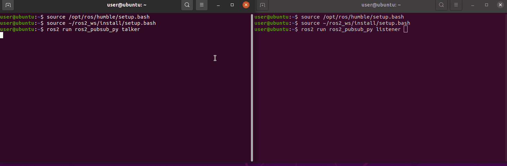
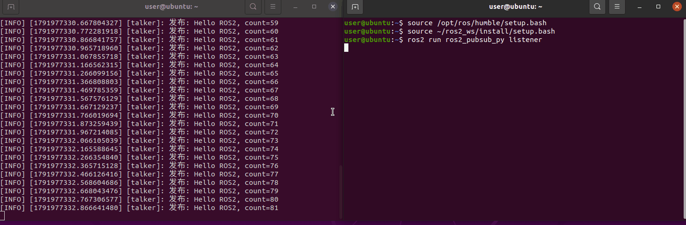
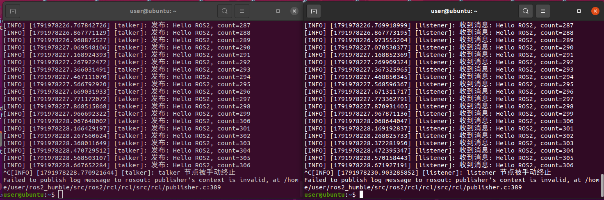

# ROS 2 话题发布订阅基础实验（talker / listener）

本页面介绍 `ros2_pubsub_py` 模块：用 Python 编写的 ROS 2 发布者 / 订阅者最小通信示例。该实验作为「基于强化学习的四旋翼无人机飞行控制」项目的前置基础实验，用来验证节点之间的发布 / 订阅链路，为后续无人机传感器数据传输、强化学习控制指令下发做基础验证。

源码位置：[src/chap2/ros2_pubsub_py](https://github.com/OpenHUTB/ros2/tree/master/src/chap2/ros2_pubsub_py)

| 文件 | 说明 |
|---|---|
| [main.py](https://github.com/OpenHUTB/ros2/blob/master/src/chap2/ros2_pubsub_py/main.py) | 模块入口，`python3 main.py` 即可启动整个模块 |
| [launch/pubsub_demo.launch.py](https://github.com/OpenHUTB/ros2/blob/master/src/chap2/ros2_pubsub_py/launch/pubsub_demo.launch.py) | launch 启动文件，一次性启动 talker 与 listener |
| [ros2_pubsub_py/talker.py](https://github.com/OpenHUTB/ros2/blob/master/src/chap2/ros2_pubsub_py/ros2_pubsub_py/talker.py) | 发布者节点，10 Hz 向 `chatter` 话题发布字符串 |
| [ros2_pubsub_py/listener.py](https://github.com/OpenHUTB/ros2/blob/master/src/chap2/ros2_pubsub_py/ros2_pubsub_py/listener.py) | 订阅者节点，订阅 `chatter` 并打印消息 |

---

## 1. 运行环境

| 项目 | 版本 / 说明 |
|---|---|
| 操作系统 | Ubuntu 20.04.6 LTS（VMware 虚拟机），宿主为 Windows 11 |
| ROS | ROS 2 Humble |
| Python | 3.8.10（虚拟机内与 Humble 匹配的版本） |
| 依赖 | 仅使用 ROS 2 自带功能包：`rclpy`、`std_msgs`、`launch`、`launch_ros` |

在虚拟机中确认环境：

```bash
lsb_release -a      # Ubuntu 20.04
echo $ROS_DISTRO    # humble
python3 --version   # Python 3.8.x
```

!!! note "ROS 1 与 ROS 2 环境不能混用"
    如果终端先后 source 过 Noetic 和 Humble，会出现 `ROS_DISTRO was set to 'noetic' before` 之类的提示。此时关闭终端，新开一个干净终端，只 source 需要的那一套环境即可。

## 2. 编译

```bash
mkdir -p ~/ros2_ws/src
cp -r <本仓库路径>/src/chap2/ros2_pubsub_py ~/ros2_ws/src/
cd ~/ros2_ws
source /opt/ros/humble/setup.bash
colcon build --packages-select ros2_pubsub_py
source install/setup.bash
```

## 3. 运行

三种方式效果相同，任选其一。

**方式 A：launch 启动（推荐）**

```bash
ros2 launch ros2_pubsub_py pubsub_demo.launch.py
```

**方式 B：main 脚本入口**

```bash
python3 ~/ros2_ws/src/ros2_pubsub_py/main.py
```

**方式 C：分别启动两个节点**

```bash
# 终端 1
ros2 run ros2_pubsub_py talker
# 终端 2
ros2 run ros2_pubsub_py listener
```

运行结果：

* talker 持续输出 `发布: Hello ROS2, count=N`；
* listener 持续输出 `收到消息: Hello ROS2, count=N`，序号与 talker 一致；
* 也可以在第三个终端执行 `ros2 topic list`、`ros2 topic echo /chatter`、`ros2 topic hz /chatter`（约 10 Hz）查看话题。

结束运行：在终端按 `Ctrl+C`。此时可能看到 `KeyboardInterrupt` 的 Traceback，也可能只看到节点打印的 `talker 节点被手动终止` / `listener 节点被手动终止`，都属于正常退出提示，不是程序错误。如果还跟着一行 `Failed to publish log message to rosout: publisher's context is invalid`，那是节点已销毁、rclpy 仍尝试向 `/rosout` 上报日志造成的，同样正常。

## 4. 运行效果

发布者节点持续发布消息：



订阅者节点稳定接收并打印消息：



按 `Ctrl+C` 结束程序：



## 5. 常见问题

| 现象 | 原因 | 解决方法 |
|---|---|---|
| `ros2: command not found` | 未 source ROS 2 环境 | `source /opt/ros/humble/setup.bash`，或写入 `~/.bashrc` |
| 提示混用了 noetic 与 humble | 同一终端加载了两套 ROS 环境 | 新开干净终端，只加载 Humble |
| listener 收不到消息 | 话题名或 `ROS_DOMAIN_ID` 不一致 | 用 `ros2 topic list` / `ros2 topic echo` 确认两个节点都在 `/chatter` 上 |
| 退出时出现 `Failed to publish log message to rosout: publisher's context is invalid` | 节点已销毁，rclpy 仍在向 `/rosout` 上报日志 | 属正常现象，可忽略 |

## 6. 测试

代码风格、docstring 与最小集成测试：

```bash
cd ~/ros2_ws
source install/setup.bash
colcon test --packages-select ros2_pubsub_py
colcon test-result --verbose
```

其中 `test/test_pubsub_integration.py` 会同时运行 talker 与 listener，断言 listener 至少收到一条 `/chatter` 消息。

人工稳定性测试：终端 1 执行 `ros2 launch ros2_pubsub_py pubsub_demo.launch.py`，终端 2 执行 `ros2 topic hz /chatter`，终端 3 执行 `ros2 topic echo /chatter`。连续运行 5 分钟以上，话题频率稳定在约 10 Hz，listener 序号与 talker 一致，无丢帧、无报错。