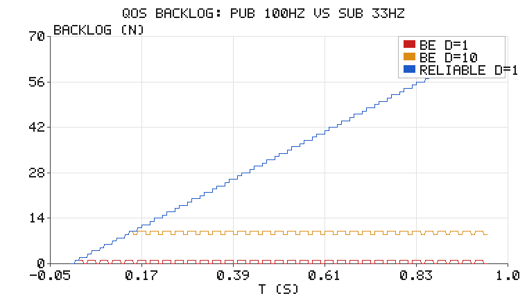
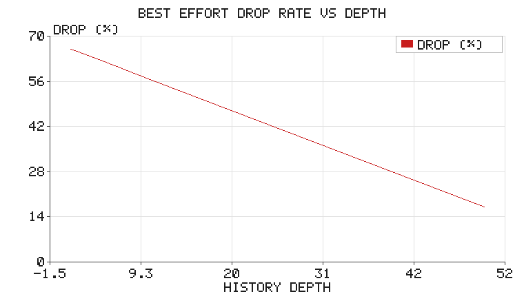

# ROS 2 QoS 服务质量：可靠性、历史深度与持久性

在 ROS 2 里，"为什么我的话题收不到数据"十有八九不是代码错了，而是 **QoS 不匹配**。
TCP 时代我们习惯"连接就是可靠"，而 ROS 2 基于 DDS，每条发布/订阅都是**一组可协商的策略**，
两端策略不兼容时连话题订阅都建立不起来，或者悄悄丢数据。

这一篇用**纯 Python 的队列模型**把三种核心策略的行为复现出来，让你在没有 ROS 环境、
没有 Gazebo 的情况下也能直观看到"丢包 / 延迟 / 积压"三者的权衡。

> 前置知识：`chap2/ros2_pubsub_py.md`（话题发布订阅基础）。建议先跑通 talker/listener
> 再来看 QoS，会更容易把"策略"和"现象"对上。

## 1. 三种核心策略

| 策略 | 取值 | 含义 |
|---|---|---|
| Reliability | `reliable` / `best_effort` | 是否保证送达。`best_effort` 允许丢样本 |
| History + Depth | `keep_last(N)` / `keep_all` | 缓存最近 N 个样本；满了之后**逐出最旧、保留最新**（旧不如新） |
| Durability | `volatile` / `transient_local` | 后加入的订阅者能否收到历史样本 |

默认值最容易踩坑：

- `rclpy.create_publisher(msg_type, topic, 10)` 的 `10` 是 **depth**，reliability 默认是 `reliable`。
- 但**传感器数据**（`sensor_msgs/msg/LaserScan`、`Image`）的惯用 QoS 是 `best_effort`。
  如果订阅端用默认 `reliable` 去订阅一个 `best_effort` 的激光话题，会出现
  "topic 列表里有、`echo` 没数据"的经典现象——因为 **reliable 订阅者不会接受
  best_effort 发布者**（DDS 的 Requested/Offered 兼容性规则）。

## 2. 一个能算清楚的最小模型

真实 DDS 很复杂，但决定行为的只有三件事：**发布频率**、**回调耗时（消费能力）**、
**缓存深度**。设发布频率 $f_p$、单条回调耗时 $t_p$，则消费能力为

$$
f_s = \frac{1}{t_p}
$$

只要 $f_p > f_s$，系统就必然过载。此时两种可靠性给出完全不同的后果：

- `best_effort`：缓存满时**逐出最旧、保留最新**（keep_last 的传感器语义：旧不如新）。
  丢包率趋于 $1 - f_s/f_p$；浅缓存下回调每次拿到的都是**最新鲜**的样本，
  延迟约为单条回调耗时；加深缓存只是让更多陈旧样本排队，延迟反而增大。
- `reliable`：不丢样本，而是**发布端背压**（DDS 重传 / 流控），积压线性增长，
  延迟随运行时间线性上升。

用 100 Hz 发布 + 30 ms 回调（33 Hz 消费能力）在本模型里跑 1 秒（下表与下图均为
**模型运行结果**，非真实 DDS 实测；真实 DDS 的行为见本节末尾的模型边界说明）：

| 配置 | 丢包率 | 平均延迟 | 末端积压 |
|---|---|---|---|
| `best_effort` depth=1 | 66.0 % | 30.0 ms | 0 |
| `best_effort` depth=10 | 57.0 % | 112.6 ms | 9 |
| `reliable` depth=1 | 0 % | 360.0 ms | 66 |



蓝色曲线是 `reliable`：一条不丢，但积压以 $f_p - f_s \approx 67$ 样本/秒 的速度直线上升，
平均延迟达到 360 ms 且随运行时长继续发散。红色是 `best_effort depth=1`：
积压恒为 0 条，代价是 2/3 的帧被逐出——但每次回调拿到的都是**最新一帧**，
延迟稳定在 30 ms（回调耗时本身）。橙色 `depth=10` 是中间态——**积压被压在 9 条左右，
但这 9 条意味着每次回调处理的是约 100~120 ms 前的陈旧数据**。

> **模型边界（重要）**：`reliable` 分支用**无界 FIFO** 模拟发布端积压，
> 这是为了把"不丢但延迟发散"的定性现象直观化。真实 DDS 的发送端 History 同样
> 受 `depth` 限制，并伴随资源占用上限与发布阻塞/重传的具体行为，
> "积压无限线性增长"在真实系统中受内存与流控约束，不会无限持续。
> 本模块未在真实 ROS 2 / DDS 发行版上实测，数值仅在本简化模型内有效。

这张图给出了两个很实用的结论：

> **结论一：浅缓存 + best_effort 才是实时控制的正解。** `depth=1` 时 keep_last
> 逐出最旧，回调永远拿到最新鲜的帧（延迟 ≈ 单条回调耗时）。
>
> **结论二：加大 depth 不是"提高吞吐"，而是"用延迟换丢包"。** 吞吐只由 $f_s$ 决定；
> 深缓存只是让更多**陈旧**样本排队等待。对实时控制，`depth` 越大越危险
> （你处理的是过期数据）；对必须完整的数据（配置、地图、点云地图块），
> 才用 `reliable` + 大 depth。

## 3. 深度的边际收益



| depth | 1 | 2 | 5 | 10 | 20 | 50 |
|---|---|---|---|---|---|---|
| 丢包率 | 66.0 % | 65.0 % | 62.0 % | 57.0 % | 47.0 % | 17.0 % |

曲线是**凸的**：从 1 加到 10 只降 9 个百分点，从 20 加到 50 降 30 个百分点。
原因很直观：depth 只是把"能容忍的瞬时抖动"变宽，而稳态丢包由 $1 - f_s/f_p$ 决定，
只有 depth 大到能吸收整个超载期间的所有样本（本例约 67 条）才会真正趋近 0。

## 4. 持久性：后加入者能收到什么

`transient_local` 是"latched topic"的 ROS 2 版本，最典型的用途是**机器人描述、
静态地图、配置参数**——订阅者晚启动也该拿到最后一份。

模型里发布端在订阅者加入前已经发了 5 条：

| durability | 加入前 5 条中能收到 |
|---|---|
| `volatile` | 0 |
| `transient_local` | 1（最后一条，latched） |

注意 `transient_local` **只保证最后 depth 条**，不是"全部历史"；要全量历史得用
`keep_all` + 大 depth，但那会吃掉可观内存，实战中很少这么干。

## 5. 代码与运行

```bash
cd src/chap2/qos_demo
python3 tests/test_qos.py            # 10 项单元测试
python3 scripts/main.py --outdir ../../../docs/img/chap2/qos_demo
```

核心接口只有三个：

```python
import qos_model as qm

prof = qm.QoSProfile(qm.BEST_EFFORT, depth=10, durability=qm.VOLATILE)
st = qm.simulate(prof, pub_rate=100.0, proc_time=0.030, duration=1.0)
print(st.drop_rate, st.mean_latency, st.backlog[-1])
```

`simulate()` 内部就是一个 1 ms 步长的离散事件循环：发布端到点入队、缓存满则
逐出最旧（best_effort）或转入背压队列（reliable）、订阅端空闲则取一条并占用
`proc_time`。全部是标准库，没有任何 DDS 依赖。

## 6. 实战检查清单

1. **`ros2 topic info <topic> -v`** 查看两端 QoS，`Reliability` 不一致是首要怀疑对象。
2. 订阅传感器话题时显式指定 `qos_profile_sensor_data`（`best_effort`），别用默认 `reliable`。
3. 控制回路宁可 `depth=1` + `best_effort`，也不要 `depth=50` + `reliable`。
4. 需要"后加入者也能拿到"的数据用 `transient_local`，别指望 `volatile`。

## 7. 与已有内容的关系

- `chap2/ros2_pubsub_py.md` 讲的是**怎么发怎么收**，本篇讲**收发之间的传输语义**。
- `chap2/ros2_service_param_demo.md` 是请求-应答模型，不存在 QoS 协商问题。

---

> 本文档由 AI 辅助撰写，模型、代码与全部数值均在本地实跑验证（`tests/test_qos.py` 10 项全过）。
> 配图由纯标准库手写 PNG 编码生成，无 matplotlib 依赖；未在真实 ROS 2 / DDS 发行版上实测。
