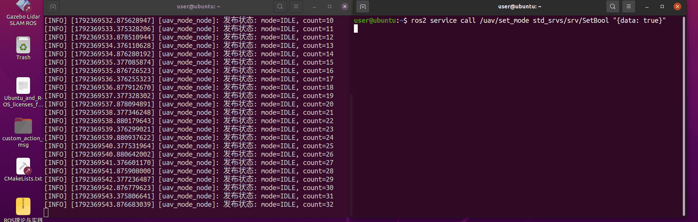
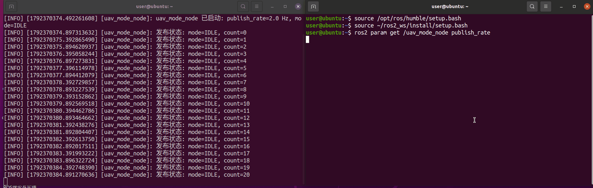
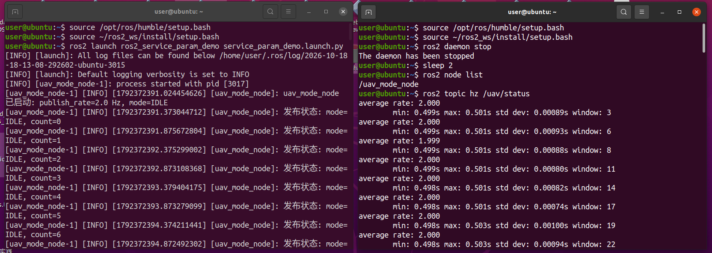

# ROS 2 服务与参数基础实验（uav_mode_node）

本页面介绍 `ros2_service_param_demo` 模块：用一个「无人机模式节点」演示 ROS 2 的**服务调用**、**参数在线修改**与**话题发布**。

源码位置：[src/chap2/ros2_service_param_demo](https://github.com/OpenHUTB/ros2/tree/master/src/chap2/ros2_service_param_demo)

| 文件 | 说明 |
|---|---|
| [uav_mode_node.py](https://github.com/OpenHUTB/ros2/blob/master/src/chap2/ros2_service_param_demo/ros2_service_param_demo/uav_mode_node.py) | 唯一节点：提供服务、声明参数、周期发布状态话题 |
| [main.py](https://github.com/OpenHUTB/ros2/blob/master/src/chap2/ros2_service_param_demo/main.py) | 模块入口，`python3 main.py` 即可启动 |
| [launch/service_param_demo.launch.py](https://github.com/OpenHUTB/ros2/blob/master/src/chap2/ros2_service_param_demo/launch/service_param_demo.launch.py) | launch 启动文件（含参数初值） |

该模块是「基于强化学习的四旋翼无人机飞行控制」项目的第二个前置基础实验：第一个实验（[ROS 2 话题发布订阅基础实验](ros2_pubsub_py.md)）验证了单向消息流，本实验补齐**模式切换**（起飞 / 悬停 / 降落需要调用方拿到成功或失败）与**在线调参**（不同飞行阶段要改频率或阈值，不能重启节点）这两件基础设施。

!!! note "与其他模块的区别"
    本模块只演示 ROS 2 服务与参数机制，**不连接仿真器、不发送任何飞控指令、不使用自定义消息**，与 `uav_keyboard_control`、`carlair_ros_bridge` 等空域载具模块没有功能重叠。

---

## 1. 接口说明

| 接口 | 类型 | 说明 |
|---|---|---|
| 服务 `/uav/set_mode` | `std_srvs/SetBool` | `data: true` → `FLYING`；`data: false` → `IDLE`；返回 `success` 与 `message` |
| 参数 `publish_rate` | double，默认 `2.0` | 状态发布频率（Hz），取值范围 (0, 100]，运行中可改 |
| 参数 `start_mode` | string，默认 `IDLE` | 启动时的初始模式，取值 `IDLE` / `FLYING`；启动后不可修改（运行中改模式请调 `/uav/set_mode`） |
| 话题 `/uav/status` | `std_msgs/String` | 内容形如 `mode=FLYING, count=12` |

> `start_mode` 只接受 `IDLE` 与 `FLYING`，与服务 `/uav/set_mode` 能切换的两种模式保持一致：`SetBool` 只有真假两态，无法表达「降落」，因此本模块不把 `LANDING` 作为可设置的模式。降落属于后续控制器模块的职责，那一步需要比 `SetBool` 更丰富的接口。

## 2. 运行环境

| 项目 | 版本 / 说明 |
|---|---|
| 操作系统 | Ubuntu 22.04 LTS（VMware 虚拟机），宿主为 Windows 11 |
| ROS | ROS 2 Humble |
| Python | 3.10（Ubuntu 22.04 自带，与 Humble 匹配） |
| 依赖 | 仅使用 ROS 2 自带功能包：`rclpy`、`std_msgs`、`std_srvs`、`launch`、`launch_ros` |

在虚拟机中确认环境：

```bash
lsb_release -a      # Ubuntu 22.04
echo $ROS_DISTRO    # humble
python3 --version   # Python 3.10.x
```

### 2.1 环境准备

如果还没装 ROS 2 Humble，先按 [安装 ROS](../ubuntu20.04.md) 页面配置好。装好后把环境写进 `~/.bashrc`，新终端会自动加载：

```bash
echo "source /opt/ros/humble/setup.bash" >> ~/.bashrc
source ~/.bashrc
echo $ROS_DISTRO     # 应输出 humble
```

> 不要同时 source Noetic 与 Humble，否则会出现 `ROS_DISTRO was set to 'noetic' before` 的警告。

## 3. 编译

```bash
mkdir -p ~/ros2_ws/src
cp -r <本仓库路径>/src/chap2/ros2_service_param_demo ~/ros2_ws/src/
cd ~/ros2_ws
source /opt/ros/humble/setup.bash
colcon build --packages-select ros2_service_param_demo
source install/setup.bash
```

## 4. 运行

```bash
# 方式 A：launch 启动（推荐）
ros2 launch ros2_service_param_demo service_param_demo.launch.py\
publish_rate:=5.0 start_mode:=FLYING
# 方式 B：main 脚本入口
python3 ~/ros2_ws/src/ros2_service_param_demo/main.py
# 方式 C：单节点并指定参数
ros2 run ros2_service_param_demo uav_mode_node \
  --ros-args -p publish_rate:=5.0 -p start_mode:=FLYING
```

节点启动后输出：

```
[INFO] [...] [uav_mode_node]: uav_mode_node 已启动: publish_rate=2.0 Hz, mode=IDLE
[INFO] [...] [uav_mode_node]: 发布状态: mode=IDLE, count=0
```

### 4.1 调用服务切换模式

另开终端（同样要 source ROS 2 与工作空间环境）：

```bash
ros2 service list
ros2 service call /uav/set_mode std_srvs/srv/SetBool "{data: true}"
ros2 service call /uav/set_mode std_srvs/srv/SetBool "{data: false}"
```

### 4.2 在线修改参数

```bash
ros2 param list
ros2 param get /uav_mode_node publish_rate        # 显示 2.0
ros2 param set /uav_mode_node publish_rate 5.0    # 输出立刻变密
ros2 param set /uav_mode_node publish_rate -1.0   # 被拒绝：publish_rate 必须大于 0
```

### 4.3 观察话题

```bash
ros2 topic echo /uav/status
ros2 topic hz /uav/status     # 频率与 publish_rate 一致
```

结束运行：在终端按 `Ctrl+C`。正常情况下只会看到节点打印的 `uav_mode_node 被手动终止` 后退出（退出路径已捕获 `KeyboardInterrupt`，不会再打印 Traceback）；若还跟着一行 `Failed to publish log message to rosout: publisher's context is invalid`，同样是节点销毁后的正常现象。

> 三点注意：① **方式 B 是本地源码调试入口**，它通过 ament 索引查找 `ros2_service_param_demo`，必须先 `source ~/ros2_ws/install/setup.bash`，干净终端只 source ROS 2 会报 `package 'ros2_service_param_demo' not found`；main.py 只是本地源码调试入口，不支持命令行改参数，需要改参数请用方式 A（ros2 launch ros2_service_param_demo service_param_demo.launch.py publish_rate:=5.0 start_mode:=FLYING）或方式 C。② `publish_rate` 是 double 类型，请写 `0.0` 而不是 `0`（整数字面量会报类型错误）；取值范围 (0, 100] Hz。③ 启动参数非法时（`publish_rate` 超出范围、`start_mode` 不在 `IDLE` / `FLYING` 之内）节点会告警并回退到默认值，**同时把回退值写回参数**，所以 `ros2 param get` 显示的值始终等于实际生效值，不会出现"参数是 5.0、实际按 2.0 发布"的不一致。

## 5. 运行效果

调用服务切换飞行模式：



在线修改参数，输出频率立刻变化：



launch 启动与话题频率：



## 6. 常见问题

| 现象 | 原因 | 解决方法 |
|---|---|---|
| `ros2: command not found` | 未 source ROS 2 环境 | `source /opt/ros/humble/setup.bash`，或写入 `~/.bashrc` |
| `Package 'ros2_service_param_demo' not found` | 未 source 工作空间 | `source ~/ros2_ws/install/setup.bash` |
| `ros2 param set` 后频率没变 | 节点名写错或参数未实现回调 | `ros2 node list` 确认节点为 `/uav_mode_node`；本模块在参数回调中重建定时器 |
| 提示混用了 noetic 与 humble | 同一终端加载了两套 ROS 环境 | 新开干净终端，只加载 Humble |
