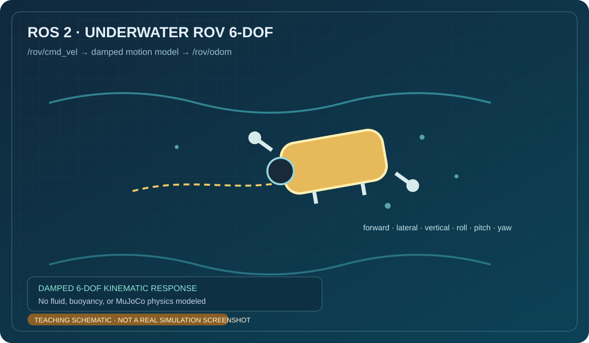

# 水下 ROV 六自由度响应模型

该练习订阅 `/rov/cmd_vel`，用含阻尼的一阶模型积分三轴位移和姿态，并发布 `/rov/odom`。完整代码位于 `src/chap9/rov_6dof_teleop/`。

> 上图为 AI 生成的概念示意图，不是 MuJoCo 水动力仿真截图。

运行：`source /opt/ros/humble/setup.bash && python3 src/chap9/rov_6dof_teleop/main.py`。该教学模型没有浮力、水动力或声呐传感器。

> 内容由 OpenAI Codex 协助整理；示意图并非运行截图，代码需由提交者在目标 ROS 2 环境复核。
