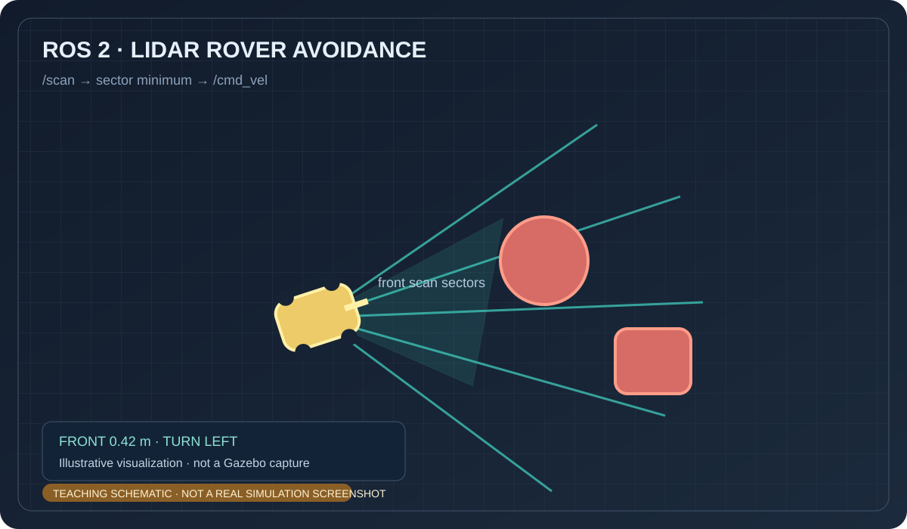

# 小车激光雷达避障

该练习订阅 `/scan`，将正前方及两侧激光数据分区，遇到近距离障碍时向空间较大的一侧转向。完整代码位于 `src/chap9/rover_lidar_avoidance/`。

> 上图为 AI 生成的概念示意图，不是 Gazebo 或实车截图。

运行：`source /opt/ros/humble/setup.bash && python3 src/chap9/rover_lidar_avoidance/main.py`。接入仿真器时，将 LaserScan 发布到 `/scan`，底盘控制器订阅 `/cmd_vel`。

> 内容由 OpenAI Codex 协助整理；示意图并非运行截图，代码需由提交者在目标 ROS 2 环境复核。
