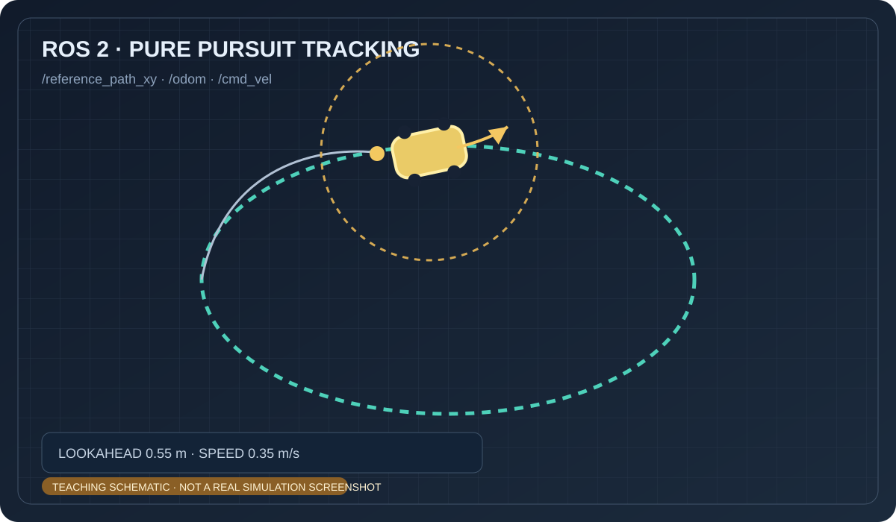

# 小车纯追踪路径跟踪

该练习用平面运动学小车跟踪椭圆参考路径，并发布估计里程计。完整代码位于 `src/chap9/rover_pure_pursuit/`。

> 上图为 AI 生成的概念示意图，不是仿真截图。

运行：`source /opt/ros/humble/setup.bash && python3 src/chap9/rover_pure_pursuit/main.py`。观察 `/odom`、`/cmd_vel` 和 `/reference_path_xy`。本模型不包含轮胎侧滑或碰撞物理。

> 内容由 OpenAI Codex 协助整理；示意图并非运行截图，代码需由提交者在目标 ROS 2 环境复核。
