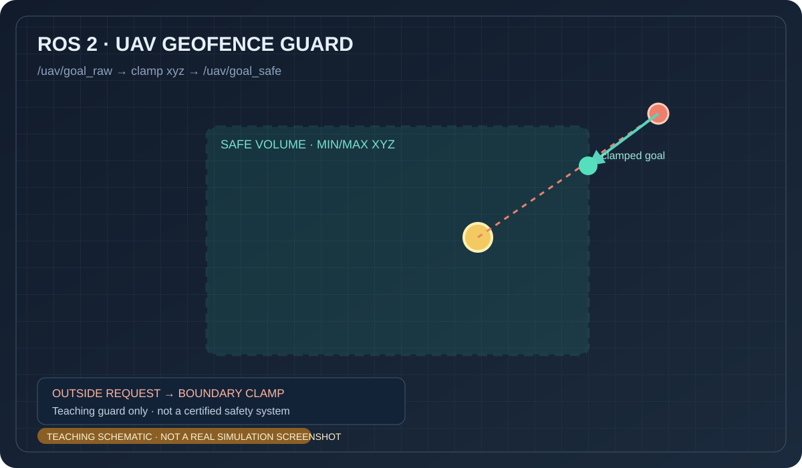

# 无人机三维禁飞区守护

该练习将位置目标限制在可配置的三维盒形区域内，越界时发布限幅后的目标并记录警告。完整代码位于 `src/chap9/uav_geofence_guard/`。

> 上图为 AI 生成的概念示意图，不是仿真截图。

运行：`source /opt/ros/humble/setup.bash && python3 src/chap9/uav_geofence_guard/main.py`。发布 `/uav/goal_raw`，并观察 `/uav/goal_safe`。示例不构成完整飞行安全系统。

> 内容由 OpenAI Codex 协助整理；示意图并非运行截图，代码需由提交者在目标 ROS 2 环境复核。
