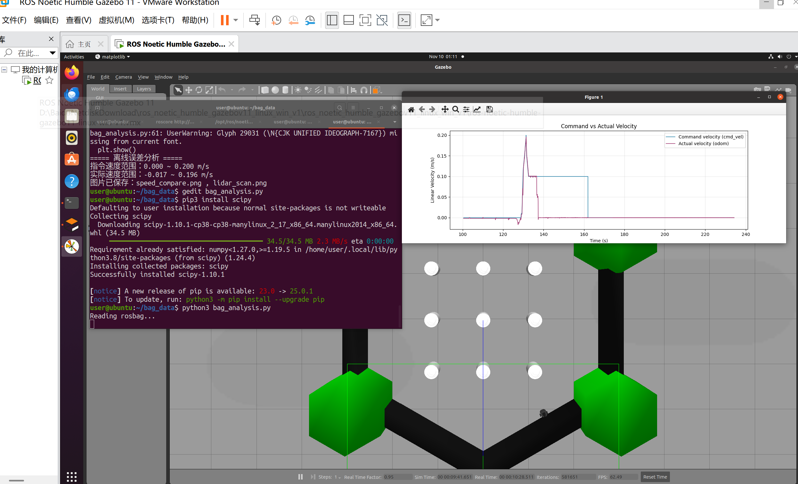
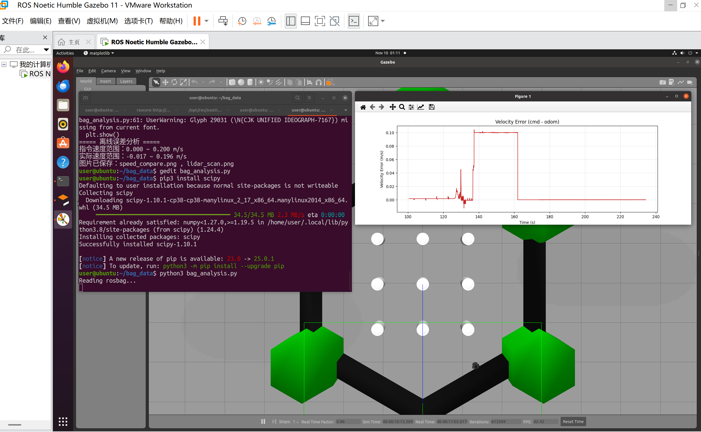
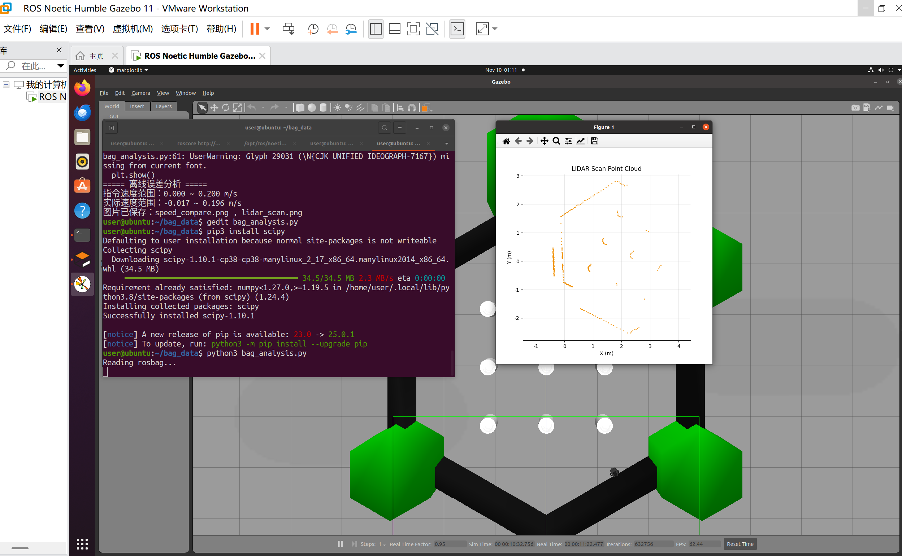

# 机器人的“黑匣子”——bag 录包数据的离线挖掘与可视化

## 实验主题

机器人的“黑匣子”——ROS bag 录包数据的离线挖掘与可视化。

## 实验背景

常规仿真实验只关注机器人能否正常运动，仿真结束后传感器与控制数据直接丢失。工程开发中会用 bag 录制全部话题数据，在仿真结束后离线复盘，分析控制误差、定位故障，相当于机器人的飞行黑匣子。

节点基于 ROS 2 与 `rosbags` 实现，`rosbags` 同时支持 ROS 1 的 `.bag` 与 ROS 2 的 bag 目录，因此历史 ROS 1 数据也能直接分析。

## 实验目标

1. 搭建图像录制节点，订阅相机话题并按固定间隔保存图像；
2. 录制 bag 数据包，包含 `/cmd_vel`、`/odom`、`/scan` 与相机话题；
3. 离线读取 bag，提取控制指令、里程计、激光雷达数据；
4. 可视化绘制：指令速度-实际速度曲线、速度误差曲线、激光雷达点云；
5. 分析机器人运动误差、卡顿、障碍物干扰现象。

## 代码位置

源码路径：`src/chap5/bag_blackbox`

## 功能包结构

```text
src/chap5/bag_blackbox/
├── bag_blackbox/
│   ├── __init__.py
│   ├── main.py                 # 离线分析入口
│   ├── bag_analysis_node.py    # 读取 bag 并绘图
│   └── image_record_node.py    # 相机图像录制节点
├── launch/
│   └── bag_blackbox.launch.py
├── resource/
│   └── bag_blackbox
├── package.xml
├── setup.cfg
└── setup.py
```

## 环境与依赖

- Ubuntu 22.04 + ROS 2 Humble + Python 3.10
- 依赖：`rclpy`、`sensor_msgs`、`cv_bridge`、`opencv-python`、`numpy`、`matplotlib`、`scipy`、`rosbags`

```bash
sudo apt install -y python3-opencv ros-humble-cv-bridge
pip install rosbags -i https://pypi.tuna.tsinghua.edu.cn/simple
python3 -c "from rosbags.highlevel import AnyReader; print('rosbags ok')"
```

## 实验步骤

### 1. 启动仿真环境

```bash
export TURTLEBOT3_MODEL=burger
ros2 launch turtlebot3_gazebo turtlebot3_world.launch.py
```

### 2. 编译功能包

```bash
cd ~/ros2_ws            # 含 src/ 的工作空间根目录
colcon build --packages-select bag_blackbox
source install/setup.bash
```

### 3. 录制 bag

新开终端，发布一段运动指令让机器人动起来：

```bash
ros2 run teleop_twist_keyboard teleop_twist_keyboard
```

再开终端录制（录制 30 秒左右，Ctrl+C 结束）：

```bash
ros2 bag record -o robot_run.bag /cmd_vel /odom /scan
```

若要同时录制相机图像，另开终端先启动图像录制节点：

```bash
ros2 run bag_blackbox image_record_main --ros-args \
    -p save_dir:=./img_save -p min_interval:=1.0 -p max_images:=50
```

### 4. 离线分析并出图

```bash
ros2 launch bag_blackbox bag_blackbox.launch.py \
    bag_path:=./robot_run.bag save_dir:=./docs/img
```

也可以用参数形式单独运行：

```bash
ros2 run bag_blackbox bag_blackbox_main --ros-args \
    -p bag_path:=./robot_run.bag -p save_dir:=./docs/img
```

终端会打印读取到的消息条数、激光点数量以及每张图的保存路径。若 bag 路径不存在或话题缺失，节点会给出中文错误并以退出码 1 结束。

### 5. 查看结果

```bash
ls -l ./docs/img
```

输出三张图：

- `command_vs_actual_velocity.png`：指令速度与实际速度对比
- `velocity_error_curve.png`：速度误差曲线（cmd − odom）
- `lidar_point_cloud.png`：激光点云（累积所有帧）

## 参数说明

| 参数 | 默认值 | 说明 |
| --- | --- | --- |
| `bag_path` | `./robot_run.bag` | 待分析的 bag 路径 |
| `save_dir` | `./docs/img` | 图表输出目录 |
| `max_lidar_points` | `200000` | 点云绘图上限，超出随机降采样 |
| `image_topic` | `/camera/image_raw` | 图像录制订阅的话题 |
| `save_dir`（录制节点） | `./img_save` | 图像保存目录 |
| `min_interval` | `1.0` | 最短保存间隔（秒） |
| `max_images` | `100` | 最多保存张数，0 表示不限 |

## 效果图

指令速度与实际速度对比：



速度误差曲线：



激光雷达点云：



## 已知限制

- 点云图把所有帧叠加绘制，长距离移动时会出现轨迹拖影，属于该可视化方式的固有现象；
- 图像录制节点按时间间隔抽帧，不保证帧率与相机一致；
- 未提供示例 bag 文件，需按第 3 步自行录制，避免二进制数据进入版本库。
