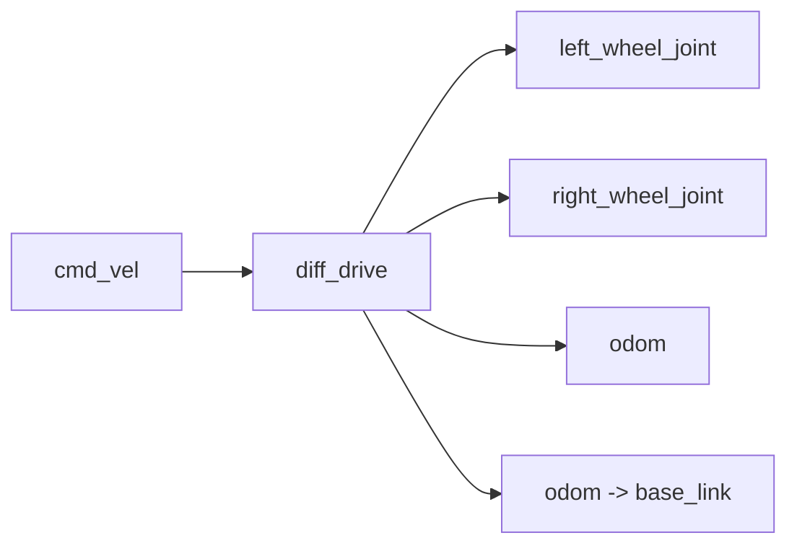

# 步骤 4：差速驱动与里程计

> 前置条件：完成[步骤 3](gazebo_03_urdf_model.md)。
> 本步目标：让 `/cmd_vel` 能驱动 Gazebo 中的机器人，并正确发布 `/odom` 和里程计 TF。
> 预计时间：40-60 分钟。

- [1. 差速驱动原理](#principle)
- [2. 插件配置](#plugin)
- [3. 参数解析](#params)
- [4. 关节状态发布](#joint-state)
- [5. 数据流验证](#verify)
- [6. 常见问题](#debug)
- [7. 本步验收](#acceptance)

## 1. 差速驱动原理 <span id="principle"></span>

两轮差速机器人通过左右轮速度差实现前进、后退和旋转。

设：

- 机器人线速度为 \(v\)；
- 角速度为 \(\omega\)；
- 轮距为 \(L\)；
- 轮半径为 \(r\)。

左右轮线速度满足：

\[
v_l = v - \frac{\omega L}{2}
\]

\[
v_r = v + \frac{\omega L}{2}
\]

- 两轮同速 -> 直行；
- 左侧慢、右侧快 -> 左转；
- 两轮反向同速 -> 原地旋转。

Gazebo 差速插件把 `/cmd_vel` 中的 `linear.x` 和 `angular.z` 转换成左右轮目标速度。

## 2. 插件配置 <span id="plugin"></span>

```xml
<gazebo>
  <plugin name="diff_drive" filename="libgazebo_ros_diff_drive.so">
    <update_rate>50</update_rate>
    <left_joint>left_wheel_joint</left_joint>
    <right_joint>right_wheel_joint</right_joint>
    <wheel_separation>${wheel_separation}</wheel_separation>
    <wheel_diameter>${2.0 * wheel_radius}</wheel_diameter>
    <max_wheel_torque>20.0</max_wheel_torque>
    <max_wheel_acceleration>1.0</max_wheel_acceleration>
    <command_topic>cmd_vel</command_topic>
    <odometry_topic>odom</odometry_topic>
    <odometry_frame>odom</odometry_frame>
    <robot_base_frame>base_link</robot_base_frame>
    <publish_odom>true</publish_odom>
    <publish_odom_tf>true</publish_odom_tf>
    <publish_wheel_tf>false</publish_wheel_tf>
  </plugin>
</gazebo>
```

插件节点图：



## 3. 参数解析 <span id="params"></span>

| 参数 | 必须与什么保持一致 | 错误后现象 |
| --- | --- | --- |
| `left_joint` | URDF 左轮关节名 | 左轮不动 |
| `right_joint` | URDF 右轮关节名 | 右轮不动 |
| `wheel_separation` | 左右轮接触点距离 | 转向过大或过小 |
| `wheel_diameter` | 2 x `wheel_radius` | 里程计速度比例错误 |
| `max_wheel_torque` | 大于摩擦阻力 | 机器人不动或加速弱 |
| `max_wheel_acceleration` | 合理平滑控制 | 起步过猛或响应过慢 |
| `command_topic` | 控制话题 | 发布者存在但插件收不到 |
| `robot_base_frame` | URDF 根 link | TF 树断裂 |

`wheel_separation` 不是车身宽度。如果车体宽 0.28 m、车轮厚 0.03 m，左右轮中心距不一定等于车体宽度，必须以 URDF 的关节 origin 为准。

## 4. 关节状态发布 <span id="joint-state"></span>

差速插件负责关节驱动，但还需要把关节状态发回 ROS，供 `robot_state_publisher` 更新 TF：

```xml
<plugin name="gazebo_joint_state_publisher"
        filename="libgazebo_ros_joint_state_publisher.so">
  <update_rate>30</update_rate>
  <joint_name>left_wheel_joint</joint_name>
  <joint_name>right_wheel_joint</joint_name>
  <joint_name>caster_joint</joint_name>
</plugin>
```

数据链：


## 5. 数据流验证 <span id="verify"></span>

启动系统后检查：

```bash
rosnode list
rostopic list | grep -E "cmd_vel|odom|joint_states|tf"
rostopic info /cmd_vel
rostopic info /odom
rostopic hz /odom
rostopic hz /joint_states
rosrun tf tf_echo odom base_link
```

手动发布线性速度：

```bash
rostopic pub -r 10 /cmd_vel geometry_msgs/Twist \
  "{linear: {x: 0.3, y: 0.0, z: 0.0}, angular: {x: 0.0, y: 0.0, z: 0.0}}"
```

手动发布角速度：

```bash
rostopic pub -r 10 /cmd_vel geometry_msgs/Twist \
  "{linear: {x: 0.0, y: 0.0, z: 0.0}, angular: {x: 0.0, y: 0.0, z: 0.6}}"
```

成功现象：

1. 线性速度使机器人向前；
2. 正角速度使机器人左转；
3. `/odom` 的位姿持续变化；
4. `tf_echo odom base_link` 输出随时间变化；
5. `rostopic hz /joint_states` 显示约 30 Hz。

## 6. 常见问题 <span id="debug"></span>

| 现象 | 优先检查 | 处理 |
| --- | --- | --- |
| `/cmd_vel` 没有订阅者 | 插件是否加载 | 检查 Gazebo 启动日志 |
| 有 `/cmd_vel` 但机器人不动 | 关节名、力矩、暂停状态 | 检查 `left_joint` 和 `right_joint` |
| 机器人旋转方向相反 | 左右轮配置 | 交换左右轮或检查车轮朝向 |
| 只原地转不走直线 | 轮距或左右轮镜像 | 检查关节 origin 和差速参数 |
| 没有 `/odom` | `publish_odom` | 打开发布并检查插件版本 |
| `odom -> base_link` 缺失 | `publish_odom_tf` | 打开 TF 发布，检查是否与其他节点冲突 |
| TF 时间戳异常 | `use_sim_time` | 让所有节点使用 Gazebo 时间 |

## 7. 本步验收 <span id="acceptance"></span>

- [ ] 能解释差速驱动左右轮速度关系；
- [ ] `/cmd_vel` 有差速插件作为订阅者；
- [ ] `/odom` 能发布且频率合理；
- [ ] `tf_echo odom base_link` 能输出位姿；
- [ ] 手动发布速度时机器人运动方向正确；
- [ ] 知道机器人不动时应该按什么顺序排查。

---

- 上一步：[URDF 与 xacro 建模](gazebo_03_urdf_model.md)
- 返回[教程总览](gazebo_platform_simulation.md)
- 下一步：[步骤 5：激光与相机插件](gazebo_05_sensor_plugins.md)
