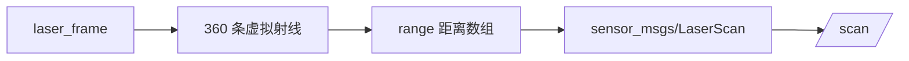
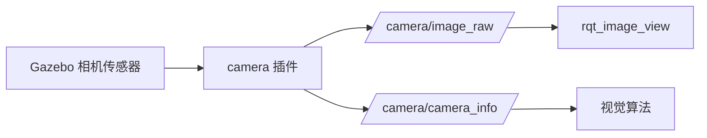
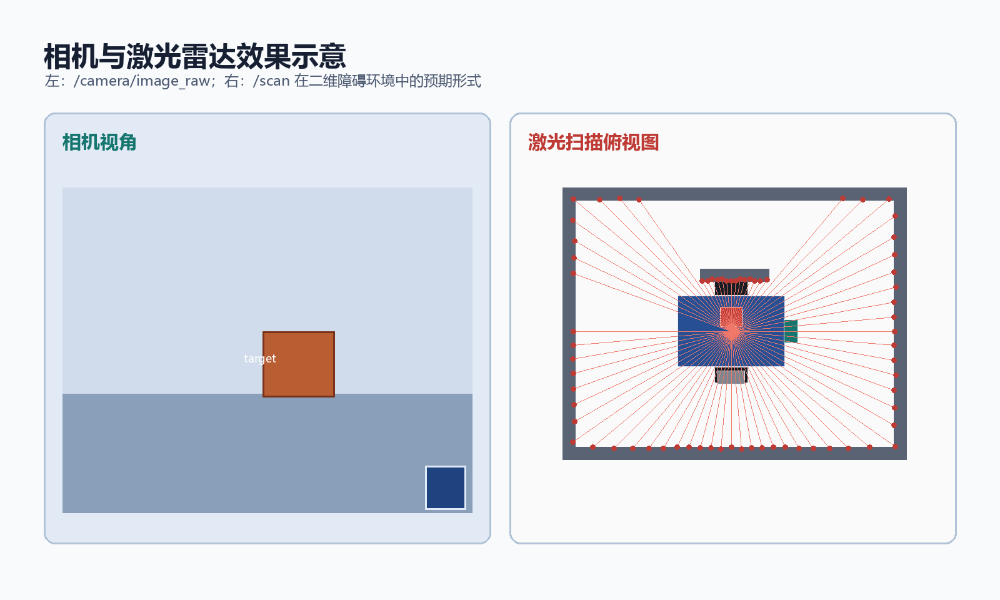

# 步骤 5：激光与相机插件

> 前置条件：完成[步骤 4](gazebo_04_diff_drive.md)。
> 本步目标：让 Gazebo 中的激光雷达和 RGB 相机发布标准 ROS 话题。
> 预计时间：40-60 分钟。

- [1. 激光雷达原理](#laser)
- [2. 激光插件配置](#laser-plugin)
- [3. 相机传感器配置](#camera)
- [4. 相机插件配置](#camera-plugin)
- [5. 数据流验证](#verify)
- [6. 常见问题](#debug)
- [7. 本步验收](#acceptance)

## 1. 激光雷达原理 <span id="laser"></span>

Gazebo 的 `ray` 传感器从激光原点发出多条虚拟射线，检测与场景障碍物的交点，并生成一串距离值。



`LaserScan` 中最关键的数据：

| 字段 | 含义 |
| --- | --- |
| `header.stamp` | 扫描时间 |
| `header.frame_id` | 激光坐标系 |
| `angle_min`、`angle_max` | 扫描角范围 |
| `angle_increment` | 相邻射线夹角 |
| `range_min`、`range_max` | 最小和最大量程 |
| `ranges[]` | 每个角度的距离 |

激光的 `frame_id` 必须存在于 TF 树中，否则 SLAM 和导航无法把激光数据放到机器人坐标系里。

## 2. 激光插件配置 <span id="laser-plugin"></span>

```xml
<gazebo reference="laser_frame">
  <sensor type="ray" name="laser_sensor">
    <always_on>true</always_on>
    <update_rate>10</update_rate>
    <visualize>false</visualize>
    <ray>
      <scan>
        <horizontal>
          <samples>360</samples>
          <resolution>1</resolution>
          <min_angle>-3.14159265359</min_angle>
          <max_angle>3.14159265359</max_angle>
        </horizontal>
      </scan>
      <range>
        <min>0.10</min>
        <max>10.0</max>
        <resolution>0.01</resolution>
      </range>
    </ray>
    <plugin name="laser_controller" filename="libgazebo_ros_laser.so">
      <topicName>/scan</topicName>
      <frameName>laser_frame</frameName>
    </plugin>
  </sensor>
</gazebo>
```

> 本虚拟机或本仓库使用的 Gazebo ROS 版本没有安装 `libgazebo_ros_ray_sensor.so`，因此使用仓库现有示例中的 `libgazebo_ros_laser.so`。两种插件的功能相同，区别是参数名和输出类型配置方式不同。

参数影响：

| 参数 | 增大后的影响 | 建议 |
| --- | --- | --- |
| `samples` | 角度更密，数据更精细，CPU 更高 | 初学用 180 或 360 点 |
| `update_rate` | 数据更快，计算量更高 | 初学用 5-10 Hz |
| `max` | 探测距离更远 | 室内用 8-10 m |
| `visualize` | Gazebo 中显示射线 | 调试时打开，平时关闭 |

## 3. 相机传感器配置 <span id="camera"></span>

```xml
<gazebo reference="camera_link">
  <sensor type="camera" name="camera_sensor">
    <always_on>true</always_on>
    <update_rate>30</update_rate>
    <visualize>false</visualize>
    <camera name="camera">
      <horizontal_fov>1.047</horizontal_fov>
      <image>
        <width>640</width>
        <height>480</height>
        <format>R8G8B8</format>
      </image>
      <clip>
        <near>0.05</near>
        <far>20.0</far>
      </clip>
    </camera>
  </sensor>
</gazebo>
```

相机参数：

- `horizontal_fov`：水平视场角，约为 60 度；
- `width`、`height`：图像分辨率；
- `near`、`far`：可见距离范围；
- `update_rate`：图像帧率。

相机分辨率提高会明显增加 Gazebo 渲染和图像传输负载，初学者先用 640 x 480。

## 4. 相机插件配置 <span id="camera-plugin"></span>

```xml
<plugin name="camera_controller" filename="libgazebo_ros_camera.so">
  <cameraName>camera</cameraName>
  <imageTopicName>image_raw</imageTopicName>
  <cameraInfoTopicName>camera_info</cameraInfoTopicName>
  <frameName>camera_link</frameName>
</plugin>
```

话题图：



`camera_info` 包含焦距、主点、畸变参数，真实相机标定和视觉定位都会使用。

## 5. 数据流验证 <span id="verify"></span>

传感器正确输出后，相机和激光的数据形态可参考下图：



启动仿真后：

```bash
rostopic list | grep -E "scan|camera"
rostopic info /scan
rostopic info /camera/image_raw
rostopic info /camera/camera_info
rostopic hz /scan
rostopic hz /camera/image_raw
rostopic echo -n 1 /scan
```

检查 TF：

```bash
rosrun tf tf_echo base_link laser_frame
rosrun tf tf_echo base_link camera_link
```

查看图像：

```bash
rosrun rqt_image_view rqt_image_view
```

在窗口中选择 `/camera/image_raw`，应看到 Gazebo 场景图像。

## 6. 常见问题 <span id="debug"></span>

| 现象 | 原因 | 处理 |
| --- | --- | --- |
| 没有 `/scan` | 激光插件未加载或 topic 名错误 | 检查 Gazebo 日志与 `<topicName>` |
| `/scan` 无数据 | `range_min` 到 `range_max` 内没有障碍 | 在场景中添加墙体或靠近地面 |
| `/scan` 频率低 | 点数或更新率过高 | 降低 `samples` 或 `update_rate` |
| 相机没有图像 | 插件或话题名错误 | 检查 `/camera/image_raw` |
| 图像卡顿 | 分辨率过高或 CPU 不足 | 降低分辨率与帧率 |
| 激光建图错位 | `frameName` 与 TF 不一致 | 统一起见使用 `laser_frame` |
| 相机坐标错误 | 相机 TF 或安装方向错误 | 检查 `camera_joint` 的 origin 和 rpy |

## 7. 本步验收 <span id="acceptance"></span>

- [ ] `/scan` 话题存在且有 360 个范围值；
- [ ] `/camera/image_raw` 和 `/camera/camera_info` 存在；
- [ ] `tf_echo base_link laser_frame` 能查询成功；
- [ ] `tf_echo base_link camera_link` 能查询成功；
- [ ] `rqt_image_view` 能看到相机图像；
- [ ] 能解释传感器数据为什么要绑定 frame。

---

- 上一步：[差速驱动与里程计](gazebo_04_diff_drive.md)
- 返回[教程总览](gazebo_platform_simulation.md)
- 下一步：[步骤 6：世界文件与 launch](gazebo_06_world_launch.md)
