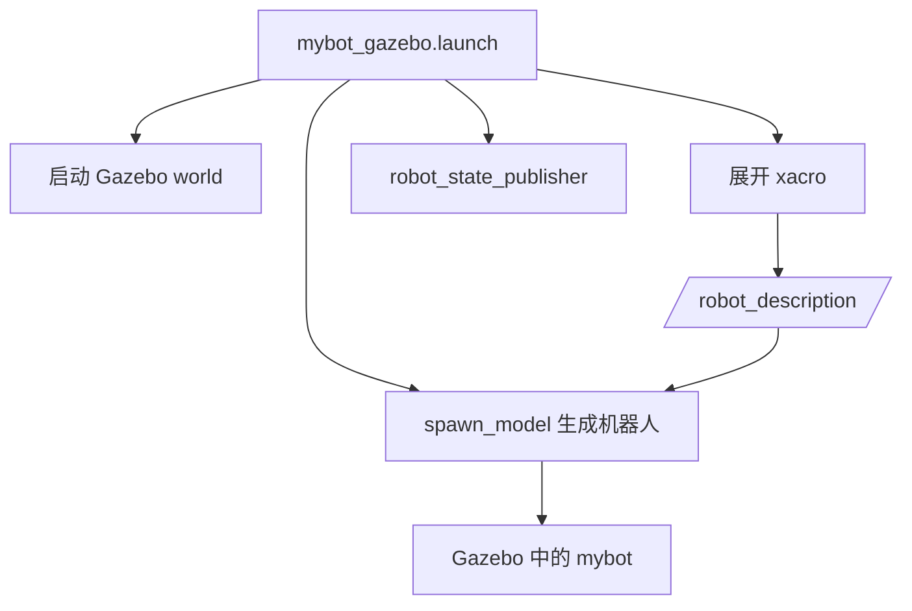

# 步骤 6：世界文件与 launch

> 前置条件：完成[步骤 5](gazebo_05_sensor_plugins.md)。
> 本步目标：用 world 文件和 launch 文件把机器人与仿真环境组合起来。
> 预计时间：30-50 分钟。

- [1. world 与 launch 的职责](#roles)
- [2. 创建最小世界](#world)
- [3. launch 启动流程](#launch)
- [4. 参数解析](#params)
- [5. 常见问题](#debug)
- [6. 本步验收](#acceptance)

## 1. world 与 launch 的职责 <span id="roles"></span>

| 文件 | 负责什么 | 不负责什么 |
| --- | --- | --- |
| `.world` | 地面、光照、物理参数、场景模型 | 不负责机器人 URDF 和 ROS 节点 |
| `.launch` | 启动 Gazebo、加载模型、发布 TF、设置参数 | 不负责模型几何和插件细节 |

将世界和启动分开，才能把同一机器人放到不同场景中测试。

## 2. 创建最小世界 <span id="world"></span>

`worlds/mybot_empty.world`：

```xml
<?xml version="1.0"?>
<sdf version="1.6">
  <world name="mybot_empty">
    <include>
      <uri>model://sun</uri>
    </include>
    <include>
      <uri>model://ground_plane</uri>
    </include>
    <physics type="ode">
      <max_step_size>0.001</max_step_size>
      <real_time_factor>1.0</real_time_factor>
      <real_time_update_rate>1000</real_time_update_rate>
    </physics>
    <scene>
      <ambient>0.55 0.55 0.55 1.0</ambient>
      <background>0.78 0.86 0.96 1.0</background>
      <shadows>true</shadows>
    </scene>
  </world>
</sdf>
```

参数含义：

- `max_step_size`：物理步长，越小越精确但计算越慢；
- `real_time_factor`：期望实时因子；
- `real_time_update_rate`：每秒物理更新次数。

## 3. launch 启动流程 <span id="launch"></span>



`launch/mybot_gazebo.launch`：

```xml
<launch>
  <arg name="paused" default="false"/>
  <arg name="use_sim_time" default="true"/>
  <arg name="gui" default="true"/>
  <arg name="headless" default="false"/>
  <arg name="debug" default="false"/>

  <include file="$(find gazebo_ros)/launch/empty_world.launch">
    <arg name="world_name" value="$(find mybot_gazebo)/worlds/mybot_empty.world"/>
    <arg name="paused" value="$(arg paused)"/>
    <arg name="use_sim_time" value="$(arg use_sim_time)"/>
    <arg name="gui" value="$(arg gui)"/>
    <arg name="headless" value="$(arg headless)"/>
    <arg name="debug" value="$(arg debug)"/>
  </include>

  <param name="robot_description"
         command="$(find xacro)/xacro --inorder $(find mybot_gazebo)/urdf/mybot.urdf.xacro"/>

  <node name="robot_state_publisher"
        pkg="robot_state_publisher"
        type="robot_state_publisher"
        output="screen"/>

  <node name="spawn_mybot"
        pkg="gazebo_ros"
        type="spawn_model"
        args="-urdf -param robot_description -model mybot -x 0 -y 0 -z 0.12"
        output="screen"/>
</launch>
```

## 4. 参数解析 <span id="params"></span>

| 参数 | 作用 | 常见错误 |
| --- | --- | --- |
| `paused` | 启动后是否暂停物理 | 误设为 true，机器人不动 |
| `use_sim_time` | 使用仿真时钟 | 与传感器时间戳不一致 |
| `gui` | 是否启动 Gazebo 界面 | 无头测试时可关闭 |
| `world_name` | 指定世界文件 | 路径错误导致空世界 |
| `robot_description` | 展开后的 URDF | xacro 失败导致模型为空 |
| `spawn_model` 的 `-z` | 模型初始高度 | 过低穿地，过高掉落 |

## 5. 常见问题 <span id="debug"></span>

| 现象 | 检查 | 处理 |
| --- | --- | --- |
| Gazebo 启动了但机器人不在 | `spawn_model` 日志 | 检查 xacro 和 `robot_description` |
| 世界不是自定义世界 | `world_name` 路径 | 使用 `$(find mybot_gazebo)` |
| 模型直接掉落 | `-z` 初值 | 调整到车轮接触地面 |
| robot_state_publisher 无输出 | `robot_description` 是否为空 | 单独运行 xacro 检查 |
| 话题时间戳异常 | `use_sim_time` | 所有终端和节点统一使用 |
| 关闭 launch 后仍留节点 | 子进程未退出 | `killall -9 gzserver gzclient` 后重试 |

## 6. 本步验收 <span id="acceptance"></span>

- [ ] 能解释 world 和 launch 的分工；
- [ ] `world_name` 指向自定义世界；
- [ ] `robot_description` 可以展开；
- [ ] `robot_state_publisher` 节点存在；
- [ ] `spawn_model` 日志没有报错；
- [ ] 能用 `gui:=false` 进行无头启动测试。

---

- 上一步：[激光与相机插件](gazebo_05_sensor_plugins.md)
- 返回[教程总览](gazebo_platform_simulation.md)
- 下一步：[步骤 7：首次启动与验证](gazebo_07_first_simulation.md)
