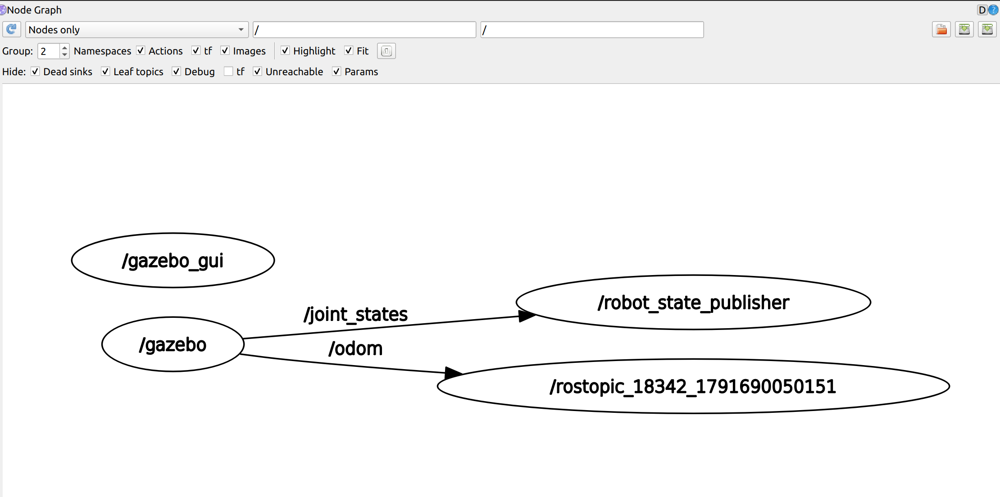
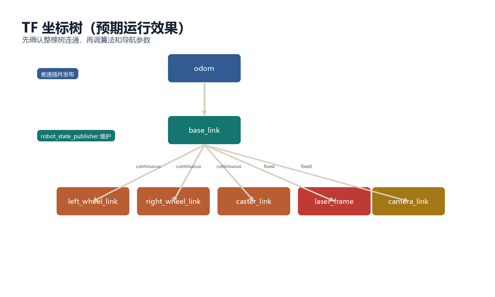
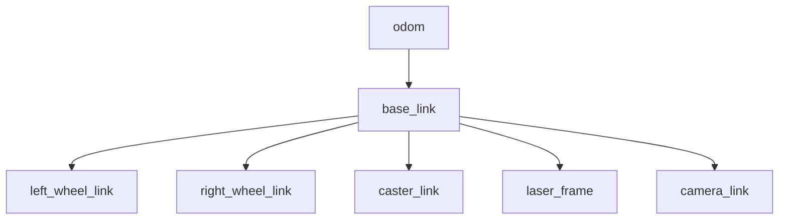

# 步骤 7：首次启动与验证

> 前置条件：完成[步骤 6](gazebo_06_world_launch.md)。
> 本步目标：第一次完整启动 Gazebo，验证模型、话题、TF 和传感器。
> 预计时间：40-60 分钟。

- [1. 启动前检查](#precheck)
- [2. 启动仿真](#launch)
- [3. Gazebo 现象](#gazebo)
- [4. 话题验证](#topics)
- [5. TF 验证](#tf)
- [6. 传感器验证](#sensors)
- [7. 常见问题](#debug)
- [8. 本步验收](#acceptance)

## 1. 启动前检查 <span id="precheck"></span>

确认工作空间已编译：

```bash
cd ~/catkin_ws
catkin_make
source devel/setup.bash
```

单独检查 xacro：

```bash
xacro src/mybot_gazebo/urdf/mybot.urdf.xacro > /tmp/mybot.urdf
check_urdf /tmp/mybot.urdf
```

只有 xacro 和 URDF 检查通过后，再启动完整仿真。

## 2. 启动仿真 <span id="launch"></span>

```bash
roslaunch mybot_gazebo mybot_gazebo.launch
```

如果只需要后台运行：

```bash
roslaunch mybot_gazebo mybot_gazebo.launch gui:=false
```

## 3. Gazebo 现象 <span id="gazebo"></span>

正确启动后应看到：

- Gazebo 世界加载；
- 机器人位于地面附近；
- 车身不会持续抖动、掉落或穿透地面；
- 左右轮和支撑轮与地面接触；
- 激光和相机模型固定在车体上；
- 终端没有“找不到插件”的持续错误。

如果模型出现但马上掉下去，先关闭 launch，调整生成位置和支撑轮高度，不要继续测试控制。


虚拟机实际运行效果：


用 `rqt_graph` 可以确认 `/joint_states` 与 `/odom` 的连接关系：



## 4. 话题验证 <span id="topics"></span>

```bash
source ~/catkin_ws/devel/setup.bash
rosnode list
rostopic list | sort
```

重点确认：

| 话题 | 类型 | 发布者 |
| --- | --- | --- |
| `/cmd_vel` | `geometry_msgs/Twist` | 控制节点或命令行 |
| `/odom` | `nav_msgs/Odometry` | diff_drive 插件 |
| `/joint_states` | `sensor_msgs/JointState` | 差速插件 |
| `/scan` | `sensor_msgs/LaserScan` | 激光插件 |
| `/camera/image_raw` | `sensor_msgs/Image` | 相机插件 |
| `/camera/camera_info` | `sensor_msgs/CameraInfo` | 相机插件 |

检查具体连接：

```bash
rostopic info /cmd_vel
rostopic info /odom
rostopic info /scan
rostopic hz /odom
rostopic hz /scan
rostopic hz /camera/image_raw
```

如果 `/cmd_vel` 有发布者但没有订阅者，说明差速插件没有加载或话题名不一致。

## 5. TF 验证 <span id="tf"></span>

```bash
rosrun rqt_tf_tree rqt_tf_tree
rosrun tf tf_echo odom base_link
rosrun tf tf_echo base_link laser_frame
rosrun tf tf_echo base_link camera_link
```

预期 TF：





判断标准：

- `tf_echo` 不报 “Could not find transform”；
- `odom -> base_link` 会随机器人运动变化；
- `base_link -> laser_frame` 和 `camera_link` 保持固定；
- TF 的时间戳与 `/use_sim_time` 一致。

## 6. 传感器验证 <span id="sensors"></span>

激光：

```bash
rostopic echo -n 1 /scan
```

确认 `frame_id` 为 `laser_frame`，`ranges` 有 360 个值。

相机：

```bash
rosrun rqt_image_view rqt_image_view
```

在下拉框中选择 `/camera/image_raw`。如果画面是空白，检查相机朝向，必要时在场景中添加物体。

## 7. 常见问题 <span id="debug"></span>

| 现象 | 可能原因 | 处理 |
| --- | --- | --- |
| Gazebo 没有模型 | spawn_model 失败 | 检查 xacro、robot_description |
| 模型下沉 | 生成高度或惯性错误 | 调整 `-z` 和质量参数 |
| 模型抖动 | 碰撞体过复杂或质量太小 | 简化碰撞体，提高质量 |
| `/cmd_vel` 无订阅者 | diff_drive 未加载 | 检查插件库名和 Gazebo 日志 |
| 无 `/odom` | 插件未启动或 joint 名错误 | 检查左右关节名 |
| TF 断开 | robot_state_publisher 未运行 | 检查 `/joint_states` 和节点列表 |
| 没有 `/scan` | 激光插件或 frame 名错误 | 检查 `frame_name` 和 TF |
| 相机黑屏 | 场景无光照或镜头朝向错误 | 检查 sun、相机安装方向 |

## 8. 本步验收 <span id="acceptance"></span>

- [ ] Gazebo 中机器人稳定站立；
- [ ] `rosnode list` 中有状态发布器和 Gazebo 相关节点；
- [ ] `/odom`、`/scan`、相机话题都存在；
- [ ] TF 树完整且时间戳正常；
- [ ] `rqt_image_view` 能看到图像；
- [ ] 能通过话题和 TF 判断仿真是否启动成功。

---

- 上一步：[世界文件与 launch](gazebo_06_world_launch.md)
- 返回[教程总览](gazebo_platform_simulation.md)
- 下一步：[步骤 8：手动速度控制](gazebo_08_manual_control.md)
