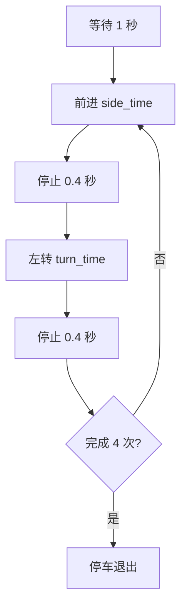
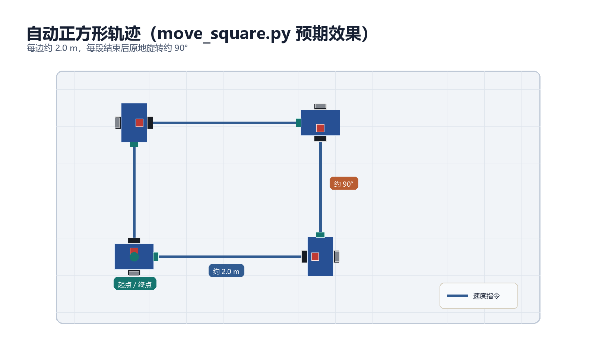

# 步骤 9：自动轨迹控制

> 前置条件：完成[步骤 8](gazebo_08_manual_control.md)。
> 本步目标：运行 `move_square.py`，让机器人自动完成近似正方形轨迹。
> 预计时间：30-50 分钟。

- [1. 节点设计](#design)
- [2. 核心代码](#code)
- [3. 运行步骤](#run)
- [4. 结果分析](#results)
- [5. 改为闭环控制](#closed-loop)
- [6. 常见问题](#debug)
- [7. 本步验收](#acceptance)

## 1. 节点设计 <span id="design"></span>

`move_square.py` 是时间开环控制：



参数：

```python
self.linear_speed = 0.35
self.angular_speed = 0.8
side_time = 2.0 / self.linear_speed
turn_time = (math.pi / 2.0) / self.angular_speed
```

理论边长为 2.0 m，理论转角为 90 度。

## 2. 核心代码 <span id="code"></span>

```python
#!/usr/bin/env python3
import math

import rospy
from geometry_msgs.msg import Twist

rospy.init_node("mybot_move_square")
pub = rospy.Publisher("/cmd_vel", Twist, queue_size=10)
rate = rospy.Rate(20)

linear_speed = 0.35
angular_speed = 0.8
side_time = 2.0 / linear_speed
turn_time = (math.pi / 2.0) / angular_speed

for index in range(4):
    cmd = Twist()
    cmd.linear.x = linear_speed
    end_time = rospy.Time.now() + rospy.Duration(side_time)
    while rospy.Time.now() < end_time and not rospy.is_shutdown():
        pub.publish(cmd)
        rate.sleep()

    pub.publish(Twist())
    rospy.sleep(0.4)

    cmd = Twist()
    cmd.angular.z = angular_speed
    end_time = rospy.Time.now() + rospy.Duration(turn_time)
    while rospy.Time.now() < end_time and not rospy.is_shutdown():
        pub.publish(cmd)
        rate.sleep()

    pub.publish(Twist())
    rospy.sleep(0.4)
```

关键点：

- 用 `rospy.Rate(20)` 持续发布速度；
- 每段动作结束后发布零速度；
- 动作间暂停，避免惯性影响下一段；
- 中断时最后发布零速度。

## 3. 运行步骤 <span id="run"></span>

终端 1：

```bash
roslaunch mybot_gazebo mybot_gazebo.launch
```

终端 2：

```bash
source ~/catkin_ws/devel/setup.bash
rosrun mybot_gazebo move_square.py
```

同时在另一个终端观察：

```bash
rostopic echo /cmd_vel
rostopic echo /odom
rosrun tf tf_echo odom base_link
```

## 4. 结果分析 <span id="results"></span>

预期轨迹如下。实际结果会受到车轮打滑、惯性和停车延迟影响，通常是近似正方形：



预期结果：

| 阶段 | 命令 | 观察现象 |
| --- | --- | --- |
| 直行 | `linear.x > 0` | 机器人前进 |
| 停止 | 全零 Twist | 机器人减速停下 |
| 左转 | `angular.z > 0` | 机器人逆时针旋转 |
| 重复 4 次 | 相同序列 | 近似正方形轨迹 |

误差来源：

- 车轮打滑；
- 速度指令与实际速度存在差异；
- 机器人存在惯性和减速时间；
- 转弯时间受到角速度误差影响。

开环控制的结果通常是“近似正方形”，不是精确正方形。它的价值是验证从节点到话题再到 Gazebo 的完整控制链。

## 5. 改为闭环控制 <span id="closed-loop"></span>

闭环控制需要订阅 `/odom`：

```python
from nav_msgs.msg import Odometry

position = None

def odom_callback(msg):
    global position
    position = msg.pose.pose.position

rospy.Subscriber("/odom", Odometry, odom_callback, queue_size=1)
```

控制逻辑改为：

1. 记录起点；
2. 计算当前点与起点的欧氏距离；
3. 距离达到 2.0 m 时停止直行；
4. 记录当前航向；
5. 航向变化达到 90 度时停止转弯。

闭环控制能减少速度误差对轨迹的影响，但还需要处理 `/odom` 的累计漂移。

## 6. 常见问题 <span id="debug"></span>

| 现象 | 原因 | 处理 |
| --- | --- | --- |
| 节点启动但机器人不动 | 仿真未启动或 `/cmd_vel` 无订阅者 | 检查 `rostopic info /cmd_vel` |
| 正方形不闭合 | 轮径、轮距或打滑 | 校正参数，降低速度 |
| 转弯角度偏差 | 角速度或时间误差 | 改用 `/odom` 闭环 |
| 动作之间拖尾过大 | 停止时间过短 | 增加 `rospy.sleep(0.4)` |
| 中断后机器人继续运动 | 未发布零速度 | 在 `finally` 中停车 |

## 7. 本步验收 <span id="acceptance"></span>

- [ ] `move_square.py` 能独立运行；
- [ ] 机器人完成四条边和四个转弯；
- [ ] 终端能观察到 `/cmd_vel` 的变化；
- [ ] `/odom` 和 TF 能显示运动轨迹；
- [ ] 能说明开环与闭环控制的区别；
- [ ] 知道如何利用 `/odom` 改进轨迹。

---

- 上一步：[手动速度控制](gazebo_08_manual_control.md)
- 返回[教程总览](gazebo_platform_simulation.md)
- 下一步：[步骤 10：参数调整与故障排查](gazebo_10_tuning_debug.md)
