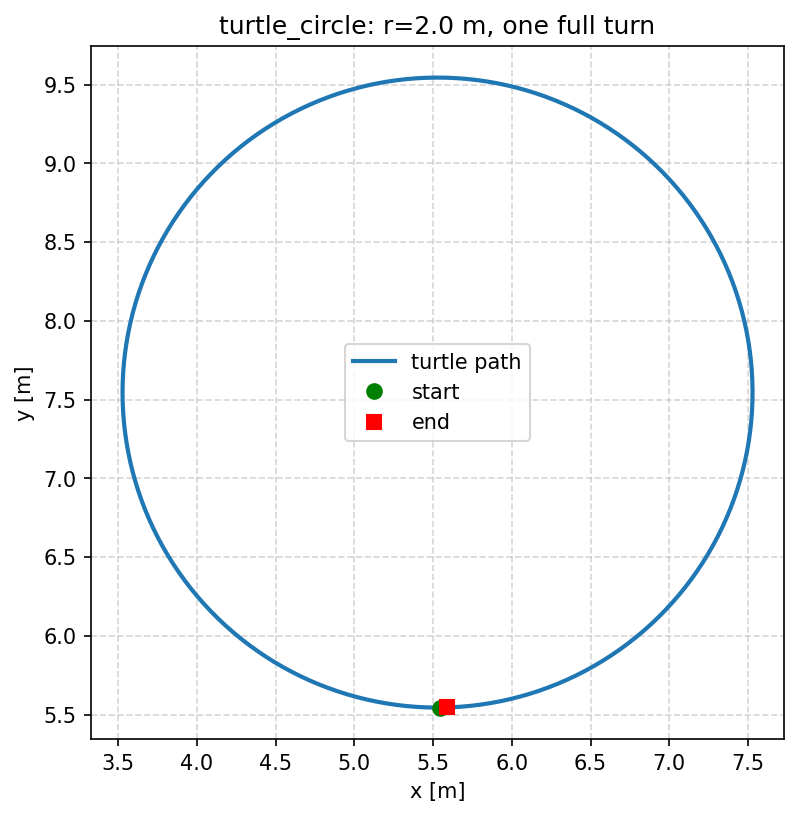

# 小海龟画圆（turtle_motion，ROS 2 实现）

对应实验文档：[小海龟画圆实验](./turtle_circle.md)。本文档说明 `src/chap1/turtle_motion`
这份**可运行实现**的原理、接口、运行方式与实测结果。

## 1. 原理

圆周运动由线速度 `v` 与角速度 `omega` 的比值决定半径：

```
r = v / omega        =>        omega = v / r
```

节点每 50 ms 发布一次 `geometry_msgs/Twist`，同时订阅 `/turtle1/pose` 累计海龟实际
转过的角度：

- 相邻位姿的航向差取最短角差（`wrap_to_pi`），**有符号**累加，抖动相互抵消；
- 1e-3 rad 死区，静止时的浮点噪声不会被当成转动；
- 累计到 `2*pi` 后发一帧零速度并停止。

## 2. 接口与参数

| 参数 | 默认 | 说明 |
| --- | --- | --- |
| `radius` | 2.0 | 圆半径 [m] |
| `linear_speed` | 2.0 | 线速度 [m/s] |
| `turtle` | `turtle1` | 海龟名字 |
| `publish_hz` | 20.0 | 速度发布频率 [Hz] |

节点入口：`main`（`ros2 run turtle_motion main`），同时提供 `circle_draw` 别名。

## 3. 运行

```bash
colcon build --packages-select turtle_motion
source install/setup.bash
ros2 run turtle_motion main                      # 需要先起 turtlesim
ros2 launch turtle_motion turtle_circle.launch.py  # 或一键起 turtlesim + 节点
```

无显示器环境设 `QT_QPA_PLATFORM=offscreen`（turtlesim 仍会发布 `/turtle1/pose`）。

## 4. 实测结果（WSL2 Ubuntu 24.04 + ROS 2 Jazzy，无显示器）

独立订阅者以 ~60 Hz 记录 `/turtle1/pose`，拟合圆得到：

```
samples: 439
start=(5.544, 5.544) end=(5.550, 5.554)
radius=2.000 m   turned=6.29 rad
```

- 半径 **2.000 m**（目标 2.0 m）；
- 累计转角 **6.29 rad**（目标 `2*pi = 6.283`）；
- 起点与终点重合，说明画满一圈后正确停车。



## 5. 与原始实验文档的差异

原文档环境是 Ubuntu 20.04 + ROS Noetic（`rospy`），本仓库的 `src/chap1/*` 与 CI 都是
ROS 2，所以用 rclpy 实现同样的话题与算法；话题名、消息类型、控制律与文档一致。

## 6. 限制

- 只在 Jazzy 的 turtlesim 上验证，未在 Noetic 上运行；
- 没有处理撞墙（turtlesim 会自行限位）；
- 只支持固定半径画一圈。
