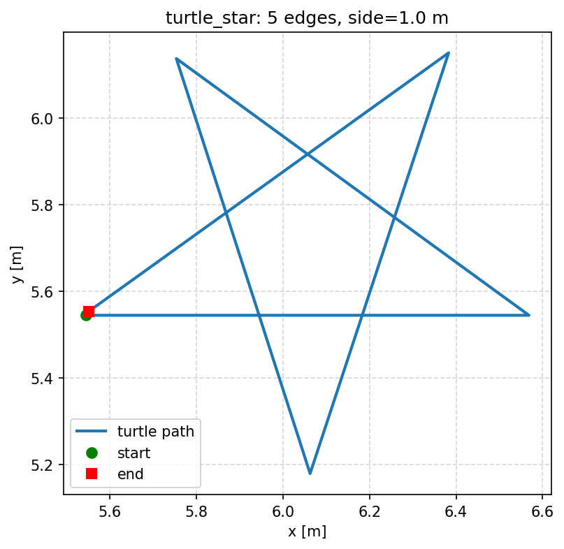

# 小海龟画五角星（turtle_star，ROS 2 实现）

对应实验文档：[小海龟绘制彩色五角星实验](./turtle_star.md)。本文档说明
`src/chap1/turtle_star` 这份**可运行实现**的原理、接口、运行方式与实测结果。

## 1. 原理

五角星外角 `144° = 4*pi/5`，循环 5 次「直行 L → 原地左转 144°」即可闭合，
总转角 `5 * 144° = 720° = 4*pi`。

本实现用**绝对位姿反馈**判定每一段是否完成，而不是按时间开环：

- 直行：从本边起点算直线距离，达到 `side_length` 就停；
- 转向：目标航向 = 本边起始航向 + 144°，误差 ≤ 0.01 rad 或穿过目标即停；
- 每条边开始前调用 `/turtle1/set_pen`（`turtlesim/SetPen`）换颜色；
- 退出时补发一帧零速度，避免节点被中断后 turtlesim 继续执行最后指令。

> 之前用「按 `L/v`、`144°/omega` 计时」的开环实现，在 headless 环境位姿流被调度拖慢时
> 五角星会越走越偏（同代码两次运行，一次 18 s 闭合、一次 40 s 还没走完）。改成绝对位姿
> 反馈后两次运行结果一致。

## 2. 接口与参数

| 参数 | 默认 | 说明 |
| --- | --- | --- |
| `side_length` | 1.0 | 边长 [m] |
| `linear_speed` | 1.0 | 直行速度 [m/s] |
| `angular_speed` | 1.0 | 原地转角速度 [rad/s] |
| `turtle` | `turtle1` | 海龟名字 |
| `pen_width` | 3 | 画笔宽度 |
| `heading_tolerance` | 0.01 | 转角到位容差 [rad] |

节点入口：`main`（`ros2 run turtle_star main`），同时提供 `star_draw` 别名。

## 3. 运行

```bash
colcon build --packages-select turtle_star
source install/setup.bash
ros2 run turtle_star main                        # 需要先起 turtlesim
ros2 launch turtle_star turtle_star.launch.py    # 或一键起 turtlesim + 节点
```

无显示器环境设 `QT_QPA_PLATFORM=offscreen`。

## 4. 实测结果（WSL2 Ubuntu 24.04 + ROS 2 Jazzy，无显示器）

两次独立运行结果一致：

```
start=(5.544, 5.544) end=(5.551, 5.554)
closure_error=0.012 m   final theta=-0.01 rad
```

- 闭合误差 **1.2 cm**（边长 1 m）；
- 末帧航向 **-0.01 rad**（5 × 144° = 720° 后应回到 0）；
- 5 条边颜色依次切换，说明 `set_pen` 服务调用成功。



## 5. 与原始实验文档的差异

原文档环境是 Ubuntu 20.04 + ROS Noetic（`rospy`），且画圆与画星放在同一个
`turtle_motion` 包里。本仓库现有的 `src/chap1/*` 与 CI 都是 ROS 2，因此：

1. 用 rclpy 实现，话题/服务名不变；
2. 为了两个实验能分 PR 提交、互不冲突，画星单独做成 `turtle_star` 包；
3. 判定方式从「定时开环」改成「绝对位姿反馈」，理由是上面提到的 headless 抖动。

## 6. 限制

- 只在 Jazzy 的 turtlesim 上验证，未在 Noetic 上运行；
- 闭合误差 1.2 cm 来自每段停顿时机的位姿量化（0.01 rad × 1 m），不是几何误差；
- 没有处理撞墙。
