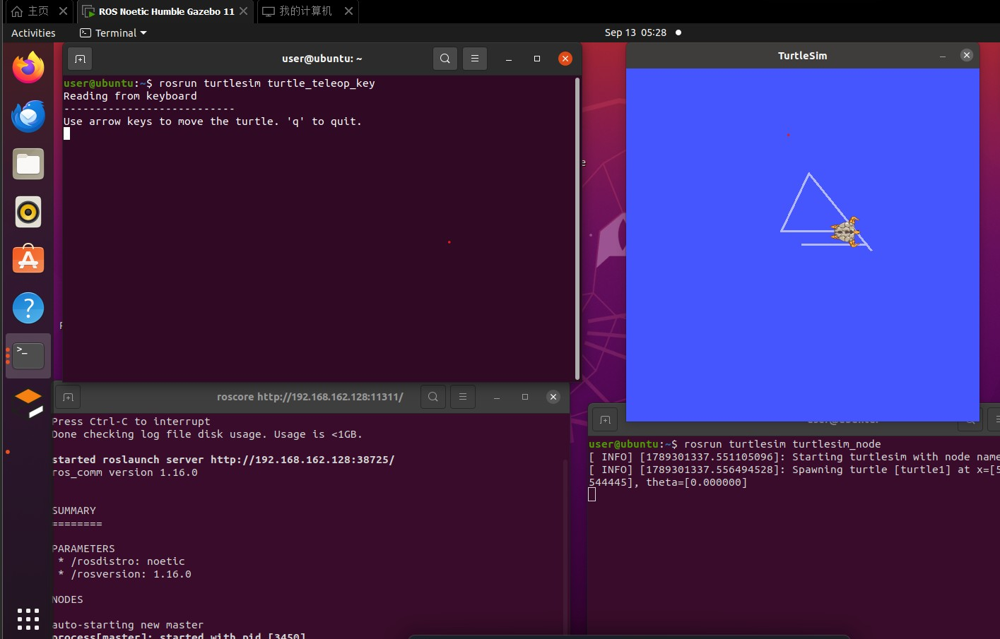

# 小海龟键盘遥控与 ROS 基础实验

本实验完成 ROS 环境验证、turtlesim 小海龟键盘遥控、常用 ROS 命令练习，
并阅读 CARLA-ROS 桥接（ros-bridge）的源码结构，理解 ROS 节点之间的话题通信方式。

## 一、实验目的与环境说明

### 1.1 实验目的

1. 验证 ROS Noetic 环境：`roscore` 能正常启动，`rosversion`、`rostopic` 等命令可用；
2. 掌握 turtlesim 的话题通信模型：遥控节点向 `/turtle1/cmd_vel` 发布 `geometry_msgs/Twist` 速度消息；
3. 实现一个键盘遥控节点：读取方向键 / WASD，把按键换算成线速度与角速度并发布；
4. 熟练使用 `rosnode`、`rostopic`、`rosmsg`、`rosservice`、`rqt_graph` 等常用命令查看和调试 ROS 系统；
5. 阅读 CARLA-ROS 桥接源码，理解外部仿真器与 ROS 之间“传感器数据转话题、控制指令转仿真命令”的双向桥接思路。

### 1.2 实验环境

| 项目 | 配置 |
| ---- | ---- |
| 操作系统 | Ubuntu 20.04（VMware 虚拟机） |
| ROS 发行版 | ROS Noetic（`rosversion` 输出 1.16.0） |
| 仿真器 | turtlesim |
| 编程语言 | Python 3（rospy），代码兼容 Python 2.7 |
| 功能包 | turtlesim_teleop |

功能包目录结构如下：

```text
turtlesim_teleop/
├── main.py           # 主程序：键盘遥控节点，发布 /turtle1/cmd_vel
├── launch/main.launch # roslaunch 入口：一键启动 turtlesim + 遥控节点
├── package.xml       # 包清单，声明 rospy、geometry_msgs、turtlesim 依赖
├── CMakeLists.txt    # 编译配置，安装 main.py 与 launch 目录
└── README.md         # 运行环境与运行步骤
```

## 二、实验原理

### 2.1 turtlesim 的话题模型

`turtlesim_node` 启动后会创建一只小海龟，并订阅 `/turtle1/cmd_vel` 话题，消息类型为
`geometry_msgs/Twist`。`Twist` 由线速度和角速度两部分组成，本实验只用到两个分量：

- `linear.x`：沿海龟自身 x 轴（车头方向）的线速度，单位 m/s，正值为前进；
- `angular.z`：绕 z 轴的角速度，单位 rad/s，正值为逆时针左转。

遥控节点作为发布者，只要向该话题写入一条 `Twist`，海龟就会按消息运动。
因此“键盘遥控”的本质是：**把按键事件映射成速度分量，再周期性或按键时发布出去**。

### 2.2 终端按键读取

普通终端是行缓冲的，按一个键后要按回车才会把内容交给程序，不适合实时遥控。
本模块用 `termios` + `tty.setcbreak()` 把终端切换为 cbreak 模式，按一个键立即生效；
再用 `select.select()` 以 100 ms 超时非阻塞读取，没有按键时循环继续，不会卡住节点。

方向键不是单个字符，而是以 `ESC` 开头的 3 字符转义序列：

| 按键 | 转义序列 |
| ---- | ---- |
| ↑ | `\x1b[A` |
| ↓ | `\x1b[B` |
| → | `\x1b[C` |
| ← | `\x1b[D` |

程序读到 `ESC` 后再尝试读 2 个字符，拼成完整的转义序列再查表，因此方向键和 WASD 都能识别。

### 2.3 速度保持与安全停车

turtlesim 会持续应用最后一次收到的速度指令，松开按键后海龟不会自动停下。
因此程序在按空格时发布一条全零 `Twist` 立即停车，在按 `q` 退出或 `Ctrl+C` 中断时，
在 `finally` 中先恢复终端设置、再发布零速度，避免海龟“跑飞”。

## 三、实验步骤

### 3.1 环境验证

打开终端，先确认 ROS 版本并启动主节点：

```bash
rosversion -d          # 输出 noetic
roscore                # 启动 ROS Master，保持该终端不关闭
```

`roscore` 正常启动时会打印 `started roslaunch server ...`、`ros_comm version 1.16.0` 等信息，
说明环境安装成功。

### 3.2 用官方节点体验键盘遥控

另开一个终端启动仿真器：

```bash
rosrun turtlesim turtlesim_node
```

再开一个终端启动官方遥控节点（键盘输入必须在这个前台终端里）：

```bash
rosrun turtlesim turtle_teleop_key
```

终端会提示 `Reading from keyboard`、`Use arrow keys to move the turtle. 'q' to quit.`，
此时按方向键即可控制海龟移动，按 `q` 退出。运行截图见 3.4 节。

### 3.3 运行本模块的遥控节点

把 `src/chap1/turtlesim_teleop` 拷贝到 catkin 工作空间的 `src` 下，编译并加载环境：

```bash
mkdir -p ~/catkin_ws/src
cp -r <本仓库>/src/chap1/turtlesim_teleop ~/catkin_ws/src/
chmod +x ~/catkin_ws/src/turtlesim_teleop/main.py
cd ~/catkin_ws && catkin_make
source devel/setup.bash
```

方式一，一键启动（需要 xterm 承载键盘输入）：

```bash
sudo apt install -y xterm       # 只需安装一次
roslaunch turtlesim_teleop main.launch
```

方式二，手动三个终端：

```bash
roscore
rosrun turtlesim turtlesim_node
rosrun turtlesim_teleop main.py
```

按键说明：方向键 / WASD 移动，空格停车，`+` / `-` 调整速度，`q` 或 `Ctrl+C` 退出。
终端会实时打印当前线速度和角速度。

### 3.4 运行结果

下图为 ROS Noetic 虚拟机中运行小海龟仿真与键盘遥控的截图：左侧终端已经启动
`roscore` 和 `turtle_teleop_key`，右侧为 turtlesim 窗口，小海龟在按键控制下走出了三角形轨迹。



从终端日志可以看到：

- `roscore` 输出的参数为 `/rosdistro: noetic`、`/rosversion: 1.16.0`；
- `turtlesim_node` 输出 `Spawning turtle [turtle1] at x=[5.544445], y=[5.544445], theta=[0.000000]`；
- 遥控终端输出 `Reading from keyboard` 和方向键提示，说明键盘节点已就绪。

## 四、常用 ROS 命令

在遥控节点和小海龟运行的同时，另开终端练习以下命令：

| 命令 | 作用 | 本实验中的观察结果 |
| ---- | ---- | ---- |
| `rosnode list` | 列出所有节点 | 能看到 `/turtlesim` 和 `/turtlesim_teleop`（或 `/turtle_teleop_key`） |
| `rosnode info /turtlesim` | 查看节点详情 | 显示它订阅 `/turtle1/cmd_vel`，发布 `/turtle1/pose` |
| `rostopic list` | 列出所有话题 | 能看到 `/turtle1/cmd_vel`、`/turtle1/pose` 等 |
| `rostopic info /turtle1/cmd_vel` | 查看话题类型和收发双方 | 类型为 `geometry_msgs/Twist` |
| `rostopic echo /turtle1/cmd_vel` | 实时打印速度消息 | 按键时打印 `linear.x` / `angular.z` 数值 |
| `rostopic hz /turtle1/pose` | 统计话题发布频率 | 观察 turtlesim 发布位姿的频率 |
| `rosmsg show geometry_msgs/Twist` | 查看消息字段定义 | 显示 `linear` 和 `angular` 两个 `Vector3` 字段 |
| `rosservice list` | 列出所有服务 | 能看到 `/clear`、`/turtle1/set_pen` 等 |
| `rosservice call /clear` | 清空画布 | 海龟走过的轨迹被擦除 |
| `rqt_graph` | 图形化显示节点与话题连接 | 可看到遥控节点 → `/turtle1/cmd_vel` → turtlesim 的连线 |
| `rosbag record -O turtle /turtle1/cmd_vel` | 录制话题数据 | 生成 `turtle.bag`，可用 `rosbag play` 回放 |

## 五、CARLA-ROS 桥接源码阅读

### 5.1 桥接的作用

CARLA 是自动驾驶仿真器，本身不是 ROS 系统。`ros-bridge` 在两个系统之间做双向翻译：

- **CARLA → ROS**：把仿真世界中的车辆位姿、激光雷达、相机、GNSS、IMU、交通灯、碰撞等数据
  转换成 ROS 话题（`/carla/...`），供 ROS 节点订阅；
- **ROS → CARLA**：把 ROS 中的控制指令（转向、油门、刹车、仿真暂停等）转换成 CARLA 的 API 调用。

一句话概括：**桥接节点既是 CARLA 世界的观察者，也是 ROS 指令的执行者**。

### 5.2 源码目录与职责

| 文件 | 职责 |
| ---- | ---- |
| `main.py` | 键盘遥控节点：读取方向键，映射成 `geometry_msgs/Twist`，发布到 `/turtle1/cmd_vel`；退出时补发零速度 |
| `launch/main.launch` | 一键启动 `turtlesim_node` 与遥控节点，用 `xterm` 给键盘节点提供终端输入 |
| `package.xml` | 声明 `rospy`、`geometry_msgs`、`turtlesim` 依赖 |
| `CMakeLists.txt` | 安装 `main.py` 到 bin 目录、`launch/` 到 share 目录 |

### 5.3 核心数据流

1. `launch/main.launch` 先启动 `turtlesim_node`，它创建小海龟并订阅 `/turtle1/cmd_vel`；
2. 遥控节点在 `xterm` 中读取方向键，把按键映射成线速度和角速度；
3. 节点以 `Twist` 消息发布到 `/turtle1/cmd_vel`，`turtlesim_node` 收到后积分位姿并刷新画面；
4. 松开按键时发布零速度，退出或 Ctrl+C 时也会补发一次零速度，避免海龟继续运动。

### 5.4 阅读收获

- 话题通信把“产生指令”和“执行运动”解耦，遥控节点不需要知道 `turtlesim` 的内部实现；
- 键盘输入依赖真实终端，`roslaunch` 场景要用 `xterm -e` 或 `launch-prefix` 提供 TTY；
- `catkin_install_python` 负责脚本，`install(DIRECTORY launch ...)` 负责 launch 文件，二者都安装后 `catkin_make install` 才是完整安装。

## 六、常见问题

1. **按方向键没有反应**：确认键盘节点是在前台终端用 `rosrun` 运行；用 `roslaunch` 启动时
   必须加 `launch-prefix="xterm -e"`，否则节点读不到终端输入。
2. **海龟不动**：检查 `roscore` 是否在运行、`turtlesim_node` 是否启动，并用
   `rostopic echo /turtle1/cmd_vel` 确认按键时确有消息发布。
3. **`Unable to register with master node`**：通常是 `roscore` 没启动，或 `ROS_MASTER_URI`
   指向了别的机器，重新打开终端 `source /opt/ros/noetic/setup.bash` 后再试。
4. **退出后海龟还在动**：本模块退出时会发布零速度；若用其他方式结束进程，可手动执行
   `rostopic pub -1 /turtle1/cmd_vel geometry_msgs/Twist "{}"` 停车。

## 七、总结

本实验验证了 ROS Noetic 环境，使用官方 `turtle_teleop_key` 和自写的 `turtlesim_teleop`
节点两种方式完成了小海龟键盘遥控，并练习了节点、话题、消息、服务相关的常用命令。
通过阅读本模块源码，进一步理解了键盘输入、`Twist` 消息与 `turtlesim_node` 订阅者之间的
数据流，以及 `catkin_install_python` 和 `install(DIRECTORY launch ...)` 在安装场景下的作用。

## 说明

本文档在整理过程中使用了 AI 助手（DeepSeek）辅助润色和结构化，实验环境、命令与截图
均由作者核对；作者对本文内容负全部责任。
