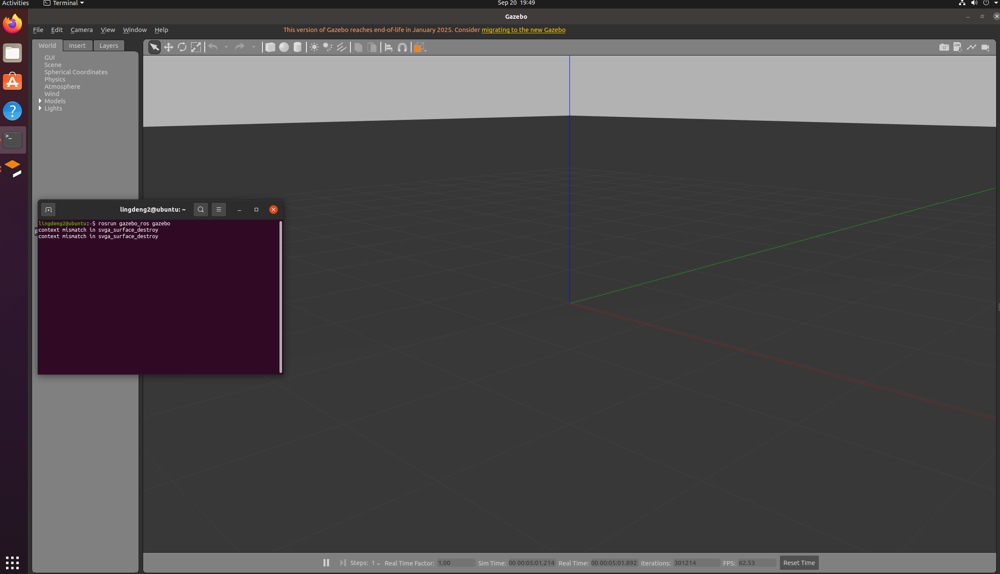
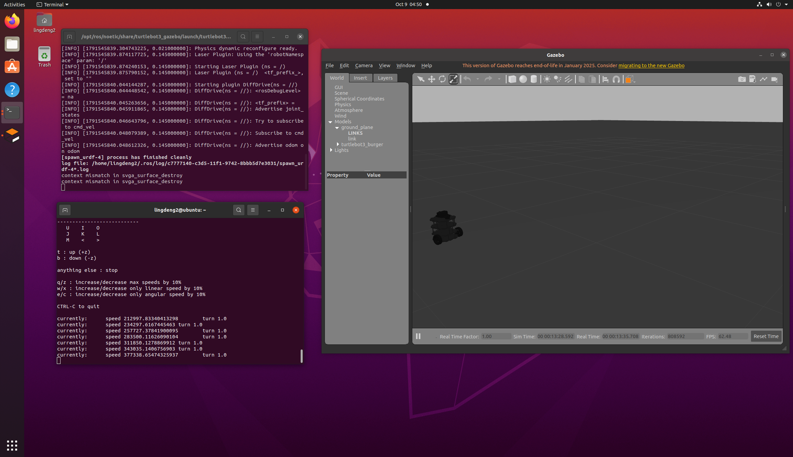
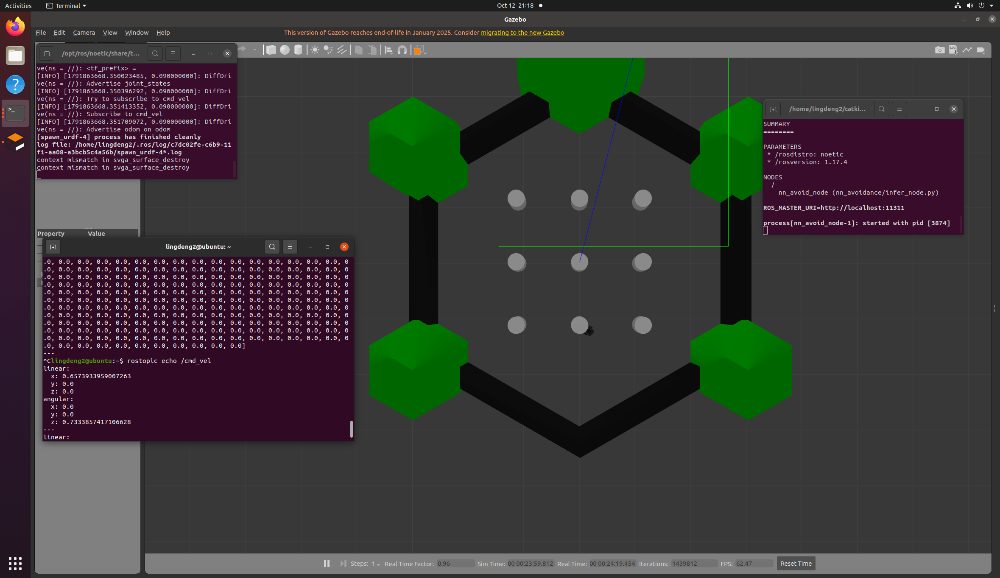

# 3.1本章聚焦于开发Gazebo环境并使用仿真小车进行可视化避障
**适用系统**：Ubuntu 20.04 LTS (Focal Fossa)
**ROS 版本**：ROS Noetic（ROS1 最终版本）
**Gazebo 版本**：Gazebo Classic 11
**文档说明**：本文档记录从零开始安装 ROS Noetic + Gazebo Classic 11 仿真环境的完整流程，包含排查与验证方法。

## 目录
- [一、环境说明](#env-intro)
- [二、安装 ROS Noetic](#install-ros-noetic)
- [三、安装 Gazebo Classic 11](#install-gazebo-classic11)
- [四、安装 gazebo_ros_pkgs（ROS 桥接包）](#install-gazebo-ros-pkgs)
- [五、配置环境变量](#config-env)
- [六、验证 ROS + Gazebo 集成](#verify-ros-gazebo)
- [七、实验结果](#experiment-result)
- [八、常见问题与解决方案](#faq)
- [九、一键检查脚本](#check-script)
- [十、后续学习建议](#next-study)
- [十一、基于Gazebo仿真的神经网络小车避障实验](#nn-obstacle-avoid)

## 一、环境说明 {#env-intro}
| 项目 | 版本/说明 |
|------|-----------|
| 操作系统 | Ubuntu 20.04 LTS (Focal Fossa) |
| ROS 版本 | ROS Noetic Ninjemys |
| Gazebo 版本 | Gazebo Classic 11.15.1 |
| 适用场景 | 机器人仿真、SLAM、导航、控制算法验证 |

> ⚠️ **重要提示**
> - Gazebo Classic 已于 **2025 年 1 月停止维护**，但 ROS Noetic 仍然使用它，现有教程和项目完全兼容。
> - Ubuntu 20.04 **必须搭配 Gazebo 11**，不要误装 `gazebo9`（那是 Ubuntu 18.04 + ROS Melodic 的标配）。
> - 后续若需迁移，可考虑 Gazebo Sim（新版）/ Ignition，但 ROS1 生态目前仍以 Classic 为主。
## 二、安装 ROS Noetic {#install-ros-noetic}

### 2.1 配置 ROS 软件源

```bash
sudo sh -c 'echo "deb http://packages.ros.org/ros/ubuntu focal main" > /etc/apt/sources.list.d/ros-noetic.list'
sudo apt-key adv --keyserver 'hkp://keyserver.ubuntu.com:80' --recv-key C1CF6E31E6BADE8868B172B4F42ED6FBAB17C654
```

> 若官方源访问慢，可改用清华、中科大等国内镜像源。

### 2.2 更新并安装完整桌面版

**强烈建议安装 `ros-noetic-desktop-full`**，它已包含 Gazebo、RViz、rqt 等全套工具：

```bash
sudo apt update
sudo apt install ros-noetic-desktop-full
```

### 2.3 初始化 rosdep

```bash
sudo apt install python3-rosdep2
sudo rosdep init
rosdep update
```

> 若因网络问题失败，可使用 `fishros` 一键配置工具或手动替换 `rosdistro` 为国内镜像。

### 2.4 配置环境变量

```bash
echo "source /opt/ros/noetic/setup.bash" >> ~/.bashrc
source ~/.bashrc
```

### 2.5 验证 ROS 安装

```bash
roscore
```

终端输出 `ROS master` 启动信息即表示成功（按 `Ctrl+C` 退出）。

## 三、安装 Gazebo Classic 11 {#install-gazebo-classic11}

> 若 `ros-noetic-desktop-full` 已安装成功，通常已包含 Gazebo 11。若终端输入 `gazebo` 提示 `Command not found`，则需要单独安装。

### 3.1 安装 Gazebo 11 本体

```bash
sudo apt update
sudo apt install gazebo11 libgazebo11-dev
```

> **关键点**：必须显式指定 `gazebo11`，不要只敲 `sudo apt install gazebo`，否则系统可能会提示安装 `gazebo9`（版本不匹配）。

### 3.2 验证 Gazebo 独立运行

```bash
gazebo
```

应弹出 `Gazebo GUI` 窗口，左侧有 `Insert` 标签，中央显示网格和坐标轴。

### 3.3 查看版本

```bash
gazebo --version
```

期望输出类似：

`Gazebo multi-robot simulator, version 11.15.1`

## 四、安装 gazebo_ros_pkgs（ROS 桥接包） {#install-gazebo-ros-pkgs}

`gazebo_ros_pkgs` 是 **ROS 与 Gazebo 通信的桥梁**，提供 `gazebo_ros` 节点、传感器 / 执行器插件等。

### 4.1 安装核心桥接包

```bash
sudo apt install ros-noetic-gazebo-ros-pkgs ros-noetic-gazebo-ros-control
```

表格

| 包名 | 作用 |
| --- | --- |
| `ros-noetic-gazebo-ros-pkgs` | 提供 `gazebo_ros` 节点、`gazebo_plugins` 插件集 |
| `ros-noetic-gazebo-ros-control` | ROS Control 与 Gazebo 的集成，用于控制器管理 |

### 4.2 验证安装

```bash
rospack find gazebo_ros
```

期望输出：

`/opt/ros/noetic/share/gazebo_ros`

## 五、配置环境变量 {#config-env}

### 5.1 添加 Gazebo 模型路径

编辑 `~/.bashrc`，在末尾追加：

```bash
export GAZEBO_MODEL_PATH=$GAZEBO_MODEL_PATH:/opt/ros/noetic/share/gazebo-11/models
```

### 5.2 source Gazebo 环境脚本

```bash
echo "source /usr/share/gazebo/setup.sh" >> ~/.bashrc
source ~/.bashrc
```

### 5.3 刷新命令缓存（可选）

若之前输入过 `gazebo` 提示找不到，执行以下命令刷新 bash 哈希表：

```bash
hash -r
```

## 六、验证 ROS + Gazebo 集成 {#verify-ros-gazebo}

### 6.1 用 ROS 方式启动 Gazebo
> ⚠️ 重要提醒：
> 使用 `rosrun`、`rostopic` 这类ROS命令前，**必须加载ROS Noetic环境**。
> 新开终端都需要执行下面这条命令（前面已经写入`.bashrc`的话，新开终端会自动加载，不用手动敲）：
> ```bash
> source /opt/ros/noetic/setup.bash
> ```

新开终端运行：

```bash
rosrun gazebo_ros gazebo
```

或使用 launch 文件（推荐）：

```bash
roslaunch gazebo_ros empty_world.launch
```

> **注意**：建议使用 ROS 命令启动 Gazebo，而不是直接敲 `gazebo`，这样能自动加载 ROS 插件、发布 `/clock`、`/gazebo/model_states` 等话题。

### 6.2 检查 ROS 话题

新开终端：

```bash
rostopic list | grep gazebo
```

应能看到：

`/gazebo/link_states`
`/gazebo/model_states`
`/gazebo/parameter_descriptions`
`/gazebo/parameter_updates`
`/gazebo/set_link_state`
`/gazebo/set_model_state`

### 6.3 在 Gazebo 中生成测试模型

新开终端：

```bash
rosrun gazebo_ros spawn_model -database box -urdf -model test_box -x 1 -y 0
```

### 6.4 使用 launch 文件启动（推荐方式）
在功能包内新建`launch/gazebo_test.launch`，写入：
```xml
<launch>
  <include file="$(find gazebo_ros)/launch/empty_world.launch">
    <arg name="paused" value="false"/>
    <arg name="use_sim_time" value="true"/>
    <arg name="gui" value="true"/>
  </include>
</launch>
```

CMakeLists.txt与package.xml文档在src/chap3代码中

编译后运行：

```bash
roslaunch any_avoidance gazebo_test.launch
```

## 七、实验结果 {#experiment-result}

### 7.1 实验环境

表格

| 项目 | 内容 |
| --- | --- |
| 操作系统 | Ubuntu 20.04 LTS |
| ROS 版本 | ROS Noetic |
| Gazebo 版本 | Gazebo Classic 11.15.1 |
| 启动命令 | `rosrun gazebo_ros gazebo` |
| 启动时间 | 2026-09-20 19:49 |

### 7.2 实验结果截图


通过 `rosrun gazebo_ros gazebo` 命令成功启动 Gazebo Classic 11，界面完整显示 3D 视图、坐标轴与仿真控制栏。



### 7.3 结果分析

表格

| 检查项 | 结果 | 说明 |
| --- | --- | --- |
| Gazebo GUI 启动 | ✅ 成功 | 3D 视图、菜单栏、工具栏正常显示 |
| ROS 桥接加载 | ✅ 成功 | 由 ROS 命令启动，自动加载 `gazebo_ros` 插件 |
| 仿真引擎运行 | ✅ 正常 | 底部状态栏显示 `Real Time Factor: 1.00`、`FPS: 62.53` |
| 坐标系统 | ✅ 正常 | 红色 X 轴、绿色 Y 轴、蓝色 Z 轴正常显示 |
| 警告信息 | ⚠️ 可忽略 | `context mismatch in svga_surface_destroy`（虚拟机渲染警告）；`reaches end-of-life`（官方停维提示） |

### 7.4 结论

实验表明，在 Ubuntu 20.04 系统下，通过 ROS Noetic 成功配置了 Gazebo Classic 11 仿真环境：

- ✅ `gazebo_ros_pkgs` 桥接包安装正确，ROS 与 Gazebo 通信正常；
- ✅ Gazebo GUI 启动成功，渲染与物理引擎运行正常；
- ⚠️ 终端出现的两条警告信息（`svga_surface_destroy`、`end-of-life`）**不影响仿真功能**，可安全忽略；
- ✅ 环境已具备开展机器人仿真、SLAM、导航等开发任务的基础条件。

### 7.5 终端日志摘录

启动命令与输出：

```bash
$ rosrun gazebo_ros gazebo
context mismatch in svga_surface_destroy
context mismatch in svga_surface_destroy
```

GUI 顶部提示：

`This version of Gazebo reaches end-of-life in January 2025. Consider migrating to the new Gazebo.`

底部状态栏信息：

`Steps: 1 - Real Time Factor: 1.00 - Sim Time: 00:00:05.01.214 - Real Time: 00:00:05.01.892 - Iterations: 301214 - FPS: 62.53`

## 八、常见问题与解决方案 {#faq}

### 8.1 报错速查表

表格

| 问题现象 | 原因 | 解决方案 |
| --- | --- | --- |
| `Command 'gazebo' not found` | Gazebo 本体未安装 | `sudo apt install gazebo11 libgazebo11-dev` |
| 提示 `did you mean gazebo9` | 系统默认匹配了错误版本 | 显式指定 `gazebo11` 安装 |
| `[rospack] Error: package 'gazebo_ros' not found` | 环境变量未 source | `source ~/.bashrc`，检查 `ROS_PACKAGE_PATH` |
| `context mismatch in svga_surface_destroy` | 虚拟机显卡 OpenGL 渲染警告 | **可忽略**，不影响使用 |
| Gazebo 黑屏 / 卡顿 | 显卡驱动或 OpenGL 问题 | `export LIBGL_ALWAYS_SOFTWARE=1` 后重启 Gazebo |
| 模型加载失败 | `GAZEBO_MODEL_PATH` 未设置 | 在 `~/.bashrc` 中添加模型路径并 source |
| `hash: _: not found` | bash 缓存问题 | 执行 `hash -r` |
| `apt install gazebo11` 找不到包 | 系统版本不是 20.04 或源有问题 | `lsb_release -a` 确认版本 |

### 8.2 关于警告信息的说明

**Gazebo 启动时提示 `This version of Gazebo reaches end‑of‑life`**
这是 Gazebo 官方提示 Gazebo Classic 11 已停止维护。由于 ROS Noetic 官方适配的仍是 Gazebo 11，**可放心忽略**。
**终端出现 `context mismatch in svga_surface_destroy`**
这是虚拟机环境下 OpenGL 渲染的警告信息。**不影响 Gazebo 功能**，可正常进行机器人仿真。

### 8.3 已安装但命令找不到的排查步骤

```
# 1. 刷新命令缓存
hash -r
# 2. 检查可执行文件是否存在
which gazebo
ls /usr/bin/gazebo
# 3. 若 apt 认为已安装但文件丢失，强制重装
sudo apt install --reinstall gazebo11
# 4. 用 ROS 方式启动（推荐）
rosrun gazebo_ros gazebo
```

## 九、一键检查脚本 {#check-script}

将以下内容保存为 `check_gazebo_ros.sh`：

```
#!/bin/bash
source /opt/ros/noetic/setup.bash
echo "=========== 环境检查 ==========="
echo "--- Ubuntu 版本 ---"
lsb_release -d
echo "--- ROS 版本 ---"
rosversion -d
echo "--- Gazebo 版本 ---"
gazebo --version
echo "--- gazebo_ros 包位置 ---"
rospack find gazebo_ros
echo "--- gazebo_ros_control 包位置 ---"
rospack find gazebo_ros_control
echo "=========== 检查完成 ==========="
```

赋予执行权限并运行：

```bash
chmod +x check_gazebo_ros.sh
./check_gazebo_ros.sh
```

## 十、后续学习建议 {#next-study}

### 10.1 控制与算法

- **ROS Control**：结合 `ros‑noetic‑gazebo‑ros‑control`，配置关节控制器（位置 / 速度 / 力矩）。
- **MoveIt!**：配合 Gazebo 做机械臂运动规划仿真。
- **SLAM / 导航**：在 Gazebo 中使用 `gmapping`、`cartographer`、`move_base` 做仿真测试。

### 10.2 推荐参考资料

- [Gazebo Classic 官方文档](http://classic.gazebosim.org/tutorials)
- [ROS Wiki ‑ gazebo_ros_pkgs](http://wiki.ros.org/gazebo_ros_pkgs)
- [ROS Wiki ‑ URDF](http://wiki.ros.org/urdf)

## 十一、基于Gazebo仿真的神经网络小车避障实验 {#nn-obstacle-avoid}
本实验基于前面已经搭建完成的 Ubuntu20.04 + ROS Noetic + Gazebo Classic11 仿真环境，在仿真平台之上，实现全连接神经网络驱动小车自主避障。利用仿真环境激光雷达获取障碍物距离，神经网络推理输出速度指令，完成机器人感知‑推理‑控制流程。


代码存放于仓库 `src/chap3/nn_avoidance` 功能包：

```
src/nn_avoidance
├─ CMakeLists.txt 
├─ package.xml          # ROS功能包描述文件，声明依赖
├─ setup.py             # Python功能包编译配置文件
├─ nn_avoidance
│  ├─ __init__.py       # Python包标识空白文件
│  ├─ train.py          # 神经网络训练脚本，生成模型权重
│  ├─ test.py           # 模型测试脚本，校验网络输出
│  └─ infer_node.py     # ROS核心节点，订阅雷达数据，推理输出小车速度
└─ launch
   └─ avoid.launch   # launch一键启动避障节点
```

### 11.2 额外环境依赖

在原有 Gazebo‑ROS 仿真环境基础上，还需要安装深度学习库：

```bash
pip3 install torch numpy
sudo apt install python3-rospkg
```

### 11.3 操作步骤

1. 编译功能包

```bash
catkin_make
```

注意： catkin_make  需要在catkin工作空间根目录（ ~/catkin_ws ）执行。如果直接在家目录运行，会提示  src does not exist 。
工作空间目录结构： ~/catkin_ws/src/功能包名

2. 刷新工作空间环境变量

```bash
source devel/setup.bash
```

3. 执行训练脚本，生成模型权重文件 `model.pth`

```bash
python3 src/nn_avoidance/nn_avoidance/train.py
```

4. 加载权重，测试神经网络输出是否正常

```bash
python3 src/nn_avoidance/nn_avoidance/test.py
```

5.新开终端启动Gazebo仿真环境，自动生成带激光雷达的Turtlebot3小车

```bash
export TURTLEBOT3_MODEL=burger
roslaunch turtlebot3_gazebo turtlebot3_world.launch
```
Gazebo 仿真环境正常启动，小车激光雷达话题 `/scan` 正常发布后，运行避障节点

6.先把训练出来的文件`model.pth`放入内层nn_avoidance文件夹中，再新开终端，刷新环境变量，运行避障节点。

```bash
cd ~/catkin_ws
source devel/setup.bash
roslaunch nn_avoidance avoid.launch
```

### 11.4 代码功能说明

1. **train.py**
搭建简单全连接神经网络，使用模拟激光雷达数据完成训练，迭代更新网络权重，训练结束保存模型权重 `model.pth`。网络输入为 8 维雷达距离数据，输出为小车线速度、角速度。
2. **test.py**
加载已经训练好的模型权重，输入一组模拟雷达数据，打印网络输出速度，用来验证模型文件是否可以正常加载。
3. **infer_node.py**
ROS 业务节点：订阅激光雷达话题 `/scan`；截取 8 组雷达测距信息送入神经网络；网络输出线速度、角速度，发布到 `/cmd_vel`，控制仿真小车运动，实现自主避障。使用rospkg库动态获取功能包路径，自动定位model.pth模型文件，不使用硬编码绝对路径，保证项目在不同电脑环境下均可运行。
4. **avoid.launch**
launch 启动文件，简化操作，一键启动神经网络避障推理节点。

### 11.5 项目原理

Gazebo 仿真环境中小车搭载激光雷达传感器，可以获取四周障碍物距离信息。雷达数据作为神经网络输入，经过前向推理得到小车运动控制量。当检测到障碍物时输出转向指令避开障碍；无障碍物时小车向前行驶。
整个实验依托前面部署好的 Gazebo‑ROS 仿真环境，把深度学习模型接入机器人 ROS 通信体系，完成感知、决策、控制整套机器人智能流程。

### 11.6 实验总结

本章前面完成了 Ubuntu20.04 下 ROS Noetic 与 Gazebo Classic11 完整仿真环境部署；在此基础上开展拓展实验，实现神经网络小车避障。
## 附录：快速命令速查

# --- 安装 ---
```bash
sudo apt install ros-noetic-desktop-full
sudo apt install gazebo11 libgazebo11-dev
sudo apt install ros-noetic-gazebo-ros-pkgs ros-noetic-gazebo-ros-control
```
# --- 环境配置 ---
```bash
echo "source /opt/ros/noetic/setup.bash" >> ~/.bashrc
echo "source /usr/share/gazebo/setup.sh" >> ~/.bashrc
source ~/.bashrc
hash -r
```
# --- 启动 ---
```bash
gazebo                                              # 独立启动
rosrun gazebo_ros gazebo                            # ROS 方式启动
roslaunch gazebo_ros empty_world.launch             # Launch 启动
```
# --- 验证 ---
```bash
rostopic list | grep gazebo
rospack find gazebo_ros
gazebo --version
```
# ---神经网络避障实验---
```bash
catkin_make
source devel/setup.bash
python3 src/nn_avoidance/nn_avoidance/train.py
python3 src/nn_avoidance/nn_avoidance/test.py
roslaunch nn_avoidance avoid.launch
```
