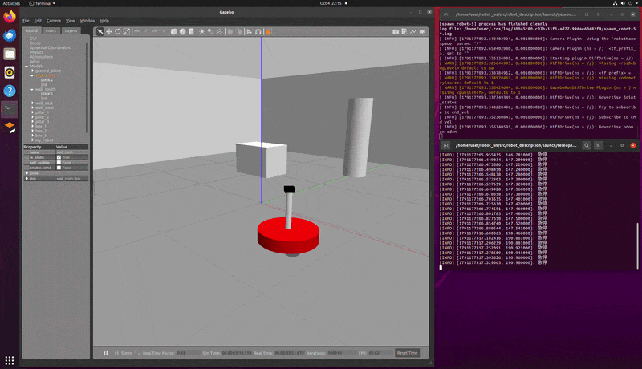

# 第4章 机器人仿真

## mbot 小车 Gazebo 仿真

第四章 mbot 小车 Gazebo 仿真环境：差分驱动底盘的启动与键盘遥控演示。



## 工作空间挂载与编译

上面的 mbot 差分驱动仿真由 `src/chap4/` 下的 3 个功能包提供，需要先挂载到 catkin
工作空间并编译：

| 功能包 | 作用 |
| ------ | ---- |
| `mbot_description` | mbot 的 URDF/xacro 模型（差分驱动底盘 + 各传感器扩展） |
| `mbot_gazebo` | Gazebo 仿真环境与 launch 文件（world + 模型加载） |
| `mbot_teleop` | 键盘遥控节点（发布 `/cmd_vel`） |

### 1. 克隆仓库并切换分支

```bash
git clone https://github.com/OpenHUTB/ros2.git ~/ros2
cd ~/ros2
git checkout feat/chap4-gazebo-sim   # 本章代码所在分支（若已合并主分支可跳过）
```

### 2. 创建 catkin 工作空间并软链接功能包

```bash
mkdir -p ~/catkin_ws/src

ln -s ~/ros2/src/chap4/mbot_description ~/catkin_ws/src/mbot_description
ln -s ~/ros2/src/chap4/mbot_gazebo     ~/catkin_ws/src/mbot_gazebo
ln -s ~/ros2/src/chap4/mbot_teleop     ~/catkin_ws/src/mbot_teleop
```

> 若不想用软链接，也可 `cp -r` 复制到 `~/catkin_ws/src/`。

### 3. 编译并加载环境

```bash
cd ~/catkin_ws
catkin_make
source devel/setup.bash
```

> 前置依赖：ROS1 桌面完整版（Noetic 或 Melodic）、`gazebo_ros_pkgs`、`xacro`、
> `joint_state_publisher`、`robot_state_publisher` 等。

### 4. 验证包已就绪

```bash
rospack find mbot_description mbot_gazebo mbot_teleop
```

---

## 动图效果完整复现指南

以下是 `demo_chap4.gif` 的闭环复现步骤：先启动差分驱动小车，再用键盘遥控驱动它运动。

### 步骤 1（底盘物理环境）：启动 Gazebo 差分驱动小车

```bash
source ~/catkin_ws/devel/setup.bash
roslaunch mbot_gazebo view_mbot_gazebo_empty_world.launch
```

Gazebo 中会出现一辆两轮差分驱动 mbot 小车（后置万向轮）。如需带场景的世界，可改用：

```bash
roslaunch mbot_gazebo view_mbot_gazebo_play_ground.launch   # 带障碍物的操场
roslaunch mbot_gazebo view_mbot_gazebo_room.launch          # 室内房间
```

### 步骤 2（键盘遥控）：启动 teleop 键盘遥控节点

```bash
source ~/catkin_ws/devel/setup.bash
roslaunch mbot_teleop mbot_teleop.launch
```

该节点读取键盘按键，发布 `geometry_msgs/Twist` 到 `/cmd_vel`，驱动差速底盘运动。

### 步骤 3（遥控交互）：键位映射

在键盘遥控终端窗口按下对应按键（无需回车）：

| 按键 | 动作 |
| ---- | ---- |
| `i` | 前进 |
| `,` | 后退 |
| `j` | 原地左转 |
| `l` | 原地右转 |
| `u` | 前进 + 左转 |
| `o` | 前进 + 右转 |
| `m` | 后退 + 右转 |
| `.` | 后退 + 左转 |
| `k` 或 空格 | 立即停止（急停） |
| `q` / `z` | 最大速度提高 / 降低 10% |
| `w` / `x` | 线速度提高 / 降低 10% |
| `e` / `c` | 角速度提高 / 降低 10% |

> 焦点需停留在键盘遥控终端窗口内；松开方向键后默认平滑减速，`k`/空格键为强制停止。

### 步骤 4（预期现象）

- 按 `i`：小车在 Gazebo 中向前直线行驶，与动图中的前进画面一致。
- 按 `j` / `l`：小车原地左转 / 右转，与动图中的转向画面一致。
- 按 `k` 或空格：小车立即刹车停下。
- 组合键 `u` / `o` / `m` / `.`：小车走出弧线轨迹，与动图中的曲线运动一致。

如需查看底层数据流，可另开终端：

```bash
rostopic echo /cmd_vel   # 键盘遥控发出的速度指令
rostopic echo /odom      # 里程计输出
```

---

## Gazebo 移动机器人平台搭建与首次仿真

本章介绍如何在 Gazebo Classic 11 中搭建一个可运行的 ROS 移动机器人平台，并完成从模型、传感器到运动控制的首次仿真。

本章配套完整功能包：

```text
src/chap4/mybot_gazebo/
```

教程内容：

- 检查 Ubuntu、ROS Noetic、Gazebo 和插件依赖；
- 创建 Catkin 工作空间并编译 `mybot_gazebo`；
- 使用 URDF/xacro 建立两轮差速机器人；
- 配置差速驱动、里程计、激光雷达和 RGB 相机；
- 编写 world 和 launch 文件；
- 启动 Gazebo 并检查话题、TF 和传感器；
- 使用手动速度命令和自动正方形轨迹验证机器人；
- 调整参数、排查故障，并扩展到 SLAM 和导航。

[进入 Gazebo 机器人平台搭建与首次仿真](chap4/gazebo_platform_simulation.md)
