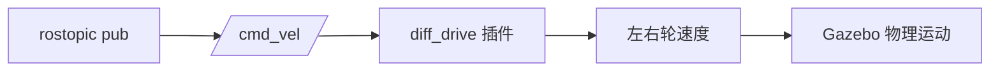

# 步骤 8：手动速度控制

> 前置条件：完成[步骤 7](gazebo_07_first_simulation.md)。
> 本步目标：用命令行直接发布 `/cmd_vel`，验证前进、旋转、停车和方向。
> 预计时间：20-30 分钟。

- [1. 理解 cmd_vel](#cmd-vel)
- [2. 前进控制](#forward)
- [3. 旋转控制](#rotate)
- [4. 组合运动](#combined)
- [5. 方向诊断](#direction)
- [6. 本步验收](#acceptance)

## 1. 理解 cmd_vel <span id="cmd-vel"></span>

`geometry_msgs/Twist` 包含线速度和角速度：

```yaml
linear:
  x: 0.3
  y: 0.0
  z: 0.0
angular:
  x: 0.0
  y: 0.0
  z: 0.6
```

对于平面移动机器人，一般只使用：

- `linear.x`：前后速度，正值为前进；
- `angular.z`：航向角速度，正值为左转。



## 2. 前进控制 <span id="forward"></span>

```bash
rostopic pub -r 10 /cmd_vel geometry_msgs/Twist \
  "{linear: {x: 0.3, y: 0.0, z: 0.0}, angular: {x: 0.0, y: 0.0, z: 0.0}}"
```

预期：

- 左右轮同速向前；
- 机器人向前运动；
- `/odom` 中 `linear.x` 接近 0.3；
- `odom -> base_link` 的位置向前变化。

按 `Ctrl+C` 停止发布后，机器人应减速停止。

## 3. 旋转控制 <span id="rotate"></span>

正向角速度：

```bash
rostopic pub -r 10 /cmd_vel geometry_msgs/Twist \
  "{linear: {x: 0.0, y: 0.0, z: 0.0}, angular: {x: 0.0, y: 0.0, z: 0.6}}"
```

预期：

- 机器人原地逆时针旋转；
- 左轮向后或减速，右轮向前或加速；
- `/odom` 的朝向角变化；
- TF 中机器人朝向发生变化。

负角速度：

```bash
rostopic pub -r 10 /cmd_vel geometry_msgs/Twist \
  "{linear: {x: 0.0, y: 0.0, z: 0.0}, angular: {x: 0.0, y: 0.0, z: -0.6}}"
```

机器人应顺时针旋转。

## 4. 组合运动 <span id="combined"></span>

边前进边左转：

```bash
rostopic pub -r 10 /cmd_vel geometry_msgs/Twist \
  "{linear: {x: 0.25, y: 0.0, z: 0.0}, angular: {x: 0.0, y: 0.0, z: 0.5}}"
```

组合运动理论半径为：

\[
R = \frac{v}{\omega}
\]

本命令对应约 0.5 m 的转弯半径。

停止：

```bash
rostopic pub -1 /cmd_vel geometry_msgs/Twist \
  "{linear: {x: 0.0, y: 0.0, z: 0.0}, angular: {x: 0.0, y: 0.0, z: 0.0}}"
```

## 5. 方向诊断 <span id="direction"></span>

| 现象 | 可能原因 | 处理 |
| --- | --- | --- |
| 前进变后退 | 左右轮轴向反 | 检查车轮 `axis` 和轮子朝向 |
| 左转变右转 | 左右轮关节互换 | 交换 `leftJoint` 和 `rightJoint` |
| 原地打滑 | 摩擦力不足或力矩过高 | 调整摩擦参数和力矩 |
| 速度明显不符 | 轮径与插件不一致 | 统一 `wheel_diameter` 和模型 |
| 停止很慢 | 加速度限制较大 | 降低 `wheelAcceleration` |

不要通过修改控制系数来掩盖模型方向错误。模型方向和插件参数正确后，控制节点才有意义。

## 6. 本步验收 <span id="acceptance"></span>

- [ ] 正向线速度让机器人前进；
- [ ] 正向角速度让机器人逆时针旋转；
- [ ] 负角速度让机器人顺时针旋转；
- [ ] 组合速度形成圆弧轨迹；
- [ ] `Ctrl+C` 后机器人能够停止；
- [ ] 能根据现象判断是模型、插件还是控制问题。

---

- 上一步：[首次启动与验证](gazebo_07_first_simulation.md)
- 返回[教程总览](gazebo_platform_simulation.md)
- 下一步：[步骤 9：自动轨迹控制](gazebo_09_auto_motion.md)
