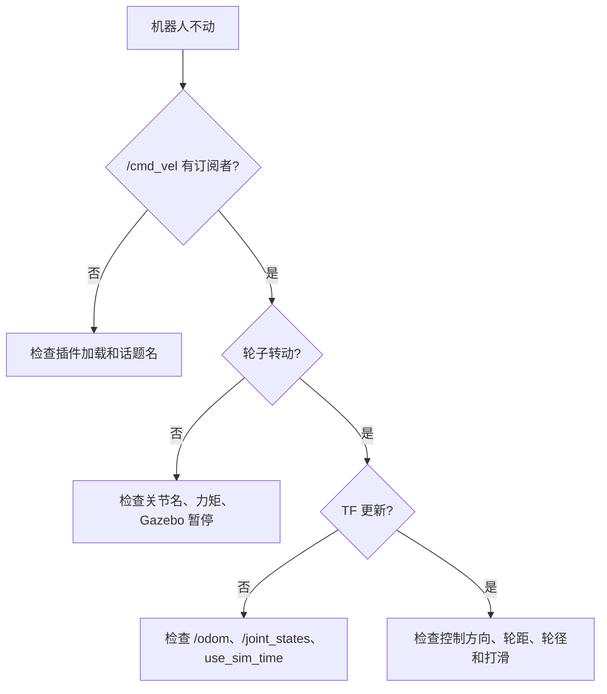

# 步骤 10：参数调整与故障排查

> 前置条件：完成[步骤 9](gazebo_09_auto_motion.md)。
> 本步目标：能够修改机器人参数，并按模块定位常见仿真故障。
> 预计时间：60-90 分钟。

- [1. 模型参数调整](#model-params)
- [2. 传感器负载调整](#sensor-params)
- [3. 控制参数调整](#control-params)
- [4. 故障定位流程](#workflow)
- [5. 故障表](#table)
- [6. 本步验收](#acceptance)

## 1. 模型参数调整 <span id="model-params"></span>

在 `mybot.urdf.xacro` 中修改：

| 参数 | 修改后需要同步检查 |
| --- | --- |
| `base_length` | 相机位置、碰撞体 |
| `base_width` | 车体碰撞和差速插件 |
| `base_height` | 支撑轮高度、生成高度 |
| `wheel_radius` | 插件轮径、初始 z、支撑轮 |
| `wheel_separation` | 插件轮距、左右轮关节 origin |
| `wheel_offset_z` | 车轮是否触地 |

修改后应重新执行：

```bash
xacro src/mybot_gazebo/urdf/mybot.urdf.xacro > /tmp/mybot.urdf
check_urdf /tmp/mybot.urdf
roslaunch mybot_gazebo mybot_gazebo.launch
```

## 2. 传感器负载调整 <span id="sensor-params"></span>

| 传感器 | 高质量设置 | 低负载设置 | 影响 |
| --- | --- | --- | --- |
| 激光 | 720 点 / 20 Hz | 180 点 / 5 Hz | 扫描精细度与 CPU |
| 相机 | 1280 x 720 / 60 Hz | 320 x 240 / 15 Hz | 图像质量与 GPU/CPU |
| 相机视场 | 大 FOV | 小 FOV | 画面覆盖范围 |

查看 Gazebo 实时因子：

```bash
gz stats
```

也可以直接观察 Gazebo 窗口左下角显示的 Real Time Factor。

查看 ROS 话题消息频率：

```bash
rostopic hz /scan
rostopic hz /camera/image_raw
```

`rostopic hz` 只表示消息发布频率，不等于 Gazebo 实时因子。

如果 Gazebo 卡顿，先降低传感器负载，再检查物理步长。

## 3. 控制参数调整 <span id="control-params"></span>

| 参数 | 增大后的效果 | 风险 |
| --- | --- | --- |
| `linear_speed` | 运动更快 | 打滑、轨迹误差大 |
| `angular_speed` | 转向更快 | 转弯过头、模型抖动 |
| `wheelTorque` | 加速更强 | 抖动、能耗高 |
| `wheelAcceleration` | 响应更猛 | 起步冲击 |
| 控制发布频率 | 更平滑 | 计算开销增加 |

建议先用低速度确认方向，再逐步提高速度。

## 4. 故障定位流程 <span id="workflow"></span>



如果一个话题不存在，先检查发布者，而不是立即改订阅者。

## 5. 故障表 <span id="table"></span>

| 现象 | 第一层 | 第二层 | 第三层 |
| --- | --- | --- | --- |
| Gazebo 无模型 | xacro 是否展开 | spawn_model 日志 | 模型名和参数 |
| 模型下沉 | 生成高度 | 碰撞体尺寸 | 质量和惯性 |
| 机器人抖动 | 碰撞体复杂度 | 质量 | 控制器力矩 |
| `/cmd_vel` 无人订阅 | `rostopic info` | 插件库 | 话题命名空间 |
| 机器人不动 | Gazebo 暂停 | 关节名 | 力矩和方向 |
| `/odom` 不动 | 轮子是否转 | 插件配置 | 轮径和轮距 |
| TF 断裂 | 节点列表 | `/joint_states` | `use_sim_time` |
| 激光无数据 | `/scan` 话题 | frame_name | 量程和方向 |
| 相机无图像 | 话题 | 插件 | 场景光照和朝向 |
| rviz 显示错误 | TF 树 | Fixed Frame | Gazebo 与 rviz 的数据类型区别 |

## 6. 本步验收 <span id="acceptance"></span>

- [ ] 能修改一个模型尺寸并重新生成成功；
- [ ] 能解释各传感器负载变化的影响；
- [ ] 能按话题、TF、插件、模型顺序排查故障；
- [ ] 能写出一次故障的“现象、证据、原因、修复”；
- [ ] 能把调整后的参数重新验证通过。

---

- 上一步：[自动轨迹控制](gazebo_09_auto_motion.md)
- 返回[教程总览](gazebo_platform_simulation.md)
- 下一步：[步骤 11：扩展任务与总结](gazebo_11_extension_summary.md)
