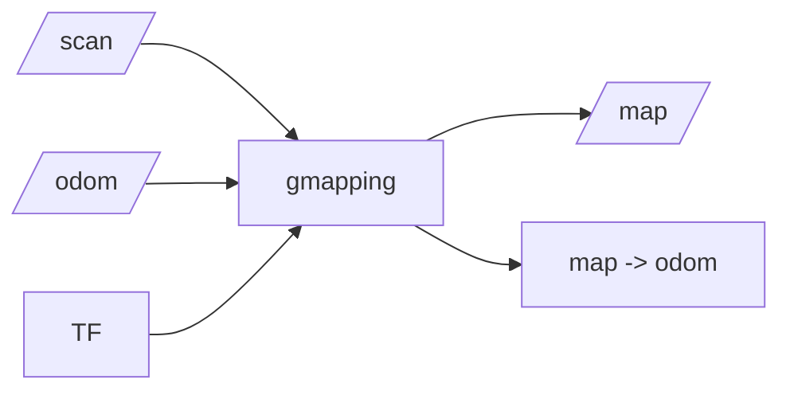
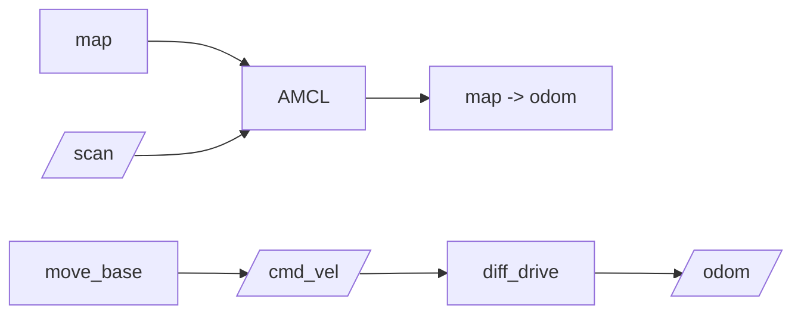

# 步骤 11：扩展任务与总结

> 前置条件：完成[步骤 10](gazebo_10_tuning_debug.md)。
> 本步目标：把移动机器人平台扩展到感知、建图、导航和综合实验。
> 预计时间：按扩展任务选择。

- [1. 已完成的能力](#completed)
- [2. 扩展任务清单](#extensions)
- [3. rosbag 复现](#rosbag)
- [4. 接入 SLAM](#slam)
- [5. 接入自主导航](#navigation)
- [6. 总结](#summary)
- [7. 参考文献](#references)

## 1. 已完成的能力 <span id="completed"></span>

完成前 10 步后，你已经拥有：

- 一个可参数化的两轮差速移动机器人；
- 一个可重复启动的 Gazebo 世界；
- 差速驱动、里程计和 TF 数据链；
- 激光雷达和 RGB 相机；
- 命令行和自动轨迹控制能力；
- 一套基于话题、TF、日志和物理现象的调试方法。

## 2. 扩展任务清单 <span id="extensions"></span>

| 扩展 | 新增加的内容 | 学习目标 |
| --- | --- | --- |
| IMU | `imu_link` 与 IMU 插件 | 多传感器融合 |
| 键盘控制 | `teleop_twist_keyboard` | 手动调试运动 |
| 障碍物 | 墙、箱子、柱体 | 测试激光和避障 |
| 深度相机 | depth camera 插件 | 三维视觉 |
| 状态可视化 | rviz 配置 | TF、激光和轨迹显示 |
| rosbag | 录制与回放 | 故障复现 |
| SLAM | gmapping / Cartographer | 构建地图 |
| 导航 | AMCL / move_base | 路径规划和避障 |
| 多机器人 | 命名空间与多模型 | 系统扩展 |

## 3. rosbag 复现 <span id="rosbag"></span>

录制核心话题：

```bash
rosbag record -O mybot_test.bag /cmd_vel /odom /joint_states /scan /tf /tf_static
```

查看 bag：

```bash
rosbag info mybot_test.bag
```

回放：

```bash
rosparam set use_sim_time true
rosbag play --clock mybot_test.bag
```

回放调试的价值：

- 不依赖 Gazebo 实时运行；
- 可以反复重现同一个问题；
- 能对控制、TF 和传感器对齐关系进行复盘。

## 4. 接入 SLAM <span id="slam"></span>

前提：

- `/scan` 频率稳定；
- `odom -> base_link` 正常；
- 激光 `frame_id` 与 TF 一致；
- 场景有足够结构特征。

建图数据流：



建图步骤：

```bash
roslaunch mybot_gazebo mybot_gazebo.launch
rosrun gmapping slam_gmapping scan:=/scan
rosrun teleop_twist_keyboard teleop_twist_keyboard.py
```

保存地图：

```bash
rosrun map_server map_saver -f ~/mybot_map
```

## 5. 接入自主导航 <span id="navigation"></span>

导航依赖：

- 已保存地图；
- AMCL 定位；
- 全局和局部代价地图；
- `/cmd_vel` 控制链接；
- 完整 TF 链。



建议顺序：

1. 先加载地图并确认 AMCL 定位；
2. 再在 rviz 中手动指定小目标；
3. 调整代价地图和机器人 footprint；
4. 最后使用程序发送多个航点。

## 6. 总结 <span id="summary"></span>

本教程不是一次跑完的命令集合，而是一条从模型到传感器的构建链：

```text
环境 -> 功能包 -> URDF -> 差速插件 -> 传感器插件 -> world/launch -> 首次运行 -> 手动控制 -> 自动控制 -> 调试和扩展
```

每一步都留下一个可验证的结果，最终才形成完整仿真平台。

继续学习时，建议始终遵守以下原则：

1. 先确认模型和 TF，再调试算法；
2. 先检查话题和频率，再修改控制器；
3. 先保存 rosbag，再反复改参数；
4. 先跑小场景，再扩大地图和传感器范围；
5. 先量化成功率，再追求轨迹美观。

## 7. 参考文献 <span id="references"></span>

- ROS Wiki：URDF、TF、rqt 和 rosbag
- Gazebo Classic 文档：SDF、物理引擎、传感器
- ROS Noetic `gazebo_ros`：差速驱动、激光和相机插件
- OpenHUTB/ros2 仓库：catkin 功能包与实验文档组织方式

---

- 上一步：[参数调整与故障排查](gazebo_10_tuning_debug.md)
- 返回[教程总览](gazebo_platform_simulation.md)
- 返回[第 4 章机器人仿真](../chap4.md)
