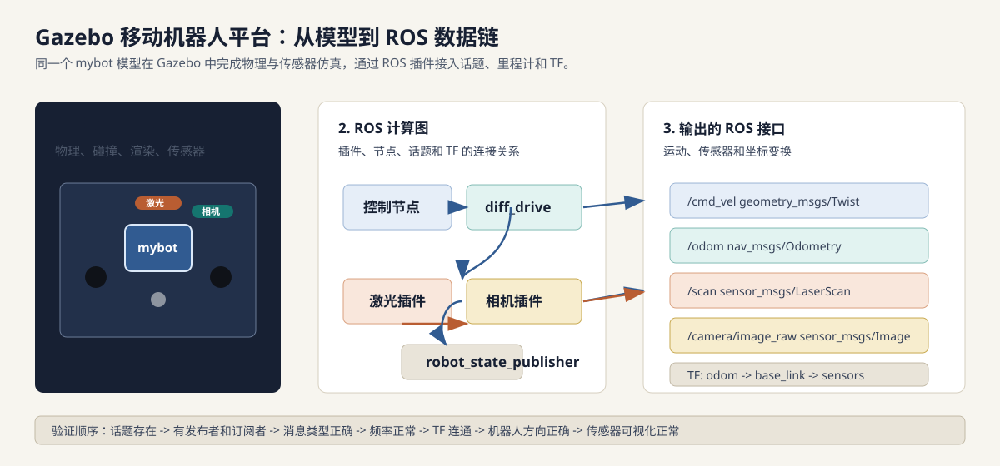
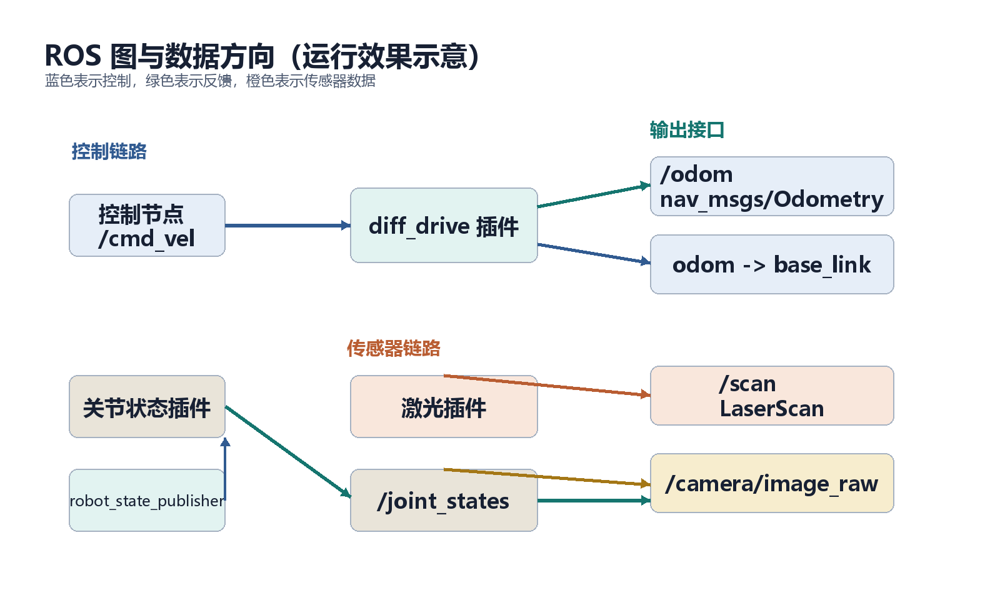
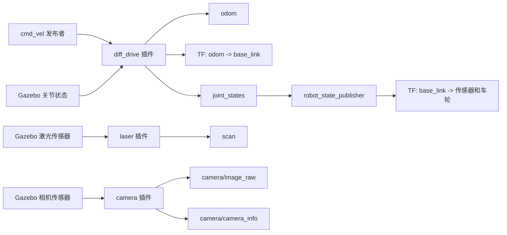
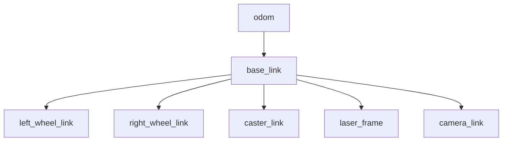
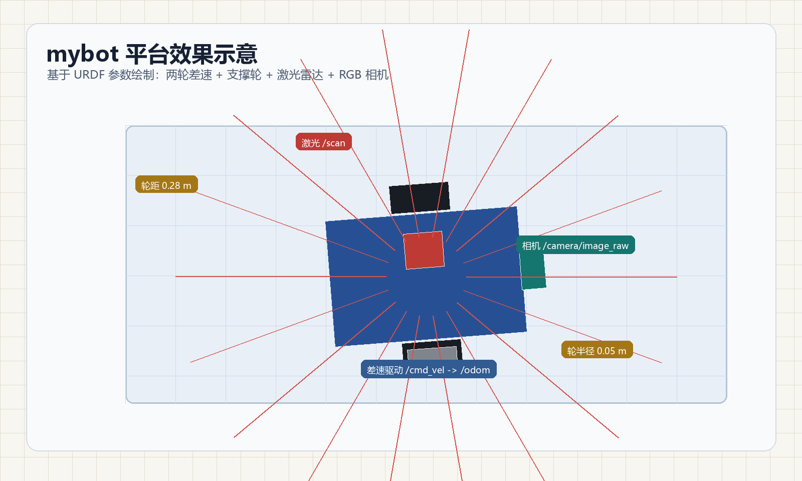
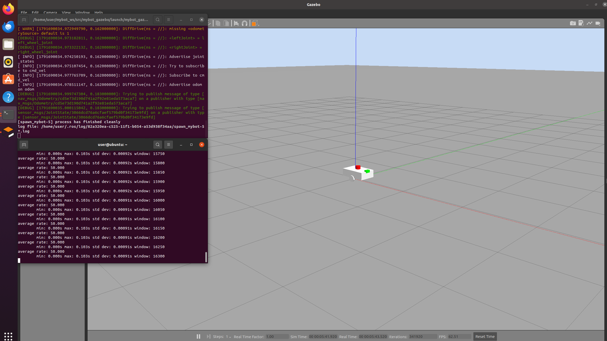

# Gazebo 机器人平台搭建与首次仿真

本实验从零搭建一个可以在 Gazebo 中运行的 ROS 移动机器人平台。机器人名为 `mybot`，采用两轮差速结构，搭载 2D 激光雷达和 RGB 相机，能够接收 `/cmd_vel` 速度指令、发布 `/odom` 里程计、输出 `/scan` 激光数据和 `/camera/image_raw` 相机图像，并形成完整的 ROS TF 坐标树。

- [1. 要解决的问题](#problem)
- [2. 系统总览与方法](#method)
- [3. 节点图与数据流解析](#graph)
- [4. 运行效果与验收现象](#results)
- [5. 快速开始](#quickstart)
- [6. 分步教程](#steps)
- [7. 设计参数与验收指标](#metrics)
- [8. 常见问题总览](#debug)
- [9. 参考文献与说明](#references)

> 完整功能包在 [`src/chap4/mybot_gazebo/`](https://github.com/OpenHUTB/ros2/tree/master/src/chap4/mybot_gazebo)，
> 包含 URDF、Gazebo 插件、世界文件、launch 文件和最小运动控制脚本。
> 本页负责路线总览；逐步操作请从第 6 节进入对应的子页面。



## 1. 要解决的问题 <span id="problem"></span>

直接在真实机器人上学习 ROS 仿真会遇到三个问题：

1. 硬件、驱动、通信和算法故障混在一起，很难判断问题来自哪一层；
2. 模型、传感器安装位置、坐标系和控制器参数一旦写错，真实机器人可能损坏；
3. 没有固定世界和可回放数据，同一个问题很难重复出现。

Gazebo 的价值不是“画一个好看的机器人”，而是提供一个可重复的物理世界，让机器人模型、传感器、ROS 话题和坐标变换在进入真实平台前先跑通。

本实验要解决的问题是：

- 怎样从 URDF/xacro 开始搭建机器人平台；
- 怎样让 Gazebo 中的机器人真正接收 ROS 速度命令；
- 怎样让激光、相机和里程计变成 ROS 话题；
- 怎样确认 TF 树、话题类型、数据频率和物理运动方向都正确；
- 怎样在出错时快速定位是模型、插件、launch、TF 还是控制节点的问题。

## 2. 系统总览与方法 <span id="method"></span>

本实验采用“模型 -> 插件 -> 世界 -> 控制 -> 验证”的构建顺序。每一步只增加一种能力，读者可以单独验证，不需要等到最后才发现问题。

| 层次 | 文件或模块 | 作用 | 产生的结果 |
|---|---|---|---|
| 机器人模型 | `urdf/mybot.urdf.xacro` | 描述车体、车轮、激光、相机和关节 | 可检查的 URDF 模型 |
| Gazebo 驱动 | `libgazebo_ros_diff_drive.so` | 把速度命令转换为左右轮运动 | `/cmd_vel`、`/odom`、里程计 TF |
| 关节状态 | 差速插件的 `publishWheelJointState` | 发布车轮关节状态 | `/joint_states` |
| 激光传感器 | `libgazebo_ros_laser.so` | 把射线扫描转换为激光消息 | `/scan` |
| 相机传感器 | `libgazebo_ros_camera.so` | 输出 RGB 图像和相机参数 | `/camera/image_raw`、`/camera/camera_info` |
| 仿真世界 | `worlds/mybot_empty.world` | 提供地面、光照和物理参数 | 可重复的仿真环境 |
| 启动组织 | `launch/mybot_gazebo.launch` | 一条命令启动世界、模型和 TF | 完整仿真系统 |
| 运动示例 | `scripts/move_square.py` | 按时间控制机器人走正方形 | 首次运动验证 |

本实验不会一开始就加入机械臂、深度相机、SLAM 和导航。先把移动平台和最小传感器链跑通，后续实验才有稳定的基础。

## 3. 节点图与数据流解析 <span id="graph"></span>

### 3.1 ROS 节点图

启动仿真后，ROS 图可以抽象为下面的结构。Gazebo 插件虽然不是普通 Python/C++ 节点，但在 ROS 名称系统里同样会提供发布者和订阅者，因此可以用 `rqt_graph` 观察。





节点图里最重要的是方向，而不是节点数量：

- 控制方向：控制节点或 `rostopic pub` 发布 `/cmd_vel`，差速插件订阅；
- 反馈方向：差速插件发布 `/odom`，导航、建图和控制节点订阅；
- 传感器方向：Gazebo 插件发布 `/scan` 和相机话题，感知节点订阅；
- TF 方向：差速插件发布里程计 TF，`robot_state_publisher` 发布机器人内部 TF。

### 3.2 话题与插件对照表

| 名称 | 类型 | 发布者 | 订阅者 | 本实验用途 |
|---|---|---|---|---|
| `/cmd_vel` | `geometry_msgs/Twist` | 控制节点或命令行 | 差速插件 | 控制前进、后退和旋转 |
| `/odom` | `nav_msgs/Odometry` | 差速插件 | 控制、导航、可视化 | 估计机器人位姿和速度 |
| `/joint_states` | `sensor_msgs/JointState` | 差速插件 | `robot_state_publisher` | 更新车轮等关节 TF |
| `/scan` | `sensor_msgs/LaserScan` | 激光插件 | 建图、避障、rviz | 感知二维障碍 |
| `/camera/image_raw` | `sensor_msgs/Image` | 相机插件 | 视觉节点、`rqt_image_view` | 获取仿真图像 |
| `/camera/camera_info` | `sensor_msgs/CameraInfo` | 相机插件 | 视觉节点 | 获取相机内参 |
| `/tf` | `tf2_msgs/TFMessage` | 差速插件、`robot_state_publisher` | TF 监听者 | 维护动态坐标变换 |
| `/tf_static` | `tf2_msgs/TFMessage` | `robot_state_publisher` | TF 监听者 | 发布固定安装关系 |

### 3.3 TF 坐标树

机器人能否导航，关键不在“有没有激光数据”，而在“激光数据位于哪个坐标系”。本实验的 TF 树应为：



三个关键判断：

1. `odom -> base_link` 是否随时间变化，表示机器人是否被正确定位；
2. `base_link -> laser_frame` 是否固定且与建模安装位置一致；
3. `base_link -> camera_link` 是否固定且相机朝向正确。

对应检查命令：

```bash
rosrun rqt_graph rqt_graph
rosrun rqt_tf_tree rqt_tf_tree
rostopic info /cmd_vel
rostopic info /odom
rostopic info /scan
rosrun tf tf_echo odom base_link
rosrun tf tf_echo base_link laser_frame
```

### 3.4 一次控制指令的完整传播链

以“让机器人向前移动”为例，一次控制不是只发布一条消息，而是经过以下完整链路：

1. 控制节点构造 `geometry_msgs/Twist`，设置 `linear.x`；
2. 消息发布到 `/cmd_vel`；
3. Gazebo 差速插件订阅 `/cmd_vel`；
4. 插件根据轮距、轮径和最大力矩计算左右轮目标速度；
5. Gazebo 驱动物理关节，机器人开始运动；
6. 插件根据轮子运动计算 `/odom`；
7. 插件发布 `odom -> base_link`；
8. 差速插件通过 `publishWheelJointState` 发布 `/joint_states`；
9. `robot_state_publisher` 更新车轮和传感器 TF；
10. rviz 或导航节点通过 TF 和话题看到结果。

如果机器人不动，不要直接修改控制算法。应按“话题是否存在 -> 是否有发布者 -> 插件是否订阅 -> 关节名是否一致 -> 轮子是否转动 -> TF 是否更新”的顺序排查。

## 4. 运行效果与验收现象 <span id="results"></span>

### 4.1 Gazebo 中的预期现象

启动 `mybot_gazebo.launch` 后，应当看到：

- 蓝色车体位于地面附近，不会持续下沉或自动翻倒；
- 左右黑色驱动轮和后部灰色支撑轮与地面接触；
- 红色激光雷达和绿色相机固定在车体上；
- 发布 `/cmd_vel` 后机器人能够前进和旋转；
- `rqt_image_view` 可以显示相机画面；
- rviz 中可以显示 TF、激光和里程计数据。

### 4.2 话题与频率验收

| 话题 | 预期频率 | 验证命令 | 成功现象 |
|---|---:|---|---|
| `/odom` | 约 50 Hz | `rostopic hz /odom` | 位置随时间变化 |
| `/joint_states` | 约 50 Hz | `rostopic hz /joint_states` | 车轮关节状态更新 |
| `/scan` | 约 10 Hz | `rostopic hz /scan` | 有 360 个范围数据 |
| `/camera/image_raw` | 约 30 Hz | `rostopic hz /camera/image_raw` | 图像持续发布 |
| `/tf` | 不低于 30 Hz | `rostopic hz /tf` | 包含 `odom -> base_link` |

频率是设计目标。实际结果会受到电脑性能、Gazebo 实时因子和传感器分辨率影响。

### 4.3 效果示意

下面图片根据 `mybot.urdf.xacro` 的尺寸、Gazebo 插件和话题设计绘制，用于在运行前说明正确效果。它们是“效果示意”，不是真实 Gazebo 截图；维护者完成运行验证后，可以替换为实际环境截图。




### 4.4 真实运行截图

下面图片来自 Ubuntu 20.04 + ROS Noetic + Gazebo Classic 11 虚拟机的实际运行结果。Gazebo 中已经生成 `mybot`，右侧终端执行 `rostopic hz /odom`，平均频率稳定在 50 Hz，说明差速插件和里程计链路已经工作。



用 `rqt_graph` 观察运行中的节点和话题关系：


## 5. 快速开始 <span id="quickstart"></span>

已熟悉 catkin 工作空间的读者可以直接执行：

```bash
source /opt/ros/noetic/setup.bash
mkdir -p ~/catkin_ws/src
cp -r src/chap4/mybot_gazebo ~/catkin_ws/src/   # 在仓库根目录执行
cd ~/catkin_ws
catkin_make
source devel/setup.bash

xacro src/mybot_gazebo/urdf/mybot.urdf.xacro > /tmp/mybot.urdf
check_urdf /tmp/mybot.urdf

roslaunch mybot_gazebo mybot_gazebo.launch
```

也可以使用包内统一入口：

```bash
cd ~/catkin_ws/src/mybot_gazebo
./main.sh
```

另开终端运行：

```bash
source ~/catkin_ws/devel/setup.bash
rosrun mybot_gazebo move_square.py
```

第一次运行建议不要直接执行自动控制节点，先按分步教程逐个确认话题、TF 和手动速度控制。

## 6. 分步教程 <span id="steps"></span>

每一步都是独立页面，完成后再进入下一步。

| 步骤 | 内容 | 完成后应得到 |
|---|---|---|
| [1. 环境检查与 Gazebo 验证](gazebo_01_environment.md) | Ubuntu、ROS Noetic、Gazebo 11 和依赖检查 | 可以独立启动 Gazebo |
| [2. 工作空间与功能包](gazebo_02_package.md) | 创建 catkin 工作空间并编译 `mybot_gazebo` | `rospack find` 能找到功能包 |
| [3. URDF 与 xacro 建模](gazebo_03_urdf_model.md) | 车体、车轮、支撑轮、激光、相机和惯性 | `check_urdf` 通过 |
| [4. 差速驱动与里程计](gazebo_04_diff_drive.md) | 配置差速插件和车轮关节状态输出 | `/cmd_vel`、`/odom`、`odom -> base_link` 正常 |
| [5. 激光与相机插件](gazebo_05_sensor_plugins.md) | 配置激光和 RGB 相机 | `/scan` 与相机话题正常 |
| [6. 世界文件与 launch](gazebo_06_world_launch.md) | 组装世界、模型生成、TF 和启动参数 | 一条 launch 命令启动系统 |
| [7. 首次启动与验证](gazebo_07_first_simulation.md) | 启动 Gazebo、检查话题、TF 和传感器 | 模型稳定、话题完整、TF 连通 |
| [8. 手动速度控制](gazebo_08_manual_control.md) | 命令行发布 `/cmd_vel` | 前进、旋转、停车方向正确 |
| [9. 自动轨迹控制](gazebo_09_auto_motion.md) | 运行正方形轨迹节点 | 机器人完成近似正方形运动 |
| [10. 参数调整与故障排查](gazebo_10_tuning_debug.md) | 尺寸、速度、传感器负载和故障表 | 能独立修改参数并定位问题 |
| [11. 扩展任务与总结](gazebo_11_extension_summary.md) | IMU、障碍、rosbag、SLAM 和导航 | 能规划后续实验 |

## 7. 设计参数与验收指标 <span id="metrics"></span>

本实验的设计参数如下，参数修改后需要同步检查 URDF、Gazebo 插件和控制脚本。

| 项目 | 数值 | 说明 |
|---|---:|---|
| 车体尺寸 | 0.42 m x 0.28 m x 0.12 m | 由 `base_length` 等参数控制 |
| 轮半径 | 0.05 m | 影响速度换算和初始高度 |
| 轮距 | 0.28 m | 影响旋转和里程计 |
| 最大车轮力矩 | 20 N·m | 过低会带不动模型，过高容易抖动 |
| 里程计频率 | 50 Hz | 差速插件输出 |
| 激光点数 | 360 | 输出 `/scan` |
| 激光量程 | 0.10-10.0 m | 影响建图范围 |
| 相机分辨率 | 640 x 480 | 降低分辨率可提升实时因子 |
| 相机帧率 | 30 Hz | 可由插件参数调整 |

本实验的验收条件：

1. `check_urdf` 通过，模型在 Gazebo 中稳定站立；
2. `/cmd_vel`、`/odom`、`/scan`、相机和 `/joint_states` 话题存在；
3. `odom -> base_link -> laser_frame` 和 `camera_link` TF 连通；
4. 发布非零速度后机器人按预期方向运动；
5. 能说出一次速度命令从 ROS 话题到 Gazebo 物理运动的完整路径。

## 8. 常见问题总览 <span id="debug"></span>

| 现象 | 第一层检查 | 第二层检查 |
|---|---|---|
| Gazebo 中没有模型 | `spawn_model` 日志、xacro 展开 | `robot_description` 参数、模型名称 |
| 模型下沉或抖动 | 初始 z、碰撞体尺寸 | 质量、惯性、支撑轮高度 |
| `/cmd_vel` 无订阅者 | `rostopic info /cmd_vel` | 差速插件是否加载、关节名是否匹配 |
| 机器人不动 | Gazebo 是否暂停 | 轮子关节方向、最大力矩、控制频率 |
| `odom -> base_link` 缺失 | `/odom` 是否发布 | 插件 TF 开关、`use_sim_time` |
| 没有 `/scan` | 激光插件是否加载 | `frame_name`、TF 树和激光量程 |
| 相机没有图像 | 话题是否存在 | 相机插件、分辨率、渲染和 `/camera_info` |
| rviz 与 Gazebo 不一致 | TF 是否完整 | Gazebo 是物理模型，rviz 主要是 TF 和消息可视化 |

详细排查过程见[步骤 10](gazebo_10_tuning_debug.md)。

## 9. 参考文献与说明 <span id="references"></span>

参考内容：

- ROS Wiki：URDF、TF、ros_control、Gazebo ROS 插件；
- Gazebo Classic 官方文档：SDF、物理引擎、传感器模型；
- ROS Noetic `gazebo_ros` 包中的 diff drive、laser 和 camera 插件示例；
- 本仓库已有的 catkin 功能包与实验文档组织方式。

## 人工智能使用声明

本文档在整理过程中使用了大型语言模型辅助进行结构梳理、文字组织和示例代码检查。示例代码需要在实际 Ubuntu 20.04 + ROS Noetic + Gazebo Classic 11 环境中运行验证，提交前应完成书中的全部验收步骤。

---

- 返回[第 4 章机器人仿真](../chap4.md)
- 下一步：[环境检查与 Gazebo 验证](gazebo_01_environment.md)
