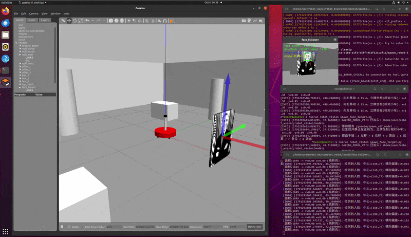
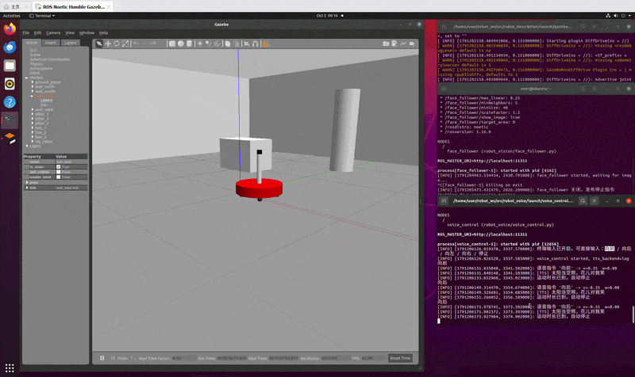

# 第五章：ROS + OpenCV 视觉追踪与语音控制

本章在第四章两轮差速小车（mbot）底盘之上，实现两大部分实验：

1. **视觉追踪**（`robot_vision`）：通过 OpenCV 人脸检测识别顶置 Kinect 相机采集到的图像，
   计算人脸中心偏离图像中心的横向偏差与人脸面积，使用比例控制器（P 控制）发布
   `/cmd_vel` 速度指令，使小车自动转向面朝目标并保持距离跟随。
2. **语音控制**（`robot_voice`）：接收“向前 / 向后 / 向左 / 向右 / 停止”等语音命令，
   发布对应的 `/cmd_vel` 运动指令，并通过语音合成（TTS）播报反馈文本
   （如“太阳当空照，花儿对我笑”）。

> 环境说明：本章为 ROS1（Melodic / Noetic）功能包，依赖 `rospy`、`cv_bridge`、
> `sensor_msgs`、`geometry_msgs`、`std_msgs` 等；语音部分同时兼容**离线无声卡的虚拟机**
> 与**真实讯飞语音 SDK** 接入。

---

## 目录结构

```
src/chap5/
├── robot_vision/                     # 第一部分：视觉识别与控制
│   ├── CMakeLists.txt
│   ├── package.xml
│   ├── launch/
│   │   ├── face_follower.launch      # 人脸追踪（P 控制）启动文件
│   │   ├── spawn_face_target.launch  # 在 Gazebo 中生成人脸立牌目标
│   │   ├── mbot_intelligence.launch  # 一键拉起视觉 + 语音
│   │   ├── face_detector.launch      # 人脸检测（仅画框演示）
│   │   ├── usb_cam.launch            # USB 相机驱动
│   │   └── freenect.launch           # Kinect (freenect) 驱动
│   ├── scripts/
│   │   ├── face_follower.py          # ★ 人脸追踪 + P 控制 + /cmd_vel
│   │   ├── face_detector.py          # 人脸检测（画框发布图像）
│   │   ├── motion_detector.py        # 运动检测
│   │   └── cv_bridge_test.py         # cv_bridge 用法示例
│   ├── data/haar_detectors/          # Haar 级联分类器
│   └── config/                       # rviz 配置
└── robot_voice/                      # 第二部分：语音识别与输出
    ├── CMakeLists.txt
    ├── package.xml
    ├── launch/
    │   └── voice_control.launch      # 语音控制启动文件
    ├── scripts/
    │   └── voice_control.py          # ★ 语音命令 -> /cmd_vel + TTS 反馈
    ├── src/                          # 讯飞 SDK C++ 节点（真实 SDK 接入）
    │   ├── iat_publish.cpp           # 语音识别（发布 voiceWords）
    │   ├── tts_subscribe.cpp         # 语音合成（订阅 voiceWords）
    │   └── voice_assistant.cpp       # 语音助手整合
    ├── include/robot_voice/          # 讯飞 SDK 头文件
    └── libs/                         # 讯飞 SDK 动态库 libmsc.so
```

---

## 第一部分：视觉追踪 `face_follower`

**演示效果**：



### 节点逻辑

1. 订阅相机 RGB 图像（`input_rgb_image`，launch 中重映射为 `/camera/rgb/image_raw`），
   通过 `cv_bridge` 转换为 OpenCV 的 BGR 格式。
2. 灰度化 + 直方图均衡后，使用 Haar 级联分类器
   `haarcascade_frontalface_default.xml` 检测人脸（正面失败时可用侧面分类器兜底）。
3. 计算人脸中心 `(cx, cy)` 与图像中心的**横向偏差**及**人脸面积**。
4. 比例控制：
   - 角速度 `w = kp_angular * err_x`（人脸偏右 → 右转），带死区与限幅（±0.5 rad/s）；
   - 线速度默认关闭（`only_turn=true` 纯原地转向）；设为 `false` 后按
     `v = kp_linear * (target_area - area) / target_area`（面积过小/太远 → 前进）保持距离，
     并叠加防贴脸死区（过近时停止/倒退）。
5. 发布 `geometry_msgs/Twist` 到 `/cmd_vel`，同时弹出 OpenCV 调试窗口，
   标注人脸框、图像中心、人脸中心与偏差/面积/速度等信息。

### 话题接口

| 方向 | 话题 | 类型 | 说明 |
| ---- | ---- | ---- | ---- |
| 订阅 | `input_rgb_image`（→ `/camera/rgb/image_raw`） | `sensor_msgs/Image` | 相机 RGB 图像 |
| 发布 | `/cmd_vel` | `geometry_msgs/Twist` | 差速底盘速度指令 |
| 发布 | `~image_out` | `sensor_msgs/Image` | 标注后的图像 |

### 关键参数（launch 可配）

| 参数 | 默认值 | 说明 |
| ---- | ------ | ---- |
| `kp_angular` | 1.2 | 横向偏差 → 角速度比例系数 |
| `kp_linear` | 0.6 | 面积偏差 → 线速度比例系数 |
| `max_linear` / `max_angular` | 0.25 / 0.5 | 速度限幅 |
| `target_area` | 0（自动） | 目标人脸面积（像素），0 表示取图像面积的 1/16 |
| `dead_zone` | 0.05 | 横向偏差死区（归一化） |
| `only_turn` | true | 纯原地转向模式（线速度恒 0）；`false` 启用距离保持 + 防贴脸死区 |
| `cascade_frontal` | OpenCV 默认 | 正面人脸分类器路径 |

---

## 第二部分：语音控制 `voice_control`

**演示效果**：



### 节点逻辑

1. 通过 `/voice_cmd` 话题（`std_msgs/String`）或**交互式终端**接收命令。
2. 将命令映射为差速底盘速度：`向前/向后 → 线速度`，`向左/向右 → 角速度`，`停止 → 零速`。
3. 发布 `geometry_msgs/Twist` 到 `/cmd_vel`（10Hz 持续发布，`move_duration` 后自动停止）。
4. 收到命令后触发 TTS 反馈，默认播报“太阳当空照，花儿对我笑”。

### 命令映射

| 语音命令 | 等价英文 | 动作 |
| -------- | -------- | ---- |
| 向前 / 前进 | forward | `linear.x = +linear_speed` |
| 向后 / 后退 | backward | `linear.x = -linear_speed` |
| 向左 / 左转 | left | `angular.z = +angular_speed` |
| 向右 / 右转 | right | `angular.z = -angular_speed` |
| 停止 / 停下 / 停 | stop | 全零（立即停车） |

### 话题接口

| 方向 | 话题 | 类型 | 说明 |
| ---- | ---- | ---- | ---- |
| 订阅 | `voice_cmd`（→ `/voice_cmd`） | `std_msgs/String` | 语音命令文本 |
| 发布 | `/cmd_vel` | `geometry_msgs/Twist` | 差速底盘速度指令 |
| 发布 | `~tts_topic`（→ `/voice_tts`） | `std_msgs/String` | 待合成的反馈文本 |

### TTS 兼容策略（`tts_backend` 参数）

| 取值 | 说明 |
| ---- | ---- |
| `log`（默认） | 离线/无声卡环境：日志输出 + 发布到 `~tts_topic` |
| `espeak` / `festival` | Linux 命令行语音合成（需自行安装） |
| `say` | macOS 自带语音合成 |
| `sdk` | 交由讯飞 SDK 节点 `tts_subscribe.cpp` 订阅 `~tts_topic` 播报 |

`voice_control.py` 始终把反馈文本发布到 `~tts_topic`，因此无论使用哪种后端，
都能把文本交给下游真实 SDK 节点（把 `tts_topic` 重映射为 `voiceWords` 即可对接
`tts_subscribe.cpp`）。

---

## 环境准备与工作空间配置

本章的视觉/语音实验依赖第四章的 mbot 仿真底盘，因此需在**同一个 catkin 工作空间**中同时挂载
**第四章的 `mbot_description`、`mbot_gazebo`** 与**本章的 `robot_vision`、`robot_voice`**
共 4 个功能包。缺失 `mbot_gazebo` 会导致 `roslaunch mbot_gazebo ...` 报
`RLException: [xxx] is neither a launch file in package ...`（包名或 launch 文件不存在）。

### 1. 克隆仓库并切换分支

```bash
git clone https://github.com/OpenHUTB/ros2.git ~/ros2
cd ~/ros2
git checkout feat/chap5-vision-voice   # 本章代码所在分支（若已合并主分支可跳过）
```

### 2. 创建 catkin 工作空间并软链接功能包

```bash
mkdir -p ~/catkin_ws/src

# 第四章：mbot 仿真底盘（Gazebo 仿真环境由它提供，缺少则无法启动仿真小车）
ln -s ~/ros2/src/chap4/mbot_description ~/catkin_ws/src/mbot_description
ln -s ~/ros2/src/chap4/mbot_gazebo     ~/catkin_ws/src/mbot_gazebo

# 第五章：视觉追踪 + 语音控制
ln -s ~/ros2/src/chap5/robot_vision    ~/catkin_ws/src/robot_vision
ln -s ~/ros2/src/chap5/robot_voice     ~/catkin_ws/src/robot_voice
```

> 若不想用软链接，也可 `cp -r` 复制到 `~/catkin_ws/src/`。软链接的好处是仓库更新后
> 无需重新拷贝，`catkin_make` 直接编译最新代码。

### 3. 编译并加载环境

```bash
cd ~/catkin_ws
catkin_make
source devel/setup.bash
```

> 前置依赖：ROS1 桌面完整版（Melodic 或 Noetic）、`gazebo_ros_pkgs`、`cv_bridge`/OpenCV、
> `rospkg` 等。若 `robot_voice` 的讯飞 SDK C++ 节点因缺少 `libmsc.so`/`libasound` 编译失败，
> 可关闭可选编译 `catkin_make -DROBOT_VOICE_BUILD_SDK=OFF`（不影响纯 Python 的 `voice_control.py`）。

### 4. 验证包与 launch 文件已就绪

```bash
# 四个包都应能解析出路径（软链接对应 ~/catkin_ws/src/ 下的包目录）
rospack find mbot_description mbot_gazebo robot_vision robot_voice

# 确认本章要用到的 launch 文件真实存在
ls $(rospack find mbot_gazebo)/launch/view_mbot_with_kinect_gazebo.launch
ls $(rospack find robot_vision)/launch/face_follower.launch
ls $(rospack find robot_voice)/launch/voice_control.launch
```

---

## 运行与测试指南（闭环复现）

以下每个终端在运行前都需执行一次 `source ~/catkin_ws/devel/setup.bash`（或已写入 `~/.bashrc`）。

### 终端 1：启动带 Kinect 相机的 Gazebo 仿真小车

```bash
source ~/catkin_ws/devel/setup.bash
roslaunch mbot_gazebo view_mbot_with_kinect_gazebo.launch
```

Gazebo 中会出现带顶置 Kinect 的 mbot 小车。Kinect 的 RGB 图像话题为
**`/kinect/rgb/image_raw`**（由 `mbot_description` 的 `kinect_gazebo.xacro` 以
`prefix="kinect"` 生成，`cameraName` 即话题前缀）。

### 终端 2：生成人脸立牌目标

```bash
source ~/catkin_ws/devel/setup.bash
roslaunch robot_vision spawn_face_target.launch
```

在小车正前方 `x=1.3 y=0.0 z=0.4` 处生成高对比度人脸立牌（标准 Gazebo 模型
`models/face_board/`，脚本会自动加入 `GAZEBO_MODEL_PATH` 并改用 `file://` 绝对路径，
保证纹理 100% 渲染）。键盘可微调立牌位置：

| 按键 | 作用 |
| ---- | ---- |
| `a` / `d` | 左移 / 右移 0.15 m |
| `w` / `s` | 靠近 / 远离小车 0.10 m |
| `r` | 复位到初始正前方 |
| `q` | 退出控制 |

### 终端 3：启动视觉人脸追踪

```bash
source ~/catkin_ws/devel/setup.bash
roslaunch robot_vision face_follower.launch cam_image_topic:=/kinect/rgb/image_raw
```

> 必须显式指定 `cam_image_topic:=/kinect/rgb/image_raw`：`face_follower.launch` 的默认话题
> `/camera/rgb/image_raw` 对应**真实 freenect Kinect**，而 Gazebo 仿真 Kinect 的前缀是 `/kinect`。

**预期现象**：

- 弹出 OpenCV 调试窗口，用**绿色框**锁定人脸，叠加人脸中心（蓝点）、横向偏差、面积与
  当前速度指令（`cmd: v=.. w=..`）。
- 小车**原地转向**（默认 `only_turn=true` 纯转向模式），自动把车头对准立牌；在终端 2 中
  用 `a`/`d` 左右移动立牌，小车会同步左右转向跟随，保持目标居中。
- 需要“前进 + 保持距离”模式时改为
  `roslaunch robot_vision face_follower.launch cam_image_topic:=/kinect/rgb/image_raw only_turn:=false`。

**真实相机（freenect / usb_cam，非 Gazebo）**：

```bash
# Kinect（freenect）：RGB 话题为 /camera/rgb/image_raw（face_follower 默认值，无需覆盖）
roslaunch robot_vision freenect.launch
roslaunch robot_vision face_follower.launch

# 或 USB 相机：RGB 话题为 /usb_cam/image_raw
roslaunch robot_vision usb_cam.launch
roslaunch robot_vision face_follower.launch cam_image_topic:=/usb_cam/image_raw
```

### 终端 4：启动语音控制节点

```bash
source ~/catkin_ws/devel/setup.bash
roslaunch robot_voice voice_control.launch
```

在交互式终端直接输入中文指令（回车触发），映射如下：

| 语音命令 | 等价英文 | 动作 |
| -------- | -------- | ---- |
| 向前 / 前进 | forward | 前进 `linear.x = +0.35 m/s`，1.5 s 后自动停止 |
| 向后 / 后退 | backward | 后退 |
| 向左 / 左转 | left | 原地左转 `angular.z = +1.2 rad/s` |
| 向右 / 右转 | right | 原地右转 |
| 停止 / 停下 / 停 | stop | 立即停车 |

每条指令执行后触发 TTS 反馈，默认播报文本「太阳当空照，花儿对我笑」；无声卡的虚拟机中
`tts_backend=log`（默认），反馈以日志输出并发布到 `/voice_tts`。

等价话题发布方式：

```bash
rostopic pub /voice_cmd std_msgs/String "data: '向前'"
rostopic pub /voice_cmd std_msgs/String "data: '停止'"
```

### （可选）一键拉起

```bash
roslaunch robot_vision mbot_intelligence.launch
```

> ⚠️ 视觉与语音节点都发布 `/cmd_vel`，**实际运行请二选一**，避免速度指令互相冲突；
> 一键启动仅用于验证两个节点均可正常拉起。

---

## 常见问题

- **报错 `cv2.data` 不存在 / 找不到默认分类器**：较老 OpenCV 无 `cv2.data`，`face_follower.py`
  已做多路径容错（launch 指定 → 包内自带 `data/haar_detectors/` → 系统
  `/usr/share/opencv4|opencv/haarcascades` → `cv2.data`），会自动回退到包内的
  `haarcascade_frontalface_alt.xml`，无需手动改 launch。
- **虚拟机无声卡、`espeak` 未安装**：保持 `tts_backend=log`，反馈文本仅以日志输出，
  同时发布到 `/voice_tts`，可被下游真实 SDK 节点消费。
- **`catkin_make` 编译 `robot_voice` 的讯飞 C++ 节点报错 / 无 SDK**：这些 C++ 节点已改为
  **可选编译**（`option(ROBOT_VOICE_BUILD_SDK)`，默认 `ON` 且自动检测）。找不到 `libmsc.so`
  或 `libasound` 时会自动跳过对应节点并告警，不影响纯 Python 节点 `voice_control.py`。
  也可强制关闭：`catkin_make -DROBOT_VOICE_BUILD_SDK=OFF`。
- **人脸检测不稳定**：调整 `scaleFactor`、`minNeighbors`、`minSize`，或改善光照、
  正对相机。

---

## 相关模块：基于 ROS 2 与神经网络的感知

本章另收录基于 ROS 2 与神经网络的多模态传感器感知模块，每个模块都自包含源代码、
训练脚本、Gazebo 仿真场景与 launch 入口：

- [基于激光雷达扫描的神经网络障碍物分类](chap5/lidar_obstacle_nn.md)
  - 仿真器：Gazebo Fortress 6.x
  - 传感器：360 束 2D GPU LiDAR（`sensor_msgs/LaserScan`）
  - 神经网络：三层 PyTorch MLP（360→128→128→3）
  - 任务：把每条扫描分类为 `near` / `far` / `free` 三类
  - 源代码：[`src/chap5/lidar_obstacle_nn/`](https://github.com/OpenHUTB/ros2/tree/master/src/chap5/lidar_obstacle_nn)

后续规划方向（占位）：相机目标检测（YOLOv8 + Gazebo 仿真相机）、深度相机避障 NN、
激光雷达 + 相机融合感知、感知→运动控制闭环。
