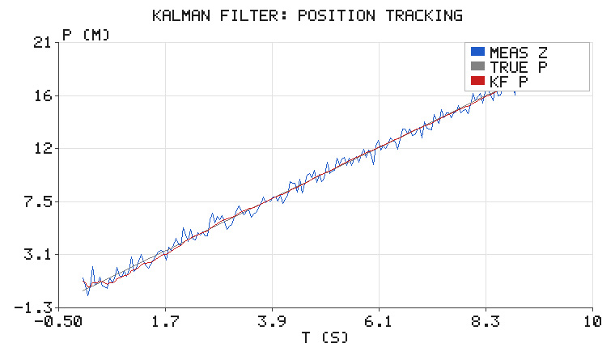
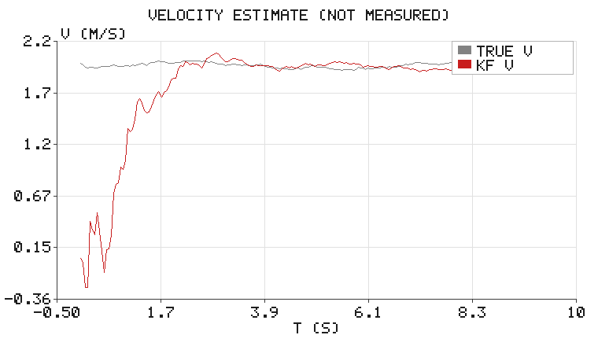

# 卡尔曼滤波：从带噪测距中估计位置与速度

机器人感知里最常遇到的情形不是"没有数据"，而是**数据太脏**。激光测距抖 5 cm、
视觉定位偶尔跳 30 cm、GPS 漂十几米——如果直接拿测量值去做控制，执行器会跟着抖。

卡尔曼滤波做的事很简单也很深刻：**用模型预测 + 用测量修正**，并且按二者的
可信度（方差）自动分配权重。本篇用一维匀速目标把公式逐行实现一遍，得到
一个可以量化的结论：**位置精度提升约 6.7 倍，且能估出从未被直接测量的速度**。

> 前置知识：概率论中的高斯分布、矩阵乘法的基本概念（2x2 足够）。

## 1. 状态空间与两个公式

状态取 $x = [p,\ v]^\top$（位置、速度），匀加速噪声驱动的匀速模型：

$$
F=\begin{bmatrix}1 & \Delta t\\ 0 & 1\end{bmatrix},\qquad
H=\begin{bmatrix}1 & 0\end{bmatrix}
$$

**预测**（用模型往前推一步，不确定度变大）：

$$
x^- = Fx,\qquad P^- = FPF^\top + Q
$$

**更新**（用测量把不确定度压回来）：

$$
K = P^-H^\top\left(HP^-H^\top + R\right)^{-1},\quad
x = x^- + K(z - Hx^-),\quad
P = (I-KH)P^-
$$

$Q$ 是过程噪声（模型有多不可信），$R$ 是测量噪声（传感器有多不准）。
$K$ 的本质就是这两个方差的比值：

$$
K \approx \frac{\text{预测方差}}{\text{预测方差} + \text{测量方差}}
$$

- $R \to \infty$（传感器极差）：$K \to 0$，完全相信预测。
- $R \to 0$（传感器极准）：$K \to 1$，直接采纳测量。

## 2. 结果

参数：$\Delta t = 0.05$ s，真实速度 2 m/s，测量噪声 $\sigma_z = 0.5$ m（只测位置），
过程噪声 $\sigma_a = 0.15\ \text{m/s}^2$，时长 10 s。



蓝色是原始测量，锯齿幅度约 ±1 m；红色是滤波输出，与灰色真值几乎重合。

| 指标 | 数值 |
|---|---|
| 原始测量 RMSE | 0.4806 m |
| 滤波位置 RMSE（全程，含收敛段） | 0.1715 m |
| 滤波位置 RMSE（稳态 $t \ge 3$ s） | **0.0720 m** |
| 滤波速度 RMSE（稳态） | 0.0435 m/s |
| 末时刻速度：估计 / 真实 | 1.977 / 1.963 m/s |
| 稳态精度提升 | **6.7 ×** |

全程与稳态差这么多，是因为初值 $v_0 = 0$ 而真实速度 2 m/s，前 1～2 秒滤波器在"学"速度。
这也是工程上强调**用合理初值**（比如第一帧测速）的原因。

## 3. 速度是怎么"无中生有"出来的

速度从未被测量，但位置序列的**斜率**里含了速度信息。滤波器的协方差矩阵 $P$
在更新中会自动把"位置测量"的信息传播到"速度估计"上——这就是 $P^-H^\top$ 那一项的作用。



灰色是真实速度（带随机游走），红色估计曲线紧贴其上，稳态误差 0.04 m/s。
这解释了为什么里程计 + IMU + 视觉的组合定位能给出速度：速度往往不是"测"出来的，是"估"出来的。

## 4. 调参：只有一个真正的旋钮

很多人调 KF 时把 $Q$、$R$ 乱试，其实关键是**比值** $Q/R$：

- $Q/R$ 偏大 → 更信测量 → 跟随快、但把噪声放进来了（曲线毛糙）。
- $Q/R$ 偏小 → 更信模型 → 平滑、但响应滞后（存在系统偏差时尤其明显）。

本例把 $Q$ 设成与真实加速度噪声匹配（$q = 0.05$）、$R$ 设成与测量噪声方差匹配
（$R = 0.25$，即 $\sigma = 0.5$），得到的结果就接近理论最优。**先用物理量估算 $R$，
再让 $Q$ 表征你对模型的信心**，比盲调有效得多。

## 5. 代码与运行

```bash
cd src/chap5/kalman_filter_tracking
python3 tests/test_kalman.py            # 6 项单元测试
python3 scripts/main.py --outdir ../../../docs/img/chap5/kalman_filter_tracking
```

核心就是一个类，五个方法：

```python
import kalman as kf

f = kf.KalmanCV(dt=0.05, q_accel=0.05, r_meas=0.25)
for z in measurements:
    f.predict()
    f.update(z)
    print(f.pos, f.vel, f.pos_std())    # 估计值 + 不确定度
```

不依赖 numpy：2x2 的乘、转置、求逆都在 `kalman.py` 里显式写出，方便与公式逐行对照。
随机数用自实现的 LCG + Box-Muller，保证在任何机器上结果一致（可复现）。

## 6. 局限与延伸

- **线性假设**：这里 $F$、$H$ 都是常矩阵。真实问题（如雷达测距测角）是非线性的，
  要用 EKF（一阶泰勒展开）或 UKF（sigma 点）。
- **匀速假设**：目标机动时会滞后，实际做法是自适应 $Q$（机动检测）或多模型（IMM）。
- **2D/3D 扩展**：把状态扩成 $[x, y, v_x, v_y]$ 即可，公式形式完全不变。

## 7. 与已有内容的关系

- `chapter/chap5/lidar_obstacle_nn.md` 做的是**单帧分类**（这一帧是什么障碍物），
  本篇做的是**跨帧状态估计**（它在哪里、多快）——两者在同一套感知链路里前后衔接。

---

> 本文档由 AI 辅助撰写，模型、代码与全部数值均在本地实跑验证（`tests/test_kalman.py` 6 项全过）。
> 配图由纯标准库手写 PNG 编码生成。
