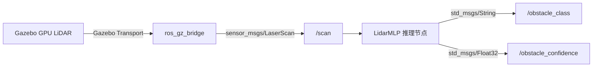
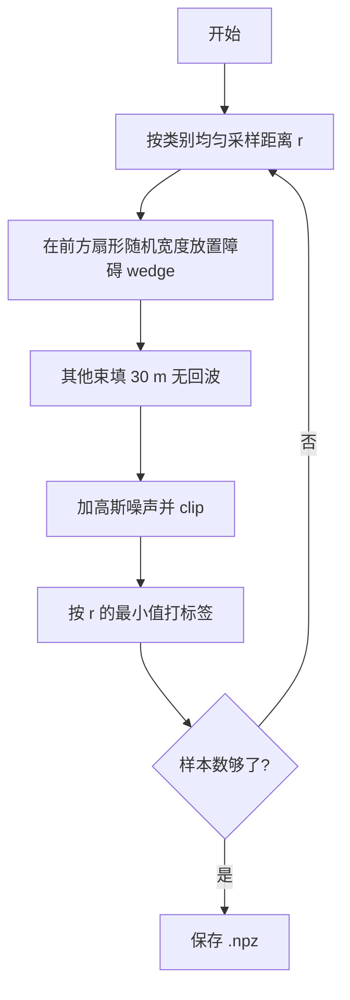
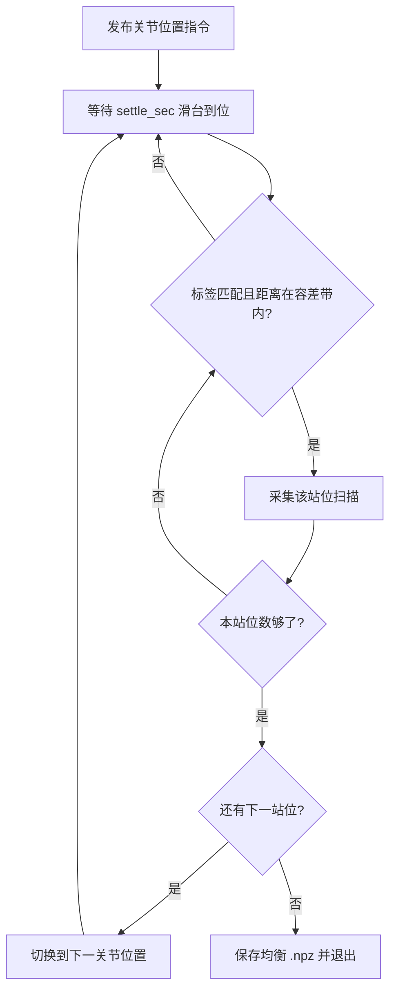
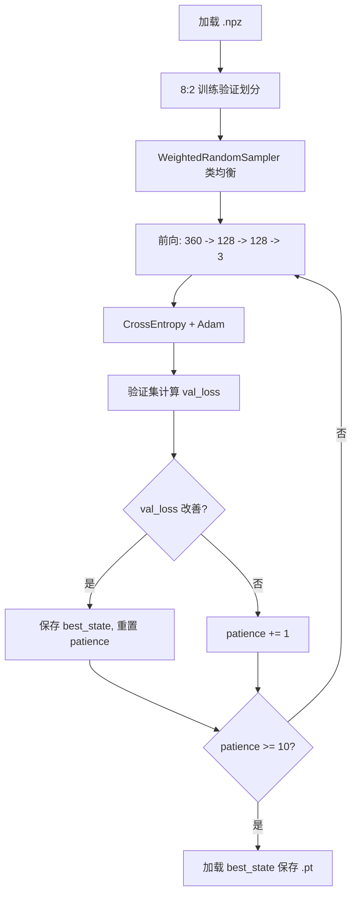
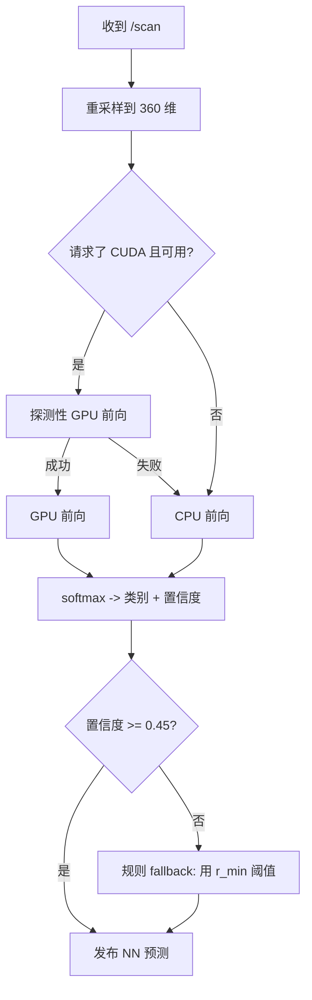
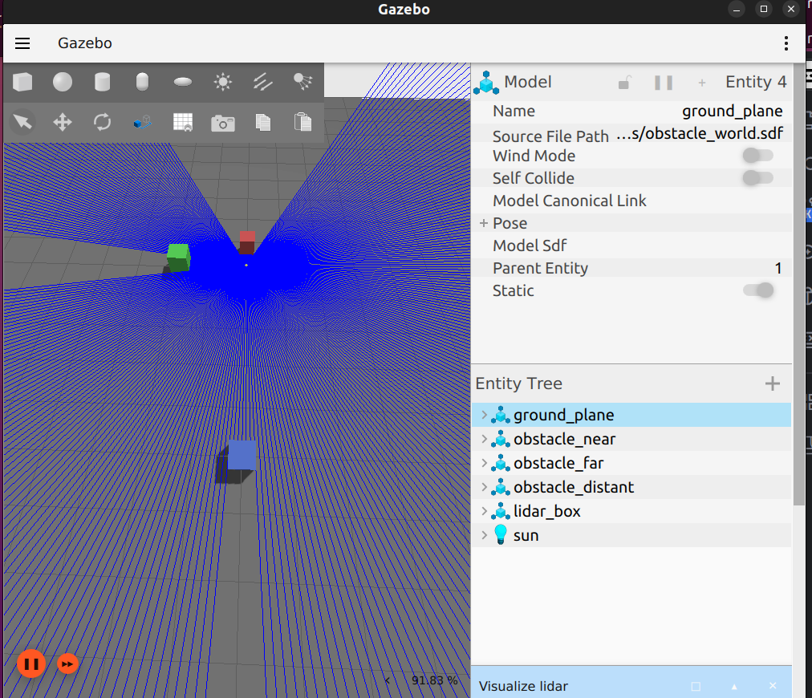
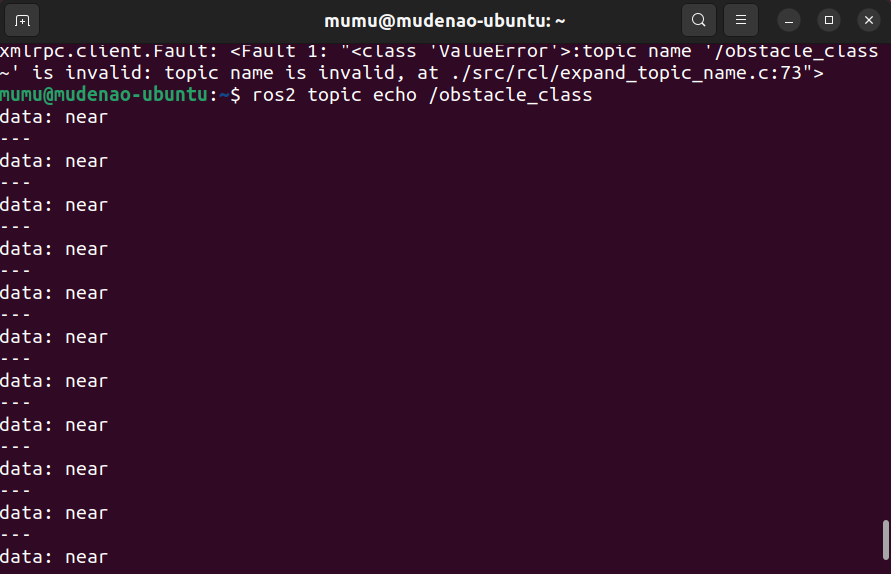
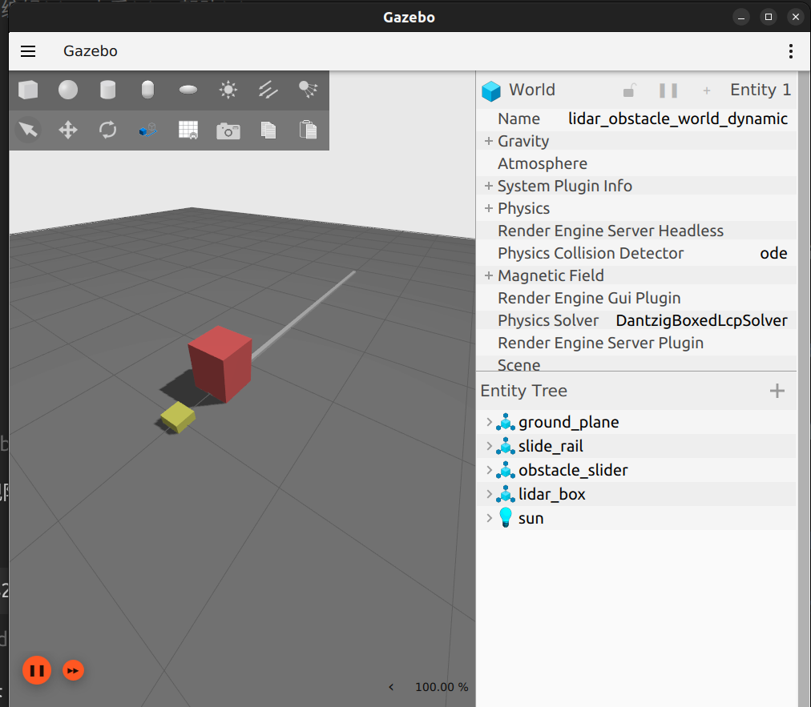
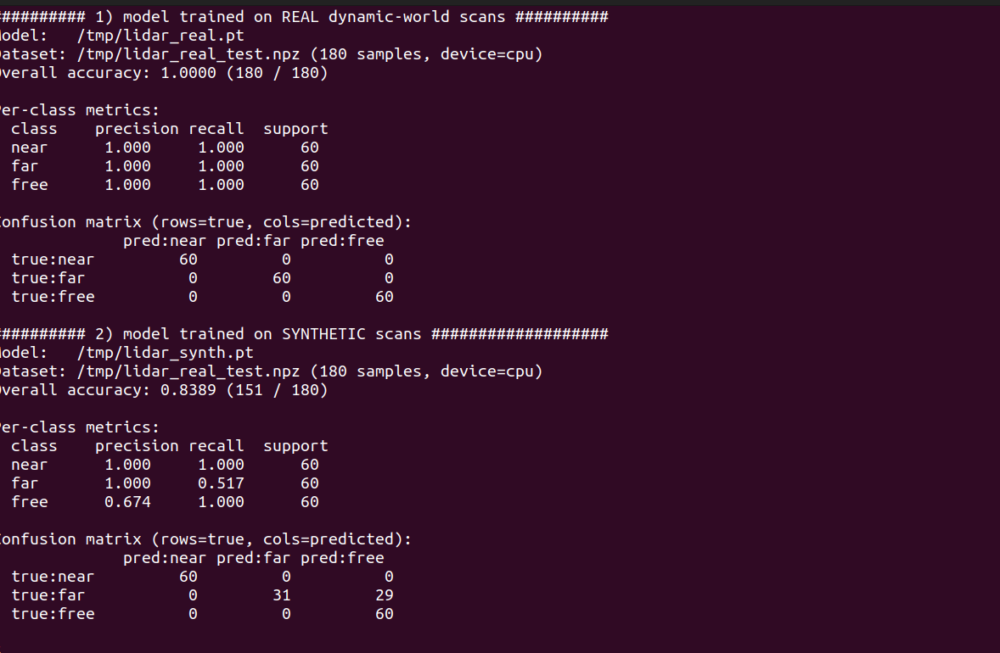

# 基于激光雷达扫描的神经网络障碍物分类

本文介绍一个基于 ROS 2 Humble、Gazebo Fortress 与 PyTorch 的激光雷达感知模块。模块订阅仿真环境中 2D 激光雷达发布的 `/scan`（`sensor_msgs/LaserScan`，360 束），由一个三层 MLP 将每条扫描分为 `near`（近障）、`far`（远障）、`free`（无障）三类，并通过 `/obstacle_class`、`/obstacle_confidence` 话题发布分类结果以及置信度。

## 1. 系统组成



仿真激光雷达生成 360 束 2D 扫描，`ros_gz_bridge` 把 Gazebo 消息转换为 ROS 2 `sensor_msgs/LaserScan`，`inference_node` 加载训练好的 MLP 权重做推理，发布类别字符串和置信度。

## 2. 环境要求与安装

| 项目 | 版本 |
| --- | --- |
| 操作系统 | Ubuntu 22.04 LTS |
| ROS | ROS 2 Humble (`/opt/ros/humble`) |
| 仿真器 | Gazebo Fortress 6.x（Ignition Gazebo） |
| Python | 3.10（ROS 2 Humble 自带） |
| GPU（可选） | NVIDIA GPU + CUDA 12.x（纯 CPU 环境完全可用，5070 Ti 等 Blackwell 架构建议直接用 CPU 推理，详见 8.1 节） |

加载 ROS 2 环境并安装 Python 依赖：

```bash
source /opt/ros/humble/setup.bash
python3 -m pip install --user -r src/chap5/lidar_obstacle_nn/requirements.txt
```

**纯 CPU 环境（无 NVIDIA 显卡）**：PyPI 默认的 torch 即为 CPU 版，上面的命令已经足够，推理节点会自动跳过 CUDA 探测直接使用 CPU。

**有 NVIDIA 显卡的环境**：按 [PyTorch 官网](https://pytorch.org/get-started/locally/) 选与驱动匹配的 CUDA wheel，例如：

```bash
python3 -m pip install --user torch --index-url https://download.pytorch.org/whl/cu121
```

**无显示器的机器（服务器/虚拟机/CI）**：GPU 激光雷达传感器需要渲染上下文才能产生回波，需安装 `xvfb` 并用虚拟显示启动（见 6.3 节）：

```bash
sudo apt install xvfb
```

验证安装：

```bash
python3 -c "import torch; print(torch.__version__, torch.cuda.is_available())"
# 纯 CPU 机器输出形如 2.3.1+cpu False，属预期且受支持
ros2 pkg prefix ros_gz_sim_demos   # 应输出 /opt/ros/humble
```

## 3. 计算原理

### 3.1 激光雷达扫描数据结构

`sensor_msgs/LaserScan` 是 ROS 2 标准激光雷达消息，关键字段：

| 字段 | 含义 |
| --- | --- |
| `angle_min` / `angle_max` | 扫描起止角（弧度） |
| `angle_increment` | 相邻束角间距 |
| `range_min` / `range_max` | 有效距离范围（米） |
| `ranges[]` | 每束的距离值，`inf` 表示无回波 |

本模块在 Gazebo SDF 里配置 360 束、`2π` 弧度、`5 Hz`、`0.05–30 m` 量程的水平 2D 激光雷达。

### 3.2 分类规则与标签

基于**扫描中最小有效距离** $r_{\min} = \min_i r_i$（$r_i$ 为第 $i$ 束距离），三分类规则：

$$
\text{label} =
\begin{cases}
0\ (\text{near}), & r_{\min} < d_{\text{danger}} \\
1\ (\text{far}),  & d_{\text{danger}} \le r_{\min} < d_{\text{far}} \\
2\ (\text{free}), & r_{\min} \ge d_{\text{far}}
\end{cases}
$$

阈值默认 $d_{\text{danger}}=1.0\,\text{m}$、$d_{\text{far}}=3.0\,\text{m}$，可在 `config/params.yaml` 修改。

### 3.3 神经网络结构

采用三层全连接网络（MLP），输入 360 维（重采样后的扫描向量），输出 3 类 logits：

$$
\begin{aligned}
\mathbf{x}_0 &= \text{clamp}(r, 0, 30)/30 \in \mathbb{R}^{360} \\
\mathbf{h}_1 &= \text{ReLU}(W_1 \mathbf{x}_0 + b_1), \quad W_1 \in \mathbb{R}^{128 \times 360} \\
\mathbf{h}_2 &= \text{ReLU}(W_2 \mathbf{h}_1 + b_2), \quad W_2 \in \mathbb{R}^{128 \times 128} \\
\mathbf{z}  &= W_3 \mathbf{h}_2 + b_3, \quad W_3 \in \mathbb{R}^{3 \times 128} \\
\hat{\mathbf{p}} &= \text{softmax}(\mathbf{z})
\end{aligned}
$$

总参数量 $\approx 360 \times 128 + 128 \times 128 + 128 \times 3 \approx 62{,}272$，权重文件约 249 KB，远低于仓库 3 MB 二进制上限。

### 3.4 训练目标

交叉熵损失 + Adam 优化器，类均衡加权采样防止小类被忽略：

$$
\mathcal{L}(\theta) = -\frac{1}{N}\sum_{i=1}^{N} w_{y_i}\sum_{c=0}^{2} \mathbb{1}[y_i=c]\log \hat{p}_{i,c}, \quad
w_c = \frac{N}{3 \cdot N_c}
$$

## 4. 算法流程

### 4.1 数据采集（合成）



### 4.2 数据采集（动态仿真场景）

静态世界（`obstacle_world.sdf`）里三个障碍物与机器人都是 `static`，对 360° 雷达而言最近距离恒为 0.4 m，`collect_data` 静止采集只能得到 `near` 一类；"旋转机器人"也无济于事——360° 扫描转不转都能同时看到全部障碍。要采到三类均衡的**真实仿真数据**，需要让障碍物的径向距离本身发生变化。

动态世界 `obstacle_world_dynamic.sdf` 把唯一的红色障碍块挂在一条水平棱柱关节（prismatic joint）上，由 Gazebo 自带的 `JointPositionController` 驱动。采集节点在 `/obstacle_slider/cmd_pos` 上发布关节位置，依次经过 6 个站位（每类两个距离），形成天然均衡且带类内距离变化的数据集：

| 站位 | 关节位置 | 障碍表面距离 | 类别 |
| --- | --- | --- | --- |
| 1 / 2 | 0.0 / 0.5 | 0.40 / 0.90 m | `near` |
| 3 / 4 | 0.8 / 2.1 | 1.20 / 2.50 m | `far` |
| 5 / 6 | 3.1 / 3.6 | 3.50 / 4.00 m | `free` |

> 障碍块半深 0.2 m、关节零位时中心在 0.6 m，因此表面距离 = 关节位置 + 0.4 m。



除了等待运动时间，节点还对每条扫描做**距离带校验**：标签与当前站位一致、且实测最近距离与该站位期望距离之差不超过 `station_tolerance`（默认 0.15 m）才入库。这样滑台穿过中间距离时产生的扫描（标签碰巧相同但距离不对）不会污染数据。

### 4.3 训练



### 4.4 在线推理



## 5. 源码解析

| 文件 | 作用 |
| --- | --- |
| [`lidar_obstacle_nn/model.py`](https://github.com/OpenHUTB/ros2/tree/master/src/chap5/lidar_obstacle_nn/lidar_obstacle_nn/model.py) | `LidarMLP` PyTorch 模块定义。 |
| [`lidar_obstacle_nn/inference_node.py`](https://github.com/OpenHUTB/ros2/tree/master/src/chap5/lidar_obstacle_nn/lidar_obstacle_nn/inference_node.py) | ROS 2 节点，订阅 `/scan`、加载权重、发布 `/obstacle_class`。 |
| [`lidar_obstacle_nn/collect_data.py`](https://github.com/OpenHUTB/ros2/tree/master/src/chap5/lidar_obstacle_nn/lidar_obstacle_nn/collect_data.py) | 订阅 `/scan` 自动标注采集 `.npz`；`motion_enabled:=true` 时驱动动态世界滑台按站位均衡采集。 |
| [`lidar_obstacle_nn/generate_synthetic_dataset.py`](https://github.com/OpenHUTB/ros2/tree/master/src/chap5/lidar_obstacle_nn/lidar_obstacle_nn/generate_synthetic_dataset.py) | 不依赖 Gazebo 直接合成均衡 `.npz`，本教程默认使用。 |
| [`lidar_obstacle_nn/train_model.py`](https://github.com/OpenHUTB/ros2/tree/master/src/chap5/lidar_obstacle_nn/lidar_obstacle_nn/train_model.py) | 训练脚本，含类均衡采样、早停、metrics sidecar。 |
| [`lidar_obstacle_nn/evaluate_model.py`](https://github.com/OpenHUTB/ros2/tree/master/src/chap5/lidar_obstacle_nn/lidar_obstacle_nn/evaluate_model.py) | 在带标签 `.npz` 上评估权重：总体准确率、逐类精确率/召回率、3×3 混淆矩阵。 |
| [`worlds/obstacle_world.sdf`](https://github.com/OpenHUTB/ros2/tree/master/src/chap5/lidar_obstacle_nn/worlds/obstacle_world.sdf) | 静态 Gazebo 场景：1 个 `static` 机器人 + 3 个不同距离障碍物 + 360 束 GPU LiDAR。 |
| [`worlds/obstacle_world_dynamic.sdf`](https://github.com/OpenHUTB/ros2/tree/master/src/chap5/lidar_obstacle_nn/worlds/obstacle_world_dynamic.sdf) | 动态 Gazebo 场景：1 个障碍块由棱柱关节位置控制器沿导轨驱动，供真实数据采集。 |
| [`launch/main.launch.py`](https://github.com/OpenHUTB/ros2/tree/master/src/chap5/lidar_obstacle_nn/launch/main.launch.py) | 顶层入口：仿真 + bridge + 推理节点一键启动，支持 `world:=static/dynamic`。 |
| [`launch/sim.launch.py`](https://github.com/OpenHUTB/ros2/tree/master/src/chap5/lidar_obstacle_nn/launch/sim.launch.py) | 仅启动 Gazebo + bridge；`world:=dynamic` 时额外桥接滑台位置指令。 |

## 6. 运行步骤

### 6.1 构建

```bash
source /opt/ros/humble/setup.bash
cd /path/to/ros2_ws          # 含本包的 src 的工作空间
colcon build --packages-select lidar_obstacle_nn --symlink-install
source install/setup.bash
```

### 6.2 首次运行前必须先生成模型权重

`models/lidar_mlp.pt` 权重文件**不随仓库分发**（仓库 `.gitignore` 约定忽略 `*.pt` 二进制训练产物，保持仓库以文本为主），克隆后第一次运行前需要自己训练生成一次（CPU 上约 1 分钟，详见 6.5 节；不训练的话推理节点会打印 `Model file not found` 警告并使用随机权重，输出无意义）。

### 6.3 一键启动（推荐）

有显示器的环境：

```bash
ros2 launch lidar_obstacle_nn main.launch.py
```

无显示器的环境（服务器、虚拟机、CI）用虚拟显示启动——`gpu_lidar` 传感器需要渲染上下文才能产生回波：

```bash
xvfb-run -a ros2 launch lidar_obstacle_nn main.launch.py
```

`main.launch.py` 同时启动：
1. Gazebo Fortress 加载 `obstacle_world.sdf`（加 `world:=dynamic` 改为加载 `obstacle_world_dynamic.sdf`）
2. `ros_gz_bridge` 把 Gazebo `/scan` 转发到 ROS 2 `/scan`
3. `inference_node` 加载 `models/lidar_mlp.pt` 推理

> **不要用 `ign gazebo -s --headless-rendering`**：该模式下 `gpu_lidar` 没有渲染上下文，360 束全部返回最大量程 30 m（实测见第 7 节对照表），采集与推理都失去意义。

### 6.4 检查输出

另开终端：

```bash
source /opt/ros/humble/setup.bash
source install/setup.bash
ros2 topic list
ros2 topic echo /obstacle_class
ros2 topic echo /obstacle_confidence
ros2 topic hz /scan
```

### 6.5 训练自己的模型

```bash
# 1. 生成合成数据集（不依赖 Gazebo，三类均衡，本教程默认路径）
python3 -m lidar_obstacle_nn.generate_synthetic_dataset \
    --output /tmp/lidar_dataset.npz --num-samples 1500

# 2. 训练
python3 -m lidar_obstacle_nn.train_model \
    --dataset /tmp/lidar_dataset.npz \
    --output src/chap5/lidar_obstacle_nn/models/lidar_mlp.pt \
    --epochs 50

# 3. 重新构建以让新权重进 install
colcon build --packages-select lidar_obstacle_nn --symlink-install
source install/setup.bash
ros2 launch lidar_obstacle_nn main.launch.py
```

静态世界直接采集只有单一类别：世界里的 `lidar_box` 是 `static`、且没有速度/差速控制插件，静止不动时每帧扫描看到同一个最近障碍（实测：默认场景静止时 20/20 帧全为 `near`）。要采三类均衡的真实数据请使用 6.6 节的动态世界流程；采集同样需要可用的渲染上下文（真实显示器或 `xvfb-run -a`），否则 `/scan` 全为最大量程。

### 6.6 动态场景真实数据采集与评估（进阶）

终端 1，启动动态世界（只起仿真 + 桥接，不起推理节点；无显示器加 `xvfb-run -a`）：

```bash
ros2 launch lidar_obstacle_nn sim.launch.py world:=dynamic
```

终端 2，自动完成 6 站位采集（默认每站位 150 条，共 900 条，约 4 分钟）：

```bash
ros2 run lidar_obstacle_nn collect_data --ros-args \
    -p motion_enabled:=true \
    -p per_station:=150 \
    -p output_path:=/tmp/lidar_real.npz
```

节点会依次打印各站位的到位与采集进度，结束时输出三类计数（应各为 300）。随后用真实数据训练并用评估脚本对比：

```bash
# train_model 内部做 8:2 随机划分并报告验证准确率
python3 -m lidar_obstacle_nn.train_model \
    --dataset /tmp/lidar_real.npz \
    --output /tmp/lidar_real.pt --epochs 50 --device cpu

# 在任意带标签 .npz 上输出准确率、逐类指标与混淆矩阵
python3 -m lidar_obstacle_nn.evaluate_model \
    --model /tmp/lidar_real.pt --dataset /tmp/lidar_real.npz
```

站位关节位置可通过 `joint_positions`（double 数组）与 `station_labels`（int 数组，0/1/2）两个 ROS 参数自定义；两个数组必须等长。

## 7. 实测结果

数据在 Ubuntu 22.04.5 LTS 与 ROS 2 Humble 环境下实测得到：

| 项目 | 实测结果 |
| --- | --- |
| OS / ROS 版本 | Ubuntu 22.04.5 LTS / ROS 2 Humble |
| Gazebo 版本 | Gazebo Fortress 6.18.0 |
| PyTorch 版本 | 2.5.1+cu121（推理使用 CPU） |
| 激光雷达 | 360 束 GPU LiDAR，5 Hz，0.05–30 m |
| 模型参数量 | 约 62,272（360→128→128→3） |
| 权重文件大小 | 249 KB |
| 数据集规模 | 1500 样本，3 类各 500 条（合成） |
| 训练时长 | 1.63 秒（CPU，50 epoch，早停在 46） |
| 最佳验证损失 | 0.0596 |
| 最终验证准确率 | 99.67 % |
| `/scan` 发布频率 | 约 4.75 Hz |
| `/obstacle_class` 实测输出 | `near`（场景含 0.6 m 红方块） |

**无头渲染 vs 虚拟显示实测对照**（同一世界、同一版本代码）：

| 启动方式 | 360 束中命中障碍数 | 最近距离 | 判定 |
| --- | --- | --- | --- |
| `ign gazebo -r -s --headless-rendering` | 0/360（全部 30.00 m） | 30.00 m | `free`（无回波，数据无效） |
| `xvfb-run -a` + 正常 GUI 构建 | 76/360 | 0.40 m | `near`（与场景一致） |

**Gazebo 仿真启动后效果**：



**终端 `/obstacle_class` 实时输出**：



### 7.1 动态世界真实数据采集与合成数据对比

动态世界实测（同一 5 Hz、360 束 GPU LiDAR，6 站位各采 150 帧）：

| 站位 | 指令关节位置 | 实测表面距离 | 命中束数（均值） | 自动标签 |
| --- | --- | --- | --- | --- |
| 1 / 2 | 0.0 / 0.5 | 0.397 / 0.903 m | 52 / 24 | near |
| 3 / 4 | 0.8 / 2.1 | 1.203 / 2.503 m | 20 / 8 | far |
| 5 / 6 | 3.1 / 3.6 | 3.503 / 4.003 m | 8 / 6 | free |

导轨是纯 visual（无 collision）且位于扫描平面下方（z=0.02 m，波束在 0.11 m），实测不产生回波。

**对比实验设置**：900 条真实数据按站位分层留出 180 条（每类 60）作为测试集，其余 720 条训练"真实模型"；另用 1500 条合成数据训练"合成模型"。两个模型结构、超参数完全一致，在**同一批 180 条真实留出样本**上评估：

| 模型 | 总体准确率 | near 召回 | far 召回 | free 召回 |
| --- | --- | --- | --- | --- |
| 真实数据训练 | **100.0 %（180/180）** | 60/60 | 60/60 | 60/60 |
| 合成数据训练 | 83.9 %（151/180） | 60/60 | **31/60** | 60/60 |

合成模型把 29 个 `far` 样本误判为 `free`（far 召回仅 51.7 %）：合成数据的障碍是带随机宽度/噪声的理想 wedge，而真实仿真中障碍块几何固定、边缘束返回值与合成分布存在差异。这一差距说明静态合成数据可以验证管线，但在真实传感器分布上的分类能力需要动态采集闭环补齐。

**动态世界 Gazebo 场景（红色障碍块 + 灰色导轨 + 黄色 lidar_box）**：



**两个模型在真实留出集上的评估输出（准确率与混淆矩阵）**：



## 8. 排错

### 8.1 CUDA 相关报错与回退机制

推理节点默认 `use_gpu:=false`，直接使用 CPU（MLP 仅 ~50K 参数，CPU 推理亚毫秒级）。显式开启 `use_gpu:=true` 时的行为与 torch 构建版本有关：

- **CUDA 版 torch**：节点在第一条 `/scan` 上做一次探测性前向；若失败（`RuntimeError`，例如显卡计算能力不被当前 wheel 支持——Blackwell sm_120 与 PyTorch 2.5 稳定版 cu121 wheel 即属此列，报错 `no kernel image is available for execution on the device`），自动回退 CPU 并继续运行。
- **CPU 版 torch**：任何 CUDA 调用会抛 `AssertionError: Torch not compiled with CUDA enabled`（而非 `RuntimeError`）。节点已在探测前短路（`use_gpu` 为 false 或 `torch.cuda.is_available()` 为 False 时完全不触碰 CUDA），并将 `AssertionError` 一并纳入捕获，因此 CPU 版 torch 上节点不会崩溃。

### 8.2 激光雷达扫描不到障碍物

如果 `/scan` 的 `ranges` 全是 30.0（最大值，无回波），检查：

1. **启动方式**：`ign gazebo -s --headless-rendering` 下 `gpu_lidar` 没有渲染上下文，360 束必然全为最大量程（实测见第 7 节对照表）。无显示器环境必须用 `xvfb-run -a ros2 launch lidar_obstacle_nn main.launch.py`。
2. **机器人 z 高度**：`lidar_box` 的 `pose z` 必须让激光雷达在障碍物高度范围内。SDF 已设 `z=0.05`，激光在 `z=0.11 m`，落在所有障碍物（z=0–0.5 m）之内。
3. **机器人是否 static**：非 static 物体会受重力影响掉到地面下。SDF 已设 `<static>true</static>`。
4. **激光雷达类型**：Gazebo Fortress 用 `gpu_lidar`（不是 `ray`），需要 `sensors-system` 插件，已在 SDF 顶部加载。

### 8.3 模型权重找不到

`inference_node` 默认从 `get_package_share_directory('lidar_obstacle_nn')/models/lidar_mlp.pt` 加载。如果该文件不存在，节点会打印警告 `Model file not found` 并用随机权重运行（输出几乎无意义）。

**解决**：训练后重新 `colcon build --packages-select lidar_obstacle_nn --symlink-install`，确保 `install/lidar_obstacle_nn/share/lidar_obstacle_nn/models/lidar_mlp.pt` 存在（symlink 指向 src 下的真实文件）。

### 8.4 动态采集：节点一直 skip，滑台不动

按顺序排查：

1. **是否启动了动态世界**：动态采集必须用 `ros2 launch lidar_obstacle_nn sim.launch.py world:=dynamic`。若误用默认静态世界，世界里没有 `obstacle_slider`，指令无人接收，节点会持续打印 `scans skipped ... wrong world?`。用 `ign model -m obstacle_slider --pose` 可确认模型是否存在。
2. **ROS→Gazebo 桥接是否存活**：`ros2 topic info /obstacle_slider/cmd_pos` 应显示 1 个订阅者。注意 SDF 插件默认话题是 `/model/obstacle_slider/joint/slide_joint/0/cmd_pos`，其中 `/0/` 是 ROS 2 非法话题名（路径段不允许数字开头），`parameter_bridge` 会直接崩溃；本世界的 SDF 已用 `<topic>/obstacle_slider/cmd_pos</topic>` 覆盖，自定义关节名时需保持话题不含数字开头的路径段。
3. **残留的 Gazebo 进程**：若之前的仿真没关干净，两个服务器会同时向 `/scan` 发布，扫描值在两个场景间交替（表现为最小距离在两个数值间跳变），距离带校验会一直不通过。采集前用 `ps -eo pid,args | grep "ign gazebo"` 确认只有一个实例。

### 8.5 动态采集：站位数据被运动过程污染

长距离移动（如从 4 m 回到 0.4 m）可能在 `settle_sec` 内没走完，此时标签虽对、距离却不对。节点已用 `station_tolerance`（默认 0.15 m）距离带拦截这类帧；若仍偶发未走到位，增大 `settle_sec`（如 6.0 秒）即可。导轨运动较慢时也可同步调大 SDF 关节 `velocity` 限制。

## 参考资料

- [ROS Index：ros_gz_sim_demos](https://index.ros.org/p/ros_gz_sim_demos/)
- [Gazebo Fortress lidar sensor 文档](https://gazebosim.org/api/sim/6.0/sensors.html)
- [PyTorch MLP 教程](https://pytorch.org/tutorials/beginner/basics/buildmodel_tutorial.html)
- [sensor_msgs/LaserScan 消息定义](https://docs.ros.org/en/humble/p/sensor_msgs/generated/msg/LaserScan.html)

---

**大模型使用声明**：本模块的源代码、文档与训练脚本由大语言模型（GLM-5.2）协助生成，作者已逐文件审查并通过实测验证（构建、仿真、采集、训练、推理全流程跑通；其中采集与推理需要可用的图形渲染上下文，无显示器环境使用 `xvfb-run -a`），对提交内容负全部责任。
