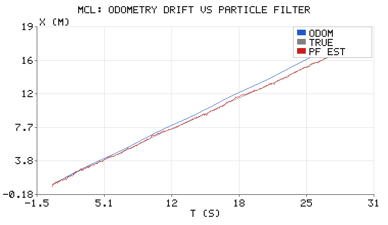
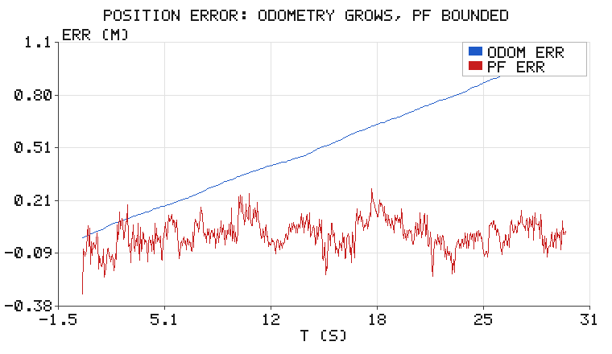

# 粒子滤波：一维蒙特卡洛定位（MCL）

上一节 `kalman_filter_tracking.md` 的卡尔曼滤波在**线性 + 高斯**假设下是最优的。
但真实机器人定位常常两条都不满足：走廊里有对称的门（多峰分布）、
激光打玻璃会突然跳（非高斯噪声）。这时候高斯假设就崩了——用一个均值 ± 方差
描述不了"我可能在 A 门也可能在 B 门"这种信念。

粒子滤波（Particle Filter）用**一堆带权样本**去表示任意形状的概率分布，
是蒙特卡洛定位（MCL, Thrun 等）的核心，也是 ROS 里 `amcl` 的算法基础。

## 1. 算法四步

用 $N$ 个粒子 $\{x_i, w_i\}$ 表示信念 $bel(x_t)$：

1. **预测**：每个粒子按运动模型采样

$$
x_i^{(t)} = x_i^{(t-1)} + v\,\Delta t + \varepsilon,\qquad \varepsilon \sim \mathcal{N}(0, \sigma_m^2)
$$

2. **更新**：按观测似然做**递推**贝叶斯加权（这里是到各信标的测距）

$$
w_i^{(t)} \;\propto\; w_i^{(t-1)} \cdot \prod_{j} \mathcal{N}\!\left(r_j;\ |x_i - b_j|,\ \sigma_r\right)
$$

> 这里必须**乘上上一轮的权重**，不能拿当前帧的似然直接覆盖。因为重采样只在
> $N_{\text{eff}} < N/2$ 时才触发：若中间有若干步没触发重采样，粒子集合根本没变
> （运动模型只是把先验搬到了新位置），此时"之前所有观测的证据"只能靠权重携带。
> 每轮覆盖一次，就等于把历史观测全丢掉了，滤波器退化成"只看最后一帧"。
>
> 重采样之后权重被重置为均匀，历史信息已经体现在粒子的**复制次数**上，此时乘
> $1/N$ 只是个常数因子，归一化后不影响结果——所以统一写成递推式是安全的。
> 本文的实现早期版本漏掉了这个递推（写成 $w_i \propto \prod_j \mathcal{N}(\cdot)$），
> 修正后同一场景的 RMSE 从 0.0846 m 降到 0.0433 m，误差抑制从 7.1 倍升到 13.8 倍。

3. **估计**：加权均值 $\hat{x} = \sum_i w_i x_i$
4. **重采样**：有效粒子数 $N_{\text{eff}} = 1/\sum_i w_i^2$ 低于 $N/2$ 时做**系统重采样**，
   把权重集中到高似然区域，抑制权重退化。

关键洞察：**里程计（运动模型）只负责"往前推"，测距（观测模型）负责"往回拉"。**
单靠里程计误差会无限累积（这是本篇的核心对比）。

## 2. 场景设置

- 20 m 走廊，三个已知信标位于 $x = 2,\ 10,\ 18$ m；
- 机器人从 $x = 1$ m 出发，单向巡航约 16.5 m；
- **只能测距**（range-only），测距噪声 $\sigma_r = 0.35$ m；
- 里程计速度被系统性高估 6%（典型轮径磨损 / 打滑），另有 0.02 m/s 随机噪声；
- 300 个粒子，$\Delta t = 0.05$ s。

注意 $\sigma_m$ 与 $\sigma_r$ 只相差一个量级，滤波器并没有"作弊"。

## 3. 结果



| 指标 | 航迹推算 | 粒子滤波 |
|---|---|---|
| RMSE | 0.5982 m | **0.0433 m** |
| 末时刻误差 | **+1.029 m** | +0.024 m |
| 重采样次数 | — | 39 |
| 误差抑制 | 1 × | **13.8 ×** |



蓝线是教科书式的**里程计漂移**：误差随里程线性增长，16.5 m 走完偏了 1.03 m
（恰好是 6% × 16.5 ≈ 1.0 m）。红线在 0 附近随机波动、**不发散**——
因为它每隔 50 ms 就被测距拉回来一次。

这就是"航迹推算（dead reckoning）"和"定位（localization）"的本质区别：

> 航迹推算的误差是**开环积分**，定位的误差是**闭环有界**。

## 4. 为什么重采样必不可少

如果一直不加权归一化后直接加权求和，几十步之后会出现**权重退化**：
几乎全部权重集中在 1～2 个粒子上，其余粒子形同废弃，滤波器失去"多假设"能力，
一旦真值跳变就再也追不回来。

系统重采样的做法：把累积权重看成一根长度 1 的线段，用 $N$ 个等间距（带随机抖动）
的指针去切它，被切到多次的粒子被复制、一次没被切到的被淘汰。本例 600 步里
触发了 39 次重采样（约每 15 步一次），说明权重确实在持续退化，机制在起作用。

判据是有效粒子数：

$$
N_{\text{eff}} = \frac{1}{\sum_i w_i^2} \in [1, N]
$$

$N_{\text{eff}} = N$ 表示权重完全均匀（没退化），$N_{\text{eff}} = 1$ 表示只剩一个粒子有效。

## 5. 代码与运行

```bash
cd src/chap6/particle_filter_localization
python3 tests/test_pf.py            # 10 项单元测试
python3 scripts/main.py --outdir ../../../docs/img/chap6/particle_filter_localization
```

使用方式：

```python
import pf

f = pf.ParticleFilter1D(n_particles=300, x_range=(0, 20),
                        sigma_move=0.06, sigma_range=0.35)
for r_meas in measurements:              # 每个控制周期
    est, resampled = f.step(v_odom, dt, r_meas, beacons)
```

## 6. 实践中的坑

- **粒子数**：$N$ 随状态维数指数增长（维数灾难）。一维 300 个够用，三维位姿
  常要几千到几万。ROS `amcl` 默认 500～5000 并可自适应。
- **粒子耗散（particle deprivation）**：重采样后所有粒子挤在一起，真值万一在
  外面就永远追不回来。缓解办法是重采样后加一点"抖动"（roughening），
  或在 $N_{\text{eff}}$ 很低时才重采样。
- **对称歧义**：一维走廊里信标少的时候会出现多峰，这正是粒子滤波比 KF 强的地方
  （它能同时保留多个假设），但也意味着**收敛更慢**。
- **观测模型要对**：似然函数若用了错误的 $\sigma_r$，滤波器会过度自信或过度迟钝。

## 7. 与已有内容的关系

- `chapter/chap5/kalman_filter_tracking.md`：高斯、单峰、线性 → KF 最优；
- 本篇：非高斯、多峰、非线性观测 → 粒子滤波；
- `chapter/chap6/slam_02_gmapping.md`：建图（Gmapping 内部同样用粒子滤波表示轨迹假设），
  本篇则是"已知地图，估计自身位姿"的定位问题，两者互补。

---

> 本文档由 AI 辅助撰写，模型、代码与全部数值均在本地实跑验证（`tests/test_pf.py` 10 项全过）。
> 配图由纯标准库手写 PNG 编码生成。
