# 6.1 仿真环境搭建

本节在 Gazebo Classic 11 中完成两件事：

1. 用 **Building Editor** 手绘一个房间，保存为世界文件 `my_room.world`；
2. 把带 **RPLIDAR 激光雷达**的 **mrobot** 机器人加载到该房间中。

这是后续 SLAM 建图与自主导航的基础。本节配套功能包位于仓库：

```text
src/chap6/catkin_ws/src/mrobot_gazebo/
```

## 1. 运行环境

| 项目 | 版本/说明 |
|---|---|
| 操作系统 | Ubuntu 20.04（focal） |
| ROS | ROS 1 Noetic（`/rosdistro: noetic`，`/rosversion: 1.17.4`） |
| 仿真器 | Gazebo Classic 11 |
| 工作空间 | `~/catkin_ws`（catkin） |

> Gazebo 启动时顶部黄色横幅 "This version of Gazebo reaches end-of-life in January 2025" 仅为停止维护提示，不影响使用，忽略即可。

## 2. 背景知识

### 2.1 什么是 SLAM

SLAM（Simultaneous Localization and Mapping，同步定位与建图）：在 GPS 无法使用的环境中，机器人一边对自身进行**定位**，一边**增量式地构建环境地图**，从而实现自主定位与导航。可以类比为一个盲人在未知环境中用双手摸索，并不断修正自己心中的环境地图。

### 2.2 激光雷达与 LaserScan

- **激光雷达**：ROS 在 `sensor_msgs` 中定义了 `LaserScan` 数据结构，用于存储二维激光扫描消息。激光雷达每旋转一周，输出一帧 LaserScan，包含每一光束的距离值、角度范围、最小/最大量程等信息。
- **RGB-D 深度相机**：得到的是三维点云（`PointCloud2`），而 ROS 中很多二维导航算法需要二维激光数据，需要通过 `depthimage_to_laserscan` 把深度图转换为虚拟 LaserScan。

本节使用激光雷达方案，仿真激光雷达话题为 `/scan`，坐标系为 `laser_link`。

## 3. 启动 ROS 与 Gazebo

```bash
# 终端 1：启动 ROS Master
roscore
```

正常输出中 `rosdistro` 为 `noetic`，`rosversion` 为 `1.17.4`，最后出现 `started core service [/rosout]` 即表示 Master 已启动，默认端口为 `11311`。

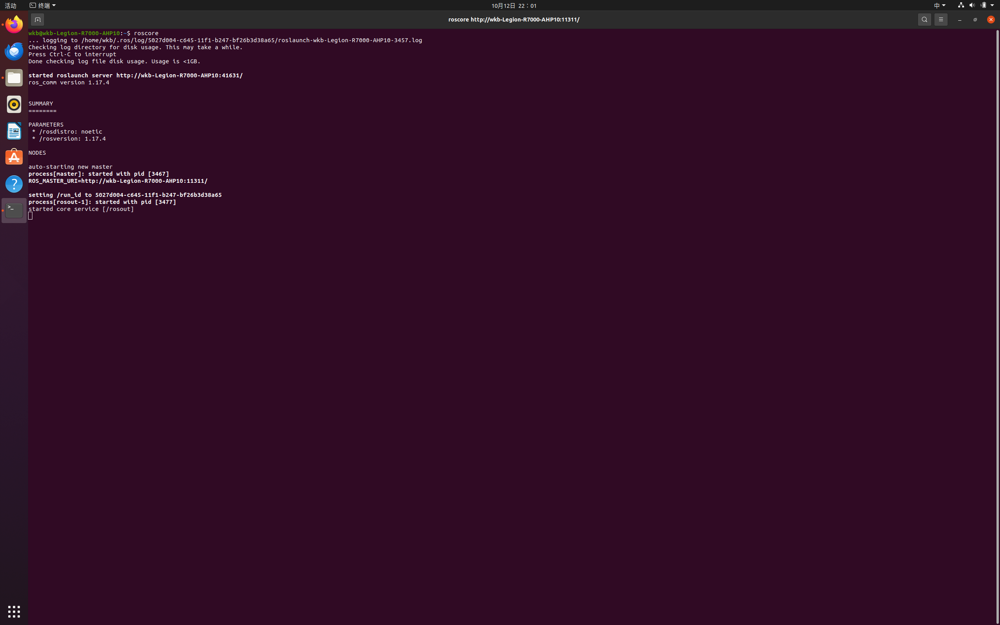

```bash
# 终端 2：启动 Gazebo（同时完成 ROS 与 Gazebo 的连接）
rosrun gazebo_ros gazebo
```

终端依次输出 `Finished loading Gazebo ROS API Plugin.`、两条 `waitForService`（`/gazebo/set_physics_properties`）以及 `Physics dynamic reconfigure ready.`，说明 Gazebo 已完成 ROS 接口初始化。

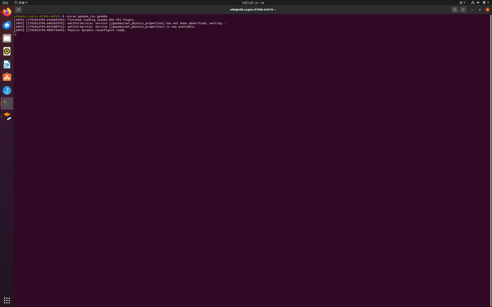

新开终端执行：

```bash
rostopic list
```

应能看到 `/clock`、`/gazebo/link_states`、`/gazebo/model_states`、`/gazebo/set_model_state`、`/rosout` 等话题，说明 ROS 已与 Gazebo 建立连接。

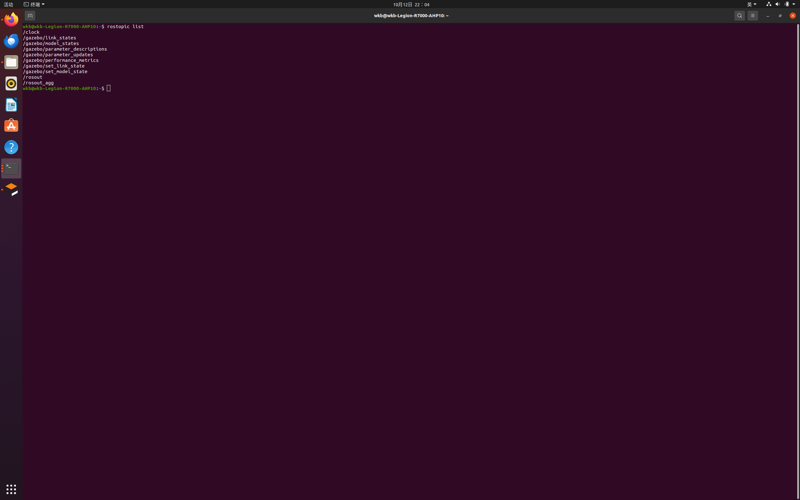

此时 Gazebo 中打开的是一个只有地面的空世界。

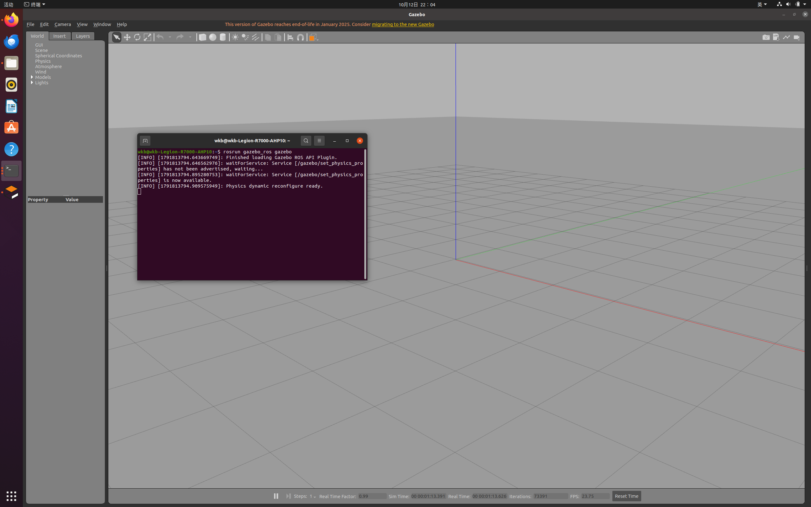

## 4. 安装 Gazebo 模型库

Gazebo 默认自带的模型很少，需要下载官方模型库，以便直接插入交通锥、垃圾箱等物体。

```bash
cd ~
# 下载模型库（GitHub 慢时可用 Gitee 镜像）
git clone https://gitee.com/kingrr/gazebo_models.git
# 或: git clone https://github.com/osrf/gazebo_models.git
```

模型库共 2697 个对象、约 194 MiB。

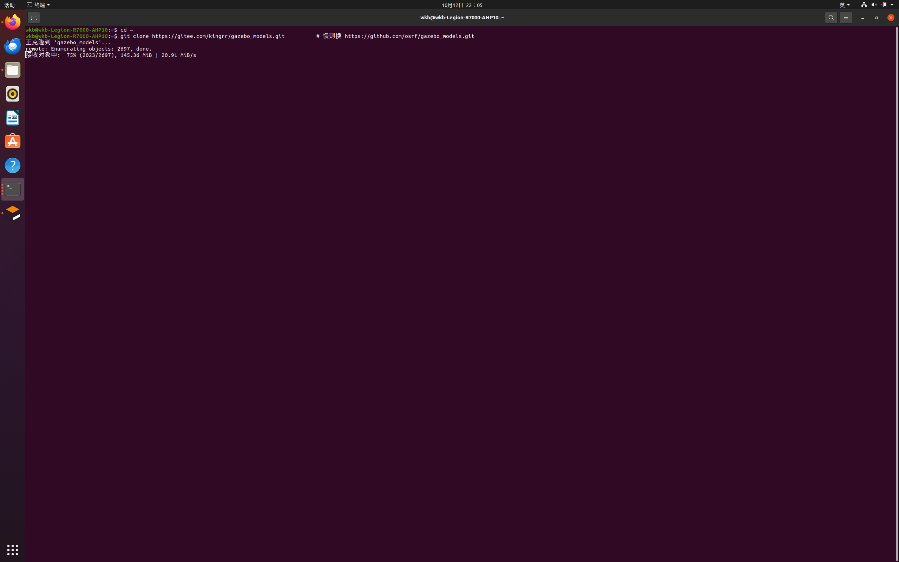

将模型库**内部的各个模型文件夹平铺**到 Gazebo 模型目录。注意不要把整个 `gazebo_models` 文件夹直接复制进去，多嵌套一层 Gazebo 不会识别：

```bash
mkdir -p ~/.gazebo/models
cp -r ~/gazebo_models/* ~/.gazebo/models/
```

模型文件可能带权限锁，批量授权：

```bash
chmod -R 777 ~/.gazebo/models
```

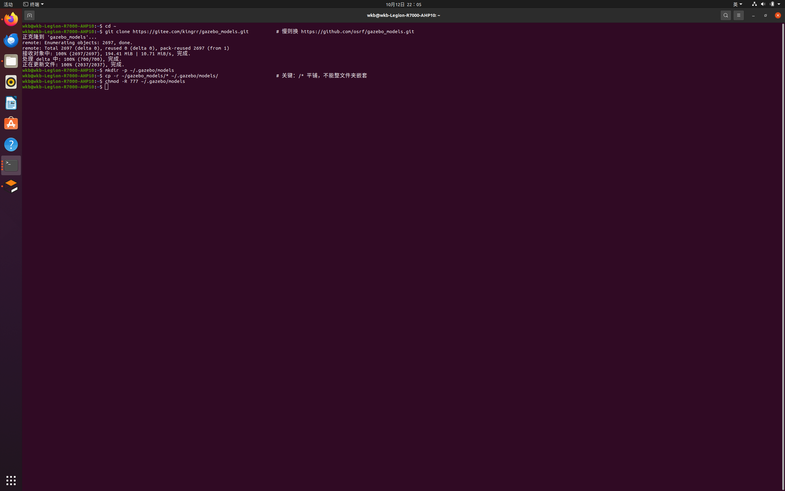

**重启 Gazebo** 后，点左侧 **Insert** 标签，可以看到大量模型（Ambulance、Construction Cone、Dumpster 等），说明模型库安装成功。

## 5. 使用 Building Editor 手绘房间

1. Gazebo 菜单：**Edit → Building Editor**，进入建筑编辑器；
2. 左上角 **Model Name** 填 `my_room`；
3. 选择左侧 **Wall**，在 2D 网格上逐段单击绘制墙体，闭合形成房间；可用 **Window / Door** 添加门窗；
4. 下方 3D 预览可实时查看房间效果。

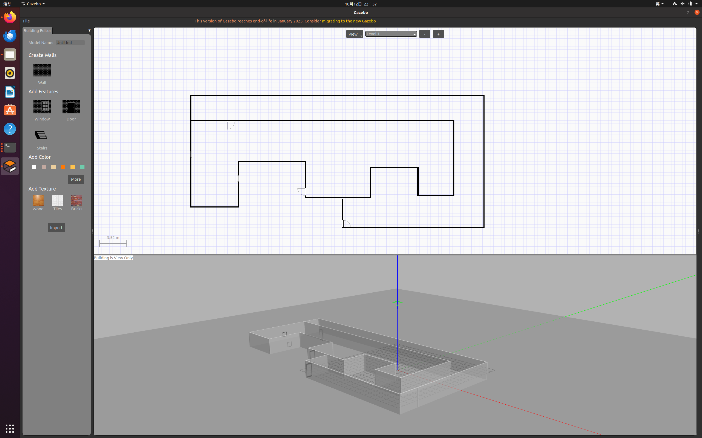

先不要直接点 Exit，否则模型不会保存。菜单 **File → Save As**，确认 **Model Name** 为 `my_room`，**Location** 选 `~/building_editor_models`，点 **Save**。保存成功后再 **File → Exit Building Editor**，退出时弹出确认框：

```
> Once you exit the Building Editor, your building will no longer be editable. Are you ready to exit?
```

确认点 **Exit**。

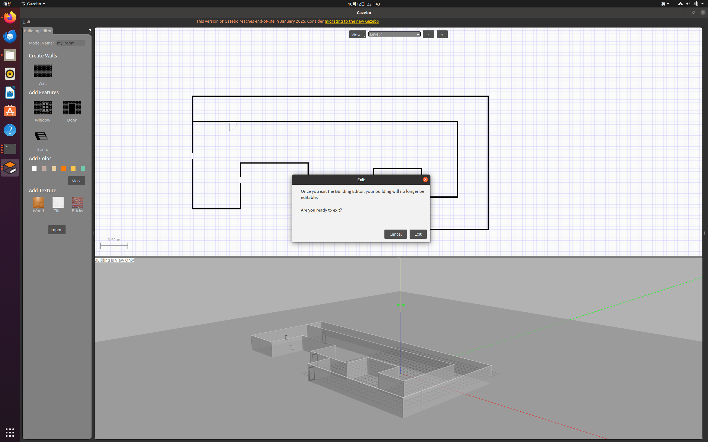

退出后，实体墙的房间直接出现在 Gazebo 场景中。编辑模式下 3D 预览里的墙是半透明的，那只是编辑模式的显示效果，退出后即为实体墙。

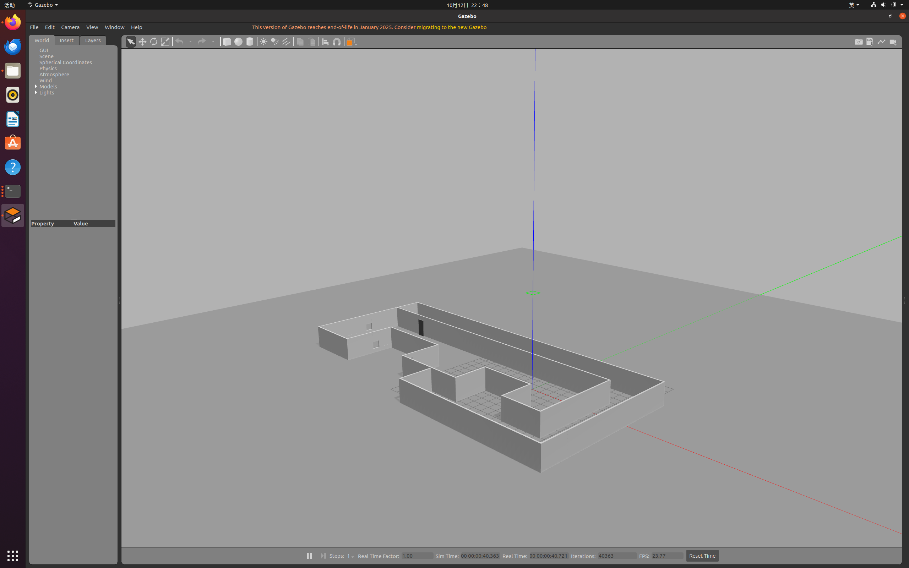

## 6. 放入交通锥并保存世界

1. 点左侧 **Insert** 标签，找到 **Construction Cone**（交通锥）；
2. 点一下，鼠标移到房间门口/墙边**单击**放下；按 Esc 可取消手上的模型。

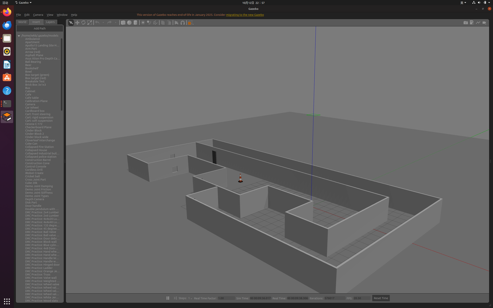

菜单 **File → Save World As**，路径选主目录，文件名**完整**输入 `my_room.world`，点 **Save**。

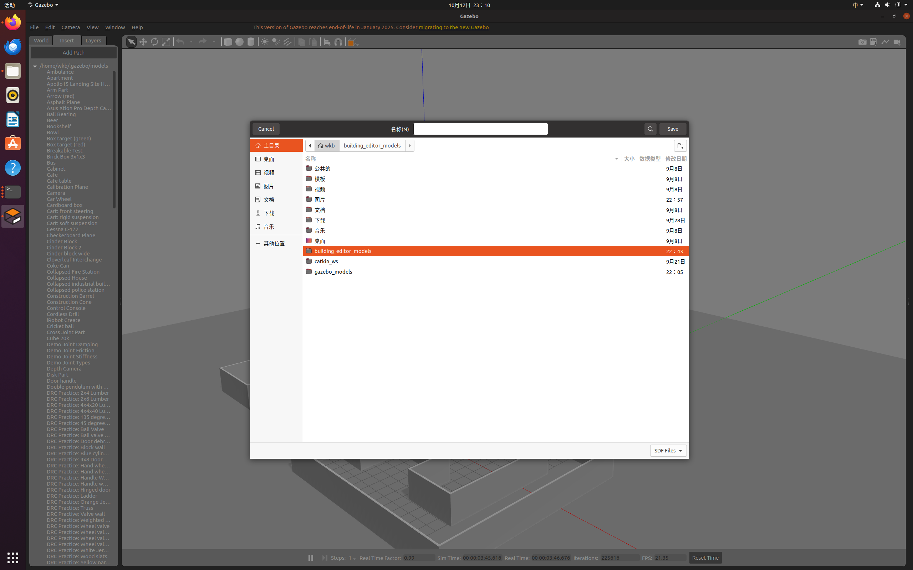

> 注意：后缀 `.world` 必须自己写。对话框右下角文件类型为 "SDF Files" 是正常的，`.world` 文件本质就是 SDF 格式；如果只填 `my_room`，会被存成 `my_room.sdf`。

实际操作中文件名曾被误填为 `my_room.word`，文件管理器主目录中可以看到该文件，但 `ls ~/my_room.world` 报 "没有那个文件或目录"。

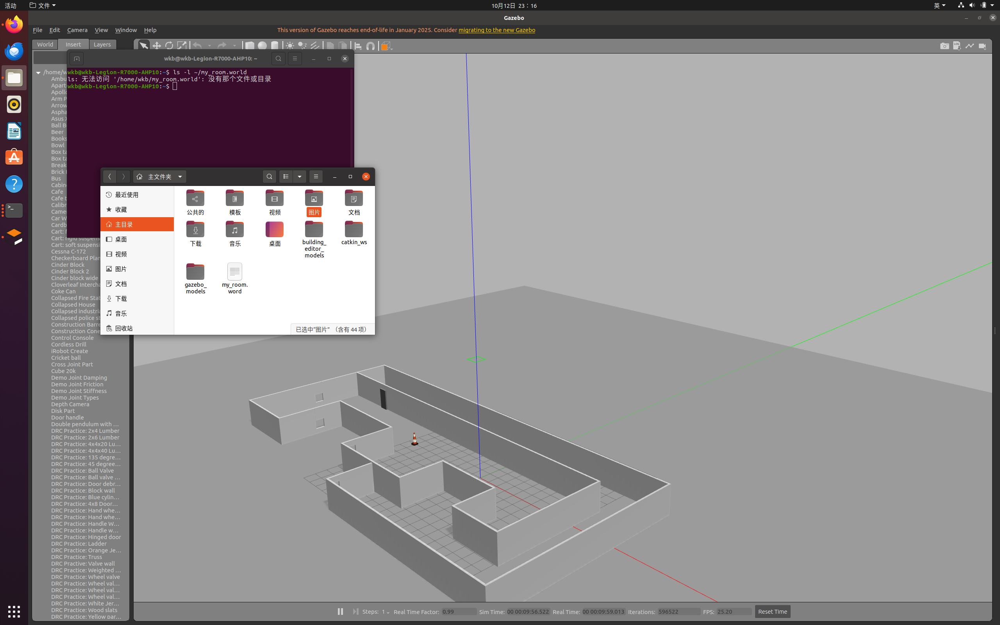

用循环自动匹配并改名为正确的 `my_room.world`：

```bash
cd ~
for f in my_room*; do [ -f "$f" ] && echo "原文件名: [$f]" && mv -- "$f" my_room.world; done
```

实测输出 `原文件名: [my_room.word]`。再执行：

```bash
ls -l ~/my_room.world
head -3 ~/my_room.world
```

修复后文件大小为 42977 字节，文件头依次为 `<sdf version='1.7'>`、`<world name='default'>`、`<light name='sun' type='directional'>`。

同时将 Building Editor 保存的房间模型复制到 Gazebo 模型目录（已存在则跳过）：

```bash
[ -d ~/.gazebo/models/my_room ] || cp -r ~/building_editor_models/my_room ~/.gazebo/models/
```

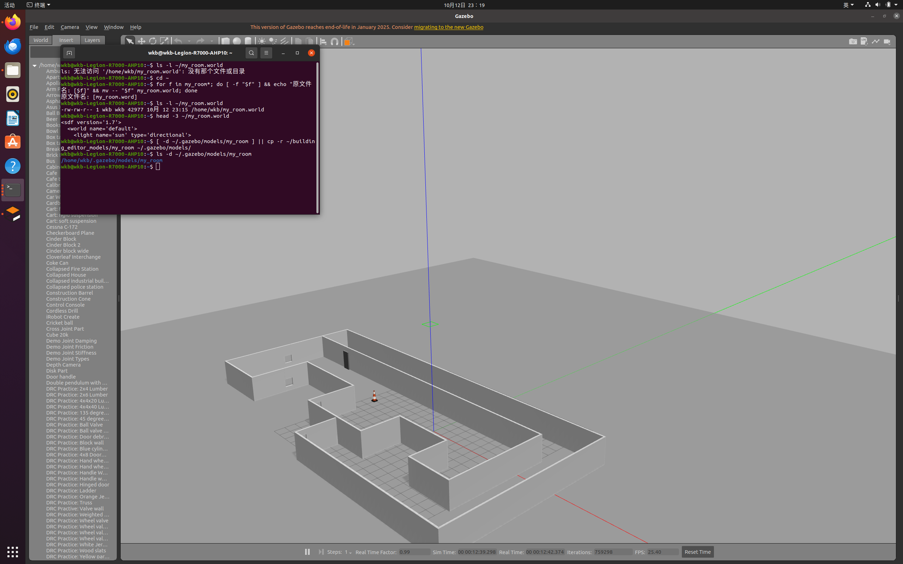

## 7. 下载 mrobot 功能包并安装依赖

mrobot 功能包来自《ROS 机器人开发实践》配套源码 `ros_exploring`。

```bash
# 准备 catkin 工作空间（如已存在可跳过）
mkdir -p ~/catkin_ws/src
cd ~/catkin_ws/src

# 下载配套源码
git clone https://gitee.com/changjy/ros_exploring.git
# 或: git clone https://github.com/huchunxu/ros_exploring.git

# 把 mrobot_gazebo 功能包复制到 src 根目录
cp -r ros_exploring/robot_mrobot/mrobot_gazebo .
```

克隆输出共 1512 个对象、约 147 MiB。

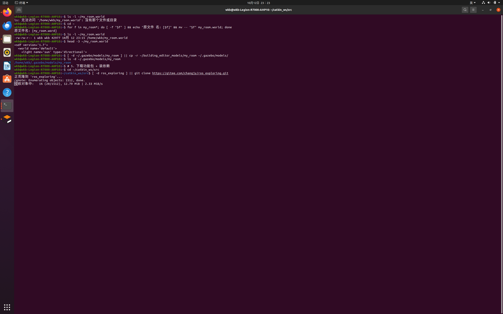

> 重要：`ros_exploring` 只作为源码下载目录，**不能留在 `src/` 里**，否则会与复制出来的包同名冲突（详见 10.1）。复制完成后把它移出 src：
>
> ```bash
> mv ~/catkin_ws/src/ros_exploring ~/ros_exploring_src
> ```

安装依赖：

```bash
sudo apt update
sudo apt install -y ros-noetic-gazebo-ros-pkgs ros-noetic-gazebo-ros-control \
                    ros-noetic-joint-state-publisher ros-noetic-robot-state-publisher ros-noetic-xacro
```

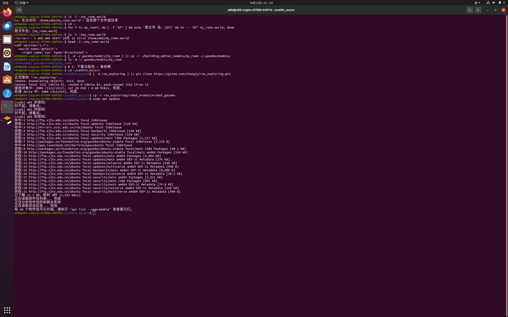

## 8. 放置世界与房间模型

为让仓库中的世界在任何机器上都能加载，把世界文件和房间模型放进功能包：

```bash
# 世界文件
cp ~/my_room.world ~/catkin_ws/src/mrobot_gazebo/worlds/

# 房间模型（Building Editor 保存的模型文件夹）
cp -r ~/building_editor_models/my_room ~/catkin_ws/src/mrobot_gazebo/models/
```

原始 launch 默认加载的是 `cloister.world`（回廊世界），需要替换为自建世界：

```bash
sed -i 's#worlds/cloister.world#worlds/my_room.world#' \
       ~/catkin_ws/src/mrobot_gazebo/launch/mrobot_laser_nav_gazebo.launch
```

替换后确认：

```bash
grep world_name ~/catkin_ws/src/mrobot_gazebo/launch/mrobot_laser_nav_gazebo.launch
```

必须显示：

```xml
<arg name="world_name" value="$(find mrobot_gazebo)/worlds/my_room.world"/>
```

功能包的 `package.xml` 中已通过下面的导出，让 Gazebo 自动把包内 `models/` 加入模型搜索路径：

```xml
<export>
  <gazebo_ros gazebo_model_path="${prefix}/models"/>
</export>
```

## 9. 编译

```bash
cd ~/catkin_ws
catkin_make
source devel/setup.bash
```

## 10. 首次启动与问题排查

先关闭手动打开的 Gazebo 窗口，然后执行：

```bash
roslaunch mrobot_gazebo mrobot_laser_nav_gazebo.launch
```

实际复现过程中先后出现了以下问题，逐一排查。

### 10.1 功能包重名

如果 `ros_exploring` 留在了 `src/` 中，roslaunch 在扫描工作空间时会报：

```text
RuntimeError: Multiple packages found with the same name "mrobot_gazebo":
- mrobot_gazebo
- ros_exploring/robot_mrobot/mrobot_gazebo
```

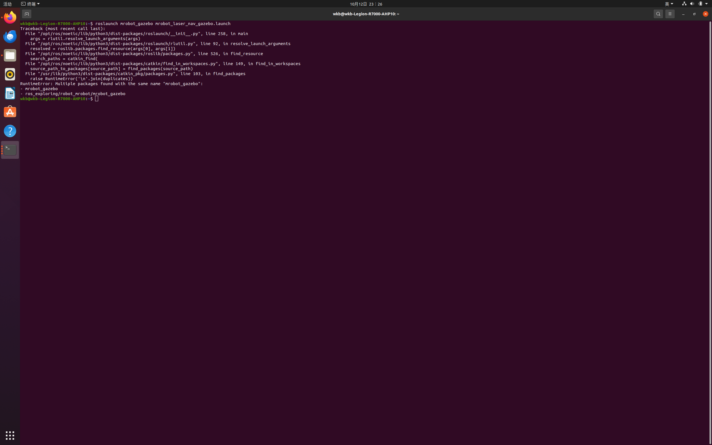

### 10.2 移动命令被误输

排查时曾将移动命令误输成 `v`（`v: 未找到命令`），导致 `ros_exploring` 实际没有移动；执行 `find` 验证时仍能看到两个 `package.xml`，之后的 `catkin_make` 和 `roslaunch` 仍然报重名。

```bash
find ~/catkin_ws/src -name package.xml | grep mrobot_gazebo
# 正确情况下应只剩一行：
# /home/wkb/catkin_ws/src/mrobot_gazebo/package.xml
```

重新输入正确的 `mv` 命令（第 7 节）后，重名问题消除。

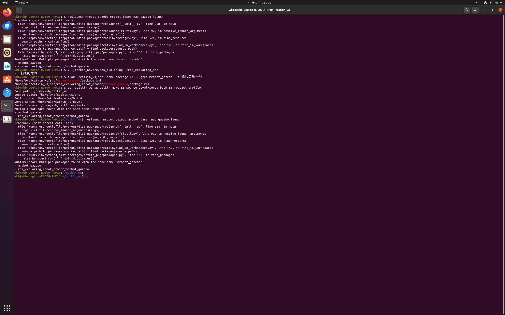

### 10.3 手动启动 roscore 报错

`roslaunch` 会自动启动 ROS Master，无需再手动运行 `roscore`。如果已有一个 Master 在运行，再手动执行 `roscore` 会报：

```text
RLException: roscore cannot run as another roscore/master is already running.
Please kill other roscore/master processes before relaunching.
```

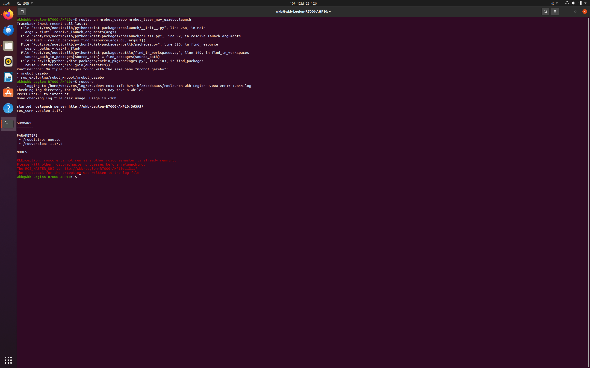

### 10.4 错误加载回廊世界

若 launch 中世界仍指向 `cloister.world`，打开的是一个回字形回廊世界，场景中还有三个黑色垃圾箱（Dumpster），与自建房间不符。

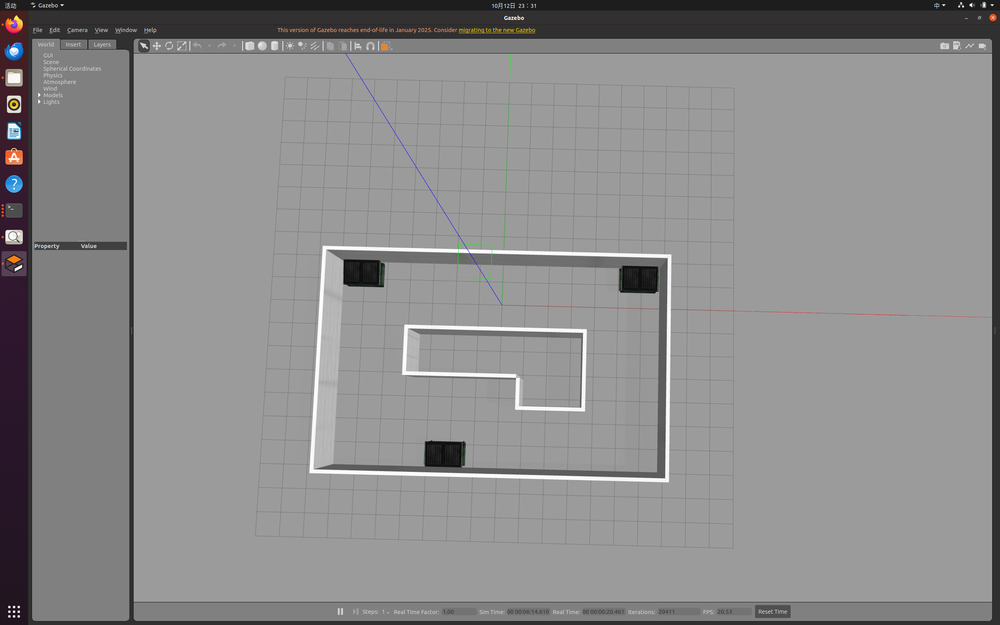

按第 8 节用 `sed` 替换为 `my_room.world` 并重新编译后，才能正确加载手绘房间。

### 10.5 正确加载房间

世界替换成功后，Gazebo 中正确出现手绘房间（含交通锥），但此时小车尚未成功生成。

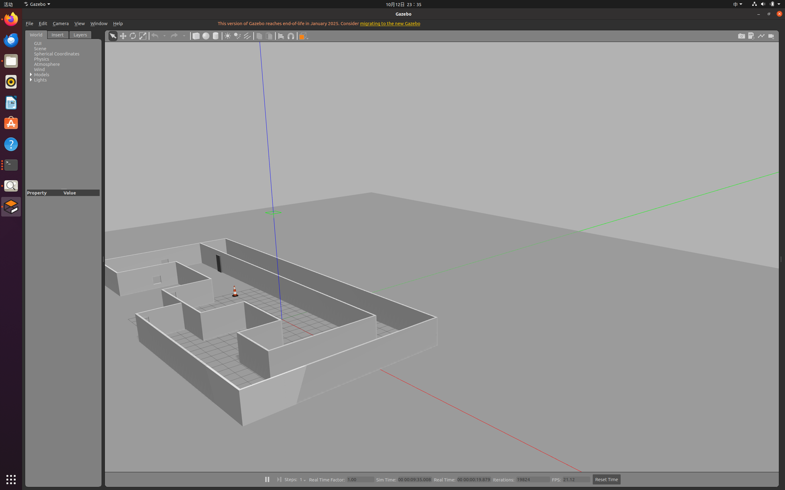

### 10.6 xacro 解析错误

首次启动时，`robot_state_publisher` 与 `urdf_spawner` 还会输出一系列 xacro 错误：

```text
[WARN] link 'laser_link' material 'black' undefined.
[ERROR] Failed to build tree: parent link [plate_2_link] of joint [rplidar_joint] not found.
[robot_state_publisher-4] process has died [pid 14233, exit code 1]
Error [parser_urdf.cc:3267] Unable to call parseURDF on robot model
Error [parser.cc:488] parse as old deprecated model file failed.
[INFO] Spawn status: SpawnModel: Entity pushed to spawn queue, but spawn service
       timed out waiting for entity to appear in simulation under the name mrobot
[ERROR] Spawn service failed. Exiting.
```

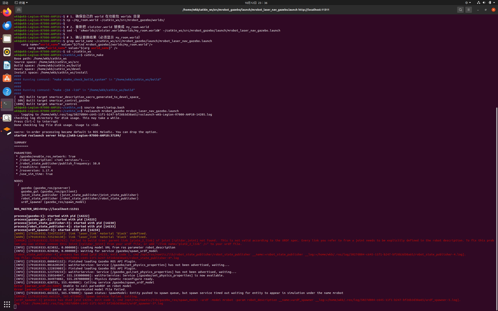

根因是 `mrobot_body.urdf.xacro` 中的宏调用缺少 `xacro:` 命名空间前缀，宏没有被展开，导致 `plate_2_link` 等链接根本不存在。

## 11. 修复 xacro 并重新启动

### 11.1 给宏调用补全前缀

在 `urdf` 目录下批量给车身文件中所有宏调用加上 `xacro:` 前缀：

```bash
cd ~/catkin_ws/src/mrobot_gazebo/urdf

sed -i \
  -e 's#<wheel #<xacro:wheel #g' \
  -e 's#<caster #<xacro:caster #g' \
  -e 's#<plate #<xacro:plate #g' \
  -e 's#<mrobot_standoff_2in #<xacro:mrobot_standoff_2in #g' \
  -e 's#<cylinder_inertial_matrix #<xacro:cylinder_inertial_matrix #g' \
  -e 's#<sphere_inertial_matrix #<xacro:sphere_inertial_matrix #g' \
  mrobot_body.urdf.xacro
```

同时修复顶层文件中的车身调用：

```bash
sed -i 's#<mrobot_body/>#<xacro:mrobot_body/>#g' mrobot_with_rplidar.urdf.xacro
```

用 `grep` 确认：

```bash
grep -nE 'xacro:(mrobot_body|wheel|caster|plate|mrobot_standoff_2in)' \
       mrobot_with_rplidar.urdf.xacro mrobot_body.urdf.xacro
```

应能看到 `<xacro:mrobot_body/>`、`<xacro:wheel .../>`、`<xacro:caster .../>`、`<xacro:plate .../>`、`<xacro:mrobot_standoff_2in .../>` 等全部带前缀。

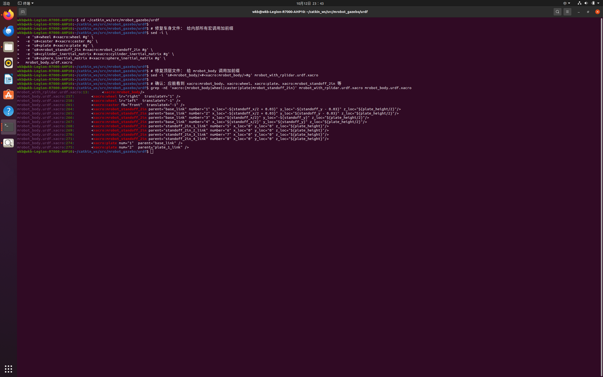

### 11.2 重新编译

```bash
cd ~/catkin_ws
catkin_make
source devel/setup.bash
```

编译输出中所有目标均为 `100%`，无报错。

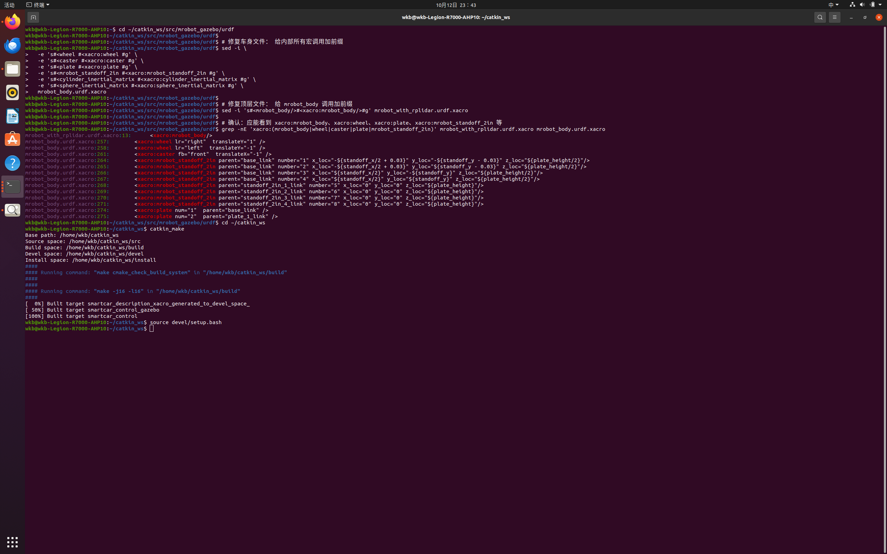

### 11.3 启动验收

```bash
roslaunch mrobot_gazebo mrobot_laser_nav_gazebo.launch
```

Gazebo 打开手绘房间 `my_room`（含交通锥），房间原点出现一台 mrobot：圆形底盘、两个驱动轮、前部万向轮、两层顶板、顶部激光雷达。

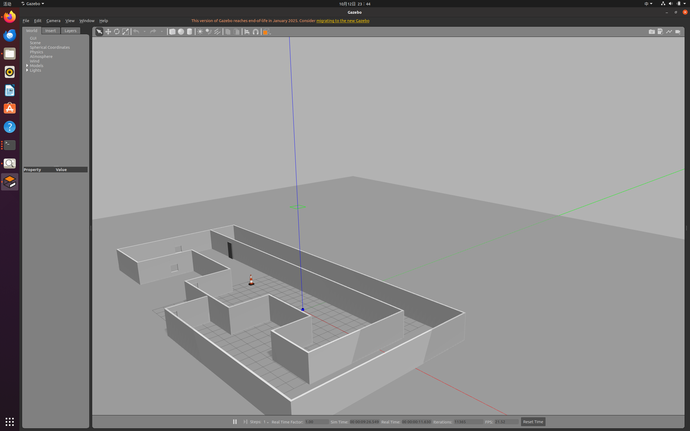

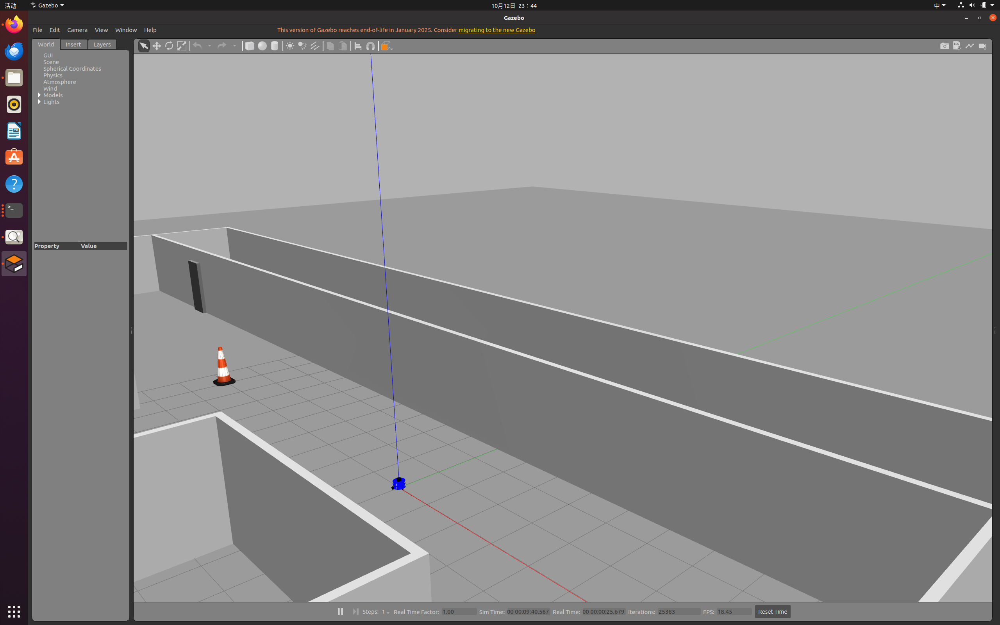

俯瞰视角确认房间、交通锥与小车的相对位置。

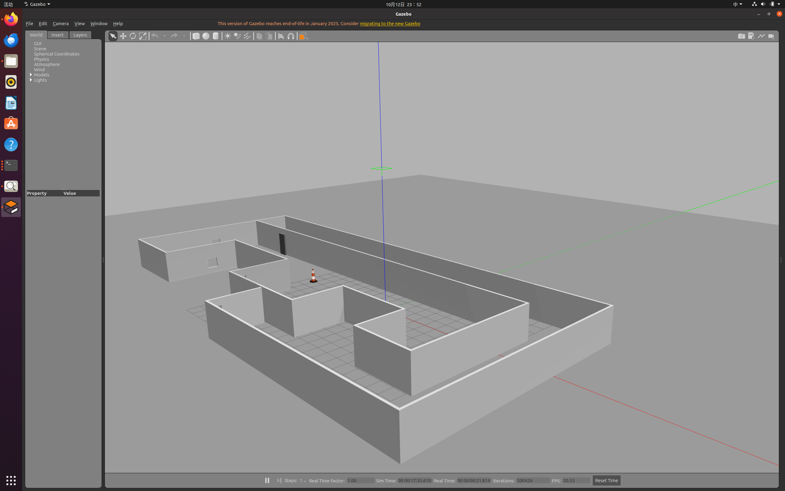

### 视角操作

| 操作 | 鼠标 |
|---|---|
| 旋转视角 | 按住左键拖动 |
| 平移视角 | 按住中键（滚轮）拖动 |
| 缩放 | 滚动滚轮 |
| 快速聚焦小车 | 左侧 World → Models → mrobot，右键 Move to |

## 12. 验收标准

- Gazebo 中正确加载自建房间（含交通锥），而不是回廊世界；
- `rostopic list` 中存在机器人相关话题（`/scan`、`/cmd_vel`、`/odom` 等）；
- 场景中能看到 mrobot 小车；
- `rostopic echo -n1 /gazebo/model_states` 的 name 列表中包含 `mrobot`；
- `rostopic hz /scan` 能持续输出激光雷达数据（约 5.5 Hz）。

## 13. 常见问题汇总

| 现象 | 原因 | 解决方法 |
|---|---|---|
| 小车没生成，报 `Could not find link 'plate_2_link'`、`parseURDF failed` | xacro 宏调用缺少 `xacro:` 前缀，车身宏未展开 | 所有宏调用加前缀：`<xacro:mrobot_body/>`、`<xacro:wheel/>`、`<xacro:plate/>` 等（见 11.1） |
| 终端提示 `in-order processing became default ... drop the option` | launch 中仍带 `--inorder` | Noetic 下 xacro 默认按文档顺序处理，删除 `--inorder`，该警告本身无害 |
| `Multiple packages found with the same name "mrobot_gazebo"` | `ros_exploring` 留在了 src 中，存在两个同名包 | 把 `ros_exploring` 移出 src：`mv ~/catkin_ws/src/ros_exploring ~/ros_exploring_src` |
| 打开的是回廊世界（3 个垃圾箱 + 回字形墙） | launch 中 world 仍是 `cloister.world` | 用 sed 替换为 `worlds/my_room.world`，并重新 `catkin_make` |
| 世界文件 `ls` 找不到，但文件管理器里有 | 文件名被误存为 `my_room.word` 或带空格 | 按第 6 节循环重命名为 `my_room.world` |
| 手动运行 `roscore` 报 `already running` | `roslaunch` 已自动启动 Master | 不再手动运行 `roscore`，关闭旧 Master 后再启动 |
| 改了 launch 不生效 | 未重新编译/source | 重新 `catkin_make` 并 `source devel/setup.bash` |
| 模型库 Insert 里看不到 | 复制时多嵌套一层、或未授权 | 平铺 `cp -r gazebo_models/* ~/.gazebo/models/`，并 `chmod -R 777` |
| 轮子抖动 / 关节报警 | `joint_state_publisher` 与差速插件都发布 `/joint_states` | 注释掉 launch 中的 `joint_state_publisher` 节点 |
| `material 'yellow'/'black' undefined` 警告 | 视觉材质未定义/大小写不一致 | 仅警告，不影响运行；可统一为已定义的材质名 |

## 参考资料

- CSDN 教程：《机器人 SLAM 与自主导航——（一）环境搭建》，melodic18
- 《ROS 机器人开发实践》，配套源码 `ros_exploring`（作者 胡春旭）
- Gazebo 官方模型库 `osrf/gazebo_models`
