# 6.2 gmapping 激光 SLAM 建图

本节在 6.1 搭建好的仿真环境基础上，使用 **gmapping** 功能包，通过键盘遥控 mrobot 走遍房间，
增量式地构建出二维**占据栅格地图**，并用 `map_saver` 把地图保存为 `map.pgm` 与 `map.yaml`。

本节配套功能包位于仓库：

```text
src/chap6/catkin_ws/src/mrobot_navigation/
src/chap6/catkin_ws/src/mrobot_teleop/
```

## 1. 本节目标

1. 理解 gmapping 基于**粒子滤波（RBPF）**的建图原理与输入输出；
2. 安装并配置 `gmapping`、`map_server` 等功能包；
3. 用三个终端分别启动 Gazebo、gmapping(+rviz)、键盘遥控；
4. 遥控小车遍历房间，在 rviz 中观察地图逐步建立；
5. 用 `map_saver` 保存地图，并读懂 `map.yaml` 各字段；
6. 记录并分析高速建图产生的噪点问题，给出改进方法。

## 2. 背景知识

### 2.1 占据栅格地图

二维导航中最常用的地图是**占据栅格地图（Occupancy Grid Map）**：把连续空间离散成大小相同的格子，
每个格子存储一个概率值，表示该格子被障碍物占据的可能性：

- 黑色（概率接近 100）：障碍物，如墙体；
- 白色（概率接近 0）：可通行的空闲区域；
- 灰色（未知）：尚未观测到的区域。

栅格边长由地图分辨率决定，本节地图分辨率为 `0.05 m/pix`，即每个像素对应实际 5 厘米。

### 2.2 gmapping 与 RBPF

gmapping 是 ROS 中经典的开源激光 SLAM 包，其节点名为 `slam_gmapping`，内部采用
**Rao-Blackwellized 粒子滤波（RBPF）**：

1. 用一组**粒子**表示机器人可能的位姿（位置 + 朝向）分布；
2. 每来一帧激光数据，结合里程计运动模型对每个粒子进行位姿预测；
3. 根据激光观测与地图的匹配程度给每个粒子**赋权重**，匹配越好权重越高；
4. 按权重**重采样**，丢弃低权重粒子、复制高权重粒子；
5. 对每个粒子各自维护一张地图，最终输出权重最高的地图。

RBPF 把"定位"和"建图"两个问题分开：先估计机器人轨迹，再在已知轨迹上计算地图，
从而降低了计算复杂度。粒子数越多越鲁棒，但计算量越大，本节配置 `particles=80`。

### 2.3 输入与输出

`slam_gmapping` 节点的关键输入输出：

| 方向 | 话题/TF | 含义 |
|---|---|---|
| 输入 | `/scan`（`sensor_msgs/LaserScan`） | 激光雷达扫描数据 |
| 输入 | `/tf`：`odom → base_footprint → base_link → laser_link` | 里程计与坐标系变换 |
| 输出 | `/map`（`nav_msgs/OccupancyGrid`） | 占据栅格地图 |
| 输出 | `/tf`：`map → odom` | 地图坐标系到里程计坐标系的校正 |

6.1 中 mrobot 的差速插件已提供 `/odom` 与 `odom → base_footprint` 的 TF，rplidar 插件提供
`/scan` 与 `laser_link`，因此 gmapping 所需的话题和 TF 链在仿真中已完整。

## 3. 安装功能包

更新软件源并安装 gmapping、map_server 与深度图转激光（深度相机方案备用）：

```bash
sudo apt update
sudo apt install -y ros-noetic-gmapping ros-noetic-map-server ros-noetic-depthimage-to-laserscan
```

安装过程中会自动安装其依赖（如 `openslam_gmapping`、`libsdl` 系列等）：

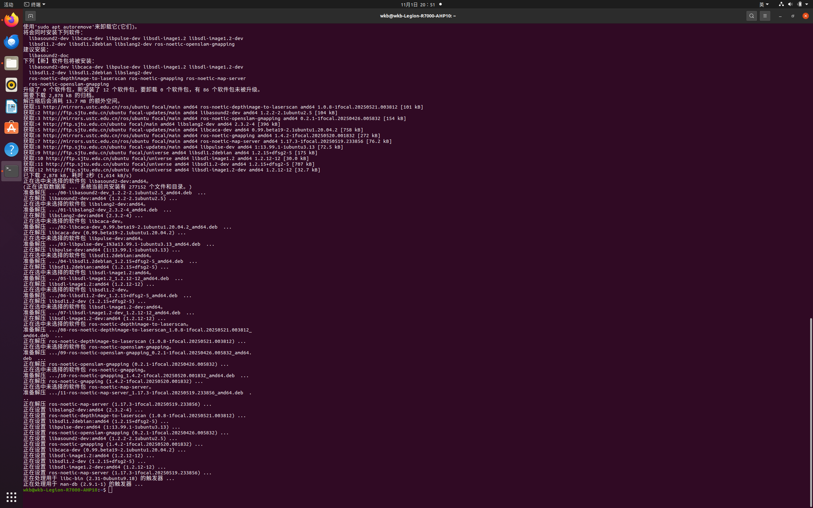

看到 "新安装了 ... 个软件包" 且无报错即安装成功。可用以下命令确认节点存在：

```bash
rospack find gmapping
rosrun map_server map_saver -h
```

## 4. 准备功能包

gmapping 的节点参数与 rviz 配置在 `mrobot_navigation` 包中，键盘遥控在 `mrobot_teleop` 包中。
从源码目录把这两个包（连同 `mrobot_description`）复制到工作空间 `src` 下。

> 注意：shell 变量（如 `$SRC`）只在定义它的那个终端有效，**换终端或重新登录后变量会失效**。
> 若变量为空，`cp "$SRC/..."` 会被展开成 `/robot_mrobot/...` 而报错。建议直接使用**绝对路径**，
> 让每条命令自包含。

本示例第一次复制时因 `$SRC` 为空而失败：

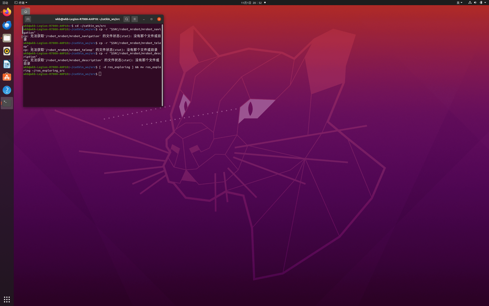

改用绝对路径重新复制三个包：

```bash
# 若源码不存在则重新克隆
git clone https://gitee.com/changjy/ros_exploring.git ~/ros_exploring_src
# 用绝对路径复制
cp -r ~/ros_exploring_src/robot_mrobot/mrobot_navigation ~/catkin_ws/src/
cp -r ~/ros_exploring_src/robot_mrobot/mrobot_teleop     ~/catkin_ws/src/
cp -r ~/ros_exploring_src/robot_mrobot/mrobot_description ~/catkin_ws/src/
```

复制后确认四个 mrobot 包都已到位：

```bash
ls -d ~/catkin_ws/src/mrobot_*
```

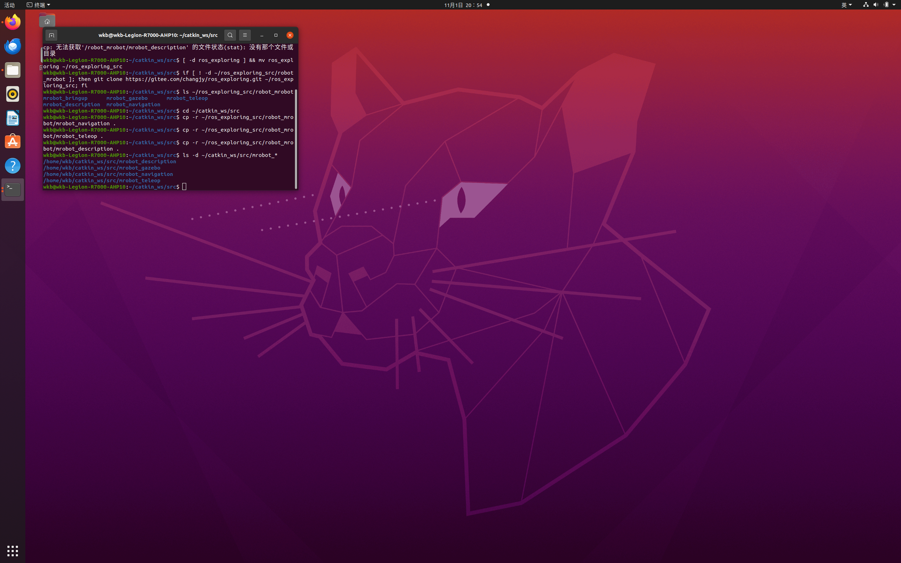

## 5. 适配 ROS Noetic

教程最初基于 ROS Kinetic（Python2），在 Noetic（Python3）下需要做两处适配。

### 5.1 键盘脚本改为 Python3 并加可执行权限

原始 `mrobot_teleop/scripts/mrobot_teleop.py` 是 Python2 代码：

- 首行解释器为 `#!/usr/bin/env python`，而 Noetic 下默认 `python` 可能不存在或指向 Python3；
- 使用了 Python2 语法 `print msg`、`print vels(...)`、裸 `except:` 等，在 Python3 下会直接报语法错误。

本仓库已提供修复后的脚本，主要修改：

```text
#!/usr/bin/env python        →  #!/usr/bin/env python3
print msg                   →  print(msg)
print vels(speed,turn)      →  print(vels(speed,turn))
except:                     →  except Exception as e:
print e                     →  print(e)
```

同时脚本必须具备**可执行权限**，否则 `roslaunch` 会报
`can't locate node [mrobot_teleop.py] in package [mrobot_teleop]`：

```bash
chmod +x ~/catkin_ws/src/mrobot_teleop/scripts/mrobot_teleop.py
```

可用以下命令验证语法与权限：

```bash
python3 -m py_compile ~/catkin_ws/src/mrobot_teleop/scripts/mrobot_teleop.py && echo "键盘脚本 OK"
ls -l ~/catkin_ws/src/mrobot_teleop/scripts/mrobot_teleop.py
```

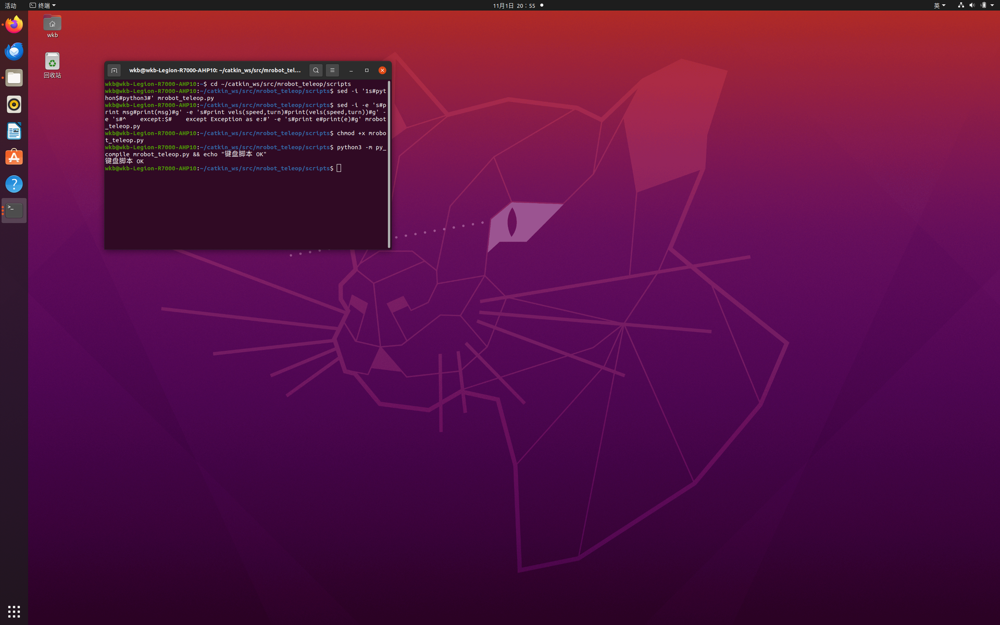

### 5.2 （可选）深度相机方案的 xacro 前缀

若使用 kinect 深度相机方案，6.1 已说明 Noetic 新版 xacro 不再展开不带 `xacro:` 前缀的宏，
需把 `mrobot_with_kinect.urdf.xacro` 中的 `<mrobot_body/>` 改为 `<xacro:mrobot_body/>`，
并去掉 launch 中已废弃的 `xacro --inorder`。本仓库的激光方案默认已正确，无需额外处理。

## 6. 编译工作空间

### 6.1 缺少 move_base_msgs 的报错

首次 `catkin_make` 时，原始 `mrobot_navigation/CMakeLists.txt` 在 `find_package(... COMPONENTS ...)`
中声明了 `move_base_msgs`。即使 gmapping 本身用不到它，catkin 在**配置阶段**仍会检查所有组件，
未安装时会直接报错：

```text
-- Could NOT find move_base_msgs (missing: move_base_msgs_DIR)
CMake Error ... Could not find the required component 'move_base_msgs'.
mrobot_navigation/CMakeLists.txt:7 (find_package)
Invoking "cmake" failed
```

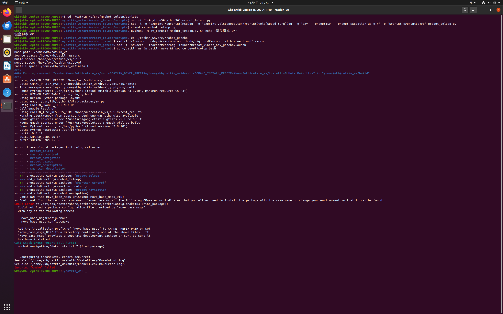

安装缺失的消息与可视化依赖（已安装的包会提示已是最新，不影响）：

```bash
sudo apt install -y ros-noetic-move-base-msgs ros-noetic-visualization-msgs \
                    ros-noetic-tf ros-noetic-geometry-msgs
```

> 本仓库已精简 `mrobot_navigation` 的 `package.xml` 与 `CMakeLists.txt`，只保留 gmapping 运行期依赖，
> 全新克隆并按本仓库编译时不再需要 `move_base_msgs`；此处保留该问题以复现原始教程的排错过程。

### 6.2 重新编译

```bash
cd ~/catkin_ws
catkin_make
source devel/setup.bash
```

编译成功，末尾出现 `[100%] Built target ...`，中间的 Gazebo "deprecated" 黄色警告可忽略：

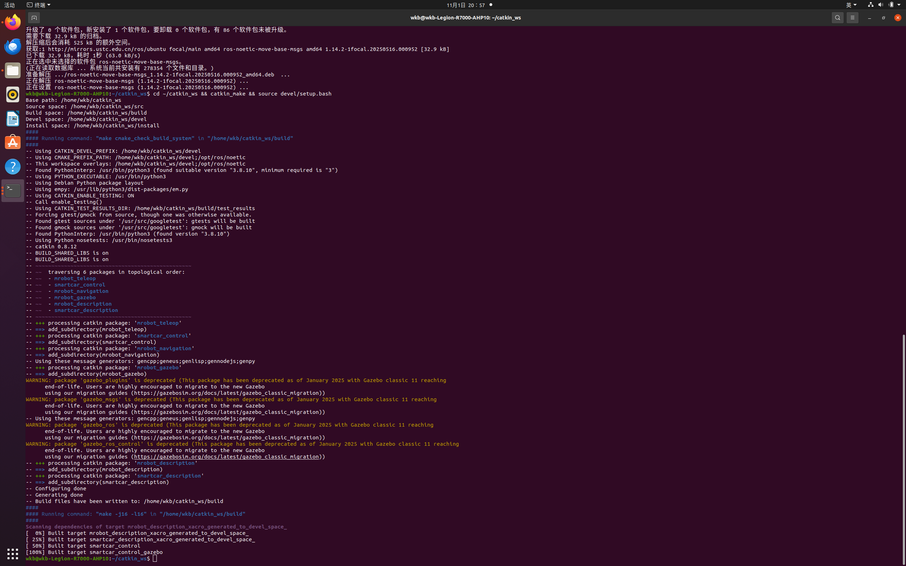

## 7. 启动激光 SLAM

打开 **3 个终端**，每个终端都先执行一次环境加载（若 `~/.bashrc` 已配置可省略）：

```bash
source ~/catkin_ws/devel/setup.bash
```

**终端 1 —— 启动 Gazebo（房间 + 小车）：**

```bash
roslaunch mrobot_gazebo mrobot_laser_nav_gazebo.launch
```

启动日志中可看到差速插件 `DiffDrive` 已订阅 `cmd_vel`、发布 `odom`，激光插件 `Laser Plugin` 启动：

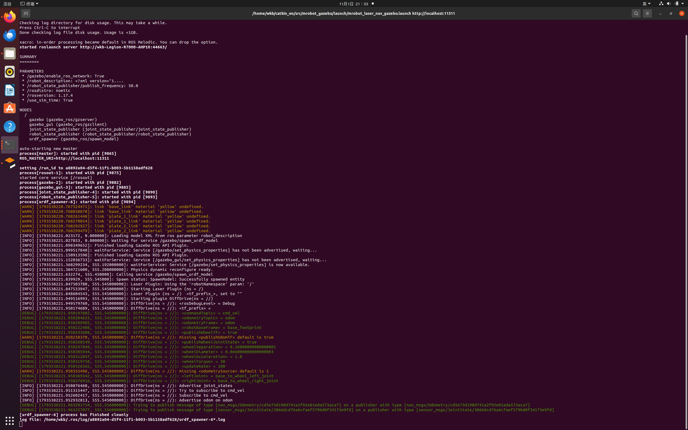

Gazebo 中加载出 6.1 手绘的 my_room 房间与 mrobot 小车：

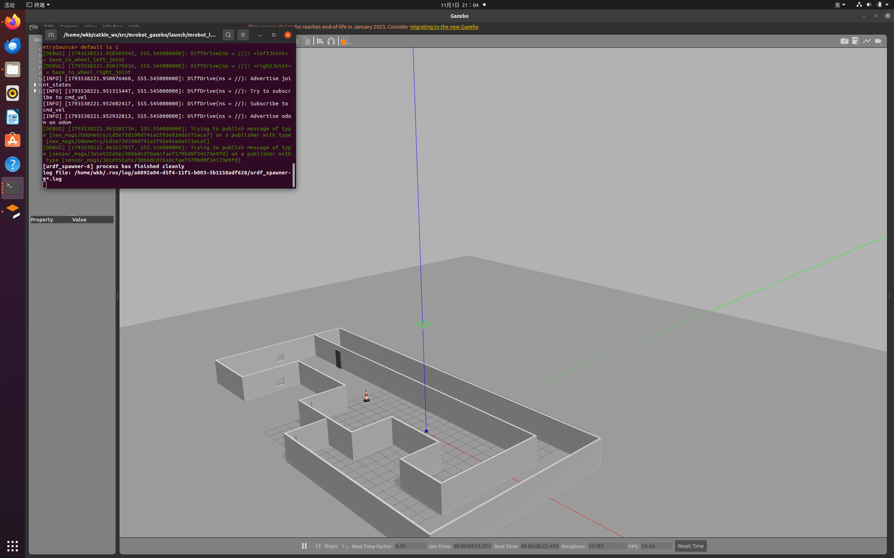

**终端 2 —— 启动 gmapping，rviz 自动打开：**

```bash
roslaunch mrobot_navigation gmapping_demo.launch
```

`gmapping_demo.launch` 先 `include` 了 `gmapping.launch`（启动 `slam_gmapping` 并加载全套参数），
再以 `gmapping.rviz` 启动 rviz。rviz 的 Fixed Frame 为 `map`，并显示 Map(`/map`)、LaserScan(`/scan`)、
RobotModel、TF 等：

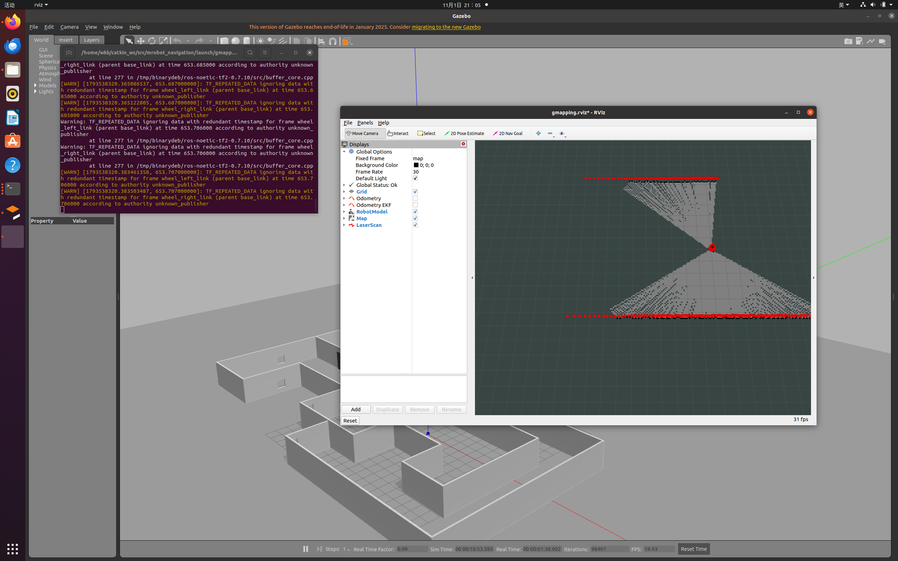

> 日志中可能出现 `TF_REPEATED_DATA ... ignoring data with redundant timestamp` 警告，
> 这是多个发布者在同一时刻发布相同时间戳的 TF 所致，不影响建图，可忽略。

**终端 3 —— 启动键盘遥控：**

```bash
roslaunch mrobot_teleop mrobot_teleop.launch
```

出现 `Control mrobot!` 键位界面，初始线速度 `speed 0.2`、角速度 `turn 1`：

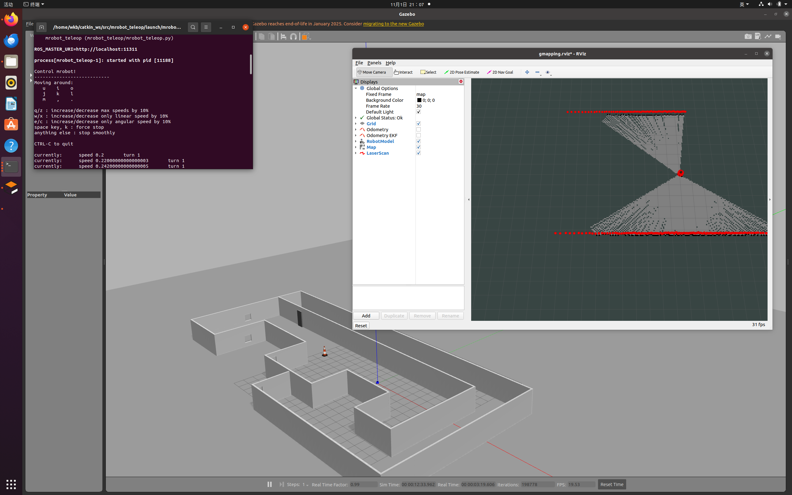

## 8. 键盘遥控建图

点击终端 3 使其获得焦点，用按键慢速驱动小车，让激光扫描覆盖整个房间：

| 按键 | 作用 |
|---|---|
| `i` | 前进（建议点按） |
| `,` | 后退 |
| `j` / `l` | 原地左转 / 右转 |
| `u` / `o` | 前进并左转 / 右转 |
| `m` / `.` | 后退并左转 / 右转 |
| `k` 或空格 | 强制停止 |
| `q` / `z` | 同时增大 / 减小线速度和角速度 10% |
| `w` / `x` | 只增大 / 减小线速度 10% |
| `e` / `c` | 只增大 / 减小角速度 10% |

随着小车移动，rviz 中 `/map` 的可通行区域（白色）和墙体（黑色）不断扩大：


### 8.1 误触加速导致速度过高

建图过程中若误按 `q`/`w` 等加速键，线速度会被持续放大。本次实操中速度一度从 0.2 增大到
**41.59 m/s**（远超正常范围）。此时 rviz 中出现明显的**放射状噪点**，地图边缘也变得毛糙：

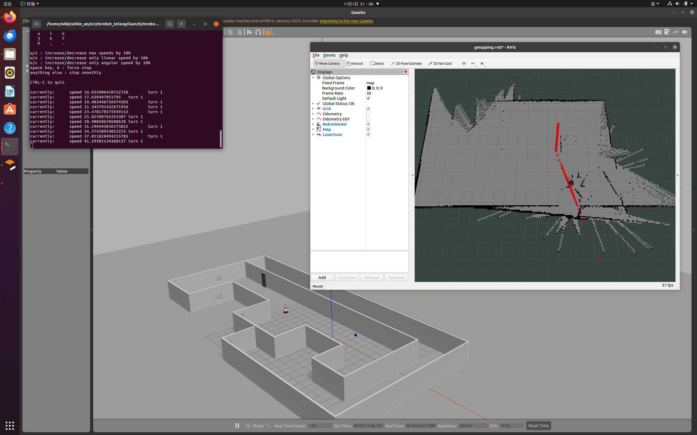

正确处理方式是：先按 `k` 或空格停车，再 `Ctrl+C` 重启 `mrobot_teleop`（速度重置为 0.2）；
若地图已明显错位，可一并重启 gmapping 后慢速重建。本次实操保留了该地图，其房间主体轮廓仍可辨认，
但放射噪点客观存在，改进建议见第 11 节。

## 9. 保存地图

建图完成后，**新开一个终端**，进入要保存地图的目录，用 `map_server` 提供的 `map_saver` 保存：

```bash
source ~/catkin_ws/devel/setup.bash
mkdir -p ~/catkin_ws/src/mrobot_navigation/maps
cd ~/catkin_ws/src/mrobot_navigation/maps
rosrun map_server map_saver
```

终端显示接收到地图并依次写入两个文件：

```text
[INFO] Waiting for the map
[INFO] Received a 576 X 544 map @ 0.050 m/pix
[INFO] Writing map occupancy data to map.pgm
[INFO] Writing map occupancy data to map.yaml
[INFO] Done
```

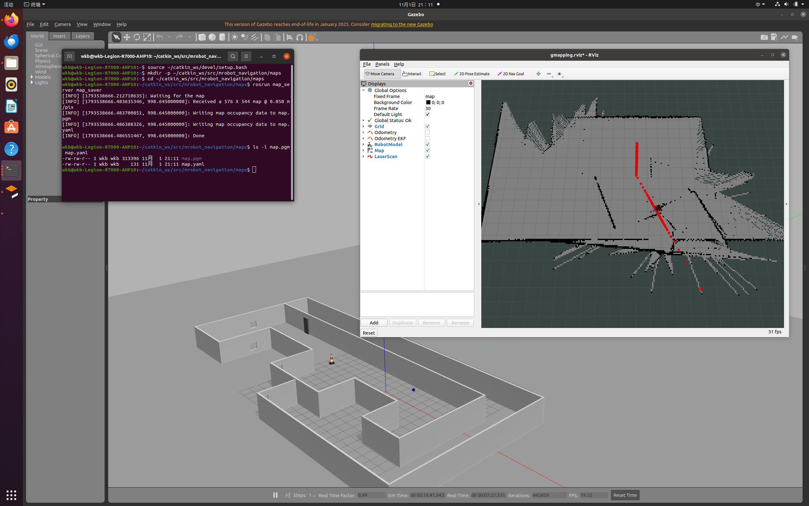

保存后可看到两个文件：

```bash
ls -l map.pgm map.yaml
# -rw-rw-r-- ... 313396 ... map.pgm
# -rw-rw-r-- ...    131 ... map.yaml
```

## 10. 地图文件解读

### 10.1 map.yaml

`map.yaml` 是地图的配置文件，本次实际内容：

```yaml
image: map.pgm
resolution: 0.050000
origin: [-13.800000, -13.800000, 0.000000]
negate: 0
occupied_thresh: 0.65
free_thresh: 0.196
```

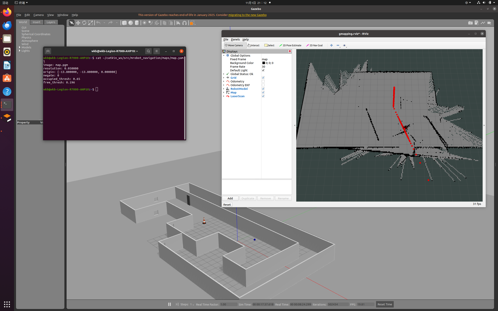

各字段含义：

| 字段 | 本次取值 | 含义 |
|---|---|---|
| `image` | `map.pgm` | 地图图像文件路径 |
| `resolution` | `0.05` | 分辨率，米/像素 |
| `origin` | `[-13.8,-13.8,0]` | 地图左下角在世界坐标系中的位姿（x,y,偏航角） |
| `negate` | `0` | 是否反转图像的黑白含义，0 表示不反转 |
| `occupied_thresh` | `0.65` | 占据概率大于该值判为障碍物 |
| `free_thresh` | `0.196` | 占据概率小于该值判为空闲 |

### 10.2 map.pgm

`map.pgm` 是 PGM（Portable Gray Map）格式的灰度图像，可用图像查看器打开。
本次地图 576×544 像素，中部为建出的房间轮廓，周围放射状短线即高速建图产生的噪点：

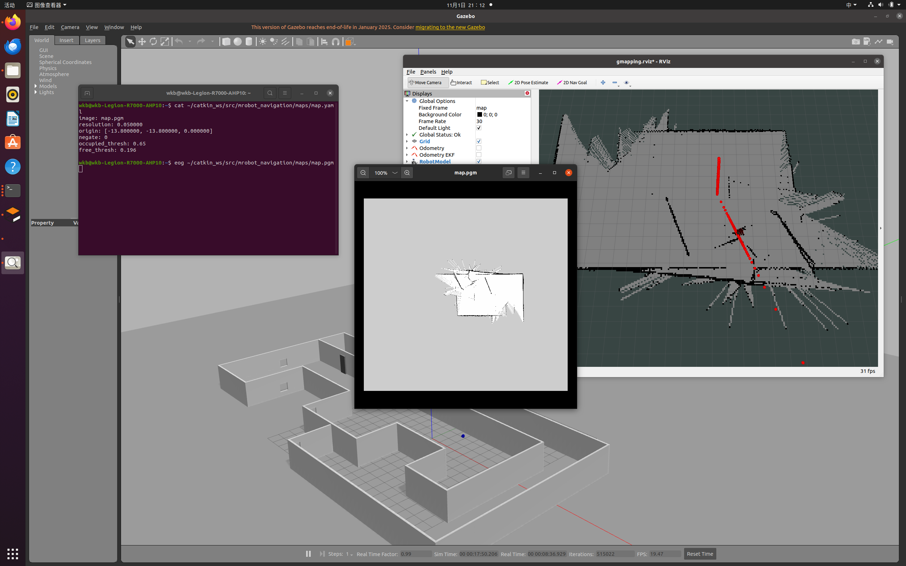

## 11. 建图质量分析与改进

### 11.1 本次问题

- 遥控时误触加速键，线速度最高达 41.59 m/s，激光帧率与里程计跟不上快速运动；
- 高速下相邻帧之间位移过大，扫描匹配退化，地图出现放射状噪点、边缘毛糙，严重时会重影错位；
- 地图四周存在未观测的灰色区域，说明部分空间覆盖不足。

### 11.2 改进建议

1. **慢速建图**：线速度保持 0.2 m/s 左右，转弯采用点动，避免长按方向键；
2. **不要误触加速键**：`q/w/e` 会放大速度，开始前确认底部为 `speed 0.2`；
3. **全覆盖**：规划路线走遍每个房间和角落，开门、过门时减速，减少灰色未知区；
4. **走闭环**：尽量回到经过的位置形成环路，利用回环修正累计误差；
5. **必要时重跑**：若出现明显重影，重启 gmapping 与 teleop 后慢速重建，可获得更干净的地图；
6. **参数调优**：环境更大时可适当增加 `particles`，并根据雷达量程调整 `maxUrange`、`maxRange`。

## 12. 常见问题

| 现象 | 原因 | 解决 |
|---|---|---|
| `can't locate node [mrobot_teleop.py]` | 脚本无可执行权限 | `chmod +x` 对应脚本 |
| `SyntaxError: invalid syntax`（print 附近） | Python2 脚本跑在 Python3 | 改为 `print(...)`，shebang 改 `python3` |
| `cp: 无法获取 '/robot_mrobot/...'` | shell 变量为空 | 用绝对路径，命令自包含 |
| `Could NOT find move_base_msgs` | CMake 声明的组件未安装 | 安装 `ros-noetic-move-base-msgs` |
| rviz 全局状态报错、无地图 | Fixed Frame 或 TF 错误 | 确认 Fixed Frame 为 `map`，检查 TF 链 |
| 地图放射噪点/重影 | 速度过快、扫描匹配失败 | 减速、全覆盖、走闭环，必要时重跑 |
| `TF_REPEATED_DATA` 警告 | 同时间戳重复 TF | 不影响建图，可忽略 |

## 13. 小结

本节完成了 gmapping 激光 SLAM 的完整流程：安装依赖 → 复制并适配功能包 → 编译 →
三终端启动 Gazebo/gmapping/键盘 → 遥控遍历房间 → `map_saver` 保存地图，并解读了
占据栅格地图与 `map.yaml` 的六个字段。下一节将基于保存的地图，使用 AMCL 进行定位并
结合 move_base 实现地图内的自主导航。
