# 6.3 导航功能包与实时避障

本节在已有二维栅格地图的基础上，实现机器人"**在地图上定位 + 路径规划 + 自主导航 + 实时避障**"。
与 6.1、6.2 的 Gazebo 物理仿真不同，本节使用 **arbotix 假仿真**：不启动 Gazebo 物理引擎，只用软件
模拟一台差速机器人的里程计与运动，配合 **map_server + fake_localization + move_base** 完成导航，
并支持 rviz 中的 **2D Nav Goal** 手动导航与 **random_navigation** 随机自动导航。

本节配套功能包位于仓库：

```text
src/chap6/catkin_ws/src/mrobot_bringup/       # arbotix 假机器人启动配置（精简版）
src/chap6/catkin_ws/src/mrobot_description/   # 假仿真使用的简化 URDF 模型
src/chap6/catkin_ws/src/mrobot_navigation/    # move_base、fake_localization、代价地图、随机导航脚本
```

## 1. 本节目标

1. 理解自主导航要解决的两大问题——**定位**与**路径规划**；
2. 理解 `move_base` 的工作机制、全局/局部规划器与两层代价地图（costmap）；
3. 理解 arbotix 假仿真与 `fake_localization` 的作用，理清完整的 TF 坐标树；
4. 安装 `navigation`、`arbotix` 功能包；
5. 准备精简版 `mrobot_bringup`、`mrobot_description` 并修复 Noetic 兼容问题；
6. 用两个终端启动假机器人与导航，在 rviz 中用 2D Nav Goal 手动导航；
7. 运行 `random_navigation` 随机自动导航，并分析 Python3 下的字典采样报错与修复。

## 2. 背景知识

### 2.1 自主导航的两大问题

移动机器人在一张已知地图上自主走到目标点，需要回答两个问题：

1. **我在哪里（定位，Localization）**：确定机器人当前在地图坐标系中的位姿（位置 x、y 与朝向 yaw）；
2. **我该怎么去（路径规划，Planning）**：在地图上找到一条从当前位姿到目标点、不与障碍物碰撞的路径，
   并把它转换成电机可执行的速度指令。

真实机器人通常用 **AMCL（自适应蒙特卡洛定位）** 解决第一个问题，用 `move_base` 解决第二个问题。
本节的假仿真用 `fake_localization` 代替 AMCL，获得"完美定位"，以便把注意力集中在导航框架本身。

### 2.2 move_base 与两大规划器

`move_base` 是 ROS 导航栈的核心节点，它对外提供一个 `move_base` 的 **action** 接口
（`MoveBaseAction`）：客户端只需下发一个目标位姿，`move_base` 就会负责规划并执行，期间反馈状态、
完成后返回结果。其内部主要包含两个规划器：

| 规划器 | 作用 | 本节实现 |
|---|---|---|
| 全局规划器（Global Planner） | 在整张地图上做全局寻路，生成从当前点到目标点的**全局路径** | `navfn`/`global_planner`（Dijkstra/A* 类算法） |
| 局部规划器（Local Planner） | 在机器人附近滚动地采样速度、预测短轨迹，输出实时 `cmd_vel`，并负责避障 | `base_local_planner` 的 `TrajectoryPlannerROS`（DWA 思路） |

执行时，局部规划器以全局路径为引导，结合周围障碍物持续生成速度指令；若局部规划器发现无路可走，
可触发恢复行为（如清障、原地旋转）。本节配置 `recovery_behavior_enabled: false`，关闭了恢复行为。

### 2.3 代价地图 costmap

`move_base` 维护两张**代价地图（Costmap2D）**，把不同来源的信息叠加成每个格子的"代价值"：

- **全局代价地图（global_costmap）**：覆盖整张地图，分辨率 0.01 m，长期稳定，供全局规划使用；
- **局部代价地图（local_costmap）**：只覆盖机器人周围 6 m × 6 m 的窗口，随机器人滚动更新，供局部规划使用。

代价地图采用**分层（layer）**结构，从下到上依次叠加：

1. **静态层（static_layer）**：直接加载 map_server 提供的静态地图，墙体等固定障碍来自这里；
2. **障碍层（obstacle_layer）**：根据实时传感器（`/scan`）标记/清除动态障碍；
3. **膨胀层（inflation_layer）**：在障碍物周围按机器人半径膨胀出一圈缓冲，避免机器人贴墙、刮蹭。

> 本节的假仿真方案不发布真实的 `/scan` 话题（简化 URDF 中激光雷达只有外形、没有 Gazebo 激光插件），
> 因此障碍层没有实时数据，代价地图主要依赖静态地图。rviz 中 LaserScan 项无数据，但不会报错。

### 2.4 arbotix 假仿真与 fake_localization

**arbotix 假仿真**由 `arbotix_python/arbotix_driver` 提供，启动时设置 `sim:=true`：

- 它用软件模拟一个差速控制器（`diff_controller`），订阅 `cmd_vel`，按 `base_width`、`ticks_meter`
  等参数对速度积分，计算出假的里程计，发布 `/odom` 话题与 `odom → base_footprint` 的 TF，同时发布关节状态；
- 整个过程不启动 Gazebo、不做物理碰撞计算，也不真正打开串口（配置里的 `port: /dev/ttyUSB0` 在
  sim 模式下仅作占位），因此几乎不消耗物理算力，"假仿真"由此得名。

**fake_localization（假定位）**用来代替真实的 AMCL：

- 它订阅里程计，把 `odom` 中的位姿直接包装成 AMCL 风格的 `/amcl_pose` 与 `/particlecloud`（粒子云）；
- 它不做任何概率估计，默认里程计位姿就是真实位姿，因此是"完美定位"，不存在定位误差和粒子发散。

### 2.5 TF 坐标树

定位与导航都依赖一条完整、无冲突的 TF 坐标树。本节各节点共同维护的坐标关系如下：

```text
map
 └── odom                 static_transform_publisher（map→odom 恒等变换）
      └── base_footprint  arbotix 的 diff_controller（假里程计）
           └── base_link  robot_state_publisher（依据 URDF）
                └── ... 电机、轮、板件 ...
                     └── laser_link
```

- `map → odom`：由 `static_transform_publisher` 发布为零平移、零旋转的恒等变换；
- `odom → base_footprint`：由 arbotix 假控制器随运动持续发布；
- `base_footprint → base_link → ... → laser_link`：由 `robot_state_publisher` 解析 URDF 静态发布。

## 3. 安装功能包

开始前先确认源码目录中包含 mrobot 各功能包，能看到 `mrobot_bringup`、`mrobot_description`、
`mrobot_gazebo`、`mrobot_navigation`、`mrobot_teleop` 五个包：

```bash
ls ~/ros_exploring_src/robot_mrobot
```

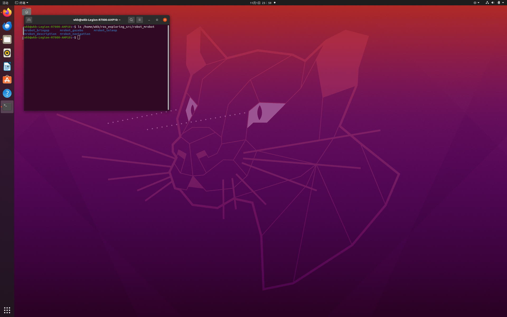

更新软件源并安装导航元包与 arbotix：

```bash
sudo apt update
sudo apt install -y ros-noetic-navigation ros-noetic-arbotix
```

- `ros-noetic-navigation`：导航元包，自动带入 `move_base`、`amcl`、`fake_localization`、
  `global_planner`、`navfn`、`costmap_2d`、`base_local_planner`、`dwa_local_planner`、`map_server` 等；
- `ros-noetic-arbotix`：提供 `arbotix_python`、`arbotix_controllers`、`arbotix_msgs`、`arbotix_sensors` 等。

安装时会列出大量将要安装的包：

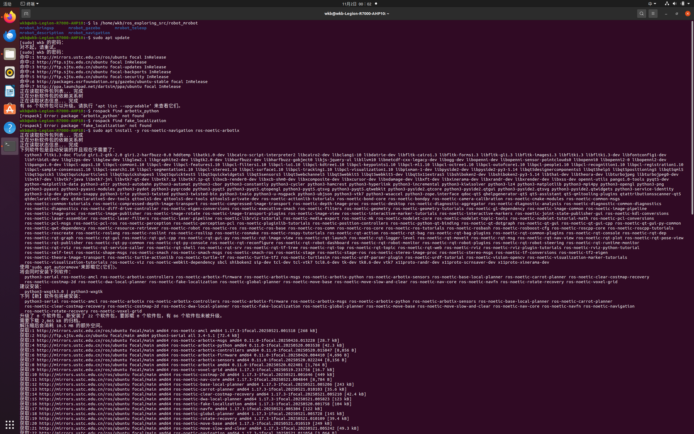

看到 "新安装了 22 个软件包" 且无报错即成功。用以下命令验证关键包可被找到：

```bash
rospack find arbotix_python
rospack find fake_localization
```

两条分别打印 `/opt/ros/noetic/share/arbotix_python` 与 `/opt/ros/noetic/share/fake_localization`：

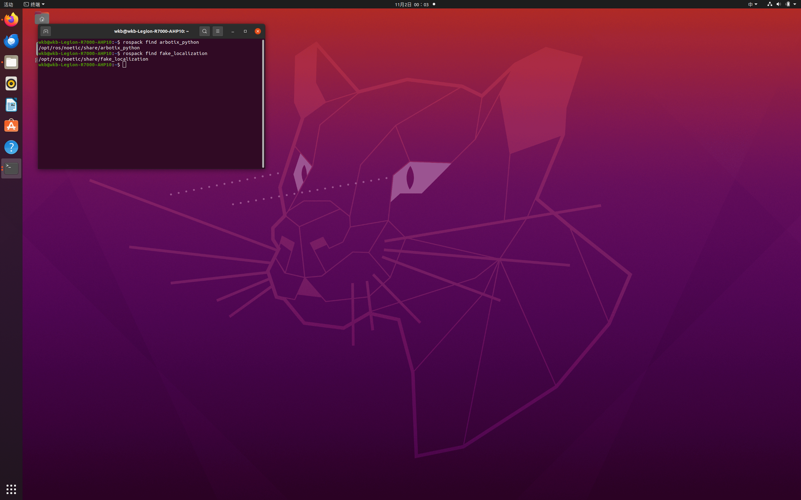

## 4. 准备精简版 mrobot_bringup

原始 `mrobot_bringup` 除了假仿真 launch 外，还包含真实硬件的 C++ 驱动（会在全局构造时打开
`/dev/ttyUSB0` 串口）以及多个无关 launch、脚本。假仿真用不到这些，因此只保留需要的 launch 与
arbotix 配置，并补写精简的构建文件。

### 4.1 创建目录并复制文件

```bash
mkdir -p ~/catkin_ws/src/mrobot_bringup/launch
mkdir -p ~/catkin_ws/src/mrobot_bringup/config

cp ~/ros_exploring_src/robot_mrobot/mrobot_bringup/launch/fake_mrobot_with_laser.launch \
   ~/catkin_ws/src/mrobot_bringup/launch/
cp ~/ros_exploring_src/robot_mrobot/mrobot_bringup/config/fake_mrobot_arbotix.yaml \
   ~/catkin_ws/src/mrobot_bringup/config/
```

### 4.2 修复 launch 的两处 Noetic 不兼容

```bash
# ① 删除已废弃的 --inorder 参数（Noetic 默认按文档顺序处理 xacro）
sed -i 's#xacro --inorder #xacro #g' \
   ~/catkin_ws/src/mrobot_bringup/launch/fake_mrobot_with_laser.launch
# ② state_publisher 在 Noetic 中已移除，改回 robot_state_publisher
sed -i 's#type="state_publisher"#type="robot_state_publisher"#g' \
   ~/catkin_ws/src/mrobot_bringup/launch/fake_mrobot_with_laser.launch
```

复制与修复命令执行后无报错：

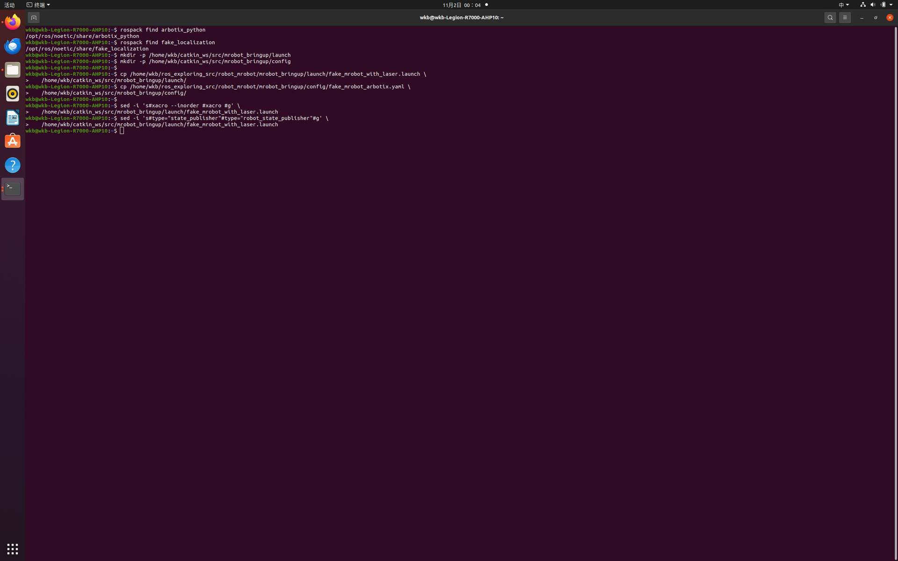

### 4.3 写入精简的构建文件

```bash
cat > ~/catkin_ws/src/mrobot_bringup/package.xml <<'EOF'
<?xml version="1.0"?>
<package format="2">
  <name>mrobot_bringup</name>
  <version>1.0.0</version>
  <description>mrobot 启动配置：使用 arbotix 假仿真加载带激光雷达的机器人（fake 导航，不启动 Gazebo）</description>
  <maintainer email="wkb@example.com">wkb</maintainer>
  <license>BSD</license>
  <buildtool_depend>catkin</buildtool_depend>
  <exec_depend>arbotix_python</exec_depend>
  <exec_depend>xacro</exec_depend>
  <exec_depend>robot_state_publisher</exec_depend>
  <exec_depend>joint_state_publisher</exec_depend>
  <exec_depend>mrobot_description</exec_depend>
</package>
EOF

cat > ~/catkin_ws/src/mrobot_bringup/CMakeLists.txt <<'EOF'
cmake_minimum_required(VERSION 3.0.2)
project(mrobot_bringup)
# 本包仅包含 launch 与 arbotix 配置，不编译 C++ 节点。
find_package(catkin REQUIRED)
catkin_package()
EOF
```

### 4.4 验证

```bash
ls -R ~/catkin_ws/src/mrobot_bringup
grep -nE 'inorder|state_publisher|robot_state_publisher' \
   ~/catkin_ws/src/mrobot_bringup/launch/fake_mrobot_with_laser.launch
```

grep 输出两行：第 15 行是 `joint_state_publisher`、第 16 行是 `robot_state_publisher`（正则 `state_publisher` 会同时匹配这两个名字）。其中节点类型已为 `robot_state_publisher`，没有独立的 `type="state_publisher"`，也没有 `--inorder`：

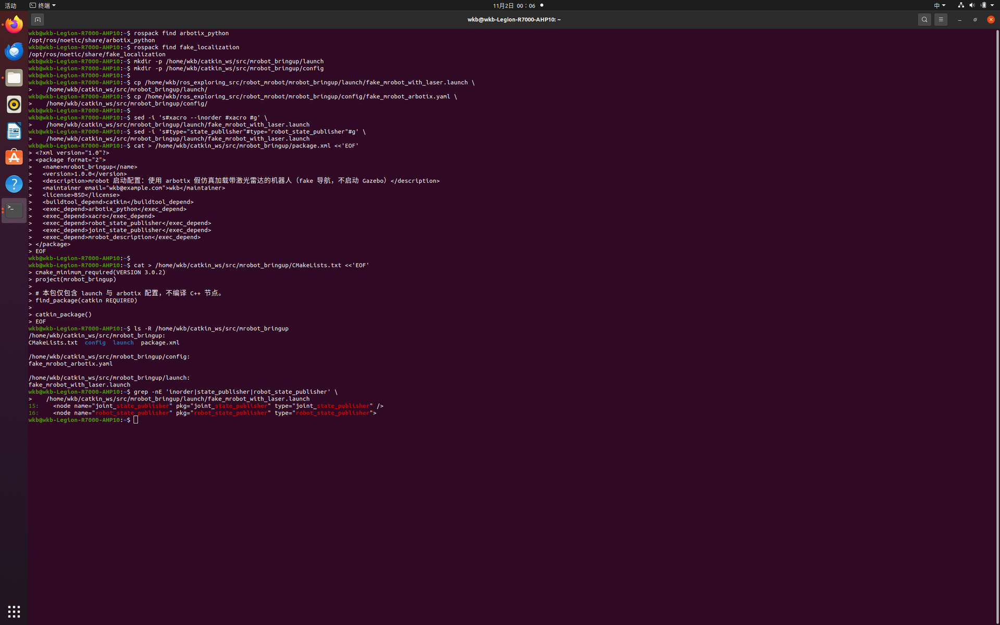

## 5. 准备 mrobot_navigation 导航文件

6.2 的 gmapping launch、rviz 与自己建的地图全部保留，下面只**新增**假导航需要的文件。

### 5.1 复制 launch、代价地图配置、rviz、地图

```bash
NAV=~/catkin_ws/src/mrobot_navigation
SRC=~/ros_exploring_src/robot_mrobot/mrobot_navigation

mkdir -p $NAV/launch $NAV/config/fake $NAV/rviz $NAV/maps $NAV/scripts
cp $SRC/launch/fake_move_base.launch $SRC/launch/fake_nav_demo.launch $NAV/launch/
cp $SRC/config/fake/*.yaml $NAV/config/fake/
cp $SRC/rviz/nav.rviz $NAV/rviz/
cp $SRC/maps/gmapping_map.yaml $SRC/maps/gmapping_map.pgm $NAV/maps/
```

### 5.2 复制并修复 random_navigation.py

```bash
NAV=~/catkin_ws/src/mrobot_navigation
SRC=~/ros_exploring_src/robot_mrobot/mrobot_navigation

cp $SRC/scripts/random_navigation.py $NAV/scripts/
# shebang 改为 python3
sed -i '1c\#!/usr/bin/env python3' $NAV/scripts/random_navigation.py
# 加可执行权限
chmod +x $NAV/scripts/random_navigation.py
```

### 5.3 验证

```bash
NAV=~/catkin_ws/src/mrobot_navigation
python3 -m py_compile $NAV/scripts/random_navigation.py && echo "random_navigation 语法 OK"
head -1 $NAV/scripts/random_navigation.py
ls -l $NAV/scripts/random_navigation.py
ls -l $NAV/maps/gmapping_map.*
```

首行为 `#!/usr/bin/env python3`、权限含 `x`、`gmapping_map.pgm` 为 278584 字节（约 272 KB）：

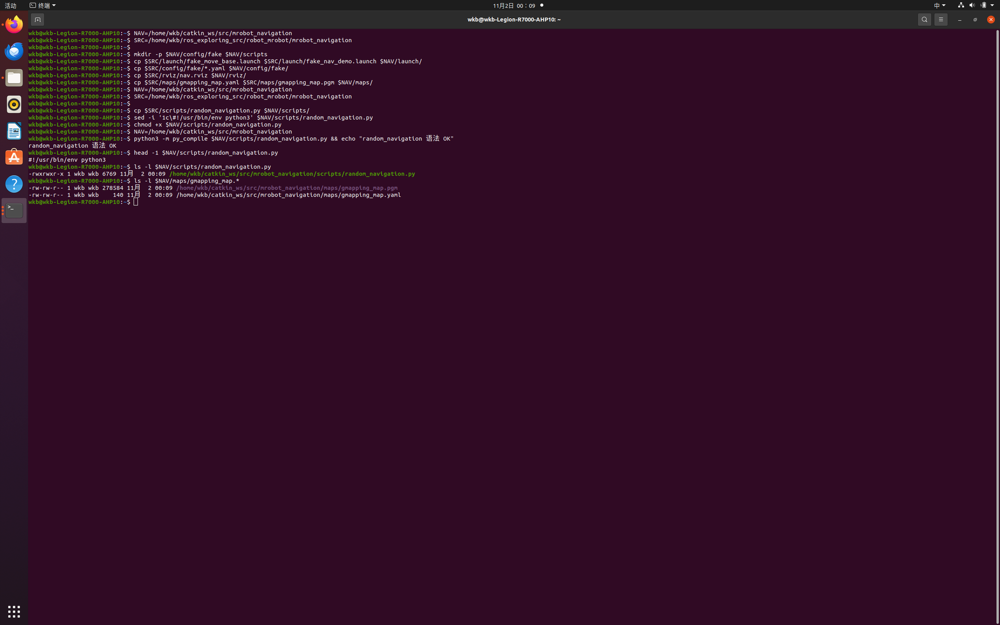

> `random_navigation` 中的 p1~p6 目标坐标与 `gmapping_map` 这张办公室地图是配套的，因此自动导航
> 必须使用 `gmapping_map`，不能换成 6.2 自己建的 my_room 小地图，否则目标点会落到地图外或墙体里。

## 6. 准备 mrobot_description 并修复 xacro 前缀

假仿真配套的是简化版 `mrobot_description`（关节名为 `left_wheel_joint`、`right_wheel_joint`，无
Gazebo 插件），与 6.1 放在 `mrobot_gazebo/urdf` 下的 Gazebo 版模型不是同一套，二者互不冲突。

与 6.1 相同的坑：Noetic 新版 xacro 不展开不带 `xacro:` 前缀的宏，需把
`mrobot_with_rplidar.urdf.xacro` 中的 `<mrobot_body/>` 加上前缀：

```bash
sed -i 's#<mrobot_body/>#<xacro:mrobot_body/>#g' \
   ~/catkin_ws/src/mrobot_description/urdf/mrobot_with_rplidar.urdf.xacro

grep -n 'mrobot_body' \
   ~/catkin_ws/src/mrobot_description/urdf/mrobot_with_rplidar.urdf.xacro
```

第 12 行显示 `<xacro:mrobot_body/>`，不再有裸的 `<mrobot_body/>`：

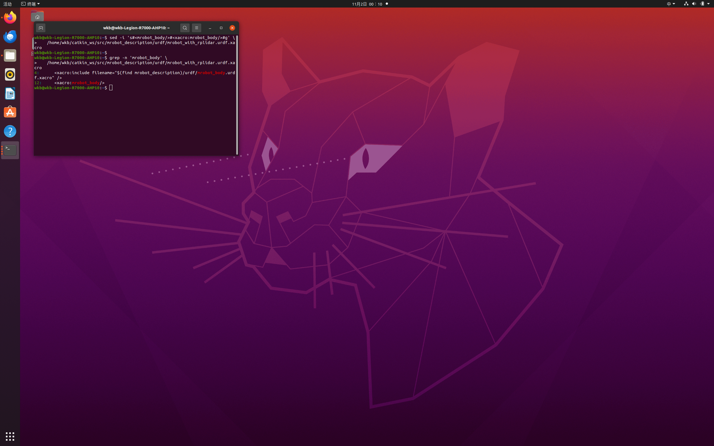

## 7. 编译工作空间

```bash
cd ~/catkin_ws
catkin_make
source devel/setup.bash
```

编译成功，末尾出现 `[100%] Built target ...`，中间的 Gazebo/costmap 黄色 deprecated 警告可忽略：

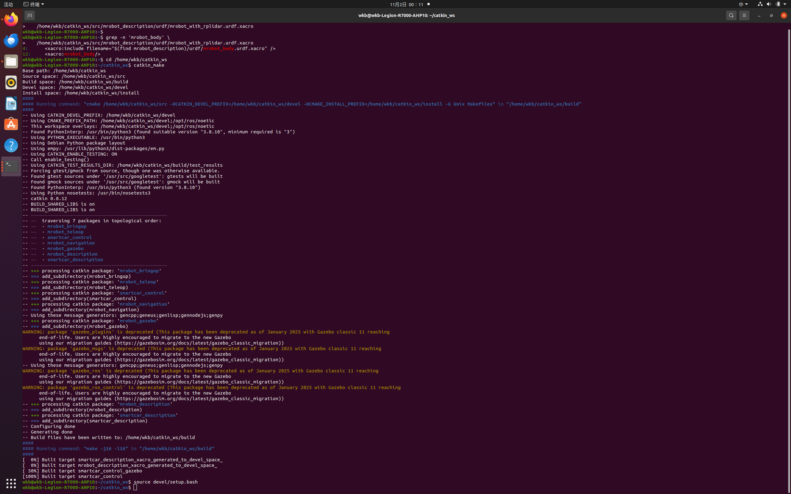

## 8. 启动假仿真与导航

需要 **2 个终端**，每个终端先执行一次环境加载（若 `.bashrc` 已配置可省略）：

```bash
source ~/catkin_ws/devel/setup.bash
```

### 8.1 终端 1——启动假机器人（arbotix）

```bash
roslaunch mrobot_bringup fake_mrobot_with_laser.launch
```

启动后不报错、停在运行状态，关键日志为：

```text
[INFO] ArbotiX being simulated.
[INFO] Started DiffController (base_controller). Geometry: 0.26m wide, 4100.0 ticks/m.
```

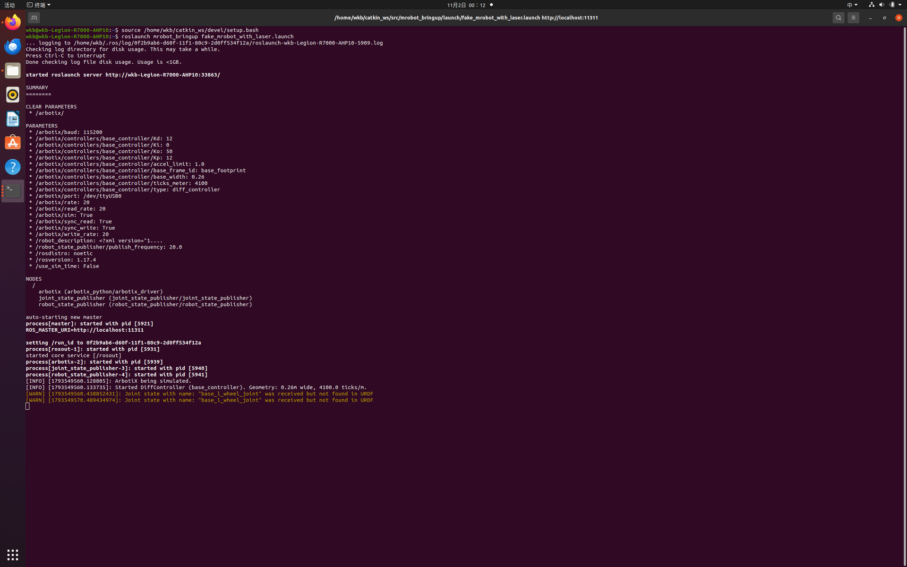

> 若此处报 `cannot launch node of type [arbotix_python/arbotix_driver]`，说明第 3 节 arbotix
> 未安装或未 source，回到第 3 节处理后再启动。

### 8.2 终端 2——启动顶层导航 launch

```bash
roslaunch mrobot_navigation fake_nav_demo.launch
```

该 launch 依次启动 map_server（加载 `gmapping_map`）、move_base（加载 `config/fake` 全套参数）、
fake_localization、map→odom 静态变换，以及 rviz。日志显示收到 `512 X 544 map @ 0.05 m/pix`、
全局/局部代价地图三层加载、`Created local planner ... TrajectoryPlannerROS`、`odom received!`。

rviz 自动打开并加载出办公室地图，左侧包含 Map、Local/Global Plan、PoseArray(粒子云)、LaserScan、
Goal Pose、Inflated Obstacles 等，Global Status 为 Ok：

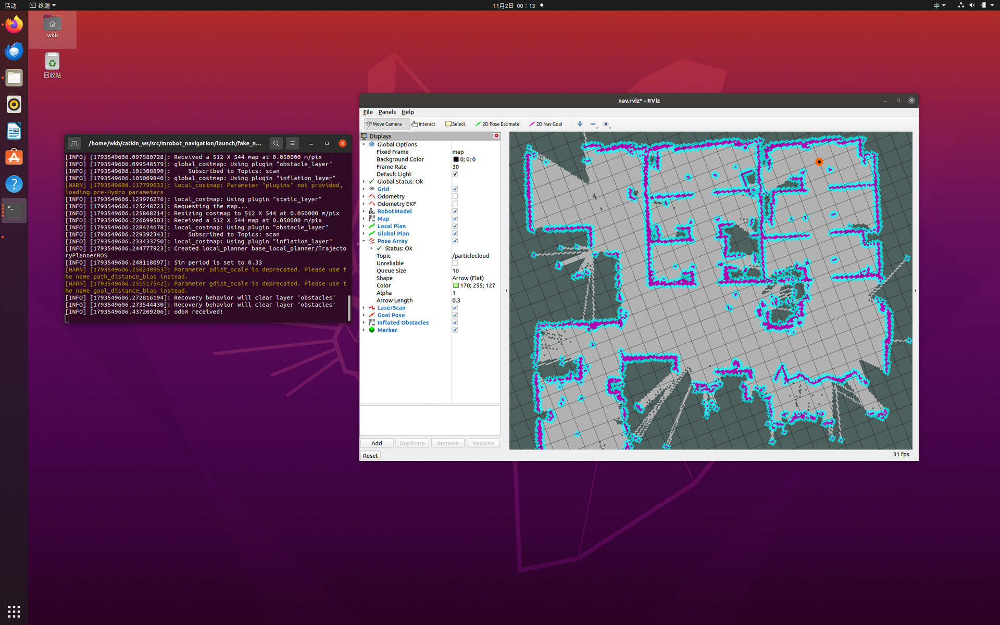

## 9. 用 2D Nav Goal 手动导航

1. 点击 rviz 顶部工具栏的 **2D Nav Goal**；
2. 在地图空旷处**按住左键拖动**——落点是目标位置，拖出的箭头方向是机器人最终朝向；
3. 松开后，地图上出现绿色的全局路径（Global Plan）与局部路径（Local Plan），机器人模型沿路径移动；
4. 到达后可再设几个不同位置的目标点，反复观察。

设置目标点后，move_base 规划出绕开障碍物的全局路径：

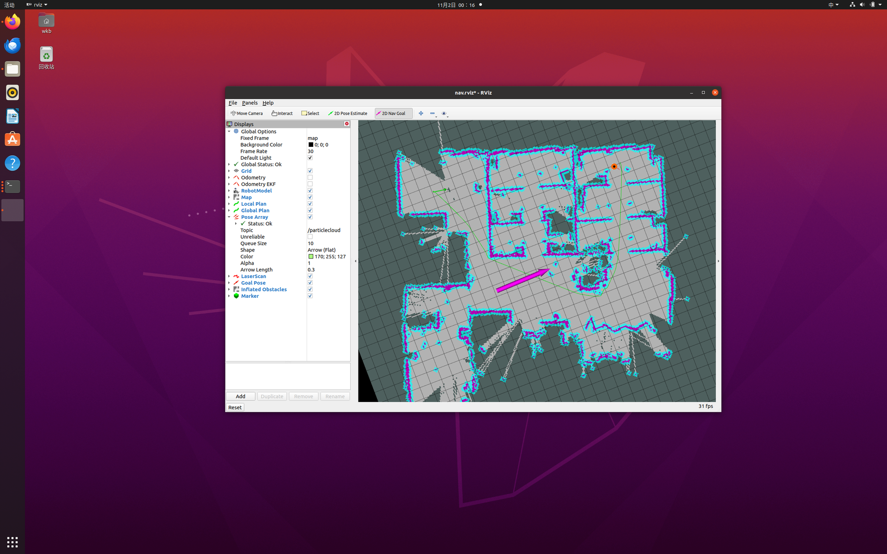

机器人沿路径实时跟随移动：


更换目标点后重新规划、继续导航：


## 10. random_navigation 随机自动导航

保持终端 1、终端 2 运行，**新开第 3 个终端**执行：

```bash
source ~/catkin_ws/devel/setup.bash
rosrun mrobot_navigation random_navigation.py
```

### 10.1 Python3 字典采样报错

首次运行时，脚本在随机选点阶段抛出异常：

```text
Traceback (most recent call last):
  File ".../random_navigation.py", line 167, in <module>
    NavTest()
  File ".../random_navigation.py", line 76, in __init__
    sequence = sample(locations, n_locations)
  File "/usr/lib/python3.8/random.py", line 359, in sample
    raise TypeError("Population must be a sequence or set.  For dicts, use list(d).")
TypeError: Population must be a sequence or set.  For dicts, use list(d).
[INFO] Stopping the robot...
```

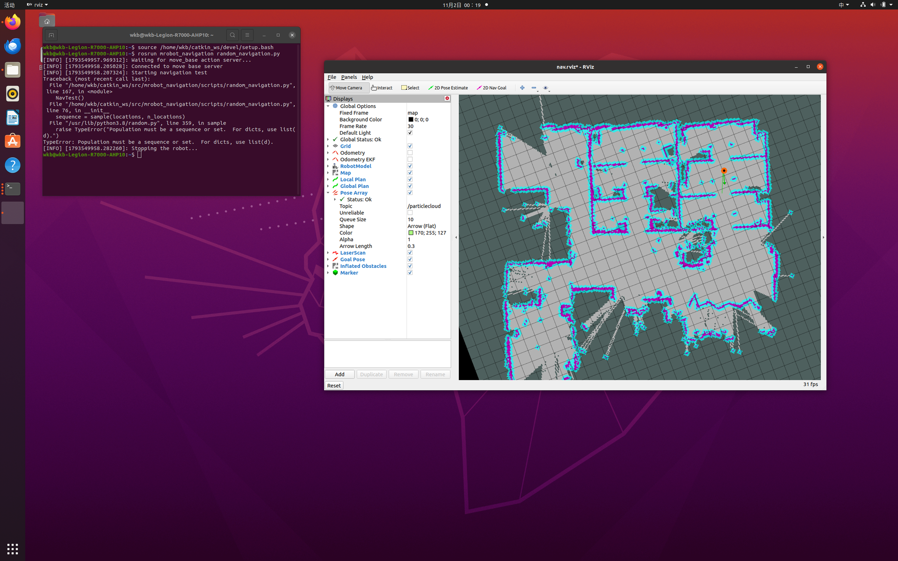

根因是 Python2 与 Python3 中 `random.sample()` 的行为差异：

- 脚本里 `locations` 是一个**字典**（键是 `p1`~`p6`，值是目标位姿）；
- Python2 的 `sample` 可以直接接受字典，对它的**键**采样；
- Python3 的 `sample` 只接受序列（list/tuple）或集合（set），拒绝字典，并在报错中明确提示
  `For dicts, use list(d)`。

### 10.2 修复并重新运行

按报错提示，把字典显式转成键列表再采样：

```bash
sed -i 's#sequence = sample(locations, n_locations)#sequence = sample(list(locations), n_locations)#' \
   ~/catkin_ws/src/mrobot_navigation/scripts/random_navigation.py

# 验证
grep -n 'sample' ~/catkin_ws/src/mrobot_navigation/scripts/random_navigation.py
python3 -m py_compile ~/catkin_ws/src/mrobot_navigation/scripts/random_navigation.py && echo "语法 OK"
```

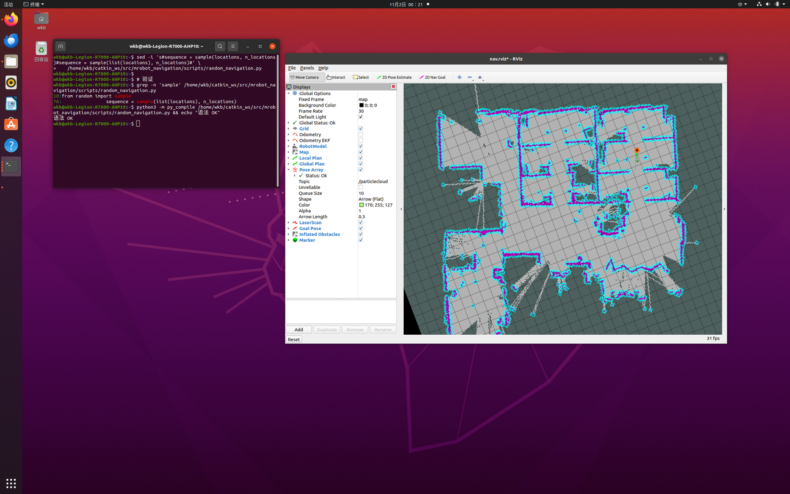

`list(locations)` 返回字典所有键的列表，`sample` 对这些键随机排序，后续仍按键取出对应位姿，
逻辑完全兼容。重新运行后机器人开始随机选点导航，第 1 个目标点成功：

```text
Going to: p5
Goal succeeded!
State:3
Success so far: 1/1 = 100.0%
Running time: 0.1 min Distance: 1.3 m
```


第 2 个目标点成功，成功率保持 100%：

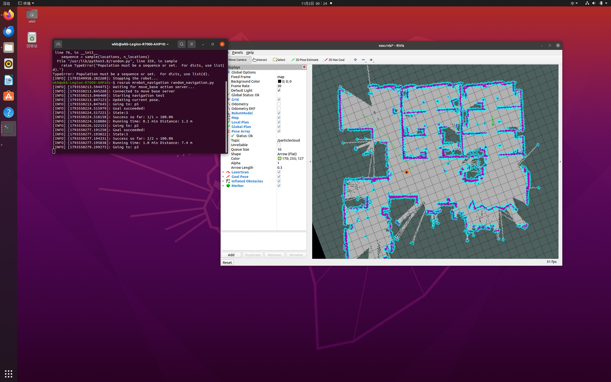

第 3 个目标点成功，距离与运行时间持续累计：

```text
Success so far: 3/3 = 100.0%
Running time: 1.4 min Distance: 12.0 m
```


rviz 中可同时观察到粒子云、全局/局部路径、目标点与膨胀障碍物随自动导航实时更新：

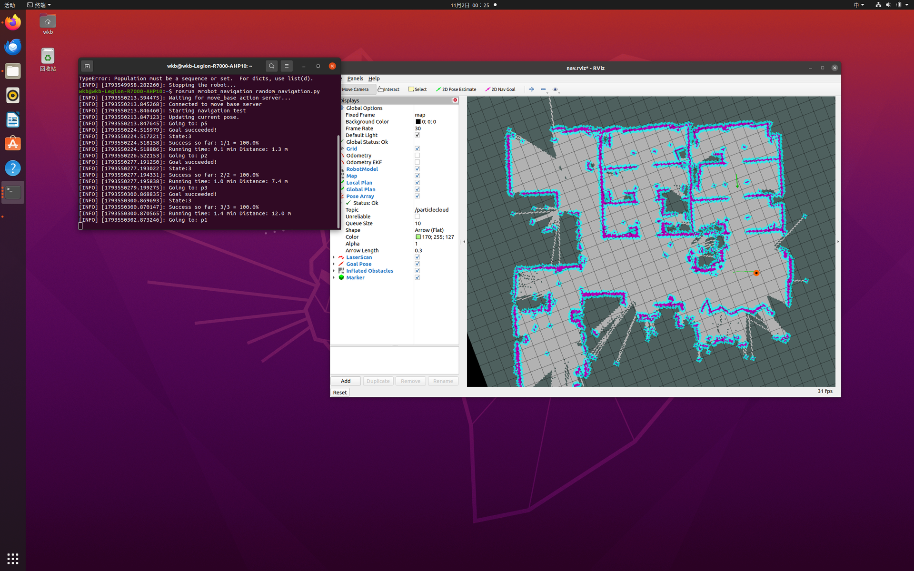

> Python3 的整数除法 `/` 为真除法，因此成功率会显示为 `100.0%` 而非教程 Python2 截图中的
> `100%`，仅是显示差异，不影响结果。

## 11. 关键参数解读

### 11.1 arbotix 差速控制器参数

`fake_mrobot_arbotix.yaml` 中 `base_controller` 的关键参数：

| 参数 | 取值 | 含义 |
|---|---|---|
| `type` | `diff_controller` | 差速控制器类型 |
| `base_frame_id` | `base_footprint` | 里程计发布的子坐标系 |
| `base_width` | `0.26` | 左右轮间距（米） |
| `ticks_meter` | `4100` | 每行进 1 米对应的编码器计数 |
| `Kp`/`Kd`/`Ki` | `12`/`12`/`0` | 控制 PID 参数（sim 模式影响很小） |

### 11.2 代价地图参数

`costmap_common_params.yaml` 中两层代价地图共用的关键参数：

| 参数 | 取值 | 含义 |
|---|---|---|
| `obstacle_range` | `2.5` | 2.5 m 内的障碍才被标记 |
| `raytrace_range` | `3.0` | 3 m 内的空闲区域被光线追踪清除 |
| `robot_radius` | `0.175` | 机器人半径，用于膨胀 |
| `inflation_radius` | `0.1` | 障碍膨胀半径 |
| `observation_sources` | `scan` | 障碍观测来源（本方案无实时数据） |

### 11.3 局部规划器参数

`base_local_planner_params.yaml` 中 `TrajectoryPlannerROS` 的关键参数：

| 参数 | 取值 | 含义 |
|---|---|---|
| `controller_frequency` | `3.0` | 控制（速度下发）频率 3 Hz |
| `max_vel_x` / `min_vel_x` | `0.5` / `0.1` | 前向线速度上下限 |
| `max_vel_theta` | `1.0` | 最大角速度 |
| `xy_goal_tolerance` | `0.05` | 到达目标的位置容差 5 cm |
| `yaw_goal_tolerance` | `0.1` | 到达目标的角度容差 0.1 rad |
| `sim_time` | `1.0` | 每条候选轨迹的仿真时长 1 s |
| `dwa` | `true` | 采用 DWA 方式采样 |
| `recovery_behavior_enabled` | `false` | 关闭恢复行为 |

## 12. 常见问题

| 现象 | 原因 | 解决 |
|---|---|---|
| `cannot launch node of type [arbotix_python/arbotix_driver]` | arbotix 未安装或未 source | 安装 `ros-noetic-arbotix`，并 `source devel/setup.bash` |
| `rospack: package 'arbotix_python' not found` | 只执行了 `apt update`，未 `apt install` | 执行 `apt install ros-noetic-arbotix` |
| `type="state_publisher"` 启动异常 | `state_publisher` 在 Noetic 已移除 | 改为 `type="robot_state_publisher"` |
| xacro 警告 `in-order processing became default` | launch 中仍带 `--inorder` | 删除 `--inorder` 参数 |
| 小车模型不显示/缺 link | 宏调用缺 `xacro:` 前缀 | `<mrobot_body/>` 改为 `<xacro:mrobot_body/>` |
| `TypeError: Population must be a sequence or set` | Python3 的 `sample` 不接受字典 | 改为 `sample(list(locations), n)` |
| rviz 中 LaserScan 无数据 | 假仿真不发布 `/scan` | 正常现象，代价地图靠静态地图，可忽略 |
| `Joint state ... not found in URDF` 警告 | arbotix 关节名与 URDF 命名不一致 | 不影响导航，可忽略 |
| `pdist_scale/gdist_scale deprecated` 警告 | 参数名已弃用 | 功能不受影响，可忽略 |

## 13. 小结

本节完成了基于 arbotix 假仿真的完整自主导航流程：安装 `navigation`、`arbotix` → 准备精简版
`mrobot_bringup`、`mrobot_description` 与 `mrobot_navigation` 并修复 Noetic 兼容问题 → 编译 →
两个终端启动假机器人与导航 → 在 rviz 中用 2D Nav Goal 手动导航 → 运行 `random_navigation` 随机
自动导航。过程中理清了 `move_base` 的全局/局部规划器、两层代价地图与完整 TF 树，并定位修复了
Python3 下 `random.sample` 不接受字典的问题，最终随机导航成功率保持 100%。

## 参考资料

- ROS Wiki：move_base 官方文档，<http://wiki.ros.org/move_base>
- ROS Wiki：navigation 导航栈，<http://wiki.ros.org/navigation>
- ROS Wiki：fake_localization 官方文档，<http://wiki.ros.org/fake_localization>
- ROS Wiki：arbotix_python 假仿真，<http://wiki.ros.org/arbotix_python>
- ROS Wiki：costmap_2d 代价地图，<http://wiki.ros.org/costmap_2d>
- 《ROS 机器人开发实践》，配套源码 `ros_exploring`（作者 胡春旭）
- CSDN 教程：《ROS 导航——move_base 假仿真自主导航》
