# 6.4 Gazebo 仿真机器人导航

本节把导航流程从 6.3 的 **arbotix 假仿真**搬回**真实 Gazebo 物理世界**：机器人在 Gazebo 中受到真实的
物理约束，差速插件根据轮子转动计算里程计、激光插件发布真实的 `/scan`，`move_base` 据此进行**实时避障**。
需要特别说明的是，尽管进入了真实 Gazebo，本节教程配套的定位环节**仍然使用 `fake_localization`（完美定位），
而不是 AMCL**，因此 rviz 中无需设置初始位姿，直接下发 `2D Nav Goal` 即可。

本节包含两个演示：先在教程自带的 **cloister 回廊**世界跑通真实导航，再把世界换成 6.1 自己创建的
**my_room 房间**（教程中称 hourse.world），用自己 gmapping 建的地图导航。

本节配套功能包位于仓库：

```text
src/chap6/catkin_ws/src/mrobot_gazebo/       # 新增 cloister.world，Gazebo 启动 launch 支持外部覆盖世界
src/chap6/catkin_ws/src/mrobot_navigation/   # 新增 move_base、fake_nav_cloister/hourse 演示、config/mrobot 与配套地图
```

## 1. 本节目标

1. 理解真实 Gazebo 导航与 arbotix 假仿真的区别，掌握真实里程计、真实激光与实时避障的数据流；
2. 理解为什么本节在真实 Gazebo 中仍使用 `fake_localization`，并理清完整 TF 坐标树；
3. 准备 cloister 回廊例程所需的世界、地图、代价地图配置与 launch；
4. 排查并修复 roslaunch 命令行无法覆盖 `world_name` 参数的问题；
5. 排查并修复 `fake_nav_hourse_demo.launch` 文件缺失的问题；
6. 在 cloister 与自建 my_room 两个世界中完成 `2D Nav Goal` 自主导航；
7. 记录当前保留的两类 TF 警告，作为后续优化项。

## 2. 背景知识

### 2.1 真实 Gazebo 导航与 arbotix 假仿真的区别

6.3 的 arbotix 假仿真不启动 Gazebo，里程计、关节运动都是软件"算"出来的，且没有真实激光。本节则启动
完整的 Gazebo 物理引擎，两者对比如下：

| 对比项 | 6.3 arbotix 假仿真 | 6.4 Gazebo 真仿真 |
|---|---|---|
| 物理引擎 | 不启动 Gazebo | 真实 Gazebo，含重力、碰撞、摩擦 |
| 里程计 `/odom` | arbotix 软件积分 | 差速插件依据轮子真实转动计算 |
| 激光 `/scan` | 无 | 激光插件真实射线扫描 |
| 实时避障 | 主要靠静态地图 | 静态地图 + 真实激光障碍，实时避障 |
| 定位 | fake_localization | **仍是 fake_localization** |
| 路径规划 | move_base | move_base |

### 2.2 真实里程计、激光与实时避障

Gazebo 机器人模型（`mrobot_gazebo/urdf`）中配置了两个关键插件：

- **差速驱动插件 `libgazebo_ros_diff_drive.so`**：订阅 `/cmd_vel`，驱动左右轮转动，根据轮子实际转角
  计算并发布 `/odom` 里程计，同时广播 `odom → base_footprint` 的 TF，并发布 `/joint_states`；
- **激光插件 `libgazebo_ros_laser.so`**：在每个仿真周期发射射线，发布 `laser_link` 坐标系下的真实
  `/scan` 数据。

`move_base` 的代价地图同时叠加静态地图与实时激光：当机器人运动时，激光不断标记/清除周围障碍，
局部规划器据此滚动采样速度，遇到障碍会重新规划、绕开，实现真实的实时避障。

### 2.3 为什么仍使用 fake_localization

真实机器人通常用 **AMCL（自适应蒙特卡洛定位）** 解决"我在哪里"的问题，需要在 rviz 中先给出初始位姿
（`2D Pose Estimate`），再通过粒子滤波逐步收敛。本节为了把重点放在 Gazebo 与 `move_base` 的联动上，
沿用 `fake_localization`：

- 它订阅里程计，把 `odom` 位姿直接包装成 AMCL 风格的 `/amcl_pose` 与 `/particlecloud`；
- 不做概率估计，默认里程计即真实位姿，属于"完美定位"，因此启动后定位即准确，无需初始位姿。

> 若希望体验真实粒子滤波定位，可自行编写 `amcl.launch`（或从配套源码 `ros_exploring` 中获取），将
> `fake_localization` 替换为 AMCL 并在 rviz 中设置初始位姿。这部分属于拓展内容，不在本节主线。

### 2.4 数据流与 TF 坐标树

两个 launch 各管一摊：

```text
终端 1  mrobot_laser_nav_gazebo.launch
          ├─ Gazebo 加载世界（cloister 或 my_room）
          ├─ 差速插件：订阅 /cmd_vel，发布 /odom、/joint_states 与 TF(odom→base_footprint)
          ├─ 激光插件：发布 /scan（frame: laser_link）
          └─ robot_state_publisher：发布机器人模型 TF

终端 2  fake_nav_cloister_demo / fake_nav_hourse_demo.launch
          ├─ map_server         加载静态地图
          ├─ move_base          全局/局部规划、实时避障（config/mrobot）
          ├─ fake_localization  包装 AMCL 风格定位
          ├─ static_transform   map→odom 恒等变换
          └─ rviz               可视化与 2D Nav Goal
```

完整 TF 树：

```text
map
 └── odom                 static_transform_publisher / fake_localization（map→odom）
      └── base_footprint  Gazebo 差速插件（真实里程计）
           └── base_link  robot_state_publisher（依据 URDF）
                └── ... 轮、板件、laser_link ...
```

## 3. 环境与依赖检查

开始前先确认工作空间环境加载正常，且导航所需的关键包都能被找到：

```bash
source /home/wkb/catkin_ws/devel/setup.bash
for p in map_server move_base fake_localization amcl gazebo_ros; do
  rospack find $p >/dev/null 2>&1 && echo "OK: $p" || echo "缺失: $p"
done
```

五个包全部输出 `OK`，说明 6.2、6.3 安装的 `ros-noetic-navigation` 等依赖已满足，本节无需再安装新包：

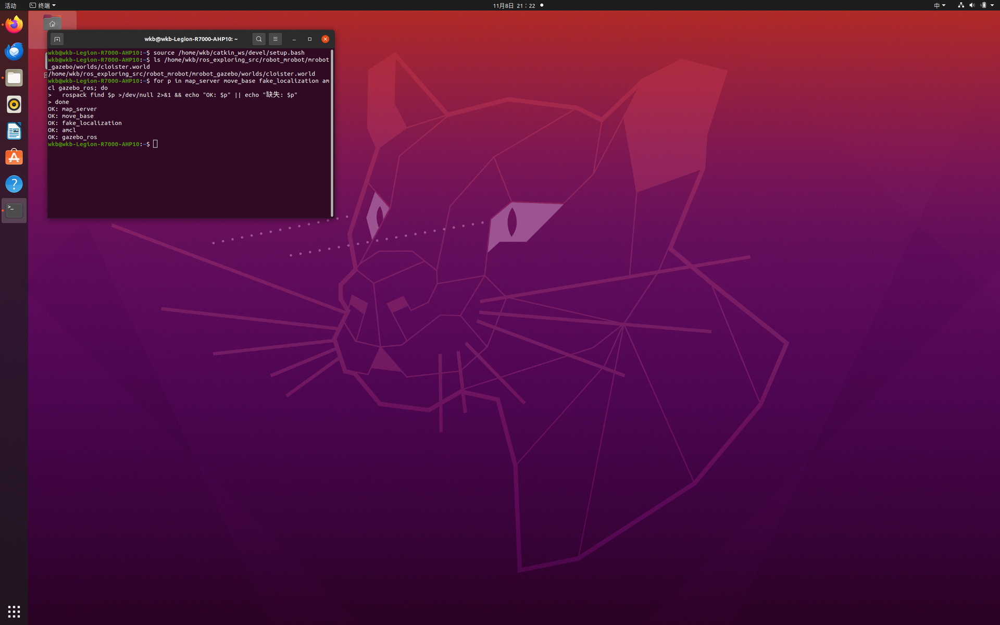

同时确认参考源码中 cloister 世界文件存在：

```bash
ls /home/wkb/ros_exploring_src/robot_mrobot/mrobot_gazebo/worlds/cloister.world
```

**阶段 A：cloister 回廊例程**

## 4. 准备 cloister 所需文件

### 4.1 复制 cloister.world

```bash
SRC=/home/wkb/ros_exploring_src/robot_mrobot
G=/home/wkb/catkin_ws/src/mrobot_gazebo
cp "$SRC/mrobot_gazebo/worlds/cloister.world" "$G/worlds/"
ls -l "$G/worlds/cloister.world"
```

复制后 `cloister.world` 与原有的 `my_room.world` 并列存在：

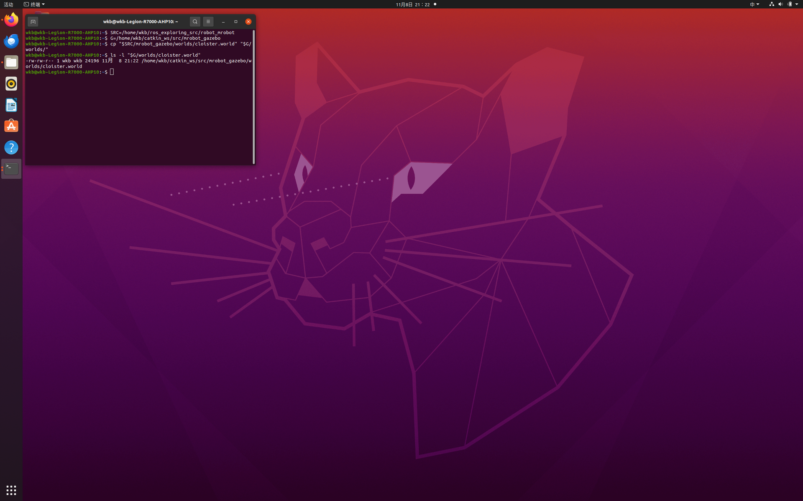

### 4.2 复制地图、代价地图配置与 launch

```bash
SRC=/home/wkb/ros_exploring_src/robot_mrobot
N=/home/wkb/catkin_ws/src/mrobot_navigation
# cloister 地图
cp "$SRC/mrobot_navigation/maps/cloister_gmapping.yaml" "$N/maps/"
cp "$SRC/mrobot_navigation/maps/cloister_gmapping.pgm"  "$N/maps/"
# config/mrobot 代价地图配置
mkdir -p "$N/config/mrobot"
cp "$SRC/mrobot_navigation/config/mrobot/"*.yaml "$N/config/mrobot/"
# move_base 与 cloister 演示 launch
cp "$SRC/mrobot_navigation/launch/move_base.launch" "$N/launch/"
cp "$SRC/mrobot_navigation/launch/fake_nav_cloister_demo.launch" "$N/launch/"
```

复制完成后，`maps` 中出现 cloister 地图、`config/mrobot` 下有四个参数文件、`launch` 中新增
`move_base.launch` 与 `fake_nav_cloister_demo.launch`：

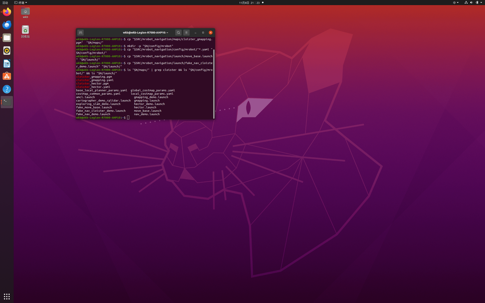

## 5. 编译工作空间

```bash
cd /home/wkb/catkin_ws
catkin_make
source devel/setup.bash
```

编译成功，末尾出现 `[100%] Built target ...`，无报错：

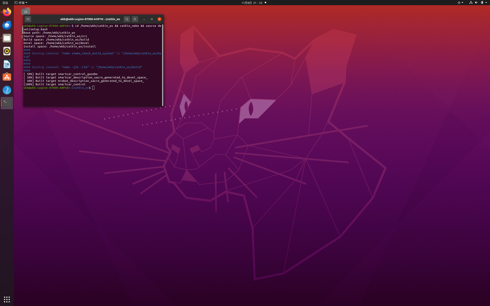

## 6. 修复 world_name 命令行覆盖问题

### 6.1 报错现象

最初尝试通过命令行把世界临时切换为 cloister：

```bash
G=/home/wkb/catkin_ws/src/mrobot_gazebo
roslaunch mrobot_gazebo mrobot_laser_nav_gazebo.launch world_name:=$G/worlds/cloister.world
```

却直接抛出异常，Gazebo 未能启动：

```text
RLException: Invalid <arg> tag: cannot override arg 'world_name', which has already been set.
Arg xml is <arg name="world_name" value="$(find mrobot_gazebo)/worlds/my_room.world"/>
```

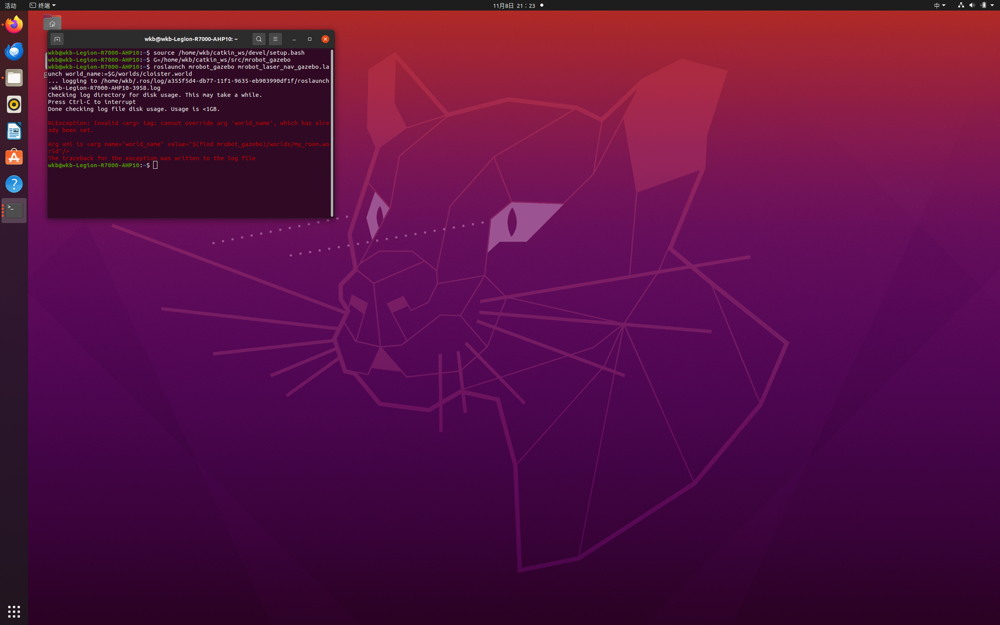

### 6.2 原因与修复

roslaunch 的 `<arg>` 有两种取值方式：

- `<arg name="x" value="..."/>`：**强制固定**为该值，命令行无法覆盖；
- `<arg name="x" default="..."/>`：外部未设置时使用默认值，**允许命令行覆盖**。

原 launch 第 4 行使用的是 `value`，因此命令行传入同名参数会被拒绝。把它改为 `default` 即可，
`my_room` 仍作为默认值，不传参数时行为不变：

```bash
sed -i 's#<arg name="world_name" value=#<arg name="world_name" default=#' \
   /home/wkb/catkin_ws/src/mrobot_gazebo/launch/mrobot_laser_nav_gazebo.launch
grep -n 'world_name' /home/wkb/catkin_ws/src/mrobot_gazebo/launch/mrobot_laser_nav_gazebo.launch
```

第 4 行变为 `default`，而 include 中传递参数的第 13 行保持 `value="$(arg world_name)"` 不变：

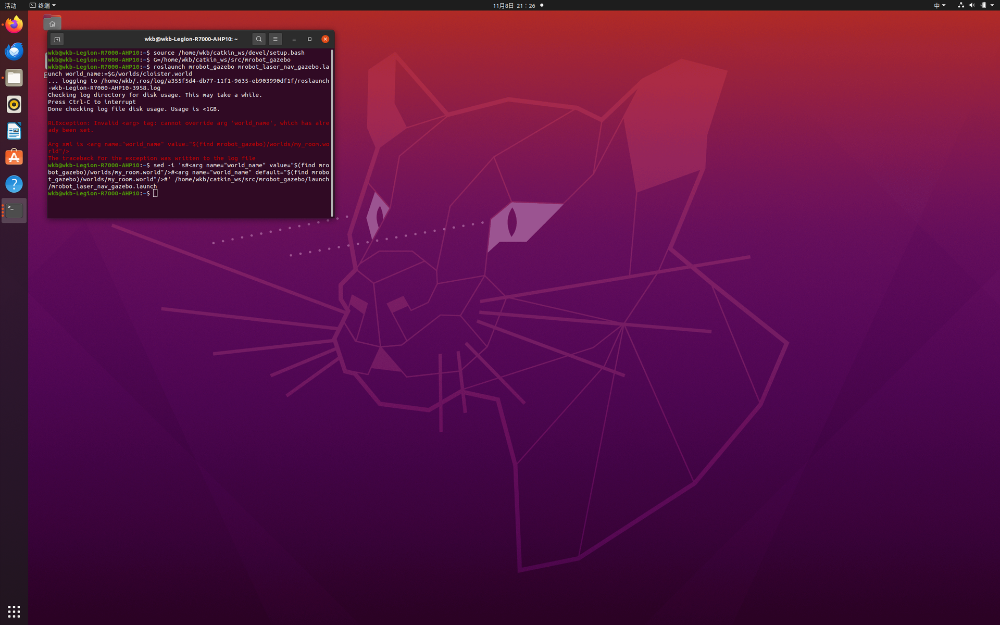

## 7. 启动 cloister 导航

### 7.1 终端 1：启动 Gazebo + cloister

```bash
source /home/wkb/catkin_ws/devel/setup.bash
G=/home/wkb/catkin_ws/src/mrobot_gazebo
roslaunch mrobot_gazebo mrobot_laser_nav_gazebo.launch world_name:=$G/worlds/cloister.world
```

修复后命令行覆盖生效，Gazebo 启动，差速插件加载并打印 `DiffDrive` 配置，`urdf_spawner` 成功
生成机器人模型：

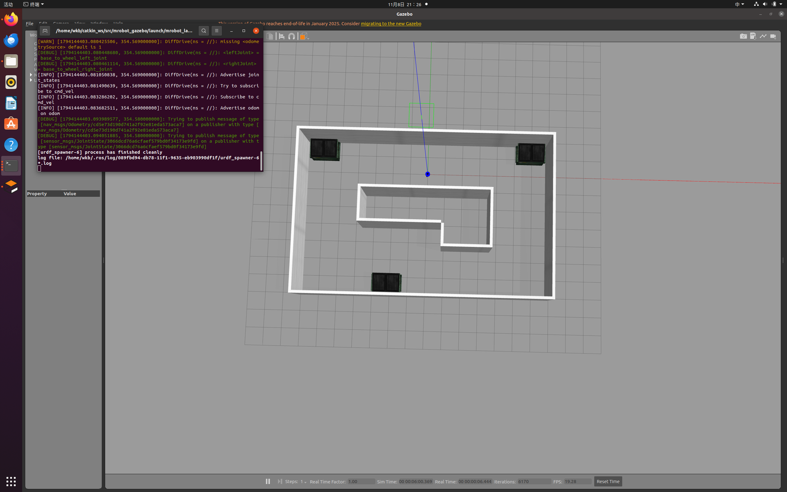

roslaunch 顶部的 `SUMMARY` 完整列出了参数与节点：`gazebo`、`joint_state_publisher`、
`robot_state_publisher`、`urdf_spawner` 等，`/use_sim_time` 为 true：

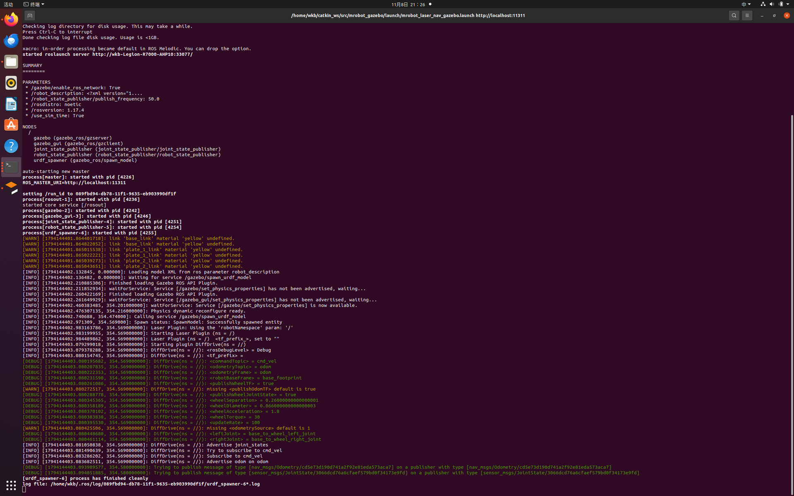

### 7.2 终端 2：启动导航 + rviz

```bash
source /home/wkb/catkin_ws/devel/setup.bash
roslaunch mrobot_navigation fake_nav_cloister_demo.launch
```

rviz 启动后加载 cloister 静态地图，机器人位置正确，左侧包含 Map、Local/Global Plan、Pose Array、
LaserScan、Goal Pose、Inflated Obstacles 等显示项。Gazebo 中可清晰看到 cloister 房间与机器人：

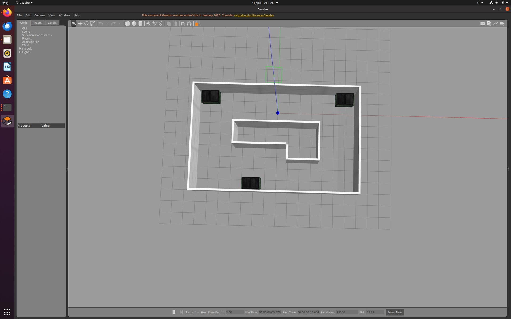

### 7.3 下发 2D Nav Goal

1. 点击 rviz 工具栏的 **2D Nav Goal**；
2. 在地图空旷处按下左键拖出目标方向，松开即下发目标；
3. 地图上出现全局/局部规划路径，Gazebo 中的机器人真实转动、沿路径移动并实时避障，rviz 同步；
4. 到达目标后终端出现 `Goal reached`，可多换几个目标点反复验证。

**阶段 B：自建 my_room 房间导航**

## 8. 修复 fake_nav_hourse_demo 文件缺失问题

### 8.1 报错现象

进入自建房间演示时，执行：

```bash
roslaunch mrobot_navigation fake_nav_hourse_demo.launch
```

终端报错，导航未能启动：

```text
RLException: [fake_nav_hourse_demo.launch] is neither a launch file in package [mrobot_navigation]
nor is [mrobot_navigation] a launch file name
```

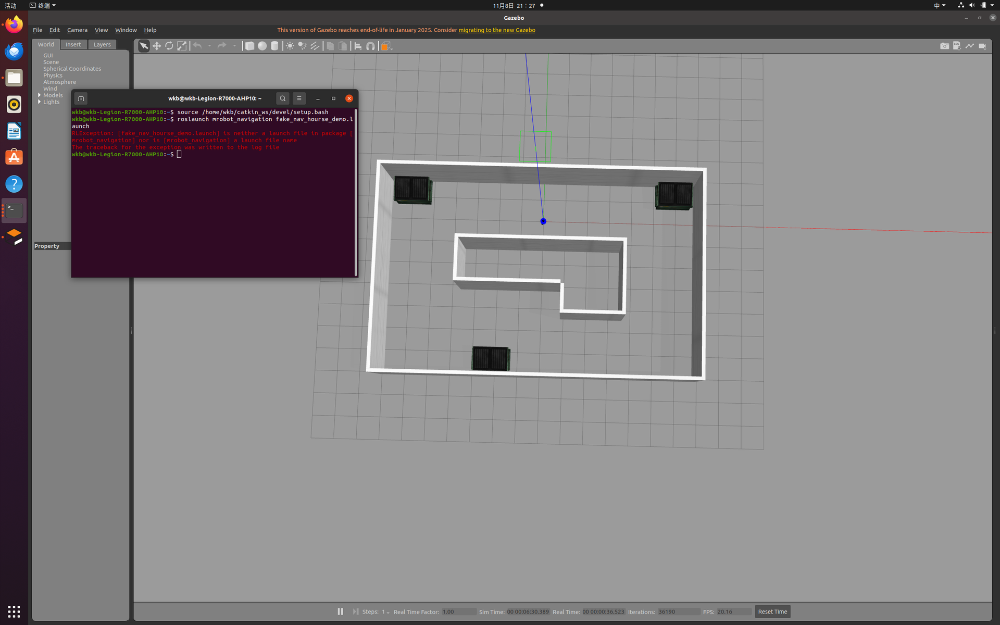

### 8.2 诊断

先列出各目录，确认到底哪些文件就位：

```bash
G=/home/wkb/catkin_ws/src/mrobot_gazebo
N=/home/wkb/catkin_ws/src/mrobot_navigation
ls "$G/worlds/"
ls "$N/launch/"
ls "$N/maps/"
ls -R "$N/config/"
```

诊断结果显示 cloister 相关文件都已就位，但 `launch` 中确实没有 `fake_nav_hourse_demo.launch`，
`maps` 中也没有 hourse 地图：

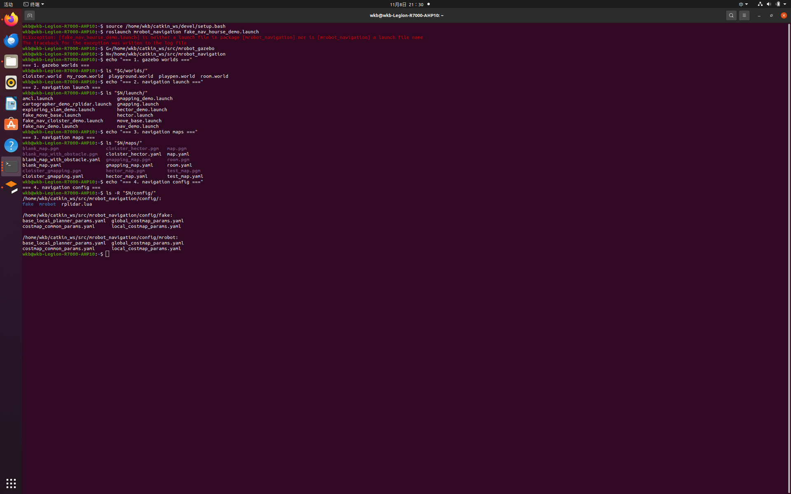

### 8.3 准备 hourse_gmapping 地图

教程明确：`map.pgm、map.yaml、hourse_gmapping.pgm、hourse_gmapping.yaml` 都要有，对应后缀的文件
内容相同。把自建房间地图复制为 hourse_gmapping，并修改 yaml 中的图片名：

```bash
N=/home/wkb/catkin_ws/src/mrobot_navigation
cp "$N/maps/map.pgm" "$N/maps/hourse_gmapping.pgm"
cp "$N/maps/map.yaml" "$N/maps/hourse_gmapping.yaml"
sed -i 's/^image: map.pgm/image: hourse_gmapping.pgm/' "$N/maps/hourse_gmapping.yaml"
```

### 8.4 创建 fake_nav_hourse_demo.launch

它与 cloister 版结构完全一致，唯一区别是地图默认值。复制 cloister 版并把地图名整体替换：

```bash
N=/home/wkb/catkin_ws/src/mrobot_navigation
cp "$N/launch/fake_nav_cloister_demo.launch" "$N/launch/fake_nav_hourse_demo.launch"
sed -i 's/cloister_gmapping/hourse_gmapping/g' "$N/launch/fake_nav_hourse_demo.launch"
```

验证 hourse 地图 yaml 与 launch 地图参数：

```bash
cat "$N/maps/hourse_gmapping.yaml"
grep 'arg name="map"' "$N/launch/fake_nav_hourse_demo.launch"
```

yaml 中 `image: hourse_gmapping.pgm`、`origin: [-13.8, -13.8, 0]`，launch 中地图默认值为
`hourse_gmapping.yaml`：

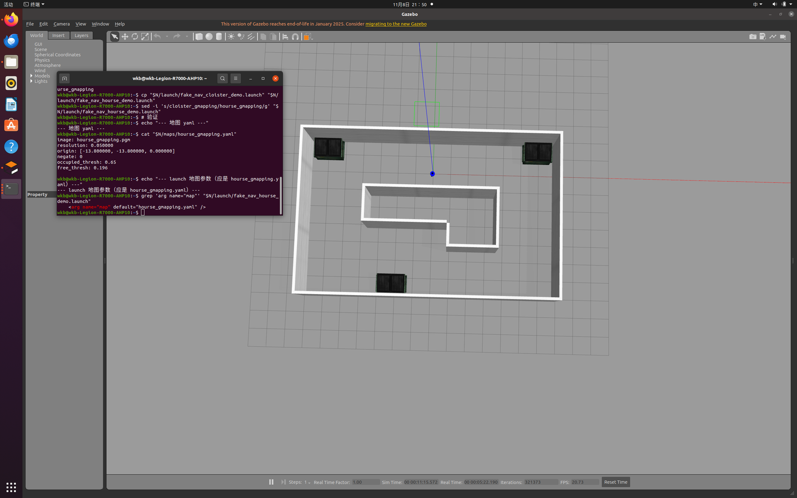

## 9. 编译并启动 my_room 导航

### 9.1 重新编译

```bash
cd /home/wkb/catkin_ws
catkin_make
source devel/setup.bash
```

编译成功，新增的 hourse launch 与地图被正确识别：

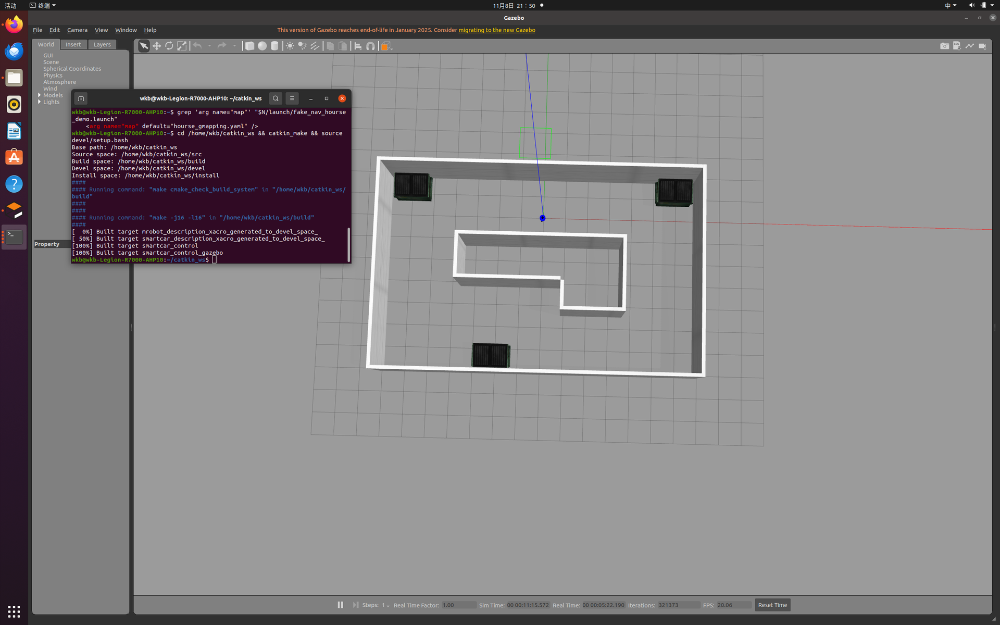

### 9.2 终端 1：启动 Gazebo（默认 my_room）

```bash
source /home/wkb/catkin_ws/devel/setup.bash
roslaunch mrobot_gazebo mrobot_laser_nav_gazebo.launch
```

不传 `world_name` 时默认加载自建的 my_room 世界。

### 9.3 终端 2：启动自建房间导航

```bash
source /home/wkb/catkin_ws/devel/setup.bash
roslaunch mrobot_navigation fake_nav_hourse_demo.launch
```

rviz 与 Gazebo 同时运行，rviz 中加载自建房间地图，Gazebo 中为对应的 my_room 房间：

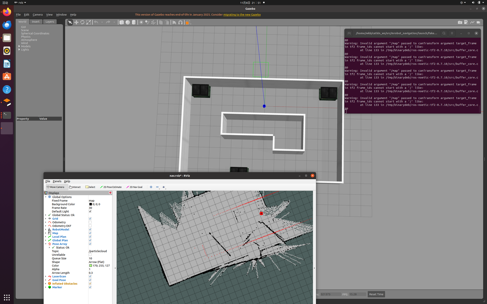

### 9.4 在自己的地图中导航

点击 **2D Nav Goal** 在房间内设置目标点，机器人沿规划路径移动、避障，rviz 中可同时看到静态地图、
实时激光点、全局/局部路径与膨胀障碍，到达后终端出现 `Goal reached`。这对应教程"机器人在自己建立的
地图中正常运行"的结论：

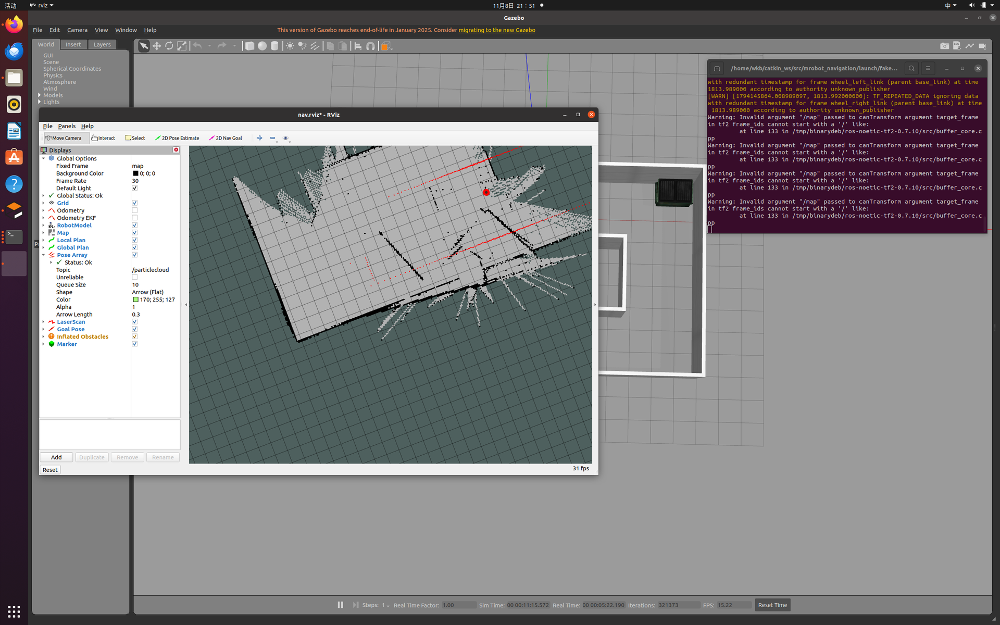

## 10. 保留的警告与后续优化

当前导航流程已经跑通，终端中仍存在两类警告，按计划**保留到后续修改**，不影响本节主体功能。

### 10.1 frame_id 以斜杠开头

```text
Warning: Invalid argument "/map" passed to canTransform argument target_frame
- frame tf2 frame_ids cannot start with a '/'
```

`config/mrobot` 的代价地图参数沿用了旧式坐标系名 `/map`、`/odom`、`/base_footprint`，而 tf2 规定
frame_id 不能以 `/` 开头。后续优化时把这些 frame 名的前导斜杠去掉（话题名 `/scan` 是 ROS 话题、
不是 frame，保持不变）。

### 10.2 TF_REPEATED_DATA 冗余时间戳

```text
TF_REPEATED_DATA ignoring data with redundant timestamp for frame wheel_left_link
(wheel_right_link) ...
```

Gazebo 差速插件与 launch 中的 `joint_state_publisher` 都在发布关节状态，相同时间戳的数据被 tf2 丢弃。
后续可把 launch 里的 `joint_state_publisher` 节点注释掉，只让差速插件负责关节状态（launch 注释中已
预留该说明）。

## 11. 关键参数解读

### 11.1 代价地图共用参数（costmap_common_params.yaml）

| 参数 | 取值 | 含义 |
|---|---|---|
| `obstacle_range` | `2.5` | 2.5 m 内的障碍才被标记 |
| `raytrace_range` | `3.0` | 3 m 内空闲区域被光线追踪清除 |
| `robot_radius` | `0.165` | 机器人半径，用于膨胀 |
| `inflation_radius` | `0.1` | 障碍膨胀半径 |
| `observation_sources` | `scan` | 障碍观测来源，真实激光 `/scan` |

### 11.2 全局/局部代价地图

| 参数 | 全局代价地图 | 局部代价地图 |
|---|---|---|
| `global_frame` | `/map` | `/odom` |
| `robot_base_frame` | `/base_footprint` | `/base_footprint` |
| `static_map` | `true` | `false` |
| `rolling_window` | `false` | `true`（6 m × 6 m 滚动窗口） |
| `resolution` | `0.01` | `0.01` |

### 11.3 局部规划器（base_local_planner_params.yaml）

| 参数 | 取值 | 含义 |
|---|---|---|
| `controller_frequency` | `3.0` | 速度下发频率 3 Hz |
| `max_vel_x` / `min_vel_x` | `0.3` / `0.05` | 前向线速度上下限 |
| `min_in_place_vel_theta` | `0.5` | 原地旋转最小角速度 |
| `xy_goal_tolerance` | `0.1` | 位置容差 10 cm |
| `yaw_goal_tolerance` | `0.1` | 角度容差 0.1 rad |
| `sim_time` | `1.0` | 候选轨迹仿真时长 1 s |
| `dwa` | `true` | 采用 DWA 采样 |
| `recovery_behavior_enabled` | `false` | 关闭恢复行为 |

## 12. 常见问题

| 现象 | 原因 | 解决 |
|---|---|---|
| `cannot override arg 'world_name'` | launch 用 `value` 固定了参数 | 改为 `default`，即可命令行覆盖 |
| `fake_nav_hourse_demo.launch is neither a launch file` | 自建 launch 未创建 | 复制 cloister 版并替换地图名 |
| `frame_ids cannot start with a '/'` | 旧式 frame 名带斜杠 | 后续去掉 frame 前导斜杠（本节保留） |
| `TF_REPEATED_DATA ... wheel_link` | 两个关节状态发布者 | 后续注释 joint_state_publisher（本节保留） |
| rviz 中机器人位置与地图有偏差 | 地图 origin 与世界对齐问题 | 不影响导航流程，后续结合建图校准 |
| 机器人完全不动 | Gazebo 处于暂停或未 source | 确认 Gazebo 播放状态并 `source devel/setup.bash` |

## 13. 小结

本节在真实 Gazebo 物理世界中完成了自主导航：环境检查 → 准备 cloister 世界、地图、`config/mrobot`
与 launch → 编译 → 修复 `world_name` 命令行覆盖问题 → 启动 cloister 导航并用 2D Nav Goal 实时避障 →
修复 `fake_nav_hourse_demo` 缺失问题 → 在自建 my_room 房间、用自己 gmapping 建的地图完成导航。
与 6.3 相比，本节的里程计、激光与避障都是真实物理仿真，但定位仍采用 `fake_localization` 完美定位。
frame 斜杠与 TF 冗余两类警告已记录，留待后续优化。

## 参考资料

- ROS Wiki：move_base 官方文档，<http://wiki.ros.org/move_base>
- ROS Wiki：fake_localization 官方文档，<http://wiki.ros.org/fake_localization>
- ROS Wiki：amcl 自适应蒙特卡洛定位，<http://wiki.ros.org/amcl>
- ROS Wiki：gazebo_ros 差速插件，<http://wiki.ros.org/gazebo_ros_pkgs>
- ROS Wiki：costmap_2d 代价地图，<http://wiki.ros.org/costmap_2d>
- 《ROS 机器人开发实践》，配套源码 `ros_exploring`（作者 胡春旭）
- CSDN 教程：《机器人 SLAM 与自主导航（四）Gazebo 仿真机器人导航》
