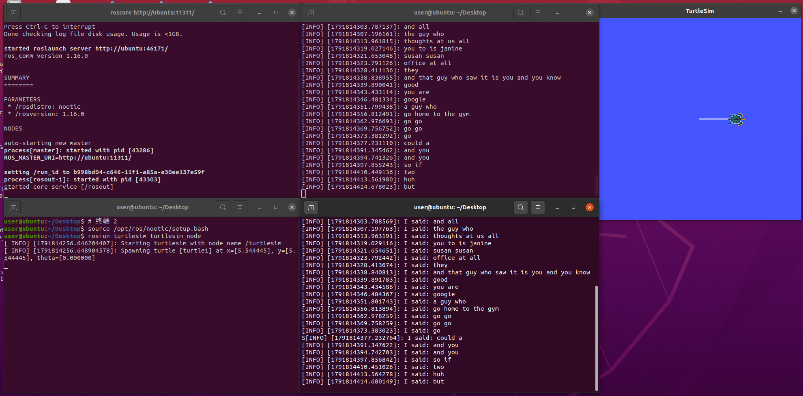

# 第八章 ROS 机器人综合应用：语音识别与小乌龟控制

本文档说明本实验中三个主要代码/包的用途、环境配置、编译方法和运行步骤。实验环境为 Ubuntu 20.04 + ROS Noetic，语音识别使用 PocketSphinx + GStreamer 1.0。


本章使用 **ROS 1 Noetic、Ubuntu 20.04、Python 3、GStreamer 1.0**，不需要 ROS 2 或 AirSim。学习目标是把麦克风输入转换为 ROS 文本消息，再转换为小乌龟速度指令。

```text
麦克风 → GStreamer（16 kHz、单声道 S16LE）→ PocketSphinx
       → /recognizer/output（std_msgs/String）
       → voice_teleop → /turtle1/cmd_vel（geometry_msgs/Twist）→ turtlesim
```

### 配套代码与准备

代码保存在仓库 `src/chap8/noetic_voice/`，包含 `pocketsphinx` 和 `robot_voice` 两个包。`pocketsphinx_models` 是模型数据目录，不是 catkin 包；英文演示使用系统安装的模型，中文模型作为可选扩展。

在 Ubuntu 中，将本仓库复制或克隆到 `~/ros2` 后，只复制本实验的两个包到独立工作空间：

```bash
mkdir -p ~/catkin_ws/src
cp -r ~/ros2/src/chap8/noetic_voice/pocketsphinx ~/catkin_ws/src/
cp -r ~/ros2/src/chap8/noetic_voice/robot_voice ~/catkin_ws/src/
```

如果已有同名包，请先检查已有内容，不要直接覆盖。本仓库第五章已有一个不同实现的 `robot_voice`，不能把整个仓库放入同一个 catkin 工作空间编译。示例容器目录的 `CATKIN_IGNORE` 用于避免整仓扫描时重复发现包；上述命令仅复制内部两个包。

VMware 中先确认声卡已连接，并在 Ubuntu“设置 → 声音 → 输入”中检查说话时音量条会变化。每个新终端都需要加载 ROS 环境；识别节点使用系统 Python 的 GI/GStreamer，不要在 AirSim 的虚拟环境里运行。

## 8.1 文件与目录说明

本实验涉及三个目录：

```text
~/catkin_ws/src/pocketsphinx
~/catkin_ws/src/robot_voice
~/pocketsphinx_models
```

如果文件当前在 Windows 桌面上，对应目录为：

```text
C:\Users\35485\Desktop\pocketsphinx
C:\Users\35485\Desktop\robot_voice
C:\Users\35485\Desktop\pocketsphinx_models
```

复制到 Ubuntu 后，应放置为：

```text
~/catkin_ws/src/pocketsphinx
~/catkin_ws/src/robot_voice
~/pocketsphinx_models
```

## 8.2 三个主要代码的作用

### 8.2.1 recognizer.py

路径：

```text
~/catkin_ws/src/pocketsphinx/nodes/recognizer.py
```

作用：

- 启动 GStreamer 音频输入管道。
- 调用 PocketSphinx 进行语音识别。
- 读取模型参数 `_hmm`、`_lm`、`_dict`。
- 将最终识别结果发布到 ROS 话题 `/recognizer/output`。

输入：

```text
麦克风音频
```

输出话题：

```text
/recognizer/output
```

消息类型：

```text
std_msgs/String
```

常用启动方式：

```bash
rosrun pocketsphinx recognizer.py \
_hmm:="$HMM" \
_lm:="$LM" \
_dict:="$DICT" \
_source:=autoaudiosrc
```

### 8.2.2 voice_teleop.py

路径：

```text
~/catkin_ws/src/robot_voice/scripts/voice_teleop.py
```

作用：

- 订阅 `/recognizer/output`。
- 根据识别到的英文命令控制 turtlesim 小乌龟。
- 向 `/turtle1/cmd_vel` 发布速度消息。

订阅话题：

```text
/recognizer/output
```

发布话题：

```text
/turtle1/cmd_vel
```

消息类型：

```text
geometry_msgs/Twist
```

支持的命令：

```text
go / forward     前进
back / backward  后退
left             左转
right            右转
stop / halt      停止
```

启动方式：

```bash
rosrun robot_voice voice_teleop.py
```

### 8.2.3 voice_cmd_vel.py

路径：

```text
~/catkin_ws/src/pocketsphinx/nodes/voice_cmd_vel.py
```

作用：

- 订阅 `recognizer/output`。
- 根据识别到的命令持续发布速度控制。
- 默认发布到相对话题 `cmd_vel`。
- 更适合移动底盘或 TurtleBot 一类机器人。

订阅话题：

```text
recognizer/output
```

发布话题：

```text
cmd_vel
```

消息类型：

```text
geometry_msgs/Twist
```

支持的命令：

```text
forward
back
left
right
stop
halt
full speed
half speed
```

启动方式：

```bash
rosrun pocketsphinx voice_cmd_vel.py
```

如果要用它控制 turtlesim，需要把 `cmd_vel` 重映射到 `/turtle1/cmd_vel`：

```bash
rosrun pocketsphinx voice_cmd_vel.py cmd_vel:=/turtle1/cmd_vel
```

## 8.3 系统依赖安装

在 Ubuntu 中安装依赖：

```bash
sudo apt update
sudo apt install -y \
  ros-noetic-audio-common \
  ros-noetic-turtlesim \
  libasound2 \
  python3-gi \
  python3-gst-1.0 \
  gir1.2-gstreamer-1.0 \
  gir1.2-gst-plugins-base-1.0 \
  gstreamer1.0-tools \
  gstreamer1.0-plugins-base \
  gstreamer1.0-plugins-good \
  gstreamer1.0-pulseaudio \
  gstreamer1.0-pocketsphinx \
  pocketsphinx-en-us
```

检查 PocketSphinx 插件是否可用：

```bash
gst-inspect-1.0 pocketsphinx
```

如果能看到 `Long-name PocketSphinx`，说明插件安装成功。

## 8.4 编译工作空间

给 Python 脚本添加执行权限：

```bash
chmod +x ~/catkin_ws/src/pocketsphinx/nodes/recognizer.py
chmod +x ~/catkin_ws/src/pocketsphinx/nodes/voice_cmd_vel.py
chmod +x ~/catkin_ws/src/robot_voice/scripts/voice_teleop.py
```

编译：

```bash
source /opt/ros/noetic/setup.bash
cd ~/catkin_ws
catkin_make
source ~/catkin_ws/devel/setup.bash
rospack profile
```

检查包是否能被 ROS 找到：

```bash
rospack find pocketsphinx
rospack find robot_voice
```

正常情况下应输出：

```text
/home/user/catkin_ws/src/pocketsphinx
/home/user/catkin_ws/src/robot_voice
```

## 8.5 英文模型路径配置

英文模型来自系统包 `pocketsphinx-en-us`。

设置模型路径：

```bash
HMM=$(dirname "$(find /usr/share/pocketsphinx/model -type f -name mdef | head -n 1)")
LM=$(find /usr/share/pocketsphinx/model -type f -name 'en-us.lm.bin' | head -n 1)
DICT=$(find /usr/share/pocketsphinx/model -type f -name 'cmudict-en-us.dict' | head -n 1)

echo "HMM=$HMM"
echo "LM=$LM"
echo "DICT=$DICT"

ls "$HMM/mdef" "$LM" "$DICT"
```

常见路径为：

```text
/usr/share/pocketsphinx/model/en-us/en-us
/usr/share/pocketsphinx/model/en-us/en-us.lm.bin
/usr/share/pocketsphinx/model/en-us/cmudict-en-us.dict
```

## 8.6 中文模型路径配置

中文模型目录：

```text
~/pocketsphinx_models/cmusphinx-zh-cn-5.2
```

关键文件：

```text
~/pocketsphinx_models/cmusphinx-zh-cn-5.2/zh_cn.cd_cont_5000
~/pocketsphinx_models/cmusphinx-zh-cn-5.2/zh_cn.lm.bin
~/pocketsphinx_models/cmusphinx-zh-cn-5.2/zh_cn.dic
```

设置中文模型路径：

```bash
ZH_HMM=~/pocketsphinx_models/cmusphinx-zh-cn-5.2/zh_cn.cd_cont_5000
ZH_LM=~/pocketsphinx_models/cmusphinx-zh-cn-5.2/zh_cn.lm.bin
ZH_DICT=~/pocketsphinx_models/cmusphinx-zh-cn-5.2/zh_cn.dic

ls "$ZH_HMM/mdef" "$ZH_LM" "$ZH_DICT"
```

启动中文识别：

```bash
rosrun pocketsphinx recognizer.py \
_hmm:="$ZH_HMM" \
_lm:="$ZH_LM" \
_dict:="$ZH_DICT" \
_source:=autoaudiosrc
```

说明：这套中文模型可以用于普通话识别，但输出格式和准确率不一定与教材中的 `robot_voice/config/pocketsphinx-cn` 旧模型完全一致。

## 8.7 运行方式一：只测试语音识别

终端 1：启动 ROS master。

```bash
source /opt/ros/noetic/setup.bash
roscore
```

终端 2：启动英文识别节点。

```bash
source /opt/ros/noetic/setup.bash
source ~/catkin_ws/devel/setup.bash

HMM=$(dirname "$(find /usr/share/pocketsphinx/model -type f -name mdef | head -n 1)")
LM=$(find /usr/share/pocketsphinx/model -type f -name 'en-us.lm.bin' | head -n 1)
DICT=$(find /usr/share/pocketsphinx/model -type f -name 'cmudict-en-us.dict' | head -n 1)

rosrun pocketsphinx recognizer.py \
_hmm:="$HMM" \
_lm:="$LM" \
_dict:="$DICT" \
_source:=autoaudiosrc
```

终端 3：查看识别结果。

```bash
source /opt/ros/noetic/setup.bash
source ~/catkin_ws/devel/setup.bash
rostopic echo /recognizer/output
```

## 8.8 运行方式二：语音控制 turtlesim 小乌龟

终端 1：启动 ROS master。

```bash
source /opt/ros/noetic/setup.bash
roscore
```

终端 2：启动 turtlesim。

```bash
source /opt/ros/noetic/setup.bash
rosrun turtlesim turtlesim_node
```

终端 3：启动语音识别。

```bash
source /opt/ros/noetic/setup.bash
source ~/catkin_ws/devel/setup.bash

HMM=$(dirname "$(find /usr/share/pocketsphinx/model -type f -name mdef | head -n 1)")
LM=$(find /usr/share/pocketsphinx/model -type f -name 'en-us.lm.bin' | head -n 1)
DICT=$(find /usr/share/pocketsphinx/model -type f -name 'cmudict-en-us.dict' | head -n 1)

rosrun pocketsphinx recognizer.py \
_hmm:="$HMM" \
_lm:="$LM" \
_dict:="$DICT" \
_source:=autoaudiosrc
```

终端 4：启动小乌龟语音控制节点。

```bash
source /opt/ros/noetic/setup.bash
source ~/catkin_ws/devel/setup.bash
rosrun robot_voice voice_teleop.py
```

终端 5，可选：查看识别结果。

```bash
source /opt/ros/noetic/setup.bash
source ~/catkin_ws/devel/setup.bash
rostopic echo /recognizer/output
```

此时对麦克风说：

```text
go
back
left
right
stop
```

如果识别结果正确，小乌龟会根据命令运动。

## 8.9 使用 voice_cmd_vel.py 控制 turtlesim

`voice_cmd_vel.py` 默认发布到 `cmd_vel`，因此控制 turtlesim 时需要重映射：

```bash
rosrun pocketsphinx voice_cmd_vel.py cmd_vel:=/turtle1/cmd_vel
```

对应运行顺序与第 8.8 节类似，只是终端 4 改为：

```bash
source /opt/ros/noetic/setup.bash
source ~/catkin_ws/devel/setup.bash
rosrun pocketsphinx voice_cmd_vel.py cmd_vel:=/turtle1/cmd_vel
```

该脚本更适合连续控制，识别到 `forward` 后会持续发布前进速度，识别到 `stop` 或 `halt` 后停止。

## 8.10 常见问题

### 8.10.1 ConnectionRefusedError

现象：

```text
ConnectionRefusedError: [Errno 111] Connection refused
```

原因：没有启动 `roscore`。

解决：先在一个终端运行：

```bash
roscore
```

### 8.10.2 Failed to initialize PocketSphinx

现象：

```text
GStreamer error: Failed to initialize PocketSphinx
```

常见原因：`_hmm` 路径写成了外层目录，没有指向包含 `mdef` 的声学模型目录。

解决：确认下面命令能找到文件：

```bash
ls "$HMM/mdef" "$LM" "$DICT"
```

### 8.10.3 小乌龟不动

检查三点：

```bash
rostopic echo /recognizer/output
rostopic echo /turtle1/cmd_vel
rostopic list
```

如果 `/recognizer/output` 没有输出，说明识别节点没有识别到命令。

如果 `/recognizer/output` 有输出但 `/turtle1/cmd_vel` 没有输出，说明控制节点没有启动或命令词不匹配。

如果 `/turtle1/cmd_vel` 有输出但小乌龟不动，检查 `turtlesim_node` 是否正在运行。

### 8.10.4 识别不准确

PocketSphinx 是传统离线语音识别，通用模型准确率有限。实验时建议：

- 保持环境安静。
- 麦克风靠近嘴边。
- 每次只说一个短命令。
- 使用 `go/back/left/right/stop` 这类短词。
- 必要时改成小词汇语法模型，提高命令识别稳定性。

## 8.11 控制逻辑与验证

`voice_teleop.py` 会去掉识别文本首尾空白并转换为小写，然后进行**整句精确匹配**。例如 `go` 能触发前进，而 `go go`、`go home to the gym` 不会触发。日志中出现 `I said:` 仅表示收到了文本，并不代表发布了速度。

| 识别文本 | 发布的速度 | 行为 |
| --- | --- | --- |
| `go` / `forward` | `linear.x = 2.0` | 前进 |
| `back` / `backward` | `linear.x = -2.0` | 后退 |
| `left` | `angular.z = 2.0` | 左转 |
| `right` | `angular.z = -2.0` | 右转 |
| `stop` / `halt` | 所有分量为零 | 停止 |
| 其他文本 | 不发布 | 忽略 |

速度可在启动时修改，例如：

```bash
rosrun robot_voice voice_teleop.py _linear_speed:=1.0 _angular_speed:=1.0
```

这个节点每收到一条匹配命令只发布一次速度。turtlesim 在收不到后续速度消息时会超时停止，因此“动一下就停”符合此实现。`voice_cmd_vel.py` 则以 10 Hz 持续发布上一次指令，使用子串匹配，而且运动中的左右指令会调整转弯速度；两者不要同时启动，以免争用控制话题。持续控制示例没有命令超时保护，不应直接当作真实机器人安全控制器。

### 分层检查

先运行 `roscore`、turtlesim 和 `voice_teleop.py`，用人工文本验证控制链路：

```bash
source /opt/ros/noetic/setup.bash
source ~/catkin_ws/devel/setup.bash
rostopic pub -1 /recognizer/output std_msgs/String "data: 'go'"
rostopic pub -1 /recognizer/output std_msgs/String "data: 'stop'"
```

再运行识别节点，对麦克风说一个命令，分别检查文本和速度：

```bash
rostopic echo /recognizer/output
# 在另一个终端运行
rostopic echo /turtle1/cmd_vel
```

人工文本测试成功只证明控制链路正常，不能替代麦克风识别测试。中文模型的输出也不会自动匹配英文控制词；若需中文控制，应根据实际识别文本增加映射，并逐条验证。

## 8.12 实验运行效果



图中左上为 ROS master，左下为 turtlesim 启动终端，中间为识别输出与控制节点接收日志，右侧为小乌龟窗口。截图可见英文识别结果、对应的 `I said:` 日志以及短轨迹；同时也出现了无关识别文本。这说明识别与订阅链路已运行，但单张截图不能证明所有方向命令均已成功或识别准确率达到某个指标。

提供的两张图片内容相同，因此保留一张，并裁去桌面无关区域与虚拟机登录信息。当前材料未提供中文控制成功记录或定量准确率测试。

## 8.13 参考与代码来源

- [ROS pocketsphinx 包说明](https://wiki.ros.org/pocketsphinx)：桌面提供的包保留原作者、版本及许可证元数据，识别节点采用 Python 3 / GStreamer 1.0 实现。
- `robot_voice/scripts/voice_teleop.py`：本次提供的小乌龟控制脚本；包中许可证字段仍为 `TODO`，对外发布前需由作者明确。
- 中文模型目录 `cmusphinx-zh-cn-5.2`：按其 README 保留模型来源与许可说明。大型模型和压缩包不纳入本章代码，按第 8.6 节放到本地用户目录。
