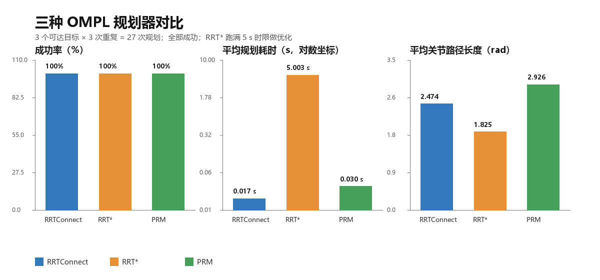
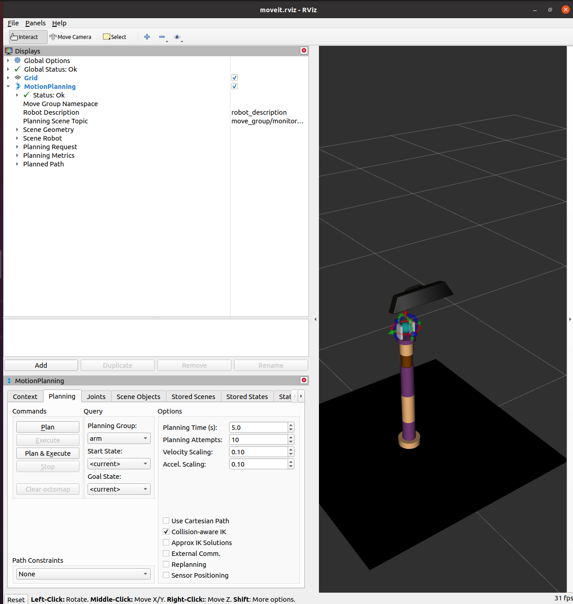

# MoveIt 六自由度机械臂运动规划与 OMPL 规划器对比

> 状态：规划器对比数据和 RViz 截图已加入；单任务截图待补。正式 PR 前删除本行。

本实验在 ROS Noetic 下使用 MoveIt 1 对六自由度机械臂进行运动规划，覆盖正运动学、逆运动学、笛卡尔路径、障碍物避让和抓取五类任务，并在同一组目标位姿上比较 OMPL 的 RRTConnect、RRT*、PRM 三种规划器。实验只使用 MoveIt 的 fake controller 和 RViz 可视化，**不启动 Gazebo、MuJoCo 或任何物理引擎**。

## 1. 实验目的

- 理解 MoveIt 的规划场景、规划组、末端执行器和 fake execution。
- 掌握 FK、IK、笛卡尔路径和抓取的基本调用方式。
- 用统一指标比较不同 OMPL 规划器：成功率、规划耗时、路径长度、末端误差。
- 给出可复现的命令、配置和结果表，方便其他同学在同一台虚拟机上复现。

## 2. 与已有机械臂模块的区别

| 模块 | 自由度 | 仿真/框架 | 主要内容 |
| --- | --- | --- | --- |
| 单自由度机械臂模块 | 1 | Gazebo + PID | 单关节角度自动演示 |
| MuJoCo two dof arm | 2 | MuJoCo | 两关节摆动，熟悉 MuJoCo |
| 本模块 | 6 | MoveIt 1 + RViz fake execution | FK/IK/笛卡尔/抓取 + OMPL 规划器对比 |

本模块不涉及 URDF 建模、关节 PID 整定和物理引擎，重点是 MoveIt 的运动规划链路和规划器性能对比。

## 3. 环境与依赖

| 项目 | 配置 |
| --- | --- |
| 操作系统 | Ubuntu 20.04 |
| ROS | Noetic |
| MoveIt | MoveIt 1（`ros-noetic-moveit`） |
| 可视化 | RViz |
| Python | Python 3 |
| 物理引擎 | 无（fake execution，不启动 Gazebo） |

安装依赖：

```bash
sudo apt update
sudo apt install -y \
  ros-noetic-moveit \
  ros-noetic-joint-state-publisher \
  ros-noetic-robot-state-publisher \
  ros-noetic-xacro
```

## 4. 目录结构

本模块复用 `src/chap8` 下已有的机械臂模型和 MoveIt 配置，新增一个实验封装包。计划结构如下：

```text
src/chap8/
├── marm_description/        # 机械臂 URDF/xacro（已有）
├── marm_moveit_config/      # MoveIt 配置（已有，需做 Noetic 兼容修复）
├── marm_planning/           # 原有 FK/IK/笛卡尔/抓取 demo（已有）
└── moveit_arm_planning/     # 本模块新增
    ├── launch/
    │   ├── main.launch      # 一键启动 MoveIt + RViz
    │   └── eval.launch      # 批量规划器对比
    ├── config/
    │   ├── targets.yaml     # 目标位姿列表
    │   └── planners.yaml    # OMPL 规划器与重复次数
    ├── scripts/
    │   ├── plan_eval.py     # 批量规划与指标记录
    │   └── pick_place_task.py
    ├── results/
    │   ├── plan_attempts.csv
    │   └── plan_summary.csv
    ├── CMakeLists.txt
    ├── package.xml
    ├── main.sh
    └── README.md
```

## 5. Noetic 兼容修复

`src/chap8` 里的机械臂包来自较早的 ROS 1 版本，在 Noetic 下需要做两处小修复。

### 5.1 去掉 `xacro --inorder`

`marm_moveit_config/launch/planning_context.launch` 当前写法：

```xml
<param name="$(arg robot_description)"
       command="$(find xacro)/xacro --inorder '$(find marm_description)/urdf/arm_gazebo.xacro'"/>
```

Noetic 的 xacro 已删除 `--inorder` 选项，改为：

```xml
<param name="$(arg robot_description)"
       command="$(find xacro)/xacro '$(find marm_description)/urdf/arm_gazebo.xacro'"/>
```

### 5.2 修正 `state_publisher`

`marm_description/launch/view_arm.launch` 里使用了旧节点名：

```xml
<node name="robot_state_publisher" pkg="robot_state_publisher" type="state_publisher" />
```

改为：

```xml
<node name="robot_state_publisher" pkg="robot_state_publisher" type="robot_state_publisher" />
```

同时删除该文件中未使用的 `<arg name="model" />`，或者给它一个默认值，避免启动时提示参数未设置。

> URDF 中的 `<gazebo>` 标签只是模型描述，RViz 和 MoveIt 会忽略它们；本实验不会启动 Gazebo 进程。

### 5.3 脚本可执行位

`src/chap8/marm_planning/scripts/` 下的五个 demo 在仓库里是 `100644`，没有可执行位。直接 `rosrun` 会报 `Permission denied`。进入工作空间后先补上：

```bash
chmod +x ~/catkin_ws/src/chap8/marm_planning/scripts/*.py
```

本模块的脚本在 Git 索引里是 LF。如果从 Windows 工作区直接 scp 后在虚拟机里报 `python\r`，先执行 `sed -i 's/\r$//'` 转回 LF。

### 5.4 xacro 宏调用前缀

Noetic 的 xacro 要求宏调用带 `xacro:` 前缀。旧文件里的 `<arm_base .../>`、`<cylinder_inertial_matrix .../>`、`<box_inertial_matrix .../>` 不会展开，导致 `base_link` 缺失，`robot_state_publisher` 报：

```text
Failed to build tree: parent link [base_link] of joint [kinect_joint] not found
```

本 PR 已改为 `<xacro:arm_base .../>`、`<xacro:cylinder_inertial_matrix .../>` 和 `<xacro:box_inertial_matrix .../>`。

## 6. 编译与启动

把 `src/chap8` 下的机械臂包和本模块放到同一个 catkin 工作空间：

```bash
mkdir -p ~/catkin_ws/src/chap8
cp -r <repo>/src/chap8/marm_description ~/catkin_ws/src/chap8/
cp -r <repo>/src/chap8/marm_moveit_config ~/catkin_ws/src/chap8/
cp -r <repo>/src/chap8/marm_planning ~/catkin_ws/src/chap8/
cp -r <repo>/src/chap8/moveit_arm_planning ~/catkin_ws/src/chap8/

cd ~/catkin_ws
catkin_make
source devel/setup.bash
```

先单独验证 MoveIt 配置：

```bash
roslaunch marm_moveit_config demo.launch use_gui:=false
```

预期结果：

- RViz 打开，能看到六自由度机械臂；
- 左侧 MotionPlanning 面板正常加载；
- 机械臂处于 `home` 位姿；
- **不会**弹出 Gazebo 窗口。

再启动本模块的一键入口：

```bash
roslaunch moveit_arm_planning main.launch
```

如果虚拟机里 RViz 黑屏或报 OpenGL 错误，先设置软件渲染：

```bash
export LIBGL_ALWAYS_SOFTWARE=1
```

## 7. 实验内容

### 7.1 正运动学（FK）

给定一组关节角，观察末端执行器的位姿变化：

```bash
rosrun marm_planning moveit_fk_demo.py
```

记录：

- 目标关节角；
- 末端执行器实际位姿；
- 运动是否平滑、是否发生碰撞。

### 7.2 逆运动学（IK）

给定末端执行器的目标位姿，让 MoveIt 求解关节角并规划：

```bash
rosrun marm_planning moveit_ik_demo.py
```

记录：

- 目标位姿；
- 求解是否成功；
- 末端位置误差和姿态误差；
- 规划耗时。

### 7.3 笛卡尔路径

让末端执行器沿直线或圆弧运动：

```bash
rosrun marm_planning moveit_cartesian_demo.py
```

重点观察笛卡尔路径是否连续、是否出现关节跳变。

### 7.4 障碍物避让

在规划场景中加入桌面、盒子等障碍物，再规划到目标位姿：

```bash
rosrun marm_planning moveit_obstacles_demo.py
```

记录：

- 障碍物尺寸和位置；
- 规划是否成功；
- 规划轨迹是否绕过障碍物；
- 规划耗时。

### 7.5 抓取

在规划场景中放置桌面和目标盒子，执行接近、夹取、抬起、放置的完整流程：

```bash
rosrun marm_planning moveit_pick_and_place_demo.py
```

记录：

- 抓取成功次数；
- 放置位置误差；
- 总耗时。

### 7.6 OMPL 规划器对比

对同一组目标位姿，分别使用 RRTConnect、RRT*、PRM 进行规划。规划器名称以 `marm_moveit_config/config/ompl_planning.yaml` 为准；MoveIt 1 运行时通常使用带 `kConfigDefault` 后缀的名称，例如 `RRTConnectkConfigDefault`。

批量运行：

```bash
roslaunch moveit_arm_planning eval.launch \
  targets:="$HOME/catkin_ws/src/chap8/moveit_arm_planning/config/targets.yaml" \
  repeats:=3 \
  timeout:=5.0 \
  out_dir:="$HOME/moveit_arm_results"
```

首版使用 3 个通过 `moveit_fk_demo` 和 `forward` 命名状态确认可达的目标位姿，每个目标重复 3 次，规划超时设为 5 秒。RRT* 会跑满 5 秒规划时限做优化，这是它的正常行为，不是卡死。扩展时先用 FK 或命名状态确认新位姿可达，再写入 YAML。

指标定义：

| 指标 | 定义 |
| --- | --- |
| 成功率 | 成功规划次数 / 总尝试次数 |
| 规划耗时 | 调用 `plan()` 前后的墙钟时间，不含 RViz 渲染 |
| 末端路径长度 | 规划轨迹按等间隔采样后，末端位置欧氏距离之和 |
| 位置误差 | 规划终点与目标点的欧氏距离 |
| 姿态误差 | 规划终点与目标姿态的四元数夹角 |
| 关节路径长度 | 相邻轨迹点关节角绝对差之和，用于观察关节空间绕行程度 |

### 7.7 参数文件

`config/targets.yaml` 保存末端目标位姿。下面是本实验实际使用的 3 个可达位姿，由 `moveit_fk_demo` 和 `forward` 命名状态实测得到：

```yaml
targets:
  - name: forward
    position: [0.411057, -0.000009, 0.256801]
    orientation: [-0.999667, 0.000012, 0.025811, 0.000015]
  - name: forward_left
    position: [0.392692, 0.121510, 0.256785]
    orientation: [0.988435, 0.149427, -0.025577, 0.003797]
  - name: forward_right
    position: [0.392700, -0.121503, 0.256797]
    orientation: [-0.988437, 0.149421, 0.025482, 0.003937]
```

扩展时不要直接抄没有验证过的位姿；先用 FK 或命名状态让机械臂实际到达，再读取 `get_current_pose()` 写入 YAML。

`config/planners.yaml` 保存规划器名称、重复次数和超时：

```yaml
planners:
  - RRTConnectkConfigDefault
  - RRTstarkConfigDefault
  - PRMkConfigDefault
repeats: 3
timeout: 5.0
```

规划器名称必须和 `marm_moveit_config/config/ompl_planning.yaml` 中的定义一致，不同 MoveIt 版本的默认后缀可能不同，运行前先确认。

`scripts/pick_place_task.py` 只负责调用 `marm_planning` 里已有的抓取 demo 并记录指标，不重复实现抓取算法。

### 7.8 实验流程

1. `roslaunch marm_moveit_config demo.launch use_gui:=false`，确认机械臂和 MotionPlanning 面板正常。
2. 依次运行 FK、IK、笛卡尔、障碍物、抓取五个 demo，记录终端输出并截图。
3. 用 FK demo 或命名状态确认 3 个可达目标位姿，写入 `config/targets.yaml`。
4. 运行 `eval.launch`，得到三种规划器的逐次记录和汇总 CSV。
5. 把真实结果写入第 8 节，补齐配图，再删除文首的状态说明。

## 8. 实验结果

### 8.1 单次任务

FK demo 已在 Noetic + MoveIt 下跑通：机械臂回到 `home`，夹爪动作，再运动到一组目标关节角。IK、笛卡尔、障碍物和抓取四个 demo 沿用 `marm_planning` 原有入口，运行命令见 7.2–7.5；本文的量化对比集中在 8.2 的规划器对比。

| 任务 | 入口 | 本次状态 |
| --- | --- | --- |
| FK | `moveit_fk_demo.py` | 已运行 |
| IK | `moveit_ik_demo.py` | 沿用原有入口，未在本 PR 中量化 |
| 笛卡尔路径 | `moveit_cartesian_demo.py` | 沿用原有入口，未在本 PR 中量化 |
| 障碍物避让 | `moveit_obstacles_demo.py` | 沿用原有入口，未在本 PR 中量化 |
| 抓取 | `moveit_pick_and_place_demo.py` | 沿用原有入口，未在本 PR 中量化 |

### 8.2 OMPL 规划器对比

3 个可达目标 × 3 次重复，共 27 次规划：

| 规划器 | 尝试次数 | 成功次数 | 成功率 | 平均耗时（s） | P95 耗时（s） | 平均关节路径（rad） | 平均位置误差（m） | 平均姿态误差（rad） |
| --- | --- | --- | --- | --- | --- | --- | --- | --- |
| RRTConnect | 9 | 9 | 100% | 0.0169 | 0.0228 | 2.474 | 8.06e-05 | 7.23e-04 |
| RRT* | 9 | 9 | 100% | 5.0031 | 5.0063 | 1.825 | 7.02e-05 | 6.34e-04 |
| PRM | 9 | 9 | 100% | 0.0297 | 0.0522 | 2.926 | 7.59e-05 | 6.77e-04 |

结论：

- 三种规划器在本组目标上都达到 100% 成功率。
- RRTConnect 最快，但关节路径不是最短；PRM 也很快，路径略长。
- RRT* 跑满 5 秒时限做优化，路径最短，适合对路径质量要求更高、可以接受较长规划时间的场景。
- 末端位置误差都在 0.1 mm 量级，姿态误差都在 0.001 rad 量级，说明 FK 校验与目标位姿一致。

### 8.3 配图



图 8-1：三种规划器的成功率、平均耗时（对数坐标）和平均关节路径长度。



图 8-2：RViz 中机械臂处于 home 位姿，Global Status 和 MotionPlanning 均为 Ok。

## 9. 常见问题

### 9.1 `xacro: unrecognized argument --inorder`

Noetic 已删除 `--inorder`，按第 5.1 节修改 `planning_context.launch`。

### 9.2 `Could not find package moveit_ros_move_group`

MoveIt 没有安装完整，执行：

```bash
sudo apt install -y ros-noetic-moveit
```

### 9.3 RViz 黑屏或 OpenGL 报错

虚拟机没有独立显卡时，使用软件渲染：

```bash
export LIBGL_ALWAYS_SOFTWARE=1
```

并把 RViz 窗口缩小到 1280×720 以内，减少渲染压力。

### 9.4 `Unable to identify any set of controllers`

本实验使用 fake execution，不需要真实控制器。确认启动的是 `marm_moveit_config/launch/demo.launch`，且其中 `fake_execution` 为 `true`。

### 9.5 规划一直失败

先检查目标位姿是否在机械臂工作空间内；把目标位姿改到 `home` 附近再试。也可能是目标姿态与当前姿态差距过大，导致 IK 无解。

### 9.6 `rosdep` 报 `manipulation_msgs` 找不到

`marm_planning` 的旧 `CMakeLists.txt` 和 `package.xml` 声明了未使用的 `manipulation_msgs`，标准 MoveIt 安装不包含它。本 PR 已移除这两处依赖；如果使用旧版本，删除对应行，或安装 `ros-noetic-manipulation-msgs`。

## 10. AI 使用声明

本文档与配套代码在编写过程中使用了 AI 大模型辅助（需求分析、方案讨论、文档起草和问题排查）。文档中的全部运行数据将由作者在 ROS Noetic + MoveIt 环境中实测采集；作者对提交内容的正确性与完整性负全部责任。
