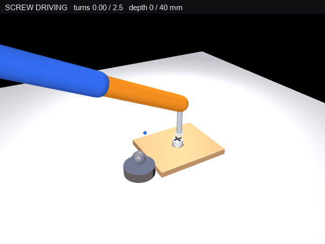

# 机械臂拧螺丝仿真

功能包源码位于仓库的 `src/chap8/mujoco_arm_screw` 目录，按 catkin 包组织
（`package.xml`、`CMakeLists.txt`、`launch/mujoco_arm_screw.launch`、`requirements.txt`），
入口脚本为 `main.py`，可用 `roslaunch mujoco_arm_screw mujoco_arm_screw.launch` 启动，
也可直接 `python3 main.py`。

> **这是运动学回放，不是动力学仿真。** 每帧把关节角直接写入 `qpos`（单步最大 0.07 rad，沿 IK 解逼近），
> 再用 `mj_forward` 求正运动学与几何位置后渲染；全程没有 `mj_step`、不积分动力学，也不经过执行器或
> PD 控制器。原因见第 6 节（改用动态控制时实测动态末端误差达 353 mm）。

## 1. 任务

三自由度空间机械臂末端夹持竖直螺丝刀，对准桌面木板上的螺丝，
连续旋转 2.5 圈（900°）按螺距把螺丝拧入桌面螺孔，再抬起撤离。
完整演示"接近 → 对准下压 → 旋转拧入 → 抬起"。

## 2. 机械臂模型

| 部件 | 说明 |
|---|---|
| 肩方位 yaw | hinge 轴 (0 0 1)，范围 ±180°（`range="-3.14159 3.14159"` rad） |
| 肩俯仰 pitch1 | hinge 轴 (0 -1 0)，范围 ±120°（`range="-2.0944 2.0944"` rad） |
| 肘俯仰 pitch2 | hinge 轴 (0 -1 0)，范围 ±150°（`range="-2.6180 2.6180"` rad） |
| 杆长 | L1 = L2 = 0.30 m，肩俯仰中心高 0.06 m |
| 螺丝刀 | 竖直杆（半径 0.009 m、长 0.10 m）+ 十字刀头；driver 原点在末端 tip 下方 0.11 m，刀头最低点再低 0.006 m |
| 螺丝 | 半径 0.019 m、半高 0.023 m 的圆柱 + 顶部十字槽 + 底部小圆柱（半径 0.012 m、高 0.014 m） |
| 桌面 | 木板 box（0.26×0.22×0.02 m），板面高度 z = 0.020 m；另加深色螺孔标记 |

## 3. IK 与构型选择（关键）

对目标点 (x, y, z)（z 为末端 tip 的世界高度，以肩俯仰中心为基准换算）：

```
r    = hypot(x, y)
d    = hypot(r, z)
yaw  = atan2(y, x)                        # 肩方位
q2   = −acos((d² − L1² − L2²) / (2 L1 L2)) # 负解：肘抬到肩上方
q1   = atan2(z, r) − atan2(L2 sin q2, L1 + L2 cos q2)
```

**为什么必须取负解**：螺丝位于桌面上，目标点离肩只有约 0.21 m，而臂长
0.60 m，二连杆必须折叠约 139°。正解（q2 > 0）会把肘压到地面以下
（z ≈ −0.14 m），L1/L2 整段被地面挡住，画面里只剩一截杆"从桌面长出来"；
负解（q2 < 0）让肘抬到肩上方（约 z = 0.36 m），L2 从上往下伸到螺丝，
形成正常的"俯身拧螺丝"姿态。

## 4. 时间线

`main.py` 每次运行渲染 450 帧，帧序即下表的时间轴。每帧只是推进一次运动学插值、
不积分动力学，XML 里的 `timestep` 只服务于 `mj_forward`，代码里没有「步长换算」这一层；导出 GIF 的实际参数见第 9 节。

| 段 | 帧 | 动作 |
|---|---|---|
| APPROACH | 0–70 | 从 HOME (0.14, 0, 0.20) 先上抬 2 cm 到螺丝上方待机位 0.22 m |
| PRESS | 70–110 | 下压到 0.159 m 对位，刀头最低点贴住螺丝顶面（0.043 m） |
| SCREW | 110–350 | 旋转拧入 900°，螺丝同步下沉 40 mm，刀头跟随下压 |
| LIFT | 350–420 | 抬起撤离 |
| HOLD | 420–450 | 停留展示拧好的螺丝 |

## 5. 螺丝下沉与旋转

螺丝绕 z 轴旋转 theta 的四元数 `quat_z(theta)`，同时中心高度按转角线性下沉：

```
sz(theta) = 0.020 − 0.040 × (theta / 900°)      # 单位 m
```

- 初始：中心 z = 0.020 m，顶面 z = 0.020 + 0.023 = 0.043 m，**露出板面（0.020 m）23 mm**；
- 终了：中心 z = −0.020 m（相对初始下沉 40 mm），顶面 z = 0.003 m，
  **比板面 0.020 m 低 17 mm**——螺丝已拧入木板内部，但没有与板面齐平；
- 螺丝刀刀头与螺丝同步旋转，tip 高度 = `sz + 0.023（螺丝半高）+ 0.006（刀头厚度）+ 0.11（driver 偏移）`。
  0.006 m 的刀头厚度必须计入：`bladeA/B` 是 `size="0.016 0.003 0.003"`、`pos="0 0 -0.003"` 的盒体，
  最低点在 driver 原点下方 0.006 m。若把 driver 原点当作刀头，算出来的「间隙 0」实际对应刀头插进螺丝顶 6 mm。

## 6. 控制方案

臂采用**运动学插值驱动**：每帧 qpos 向 IK 目标角逼近（最大步长
0.07 rad/帧），随后 `mj_forward` 更新运动学并渲染，不积分动力学。
原因：臂杆质量轻（默认密度 1000），重力角加速度极大，手写 PD /
position 执行器均无法收敛（实测动态末端误差达 353 mm）。

## 7. 渲染与视觉

- 相机：lookat (0.11, 0.04, 0.14)、distance 0.98、azimuth 60°、elevation −30°
- 顶部状态条实时显示 `SCREW DRIVING turns x.xx / 2.5  depth xx / 40 mm`
- 黄色线：臂末端 tip 轨迹；青色线：刀头螺旋下降轨迹（旋转+下沉的合成）
- 螺丝顶十字槽随旋转转动，直观显示"正在拧"

## 8. 验证结果

### 8.1 IK 求解精度

| 检查 | 方法 | 结果 |
|---|---|---|
| 逆解 / 正解互逆 | `test/verify_mujoco_arm_screw.py ik`：`ik3` 逆解 → `fk3` 正解回代 | 最大误差 0.00 mm，PASS |
| 独立几何校验 | `test/verify_mujoco_arm_screw.py mjcfk`：`ik3` 求角写入 `qpos` → `mj_forward` 读 `tip` body 世界坐标，与目标点直接比对；再把螺丝刀挂到 tip 下方、螺丝放到初始高度，读 `bladeA` 盒体世界坐标减去盒体半高得到**刀头最低点**，与螺丝顶面 0.043 m 比对。两次读数都来自 MuJoCo，**不经过手写正解** | 三个目标点 tip 误差 0.0000 mm；刀头最低点 0.0430 m vs 螺丝顶面 0.0430 m，误差 0.0000 mm，PASS |

说明：`ik3` 与 `fk3` 共用同一套连杆几何定义，两者互查只能说明"求解与定义自洽"，不能单独作为绝对正确性的证据。绝对正确性由第二行的 MuJoCo 前向运动学校验（独立于手写正解）与画面共同支撑：刀头贴住螺丝顶、杆件不穿地面。

### 8.2 全流程

| 检查项 | 结果 | 判定 |
|---|---|---|
| 对位+拧入段（frame 110–350）刀头最低点 vs 螺丝顶面 | 最大悬空 0.0000 m、最大压入 0.0000 m（全程贴合） | PASS |
| 刀头最低点（MuJoCo 读数） | 0.0430 m，与螺丝顶面 0.0430 m 误差 0.0000 mm | PASS |
| 最终转角 | 900.0°（2.50 圈） | PASS |
| 螺丝中心下沉量 | 40.0 mm（0.020 → −0.020 m） | PASS |
| 螺丝终了顶面高度 | 0.003 m（板面 0.020 m，低 17 mm） | PASS |

统计窗口说明：`main.py` 与 `test/verify_mujoco_arm_screw.py clear` 使用同一个窗口
`PRESS_END ≤ frame ≤ SCREW_END`（110–350），统计的是「刀头最低点 − 螺丝顶面」的**有符号差值**
（正 = 刀头悬空、负 = 刀头压入），两侧各记最大值。取绝对值会把「刀头插进螺丝 6 mm」也记成贴合 0。
三处的刀头最低点都取 `bladeA` 的 `data.geom_xpos − model.geom_size`（MuJoCo 实算），`main.py` 的打印也不例外，
不是用 `driver 原点 − BLADE_DROP` 的常量推算。

运行环境（实际验证的版本，**两台都是作者本人的机器，尚未由第三方复核**；按仓库规范还需要另一人复跑确认，
复跑步骤与预期数值见包内 `README.md` 的「复跑」一节）：

| 项 | 版本 |
|---|---|
| 操作系统 | Windows 11（本机）；Ubuntu 22.04.5 LTS（云主机，无独显） |
| Python | Windows 3.11；Ubuntu **系统解释器** `/opt/python3.12/bin/python3` = 3.12.11；同一台 Ubuntu 上**另建**的 conda ROS 环境 = 3.12.16 |
| 模拟器 | MuJoCo 3.17.0（三套环境相同） |
| 关键依赖 | 每个解释器各装一套，互不影响：Windows **numpy 2.4.6 / Pillow 13.0.0**；Ubuntu 系统解释器 **numpy 1.26.4 / Pillow 10.4.0**；Ubuntu conda ROS 环境 **numpy 2.5.4 / Pillow 13.0.0**。后两者在同一台机器上，是两个解释器各装各的，不是同一份环境里并存两个版本 |
| ROS 环境 | 同一台 Ubuntu 云主机上用 conda 另建的 ROS Noetic（独立于上面的系统解释器）：roslaunch 1.17.4 / catkin 0.8.12 / cmake 3.31 / Python 3.12.16 |
| 渲染后端 | `MUJOCO_GL=glfw`；Ubuntu 端加 Xvfb（`DISPLAY=:99`） |

本包按 ROS 1（catkin）编写（`package.xml` format 2 + `launch/*.launch`）。ROS 侧**已端到端实测**：
在 Ubuntu 22.04.5 上用 conda 装了 ROS Noetic（roslaunch 1.17.4 / catkin 0.8.12 / cmake 3.31 / Python 3.12.16），
`catkin_make` 与 `catkin_make install` 均成功，`roslaunch` 在 devel、install 两个空间各启动过一次，
node 跑完 450 帧后 cleanly 退出，悬空/压入 0.0000 m、900.0°、下沉 40.0 mm 与本机一致。
命令与输出见包内 `README.md` 的「ROS 侧实测」一节。

依赖按运行方式选一条路径：独立运行时全部走 `pip install -r requirements.txt`；作为 ROS 包运行时
`rosdep install` 装 `python3-numpy`、`python3-pil`，但 `mujoco` 不在 apt 仓库、仍需 pip 装。
两条路径不要混用（会装出两套 numpy），详见 `README.md`。

`MUJOCO_GL=osmesa` 在云主机上因 PyOpenGL 拿不到 GL 上下文会报
`AttributeError: 'NoneType' object has no attribute 'glGetError'`，所以统一用 glfw 后端。

## 9. 效果图



`docs/img/mujoco_arm_screw_demo.gif` 就是本包 `main.py` 真实运行输出的那个文件，不是另外录屏：

- 脚本渲染 **450 帧**（离屏渲染，640×480）
- 保存出来的 GIF 实测：**640×480、421 帧、3.63 MB**；前 420 帧各 30 ms、末帧 990 ms，合计 **13.59 s**
- 帧数少于 450、总时长不等于 421×30 ms 都是正常的：GIF 的帧延迟以 10 ms 为单位（33 ms 存成 30 ms），
  PIL 还会把连续完全相同的帧合并成一条——末尾的停留帧合并成一帧后时长累加成 990 ms，所以 421×30 ms 只有 12.63 s
- 每次运行结束时脚本会自己打印上面这组实际参数，文档里的数字取自同一次运行的输出
- 换一台机器跑，帧数、尺寸、总时长不变，**文件字节数会有 2%~3% 的差别**（Pillow 版本与调色板量化不同）：
  ROS 环境那次生成的是 3,704,119 B（3.53 MB），Windows 本机这次是 3,802,366 B（3.63 MB），仓库里提交的是后者

臂从上方伸下来，竖直刀头贴住螺丝顶，旋转 2.5 圈把螺丝拧入木板，
顶部状态条实时显示圈数与深度。

## 10. 许可证

本包以 Apache-2.0 发布，全文见包内 `src/chap8/mujoco_arm_screw/LICENSE`
（与 `package.xml` 的 `<license>Apache-2.0</license>` 一致）。
