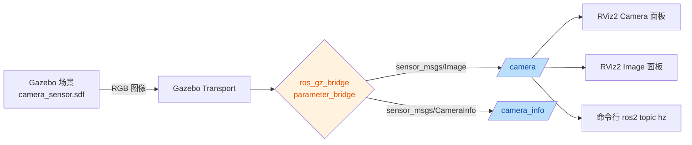
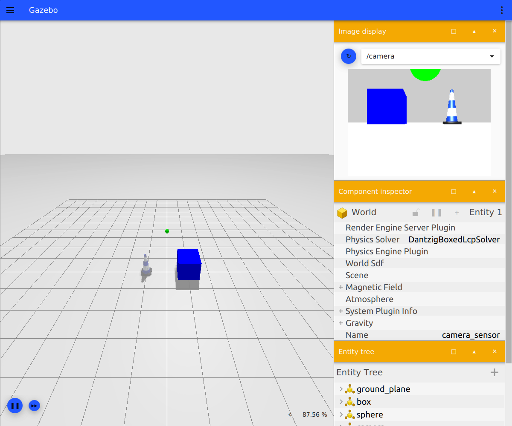
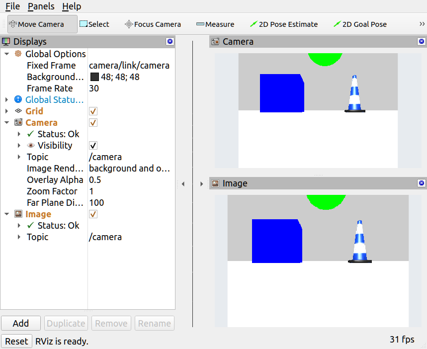

# Gazebo 仿真相机与图像话题验证

本实验在 Ubuntu 22.04 + ROS 2 Humble + Gazebo Fortress 下，用官方示例包 `ros_gz_sim_demos` 启动一个带 RGB 相机的 Gazebo 场景，把相机图像桥接成标准 ROS 2 话题，并在命令行与 RViz2 中确认画面确实在实时刷新。

实验只用系统自带示例包，不需要自己写 URDF、SDF 或插件，适合作为图像类感知实验的起点：跑通「仿真相机 → 桥接 → ROS 2 话题 → 可视化」这条链路之后，再去接自己的检测、分类或测距节点。

- [1. 要解决的问题](#problem)
- [2. 系统组成与数据流](#method)
- [3. 环境与安装](#install)
- [4. 启动仿真](#launch)
- [5. 检查话题与图像规格](#check)
- [6. 在 RViz2 中查看实时画面](#rviz)
- [7. 实测结果](#results)
- [8. 常见问题](#faq)

## 1. 要解决的问题 <span id="problem"></span>

很多图像感知实验在仿真里卡在第一步：Gazebo 里的相机到底有没有出图、出的图是哪个话题、长什么样，肉眼和命令行都不确定。本实验把这件事拆成三个可以单独验证的环节：

1. Gazebo 侧：场景启动后相机传感器是否工作；
2. 桥接侧：Gazebo Transport 的图像是否真的转成了 `sensor_msgs/msg/Image`；
3. ROS 2 侧：话题频率、分辨率、编码、相机内参是否符合预期，RViz2 里能否看到连续画面。

三个环节都通过，才说明后续的视觉节点拿到的是可信的仿真图像。

## 2. 系统组成与数据流 <span id="method"></span>



`ros_gz_sim_demos` 的 `camera.launch.py` 会同时启动三个部件：Gazebo（含 GUI）、`ros_gz_bridge` 的 `parameter_bridge`、以及加载好相机面板的 RViz2。桥接规则写死在 launch 里：

```text
/camera      sensor_msgs/msg/Image       @ gz.msgs.Image
/camera_info sensor_msgs/msg/CameraInfo  @ gz.msgs.CameraInfo
```

两条规则都用 `@` 表示双向桥接（GZ→ROS 和 ROS→GZ 同时建立），实测日志里也能看到两个方向的 Bridge 都被创建。相机图像实际只有 Gazebo 会发布，所以 **GZ→ROS 方向有持续数据流，ROS→GZ 方向闲置**。

## 3. 环境与安装 <span id="install"></span>

| 项目 | 本实验验证版本 |
| --- | --- |
| 操作系统 | Ubuntu 22.04 |
| ROS 2 | Humble |
| Gazebo | Gazebo Sim 6.18.0（Fortress） |
| 示例包 | `ros-humble-ros-gz-sim-demos` |

先加载 ROS 2 环境并确认发行版：

```bash
source /opt/ros/humble/setup.bash
echo "$ROS_DISTRO"     # 应输出 humble
```

示例包会自动拉取 Gazebo Fortress、`ros_gz` 桥接和 RViz2，不需要逐个安装：

```bash
sudo apt update
sudo apt install -y ros-humble-ros-gz-sim-demos
```

安装后可以先确认包存在：

```bash
ros2 pkg prefix ros_gz_sim_demos   # 应输出 /opt/ros/humble
ign gazebo --version               # 应输出 Gazebo Sim, version 6.x
```

## 4. 启动仿真 <span id="launch"></span>

```bash
ros2 launch ros_gz_sim_demos camera.launch.py
```

正常启动后会出现两个窗口：Gazebo（左侧 3D 场景，右侧 `Image display` 面板订阅 `/camera`）和 RViz2。终端里能看到桥接建立日志（每个话题双向各一条）：

```text
[ros_gz_bridge]: Creating GZ->ROS Bridge: [/camera (gz.msgs.Image) -> /camera (sensor_msgs/msg/Image)]
[ros_gz_bridge]: Creating ROS->GZ Bridge: [/camera (sensor_msgs/msg/Image) -> /camera (gz.msgs.Image)]
[ros_gz_bridge]: Creating GZ->ROS Bridge: [/camera_info (gz.msgs.CameraInfo) -> /camera_info (sensor_msgs/msg/CameraInfo)]
[ros_gz_bridge]: Creating ROS->GZ Bridge: [/camera_info (sensor_msgs/msg/CameraInfo) -> /camera_info (gz.msgs.CameraInfo)]
```



Gazebo 窗口右侧的 `Image display` 下拉框里选择 `/camera`，如果能看到蓝色方块、绿色球体和交通锥，说明相机传感器本身已经在出图。这一步最直观，但要确认数据真的进了 ROS 2，还需要下一步的话题检查。

## 5. 检查话题与图像规格 <span id="check"></span>

新开一个终端，同样先 `source /opt/ros/humble/setup.bash`。

**查看话题与消息类型**

```bash
ros2 topic list -t
```

实测输出中与相机相关的部分：

```text
/camera [sensor_msgs/msg/Image]
/camera_info [sensor_msgs/msg/CameraInfo]
```

**查看发布者数量**

```bash
ros2 topic info /camera
```

实测输出：

```text
Type: sensor_msgs/msg/Image
Publisher count: 1
```

只有 1 个发布者，说明图像来自桥接，而不是别的节点在误发。

**查看频率**

```bash
ros2 topic hz /camera
```

实测输出（连续多个窗口都稳定在 27 Hz 左右）：

```text
average rate: 27.580
        min: 0.027s max: 0.042s std dev: 0.00334s window: 113
```

**查看相机内参与图像规格**

```bash
ros2 topic echo /camera_info --once
```

实测关键字段：

```yaml
frame_id: camera/link/camera
height: 240
width: 320
distortion_model: plumb_bob
k:
- 277.1913528442383
- 0.0
- 160.0
- 0.0
- 277.1913528442383
- 120.0
- 0.0
- 0.0
- 1.0
```

图像消息本身的规格可以用下面的命令打印，或用 RViz2 的 Image 面板直接确认：

```bash
ros2 topic echo /camera --once --field encoding
ros2 topic echo /camera --once --field width
ros2 topic echo /camera --once --field height
```

实测为 `rgb8`、`320`、`240`，`step` 为 960（320 × 3），`frame_id` 为 `camera/link/camera`。内参矩阵中的焦距 277.19 与主点 (160, 120) 正好对应 320 × 240 的中心，畸变系数全为 0。

## 6. 在 RViz2 中查看实时画面 <span id="rviz"></span>

`camera.launch.py` 默认会带 RViz2，并加载 `camera.rviz` 配置。窗口中已经配好两个显示项：

- `Camera`：把相机图像按固定帧 `camera/link/camera` 投影到 3D 视图；
- `Image`：把图像原样贴到面板上。

两个面板的 `Status` 都是 `Ok`，`Topic` 都是 `/camera`，右下角帧率显示约 31 fps，说明画面在持续刷新而不是卡在某一帧。



如果要自己重新添加显示项，在左下角 `Add` 里分别选 `rviz_default_plugins/Camera` 和 `rviz_default_plugins/Image`，再把 `Topic` 设为 `/camera` 即可。`Global Options` 里的 `Fixed Frame` 需要设成 `camera/link/camera`，否则会因为找不到坐标系而显示异常。

## 7. 实测结果 <span id="results"></span>

在同一台机器上多次采样，结果稳定：

| 指标 | 实测值 |
| --- | --- |
| 图像话题 | `/camera`（`sensor_msgs/msg/Image`） |
| 标定话题 | `/camera_info`（`sensor_msgs/msg/CameraInfo`） |
| 发布者数量 | 1 |
| 分辨率 | 320 × 240 |
| 像素编码 | `rgb8`，`step` = 960 |
| 坐标帧 | `camera/link/camera` |
| 平均频率 | 27.5 Hz（27.52 / 27.58 两个窗口） |
| 帧间隔 | 最小 0.027 s，最大 0.042 s，标准差约 0.0033 s |
| 内参 | f = 277.19，cx = 160，cy = 120，畸变系数全 0 |
| RViz2 显示 | Camera 与 Image 面板 `Status: Ok`，约 31 fps |

频率不到 30 Hz 属于正常现象：Gazebo 的相机按仿真步长采样，实际发布频率受渲染速度与实时因子影响，不同机器上会有几个 Hz 的差异。

## 8. 常见问题 <span id="faq"></span>

**Wayland 会话下的 Qt 提示**

```
Warning: Ignoring XDG_SESSION_TYPE=wayland on Gnome.
```

这是 Gazebo 与 RViz2 在 Wayland 桌面下的提示，不影响运行。如需固定 Qt 平台后端，可以显式指定走 XWayland：

```bash
QT_QPA_PLATFORM=xcb ros2 launch ros_gz_sim_demos camera.launch.py
```

**Gazebo 窗口起不来或刚启动就退出**

多半是没有可用的图形会话或 GPU 设备。如果终端里能看到下面这类告警：

```text
libEGL warning: egl: failed to create dri2 screen
libEGL warning: failed to open /dev/dri/renderD128
```

说明当前环境（远程 SSH、纯容器、无 GPU 的虚拟机）无法创建渲染上下文。本实验需要 Gazebo GUI 与 RViz2 来确认画面，请在有桌面且有可用 GPU 或软件渲染的环境下运行。

**`ros2 topic list` 里没有 `/camera`**

按顺序排查：

1. 确认 Gazebo 窗口里的场景已经加载，并且 `Image display` 选到了 `/camera`；
2. 确认桥接节点还在：`ros2 node list | grep ros_gz_bridge`；
3. 确认使用的是同一个 `ROS_DOMAIN_ID`，两个终端都要先 `source /opt/ros/humble/setup.bash`。

**有 `/camera` 但画面不刷新**

`ros2 topic hz /camera` 如果输出 `no new messages`，通常是 Gazebo 处于暂停状态（GUI 左下角的暂停按钮被按下），点一下继续即可。

## 参考

- [ros_gz_sim_demos 官方示例](https://github.com/gazebosim/ros_gz/tree/humble/ros_gz_sim_demos)
- [Gazebo Sim 相机传感器](https://gazebosim.org/docs/fortress/sensors)
- [sensor_msgs/Image 消息定义](https://docs.ros.org/en/humble/p/sensor_msgs/msg/Image.html)
