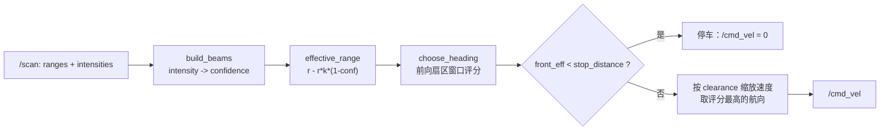
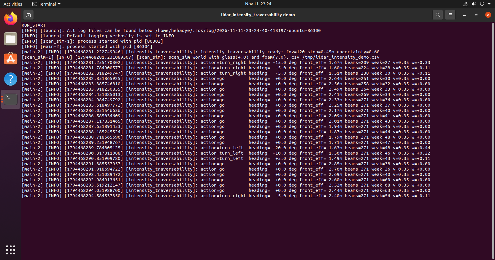
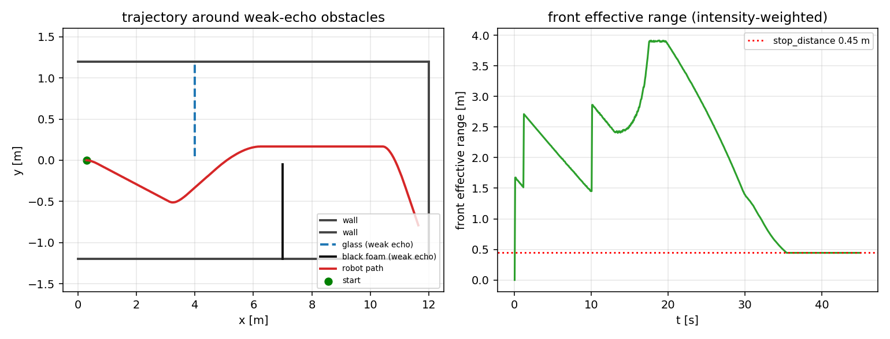

# 激光雷达回波强度辅助的可通行性判断

!!! info "模块信息"
    - 源码：`src/chap9/lidar_intensity_traversability`
    - 启动：`ros2 launch lidar_intensity_traversability main.launch.py`
    - 许可证：MIT
    - 章节：第 9 章 ROS 2
    - 一句话：用 `/scan` 的 `intensities` 判断哪些回波不可信，避免在玻璃、黑色泡棉前减速过晚。

!!! warning "仿真平台说明"
    本模块的 `scan_sim` 是**自写的几何射线世界 + 经验反射率模型**，不是 Gazebo / Carla / AirSim / MuJoCo
    等物理仿真平台；它验证的是**感知判据与控制决策链路**，不涉及物理引擎下的动力学表现。
    若作业硬性要求指定物理仿真平台，本模块需要换环境或由课程豁免。

## 1. 问题

只用 `min(ranges)` 做避障时，镜面玻璃和黑色泡棉这类低反射率物体的回波很弱，
测距看起来"很远"，控制器会误判前方空旷。几何上有障碍、回波上却像没有障碍，
是室内机器人常见的一类漏检。

## 2. 方法



### 2.1 三个核心函数（`core.py`，纯 Python）

| 函数 | 作用 | 关键式 |
|---|---|---|
| `confidence_from_intensity(intensity, ref=1200, floor=0.05)` | 把原始回波强度映射成 [floor, 1] 的置信度 | `clamp(intensity / ref, floor, 1)` |
| `effective_range(r, conf, uncertainty=0.6, min_range=0.05)` | 把低置信度回波折算成"更近"的安全距离 | `r - r * uncertainty * (1 - conf)` |
| `build_beams(ranges, angle_min, angle_inc, intensities, ...)` | 过滤 `inf`/0 值，打包每束的角度、距离、强度、置信度、有效距离 | — |
| `choose_heading(beams, fov_deg, step_deg, window_deg, ...)` | 在视场角内扫候选航向，返回线/角速度与决策 | `score = min_eff(window) - 0.004 * |angle|` |

### 2.2 选向与速度决策

1. 以 5° 为步长、±窗口 12°，在前向 `fov_deg`（默认 120°）内枚举候选航向；
2. 每个候选取窗口内**最小有效距离**作为评分，并减去角度惩罚；
3. 最优航向有效距离 < `stop_distance`（0.45 m）→ 停车；
   否则线速度按 `clearance / slow_distance` 缩放（`slow_distance` 默认 1.2 m），
   角速度 `heading / 45°` 限幅到 ±1。

## 3. 构建与运行

### 3.1 构建与启动

```bash
cd ~/ros2_ws
colcon build --packages-select lidar_intensity_traversability
source install/setup.bash
ros2 launch lidar_intensity_traversability main.launch.py
```

### 3.2 仿真世界

`scan_sim` 用线段描述走廊：x=4.0 处一块**玻璃板**（反射率 0.12），
x=7.0 处一块**黑色泡棉**（0.08），其余墙面反射率 1.0。
节点按 `/cmd_vel` 积分小车位姿，对每条线段做射线投射，按
`intensity ≈ 1400 * reflectivity * exp(-0.12 * range)` 生成回波强度，
并把每帧的位姿与决策写入 `/tmp/lidar_intensity_demo.csv`。

### 3.3 观察与复现

| 话题 | 类型 | 说明 |
|---|---|---|
| `/scan` | sensor_msgs/LaserScan | 仿真输出，含 `intensities` |
| `/cmd_vel` | geometry_msgs/Twist | 控制器输出 |
| `/traversability/decision` | std_msgs/String | `front_eff,heading,action` |

日志每 0.5 s 一行：`action` / `heading` / `front_eff` / `beams` / `weak` / `v` / `w`，
其中 `weak` 是置信度 < 0.25 的束数，可用来确认确实看到了低反射障碍。

生成分析图：

```bash
python3 src/chap9/lidar_intensity_traversability/scripts/make_figure.py \
  --csv /tmp/lidar_intensity_demo.csv --out /tmp/lidar_intensity_demo.png
```

## 4. 验证结果

实测环境：Ubuntu 20.04 + ROS 2 Foxy，Python 3.8.10，colcon 构建 1.3 s，
13 项单元测试全部通过（CI 在 Python 3.8 与 3.10 上各跑一遍）。





## 5. ROS 2 版本说明

- **实测版本**：Ubuntu 20.04 + ROS 2 **Foxy**（本机虚拟机只有 Foxy）。
- **Humble 兼容性**：模块只用到 `rclpy` 的 `create_publisher` / `create_subscription` /
  `create_timer` / `declare_parameter`，以及 `sensor_msgs/LaserScan`、
  `geometry_msgs/Twist`、`std_msgs/String`，这些接口在 Foxy 与 Humble 上一致；
  未使用任何 Foxy 专有 API，也未依赖 Python 3.8 特性。
- 同章已合并的 `rov_thruster_allocation_ls`、`uav_geofence_bypass` 同样是 Foxy 实测，
  本模块与它们保持一致的验证口径。
- 若课程严格要求 Humble 实测，需要在 Ubuntu 22.04 + Humble 环境再跑一次
  `colcon build` 与 `ros2 launch`，代码预期不需要改动。

## 6. 已知限制

- 仿真是 `scan_sim` 的几何世界 + 经验反射率模型，**不是 Gazebo/TurtleBot3，也不是真实雷达**。
- `ref_intensity`、`uncertainty` 未做真实玻璃/泡棉标定，换雷达需要重新标。
- 未接入真实底盘。

## 大模型使用声明

本模块的代码骨架、注释与文档由 **DeepSeek** 辅助整理，作者已在目标环境实际构建并运行，
对提交内容负责。
