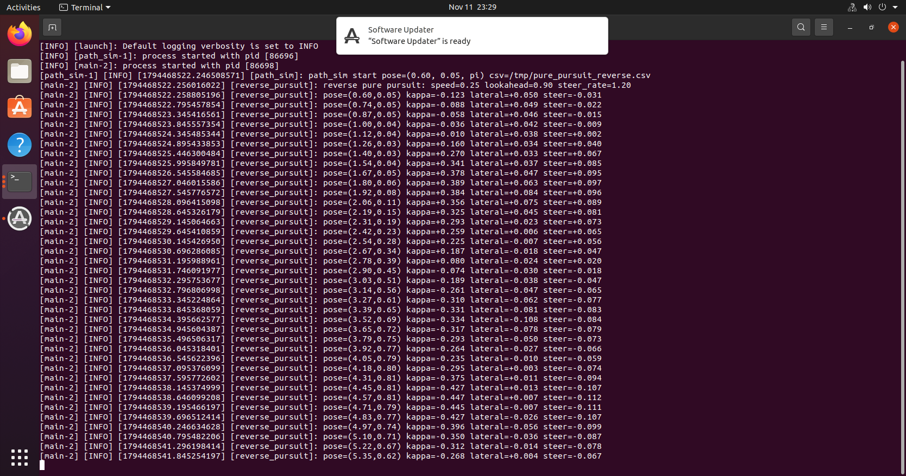
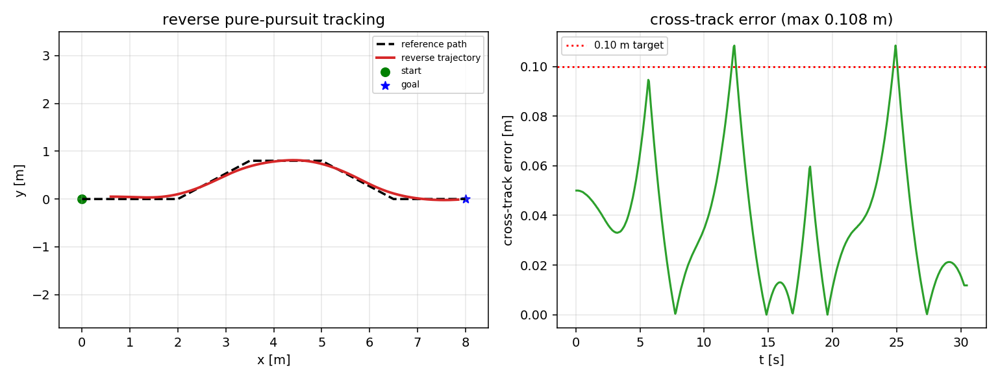

# 倒车（反向）纯追踪路径跟踪

!!! info "模块信息"
    - 源码：`src/chap9/pure_pursuit_reverse`
    - 启动：`ros2 launch pure_pursuit_reverse main.launch.py`
    - 章节：第 9 章 ROS 2
    - 一句话：沿路径倒车行驶的纯追踪控制器，含转向角速率限制与到达停车。

## 1. 问题

常见的纯追踪实现只处理前进工况。倒车时车头朝向与行进方向相反，
前视点的几何关系随之反转，直接沿用前进公式会出现符号错误并导致发散。
本模块给出倒车工况下的曲率公式、前视点取法和转向速率限制。

## 2. 方法

1. **路径弧长参数化**：`project_to_path` 把当前位姿投影到折线，得到弧长 `s` 和横向误差；
   `lookahead_point` 在 `s + L_d` 处按弧长插值取前视点（路径顶点顺序即行进方向）。
2. **曲率**：把车头方向取反得到"行进方向"，`alpha = wrap(atan2(dy, dx) - heading)`，
   `kappa = 2 sin(alpha) / L`。
3. **转向速率限制**：`steer = clamp(steer + kappa * v * dt)` 限制在 `max_steer_rate` 内；
   倒车时 `linear.x = -|v|`、`angular.z = steer`。
4. **到达判据**：弧长到达路径末端 0.15 m 内发布零速并打印横向误差。

### 2.1 倒车时前视点与曲率符号的推导

设路径按**行进方向**参数化，弧长 `s` 增大即车尾前进的方向。车辆位姿为
`(x, y, theta)`，倒车时的行进方向为 `theta + pi`。取前视点 `P = path(s + L_d)`，
令 `(dx, dy) = P - (x, y)`，则

```
alpha = wrap(atan2(dy, dx) - (theta + pi))     # 相对行进方向的夹角
kappa = 2 * sin(alpha) / L_d                    # 行进方向上的曲率
omega = speed * kappa                           # speed > 0
linear.x = -speed,  angular.z = omega
```

关键在于 `alpha` 必须相对**行进方向**计算，而不是车头方向：若沿用前进公式
（`alpha` 相对 `theta`），前视点会落在车头后方，夹角接近 `pi`，`sin(alpha)` 趋近 0，
曲率符号随机翻转，闭环会发散——这是实现倒车纯追踪时最容易踩的坑。

## 3. 构建与运行

```bash
cd ~/ros2_ws
colcon build --packages-select pure_pursuit_reverse
source install/setup.bash
ros2 launch pure_pursuit_reverse main.launch.py
```

默认路径为 S 形折线（0,0)→(2,0)→(3.5,0.8)→(5,0.8)→(6.5,0)→(8,0)，
小车初始位姿 (0.6, 0.05, π)，以 -0.25 m/s 倒车。

## 4. 验证结果

Ubuntu 20.04 + ROS 2 Foxy 实测：构建通过，10 项单元测试全部通过；
30 s 内走完全程，**最大横向误差 0.108 m**（目标线 0.10 m，略超）。





## 5. 已知限制

- 仿真为差速运动学积分，无轮胎侧滑、无执行器延迟，也未接入 Gazebo。
- 横向误差在弯道处略超 0.10 m，未做参数整定；前视距离固定，未做自适应。
- 未在 Humble 上复测。

## 大模型使用声明

本模块的代码骨架、注释与文档由 **DeepSeek** 辅助整理，作者已在目标环境实际构建并运行，
对提交内容负责。
