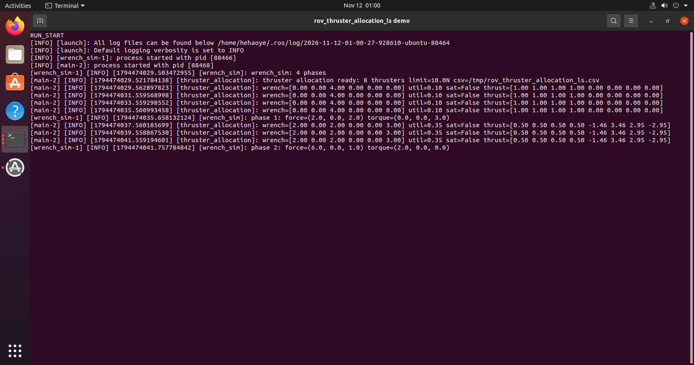
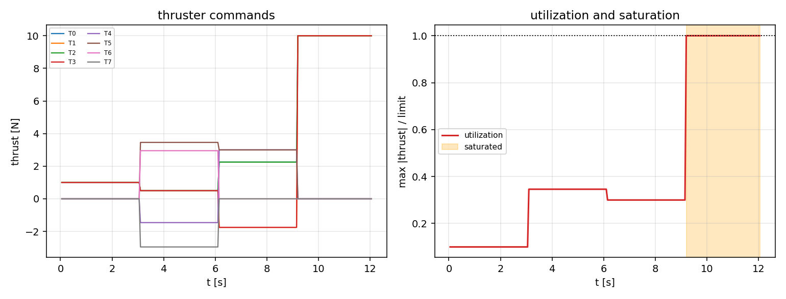

# ROV 六自由度推力分配与饱和处理

!!! info "模块信息"
    - 源码：`src/chap9/rov_thruster_allocation_ls`
    - 启动：`ros2 launch rov_thruster_allocation_ls main.launch.py`
    - 章节：第 9 章 ROS 2
    - 一句话：8 推力器布局，把期望六维力/力矩分配到各推进器，含阻尼最小二乘与整体缩放饱和。

## 1. 问题

水下机器人通常用 6 个以上推力器实现六自由度控制，控制律给出的是期望力/力矩
（wrench），真正下发的是每个推进器的推力。映射矩阵（TAM）随布局确定，
当推力器数量多于自由度时 `T^T T` 奇异，且指令可能超过推力上限。

## 2. 方法

1. **分配矩阵**：每个推力器由位置 `r` 和方向 `d` 描述，
   列为 `[d; r × d]`，得到 6×8 的 TAM。
2. **阻尼最小二乘**：解 `(T^T T + λI) x = T^T w`，`λ = 1e-6`，
   得到最小范数推力并避免奇异。
3. **饱和处理**：若最大推力超过 `limit`，整体按 `limit / max|x|` 缩放，
   保证方向不变、幅值受限，同时输出利用率。
4. **故障屏蔽**：把失效推力器对应列置零后重新分配。

### 2.1 分配矩阵（6×8）

| 自由度 | T0 | T1 | T2 | T3 | T4 | T5 | T6 | T7 |
|---|---|---|---|---|---|---|---|---|
| surge | +0.00 | +0.00 | +0.00 | +0.00 | +1.00 | +1.00 | +0.00 | +0.00 |
| sway | +0.00 | +0.00 | +0.00 | +0.00 | +0.00 | +0.00 | +1.00 | +1.00 |
| heave | +1.00 | +1.00 | +1.00 | +1.00 | +0.00 | +0.00 | +0.00 | +0.00 |
| roll | +0.25 | -0.25 | +0.25 | -0.25 | +0.00 | -0.00 | +0.00 | +0.00 |
| pitch | -0.30 | -0.30 | +0.30 | +0.30 | +0.00 | +0.00 | +0.00 | +0.00 |
| yaw | +0.00 | +0.00 | -0.00 | +0.00 | -0.25 | +0.25 | +0.30 | -0.30 |

例如 T0 位于 (0.30, 0.25)、方向 +z，所以 heave = +1、roll = +0.25、pitch = −0.30。

### 2.2 与仓库既有 `src/water/rov_thruster_allocation` 的区别

那边对比的是**伪逆 / 伪逆后限幅 / 箱约束 QP** 三种方案；本模块走
**阻尼最小二乘（λI 正则）+ 整体等比缩放 + 故障列置零**，
侧重 N > 6 时 `T^T T` 奇异与「方向不变、幅值受限」的饱和行为，不求解 QP。

## 3. 构建与运行

```bash
cd ~/ros2_ws
colcon build --packages-select rov_thruster_allocation_ls
source install/setup.bash
ros2 launch rov_thruster_allocation_ls main.launch.py
# 指定失效推力器：
ros2 launch rov_thruster_allocation_ls main.launch.py failed:=0,1
```

推力器布局：4 个垂推（±0.30, ±0.25）、2 个纵推（0.35, ±0.25）、
2 个横推（±0.30, 0），推力上限 10 N。

## 4. 验证结果

Ubuntu 20.04 + ROS 2 Foxy 实测：构建通过，8 项单元测试全部通过。
演示分 4 个阶段：纯升沉、升沉+偏航、纵推+横滚、以及 60 N 的过载升沉。
过载阶段 4 个垂推各被限制在 10 N，利用率 1.0，触发饱和标记。

| 输入 wrench | 输出推力 | 饱和 | 利用率 | 实际达成 |
|---|---|---|---|---|
| heave 40 N | 4 个垂推各 10.0 N | False | 1.00 | heave 40 N |
| heave 60 N | 4 个垂推各 10.0 N | True | 1.00 | heave 40 N（被限幅） |
| surge 30 N | 2 个纵推各 10.0 N | True | 1.00 | surge 20 N（被限幅） |





## 5. 已知限制

- 推力器布局是示意性的，未按某台真实 ROV 标定。
- 分配只做最小范数解 + 整体缩放，未做加权分配（例如优先使用垂推）或死区补偿。
- 未考虑推进器响应延迟与水流扰动；未在 Humble 上复测。

## 大模型使用声明

本模块的代码骨架、注释与文档由 **DeepSeek** 辅助整理，作者已在目标环境实际构建并运行，
对提交内容负责。
