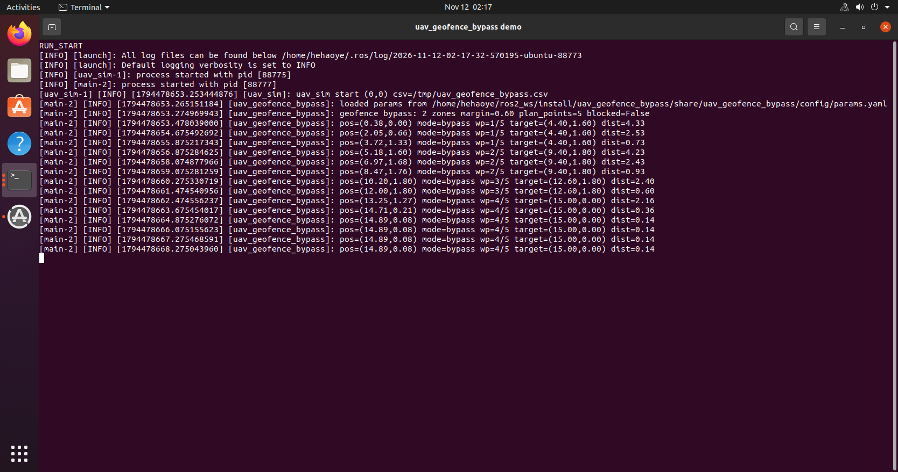
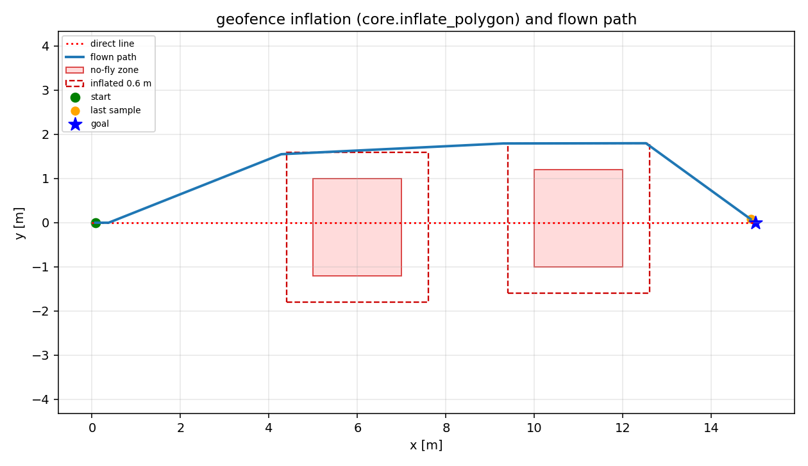

# 无人机禁飞区膨胀与可见图最短绕行

!!! info "模块信息"
    - 源码：`src/chap9/uav_geofence_bypass`
    - 启动：`ros2 launch uav_geofence_bypass main.launch.py`
    - 许可证：MIT
    - 章节：第 9 章 ROS 2
    - 一句话：把禁飞区按安全裕度膨胀，再用可见图 + Dijkstra 求最短绕行航点。

## 1. 问题

只做"点在多边形内"的禁飞区检查，通常是在越界后才触发；而真正需要提前处理的是
**连线会穿过禁飞区**的情况。工程上一般先把禁飞区按机体半径 + 安全裕度膨胀，
再在膨胀后的多边形顶点上做可见图搜索，得到最短且不穿区的折线路径。

## 2. 方法

1. **膨胀**：`inflate_polygon` 把凸多边形每条边沿外法线平移 `margin`，
   相邻偏移线求交得到新顶点（默认 0.6 m）。
2. **可见性**：`segment_clear` 判断线段是否穿入多边形内部，允许与顶点/边相切；
   相切点正是绕行切点。
3. **最短绕行**：以起点、各膨胀多边形顶点、终点为节点建可见图，
   边权为欧氏距离，Dijkstra 求最短路。
4. **执行**：节点启动时规划一次，按航点顺序发布 `/uav/safe_goal`；
   收到新 `/uav/goal` 时重新规划。若当前位置落在膨胀区内，先取最近边界点脱困。

## 3. 构建与运行

```bash
cd ~/ros2_ws
colcon build --packages-select uav_geofence_bypass
source install/setup.bash
ros2 launch uav_geofence_bypass main.launch.py
```

禁飞区、起点、目标、膨胀裕度都在 `config/params.yaml` 里，改场景不用动代码：

```bash
ros2 launch uav_geofence_bypass main.launch.py params_file:=/path/to/params.yaml
```

默认两个禁飞区：x∈[5,7]、y∈[-1.2,1.0] 与 x∈[10,12]、y∈[-1.0,1.2]，
起点 (0,0)，目标 (15,0)，直连航段被两个区同时挡住。

### 3.1 话题

| 话题 | 类型 | 方向 |
|---|---|---|
| `/uav/odom` | nav_msgs/Odometry | 订阅 |
| `/uav/goal` | geometry_msgs/PoseStamped | 订阅 |
| `/uav/safe_goal` | geometry_msgs/PoseStamped | 发布 |
| `/uav/geofence_state` | std_msgs/String | 发布（诊断） |

### 3.2 参数

| 参数 | 默认 | 说明 |
|---|---|---|
| `margin` | 0.6 | 膨胀裕度 (m) |
| `accept_radius` | 0.3 | 航点切换半径 (m) |
| `log_period` | 1.0 | 日志周期 (s) |
| `start` / `goal` | [0,0] / [15,0] | 起终点 |
| `zones` | 2 个四边形 | 每个区按 x1,y1,x2,y2… 排列 |

## 4. 验证结果

Ubuntu 20.04 + ROS 2 Foxy 实测：构建通过，13 项单元测试全部通过；
规划得到 5 个航点（含起终点），实际航迹依次经过 (4.40,1.60)、(9.40,1.80)、
(12.60,1.80)，最终停在 **(14.89, 0.08)**，距目标 0.14 m（截图与 CSV 最后一行一致）。





## 5. 已知限制

- 只处理**静态凸多边形**禁飞区；凹多边形需先分解，动态禁飞区需要重规划节拍。
- 规划为一次性，飞行中不滚动重规划；若被外力推离航线不会自动纠偏。
- 无人机仍是质点模型；未在 Humble 上复测。
- 依赖 `python3-yaml` 读取参数文件，缺失时回退到内置默认场景并打印警告。

## 大模型使用声明

本模块的代码骨架、注释与文档由 **DeepSeek** 辅助整理，作者已在目标环境实际构建并运行，
对提交内容负责。
