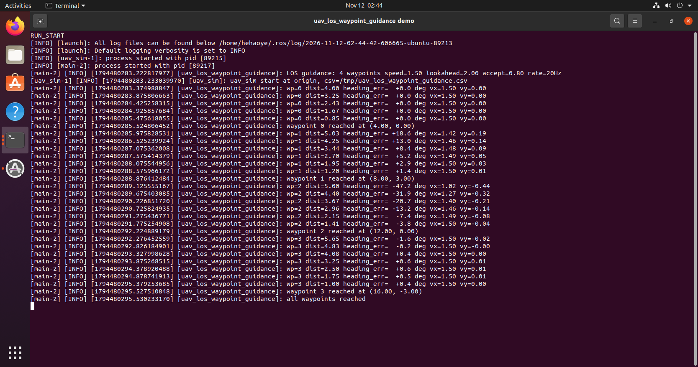
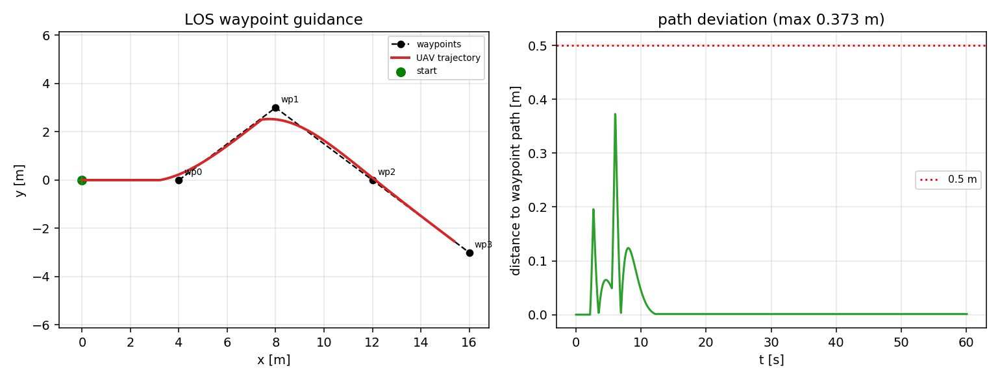

# 无人机 LOS 视线制导航点跟踪

!!! info "模块信息"
    - 源码：`src/chap9/uav_los_waypoint_guidance`
    - 启动：`ros2 launch uav_los_waypoint_guidance main.launch.py`
    - 许可证：MIT
    - 章节：第 9 章 ROS 2
    - 一句话：用视线制导（LOS）而非位置 PID 跟踪航点，输出机体系速度指令。

## 1. 问题

航点跟踪常用位置环 PID，横向偏差靠积分慢慢消除，遇到折线航段容易切内角。
LOS 制导把"路径方向 + 横向偏差修正"直接合成期望航向，是船舶/无人机常用的
路径跟踪方法，参数少、超调小。

## 2. 方法

1. **横向误差**：`segment_tracking` 把当前位姿投影到"上一航点→当前航点"的线段，
   得到纵向进度与有向横向偏差 `e`。
2. **LOS 航向**：`psi_d = psi_path - atan2(e, Delta)`，`Delta` 为前视距离（默认 2.0 m）。
3. **机体系速度**：`vx = v cos(err)`、`vy = v * lateral_gain * sin(err)`，
   偏航角速度取 `yaw_gain * err` 并限幅到 `max_yaw_rate`（默认 1.2 / 0.8 rad/s）。
4. **航点判据**：距航点小于 `accept_radius`（默认 0.8 m）即切换到下一个，
   航点表走完发布零速并打印 "all waypoints reached"。
5. **控制循环**：控制器由独立 timer 按 `control_rate_hz`（默认 20 Hz）驱动，
   `/uav/odom` 回调只更新位姿；odom 频率变化或短时中断不会让控制器停摆。

## 3. 构建与运行

```bash
cd ~/ros2_ws
colcon build --packages-select uav_los_waypoint_guidance
source install/setup.bash
ros2 launch uav_los_waypoint_guidance main.launch.py
```

航点、速度、前视距离都在 `config/params.yaml` 里，用 `params_file` 可换成自己的：

```bash
ros2 launch uav_los_waypoint_guidance main.launch.py params_file:=/path/to/params.yaml
# 命令行覆盖单个参数（标准 ROS 2 参数机制）
ros2 run uav_los_waypoint_guidance main --ros-args -p speed:=2.0 -p yaw_gain:=1.5
```

参数由 launch 以 `parameters=[params_file]` 交给 ROS 2 参数系统加载，
节点内用 `declare_parameter` / `get_parameter` 读取，不是手工解析 YAML。

默认航点：(4,0)、(8,3)、(12,0)、(16,-3)，速度 1.5 m/s。

### 3.1 话题

| 话题 | 类型 | 方向 |
|---|---|---|
| `/uav/odom` | nav_msgs/Odometry | 订阅 |
| `/uav/cmd_vel` | geometry_msgs/Twist | 发布（机体系速度） |
| `/uav/los_state` | std_msgs/String | 发布（诊断） |

### 3.2 参数

| 参数 | 默认 | 说明 |
|---|---|---|
| `speed` | 1.5 | 巡航速度 (m/s) |
| `lookahead` | 2.0 | LOS 前视距离 (m) |
| `accept_radius` | 0.8 | 航点接受半径 (m) |
| `log_period` | 0.5 | 日志与状态发布周期 (s) |
| `control_rate_hz` | 20.0 | 控制循环频率 (Hz) |
| `yaw_gain` | 1.2 | 航向误差到偏航角速度的增益 |
| `max_yaw_rate` | 0.8 | 偏航角速度限幅 (rad/s) |
| `waypoints` | … | 成对的 x, y 航点 |

## 4. 验证结果

Ubuntu 20.04 + ROS 2 Foxy 实测：构建通过，9 项单元测试全部通过；
4 个航点全部到达，**相对航点折线的最大偏差 0.373 m**（阈值 0.5 m）。





## 5. 已知限制

- 无人机模型是质点运动学（机体系速度直接积分），无姿态动力学、无风扰。
- 高度指令 `z` 只记录不使用，二维平面内验证。
- 未在 Humble 上复测。
- 依赖 `python3-yaml` 读取参数文件；缺少该依赖时节点会回退到内置默认值并打印警告。

## 大模型使用声明

本模块的代码骨架、注释与文档由 **DeepSeek** 辅助整理，作者已在目标环境实际构建并运行，
对提交内容负责。
