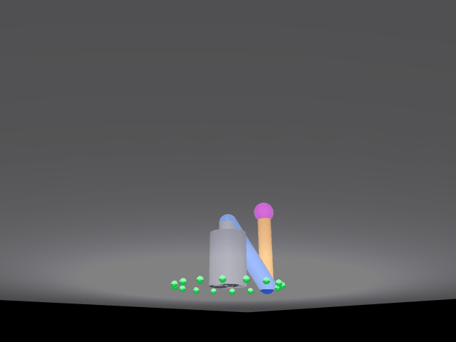

# 三自由度机械臂空间螺旋线仿真

本页对应 `src/chap8/mujoco_arm_3d`：一台**三自由度机械臂**（肩方位 yaw + 肩俯仰 shoulder + 肘俯仰 elbow），
末端在三维空间沿**圆柱螺旋线**运动（水平画圆 + 垂直匀速上升），
程序用解析空间逆运动学实时解算三个关节角，逐帧渲染后直接写出本页配图。

!!! info "环境与可复现性"
    本页数值来自两套实跑环境：**Windows 11 + Python 3.11 + MuJoCo 3.17.0**，
    以及 **Ubuntu 22.04.5 + Python 3.12.11 + MuJoCo 3.17.0**（无独立显卡，`MUJOCO_GL=glfw` + Xvfb）。
    版本表见 §3.1，命令与终端输出见 §3.2–§3.3。



动图由 `main.py` 的离屏渲染路径逐帧写出（24 fps × 9 s），就是 `python3 main.py` 在任意机器上的真实产出：
**216 帧 / 640×480 / 每帧 40 ms / 8.64 s / 1.64 MB**（体积随 Pillow 版本略有浮动）。
画面里地面的绿色小球是螺旋线在地面的水平投影参考点，黄线是 DLT 标定后叠画的二维轨迹折线，品红球是末端。
`verify_arm3d.py gui` 是另一种查看方式：弹 MuJoCo 窗口实时播放、在 `user_scn` 里画三维轨迹，不另存静态图，对照见 §3.4。

## 1. 本模块实际实现范围

| 项 | 实际情况 |
|---|---|
| 空间逆运动学 | **做了**。闭式解：先由水平投影求方位角，再在臂平面内用两连杆解析解求肩/肘（§2.1）。螺旋线上 8 个空间点，逆解写回 `qpos` 后由**引擎**正解读数，最大误差 **0.0000 mm** |
| 末端沿螺旋线跟随 | **做了**，但这是**构造性自检而非独立验证**：`qpos` 直接取 IK 解、`mj_forward` 只做正解，与上一条的 IK 输入同源，误差必然为 0。真实意义是确认「写进入 `qpos` 的关节角没有丢掉」和「螺旋线 216 帧全部可解」，不能当作跟随精度的证据（§3.5） |
| 轨迹叠加（把末端轨迹画到画面上） | **做了**。DLT 反解 3×4 投影矩阵（10 个标定点，平均重投影 **1.56 px**），216 帧全帧投影残差 x 平均 0.94 / 最大 2.57 px、y 平均 0.44 / 最大 2.44 px，末帧偏差 **2.71 px**（§2.4）。这条针对 `main.py` 的离屏渲染版；`gui` 模式另用 `user_scn` 画三维轨迹（§3.3），本页主图取离屏渲染版 |
| 物理时间对齐 | **只在 PD 对照路径成立**：该路径每帧 21 个 2 ms 子步对上 1/24 s 帧间隔。**默认的运动学驱动不跑物理时间**，每帧只有一次 `mj_forward`，不积分（§2.3） |
| yaw 解缠 | **做了**。1.5 圈跨过 $\mathrm{atan2}$ 的 $\pm\pi$ 跳变点，逐帧把 $q_0$ 加减 $2\pi$ 拉回上一帧附近（§2.2） |
| PD 位置控制 | **保留为对照路径**，`ARM3D_PD=1` 才启用，不设为默认。2 ms 步长下带宽不足，实测各增益组合末端误差仍有 **100~540 mm**、肘关节来回震荡（§2.3） |
| 动力学 / 力矩控制 | **不做**。默认运动学驱动：关节角直接写入 `qpos`、`qvel` 清零、`mj_forward`，不 `mj_step`、不积分动力学 |
| 抓取 / 夹爪 | **不做**。末端只有一个球形标记，没有夹爪、不做接触与摩擦 |
| ROS 封装 | **只做最小封装**：`package.xml` / `CMakeLists.txt` / `launch/mujoco_arm_3d.launch` / `LICENSE` / `requirements.txt` 齐备（与已合并的 `mujoco_arm_screw` 一致），但**没有话题、服务、action**，`launch` 只是把脚本拉起来 |

## 2. 原理

### 2.1 空间逆运动学（闭式解）

模型：`yaw` 绕 Z 轴（方位角），`shoulder` / `elbow` 绕 −Y 轴（在臂平面内弯折），
两段杆长 $L_1=L_2=0.30$ m，肩俯仰铰点高度 $z_0=0.24$ m。

给定末端目标 $(x,y,z)$，先把目标分解成水平半径与臂平面内的极坐标：

$$
r=\sqrt{x^{2}+y^{2}},\qquad \Delta z=z-z_{0},\qquad d=\sqrt{r^{2}+\Delta z^{2}}
$$

可达性判据 $|L_1-L_2|\le d\le L_1+L_2$；不满足则返回 `None`，主程序会打印"目标点在工作空间外"并跳过该帧。
余弦定理求肘角（这里取"肘上"解 $q_2>0$，画面里小臂向上折）：

$$
\cos q_{2}=\frac{d^{2}-L_{1}^{2}-L_{2}^{2}}{2L_{1}L_{2}},\qquad q_{2}=\arccos\big(\cos q_{2}\big)
$$

肩角 = 目标方向角减去连杆三角形内角：

$$
q_{1}=\mathrm{atan2}(\Delta z,\ r)-\mathrm{atan2}\!\big(L_{2}\sin q_{2},\ L_{1}+L_{2}\cos q_{2}\big)
$$

方位角：

$$
q_{0}=\mathrm{atan2}(y,\ x)
$$

正运动学（与逆解互查用同一套连杆定义，也用于轨迹几何自检）：

$$
x_{\text{arm}}=L_{1}\cos q_{1}+L_{2}\cos(q_{1}+q_{2}),\qquad
z_{\text{arm}}=L_{1}\sin q_{1}+L_{2}\sin(q_{1}+q_{2})
$$

$$
x=x_{\text{arm}}\cos q_{0},\qquad y=x_{\text{arm}}\sin q_{0},\qquad z=z_{0}+z_{\text{arm}}
$$

### 2.2 yaw 解缠

1.5 圈（540°）会跨过 $\mathrm{atan2}$ 的 $\pm\pi$ 跳变点，直接取角会让关节在相邻两帧之间
"瞬间甩 360°"。逐帧把新的 $q_0$ 加减 $2\pi$ 拉回上一帧附近（差值控制在 $(-\pi,\pi]$），
关节角保持连续，画面才是平滑画圆。

### 2.3 为什么默认不用 PD 驱动

这条只适用于 **PD 对照路径**（`ARM3D_PD=1`）：按 1/24 s 的帧间隔只走 1 个 2 ms 物理步时，
物理时间只推进到轨迹时间的 **4.8%**，实测末端速度只有轨迹速度的 **14%**，末端全程"追不上"螺旋线。
补齐子步（每帧 21 个 2 ms ≈ 41.7 ms，与帧间隔对齐）后，物理时间与轨迹推进同步。

即便补齐子步，PD 位置控制在 2 ms 步长下带宽仍不足：KP/KD 取 40/12、120/25、200/40、300/60、400/80
五组增益，实测末端误差仍有 **100~540 mm**，肘关节来回震荡。
所以默认路径改为**运动学驱动** ——

```text
data.qpos[yaw/shoulder/elbow] ← IK 解
data.qvel[...] ← 0
mujoco.mj_forward(model, data)
```

末端严格落在螺旋线上。**默认路径里没有 `mj_step`、没有物理时间推进**，所以那句
「每帧 21 个物理子步」只在 PD 路径成立，默认路径的终端输出改成了
「运动学驱动（IK 解直写 qpos + mj_forward，不做物理积分）」。
PD 路径仍保留（`ARM3D_PD=1 ARM3D_KP=.. ARM3D_KD=..`）作为对照，
说明"为什么不用动力学闭环"这件事本身是可复现的。

副作用要说清：**画面上的运动不是动力学积分的结果**，关节力矩、重力下垂、碰撞都没参与，见 §4。

### 2.4 相机投影为什么要标定

手算 lookAt（MuJoCo 的 `azimuth` / `elevation` 约定、`fovy` 与像素坐标的换算）与渲染器实际出图
常有几像素偏差，黄线会"贴不齐末端"。这里改成 **DLT（直接线性变换）**标定：

在三维空间取 10 个分散位姿（不同半径 + 不同高度 + 不同方位；只沿螺旋取点会近似共面、外推失效）。
**高度覆盖必须盖住整条轨迹**（螺旋 z = 0.32→0.56 m），早期版本 5 层只到 0.38 m、又只取前 10 个候选，
结果螺旋上段全落在标定范围之外，y 方向残差被放大到平均 1.38 px、末帧 4.04 px；
现在 5 层改到 0.14 / 0.24 / 0.34 / 0.44 / 0.54 m，并从 15 个候选里沿序列均匀取 10 个，覆盖铺满整条轨迹。

渲染后按画面中唯一的品红球求像素质心 `(px, py)`，每个点给两行方程

$$
\begin{bmatrix}x&y&z&1&0&0&0&0&-p_x x&-p_x y&-p_x z\\0&0&0&0&x&y&z&1&-p_y x&-p_y y&-p_y z\end{bmatrix}
\begin{bmatrix}P_{11}\\\vdots\\P_{33}\end{bmatrix}=
\begin{bmatrix}p_x\\p_y\end{bmatrix}
$$

最小二乘解出 3×4 投影矩阵 $P$，投影关系为

$$
\begin{bmatrix}u\\v\\w\end{bmatrix}=P\begin{bmatrix}x\\y\\z\\1\end{bmatrix},\qquad
(p_x,p_y)=\left(\frac{u}{w},\ \frac{v}{w}\right)
$$

解完先剔除重投影偏差 > 8 px 的离群点（被遮挡或误判）再解一次，最后 10 个点全部保留、
平均重投影误差 **1.56 px**。

实际对齐残差（216 帧全帧、每帧比投影点与画面球心）：**x 平均 0.94 / 最大 2.57 px，
y 平均 0.44 / 最大 2.44 px，末帧偏差 2.71 px**（dx −2.52、dy 1.01）。
残差不是随机噪声，来源有两处，都不能拿"抗锯齿"糊过去：

1. **DLT 是单目线性投影**，对真实透视只作一次近似，离标定点簇越远残差越大（实测把标定高度从 0.38 扩到 0.54 m 后，末帧偏差由 4.04 px 降到 2.71 px、y 平均由 1.38 降到 0.44 px）；
2. **球心用像素质心近似**：品红球在斜视角下成椭圆、靠画面边缘时像素会被裁掉一部分，质心会整体偏几个像素。

## 3. 运行

### 3.1 环境

| 组件 | 版本 |
|---|---|
| 系统 | Windows 11（本机）；Ubuntu 22.04.5 LTS（云主机，无独立显卡） |
| Python | 3.11（Windows）；3.12.11（Ubuntu） |
| MuJoCo | **3.17.0**（两套环境相同） |
| numpy | 2.4.6（Windows）；1.26.4（Ubuntu） |
| Pillow | 13.0.0（Windows）；10.4.0（Ubuntu，出 GIF 用） |
| 渲染后端 | `glfw`（有桌面时默认）；无显示器的虚拟机推荐 `egl`；`osmesa` 在部分 VMware 上会崩，见 §4 |
| 依赖 | `pip install mujoco pillow numpy`（版本见上两行；模型 XML 内嵌在 `main.py`，不需要额外的模型或贴图文件） |

### 3.2 命令

**以下命令都在本仓库根目录（clone 下来的 `ros2/` 目录）下执行**，不是自己的工作空间 `~/catkin_ws`：

```bash
# 0) 装依赖（只需一次；不需要显卡）
pip install mujoco pillow numpy

# 1) 进入本功能包目录
cd src/chap8/mujoco_arm_3d

# 2) 运行
python3 main.py                   # 渲染并写出 GIF（位置见下）
python3 verify_arm3d.py ik        # IK 数值精度验证（不需要显卡）
python3 verify_arm3d.py gui       # glfw 实时渲染：按 24 fps 播放 216 帧（约 9 秒）
```

`src/chap8/...` 是**本仓库内部**的相对路径，不是 catkin 工作空间的 `src/`。如果你把仓库 clone 到了
工作空间里（比如 `~/catkin_ws/src/ros2/`），要先 `cd` 到那个 `ros2/` 仓库根，再执行上面的 `cd src/chap8/mujoco_arm_3d`。

**ROS 封装（catkin / roslaunch）**：`package.xml`、`CMakeLists.txt`、`launch/mujoco_arm_3d.launch` 这三件就对应这条入口。把整个 `ros2` 仓库放进工作空间（例如 `~/catkin_ws/src/ros2`）后：

```bash
cd ~/catkin_ws
catkin_make
source devel/setup.bash
roslaunch mujoco_arm_3d mujoco_arm_3d.launch            # 默认 MUJOCO_GL=glfw
roslaunch mujoco_arm_3d mujoco_arm_3d.launch gl:=egl    # 有 EGL 时换后端
```

`launch` 只是把 `main.py` 拉起来（`type="main.py"`，由 `catkin_install_python` 装到 `devel/lib/mujoco_arm_3d/` 并保留可执行位）。本包**不发布/订阅任何话题**，没有 service、action，也没有自定义消息 —— 所以除 `catkin_make` 编译和 `roslaunch` 启动外，ROS 侧没有别的要配的。`roslaunch` 启动时 node 的工作目录是 `~/.ros`，GIF 会写到 `~/.ros/mujoco_arm_3d_demo.gif`；要写到别处就在包目录里直接跑 `python3 main.py --out <路径>`。`verify_arm3d.py` 属于开发期工具，不装进运行时目录，在包目录下直接执行即可。

**GIF 输出位置**：程序不写死路径，按下面的顺序决定，渲染完成后会打印一行 `输出位置：...`

1. 命令行给了 `--out`：写到指定路径，例如 `python3 main.py --out ./mujoco_arm_3d_demo.gif`；
2. 脚本所在位置能解析出仓库根（仓库根有 `mkdocs.yml`、`docs/img` 可写）：写到 `docs/img/mujoco_arm_3d_demo.gif`，也就是文档站配图，只此一份；
3. 以上都不满足（例如被 catkin 安装到 `lib/` 之下、或只把 `mujoco_arm_3d/` 单独拷出来跑）：写到当前工作目录，不会去碰 `../../../docs/img` 这种在别人机器上可能不存在的路径。

这样在仓库里跑一次就是更新文档配图，换到别人的 `catkin_ws` 里跑也不会再出现 `PermissionError: .../docs`。

`gui` 模式每帧补足到 1/24 s 实时推进（不补的话 216 帧在 0.2 秒内跑完、窗口一闪而过），
播放结束窗口保持打开，按 Enter 才退出；中途手动关窗会打印「窗口已关闭，提前结束」并停止。
窗口里还会画出整条 **3D 螺旋线轨迹**（黄色胶囊段，215 段）：离屏版的 GIF 里那条黄线是 PIL 在 2D 图上叠画的像素折线，
viewer 里没有，所以这里用 `user_scn` 补了真实的三维几何体，末端品红球沿它运动。**这条路径供本地实时查看，本页配图不是它的截图。**

两条产出路径的区别如下，尺寸和帧率不同是正常的，不要互相套用：

| 产出方式 | 轨迹怎么画 | 尺寸 / 帧率 / 时长 | 是否附图 |
|---|---|---|---|
| `main.py` 离屏渲染（**本页主图**） | DLT 标定投影叠画的 **2D 像素折线**，标定相机 | 640×480 / 216 帧 / 每帧 40 ms / 8.64 s | 是，1.64 MB |
| `verify_arm3d.py gui` | `user_scn` 里的 **3D 几何体**，viewer 默认相机 | 窗口尺寸随显示器，24 fps 实时 | 否，本地运行查看 |

两个版本跑的是同一套模型、同一条螺旋线、同一次 IK 解算，差别只在出图方式。

PD 对照路径（可选）：

```bash
ARM3D_PD=1 ARM3D_KP=40 ARM3D_KD=12 python3 main.py
```

无显示器时：

```bash
MUJOCO_GL=egl python3 main.py                  # 推荐
DISPLAY=:99 MUJOCO_GL=glfw python3 main.py     # egl 不可用时（Xvfb）
```

### 3.3 终端实跑输出（IK 验证）

`python3 verify_arm3d.py ik` 的实际输出（Windows 11 / Python 3.11 / MuJoCo 3.17.0）：

```text
== IK 数值精度验证（螺旋线 8 个空间点） ==
  点0 目标(0.200, 0.000, 0.320) 逆解(0.000, -0.823, 2.407) -> 正解(0.200, 0.000, 0.320) 误差 0.0000 mm
  点1 目标(0.141, 0.141, 0.354) 逆解(0.785, -0.658, 2.354) -> 正解(0.141, 0.141, 0.354) 误差 0.0000 mm
  点2 目标(0.000, 0.200, 0.389) 逆解(1.571, -0.504, 2.285) -> 正解(-0.000, 0.200, 0.389) 误差 0.0000 mm
  点3 目标(-0.141, 0.141, 0.423) 逆解(2.356, -0.362, 2.204) -> 正解(-0.141, 0.141, 0.423) 误差 0.0000 mm
  点4 目标(-0.200, 0.000, 0.457) 逆解(3.142, -0.230, 2.113) -> 正解(-0.200, 0.000, 0.457) 误差 0.0000 mm
  点5 目标(-0.141, -0.141, 0.491) 逆解(-2.356, -0.107, 2.011) -> 正解(-0.141, -0.141, 0.491) 误差 0.0000 mm
  点6 目标(-0.000, -0.200, 0.526) 逆解(-1.571, 0.010, 1.901) -> 正解(-0.000, -0.200, 0.526) 误差 0.0000 mm
  点7 目标(0.141, -0.141, 0.560) 逆解(-0.785, 0.122, 1.781) -> 正解(0.141, -0.141, 0.560) 误差 0.0000 mm
最大误差：0.0000 mm
结果：PASS（<0.01 mm）
```

`逆解` 是 `ik3` 算出的三个关节角（rad），`正解` 是把这组角写进 `qpos` 后由 **MuJoCo 引擎**
读出的末端世界坐标（`data.xpos[tip]`），不是手写正解 —— 所以这一列能排除"自己验自己"。
`点4` 的 `3.142` 与 `-0.000` 是 $\pi$ 附近的浮点舍入，几何上是同一组解。

`python3 main.py` 的实际输出（同一台机器）：

```text
相机标定：10/10 个点有效，平均重投影误差 1.56 px
三自由度机械臂空间螺旋线：半径 0.20 m，高度 0.32→0.56 m，1.5 圈，共 216 帧，运动学驱动（IK 解直写 qpos + mj_forward，不做物理积分）
  已渲染 54/216 帧（25%）
  已渲染 108/216 帧（50%）
  已渲染 162/216 帧（75%）
  已渲染 216/216 帧（100%）
渲染完成，耗时 1.0 秒，合成 GIF...
末端跟随误差：首帧 0.0 mm，末帧 0.0 mm，最大 0.0 mm（构造性自检：qpos 直接取 IK 解、mj_forward 只做正解，与 IK 输入同源，非独立验证）
投影对齐残差（216 帧全帧）：x 平均 0.94 / 最大 2.57 px，y 平均 0.44 / 最大 2.44 px
末帧对齐：dx -2.52 px，dy 1.01 px，偏差 2.71 px
输出位置：<仓库根>/docs/img/mujoco_arm_3d_demo.gif（仓库内 docs/img（文档站配图））
已生成效果图：.../docs/img/mujoco_arm_3d_demo.gif（216 帧，每帧 40 ms，实际 8.64 s，名义 9.0 s，1.65 MB）
```

上面是 `main.py`（离屏渲染）的终端输出，**本页顶部那张配图就是这段输出产出的**；
每次运行都会就地覆盖同一个路径。
`ARM3D_PD=1` 时第一行会换成「PD 对照路径，每帧 21 个 2 ms 物理子步」，那才是走物理积分的那条路径。

把同一个 `main.py` 拷到仓库外的目录再跑，输出行会变成：

```text
输出位置：/tmp/pkg/mujoco_arm_3d_demo.gif（当前工作目录（不在仓库结构里，可用 --out 指定））
```

也就是不再去碰 `../../../docs/img`，不会因为目标目录无权限而中断。文件大小每次会有 KB 级浮动
（1.65~1.66 MB），是 GIF 调色板压缩的差异，逐帧画面一致。

### 3.4 运动动图

末端从 $z=0.32$ m 起，绕半径 0.20 m 的圆转 1.5 圈，同时匀速升到 $z=0.56$ m；
地面的 16 个绿点是这条螺旋线在地面的水平投影参考点（半径同为 0.20 m，每 22.5° 一个）。
动图见**页首那张主图**（同一张图，这里不重复贴）。

本图由 `main.py` 逐帧渲染并合成，**216 帧 / 640×480 / 每帧 40 ms / 8.64 s / 1.64 MB**。

脚本版（`main.py` 离屏渲染）另有一套时长口径：轨迹按 **24 fps** 采样（216 帧 × 41.7 ms ≈ 名义 9.0 s），
GIF 时间轴精度只有 10 ms，41.7 ms 会被写成 **40 ms**，所以文件实际播放 216 × 40 ms = **8.64 s**，
体积约 1.65 MB。两版的帧数、尺寸不同，是出图路径不同，轨迹内容一致。

### 3.5 验证结果汇总

| 项 | 结果 |
|---|---|
| IK 数值精度 | 螺旋线 8 个空间点 逆解 → **引擎**正解读数（`data.xpos[tip]`，非手写正解），最大误差 **0.0000 mm** |
| 末端跟随误差 | 216 帧逐帧对比，首帧 / 末帧 / 最大均 **0.0 mm**。**这一项是构造性自检**：`qpos` 直接取 IK 解、`mj_forward` 只做正解，与上一行同源，恒等于 0，不算独立的跟随精度证据；它的实际用途是确认 216 帧全部可解、关节角写入没有丢失 |
| 相机标定 | 10 个标定点全部保留（z 覆盖 0.14–0.54 m，盖住整条螺旋），平均重投影误差 **1.56 px**；216 帧全帧投影残差 x 平均 0.94 / 最大 2.57 px、y 平均 0.44 / 最大 2.44 px，末帧偏差 **2.71 px**（针对离屏渲染版） |
| 效果图（本页主图） | `main.py` 离屏渲染：216 帧 / 640×480 / 每帧 40 ms / 实际 8.64 s（名义 9.0 s）/ 1.64 MB，默认输出到 `docs/img` |
| 效果图（`gui` 实时预览） | 不存静态图；`python3 verify_arm3d.py gui` 现场播放 216 帧（约 9 s），按 Enter 关闭 |
| PD 对照 | 五组 KP/KD 下末端误差 **100~540 mm**，不满足严格跟随，故不作默认路径 |

### 3.6 参数

| 参数 | 值 |
|---|---|
| 杆长 $L_1$ / $L_2$ | 0.30 m / 0.30 m |
| 肩俯仰铰点高度 $z_0$ | 0.24 m |
| 螺旋半径 | 0.20 m |
| 螺旋高度 | 0.32 → 0.56 m |
| 圈数 | 1.5 圈（540°） |
| 每圈时长 / 总时长 | 6.0 s / 9.0 s（名义） |
| 采样帧率 / 物理步长 | 24 fps / 2 ms；每帧 21 个子步只属于 PD 对照路径，默认运动学驱动每帧 1 次 `mj_forward` |
| 渲染分辨率 | 640×480 |
| GIF 输出路径 | 默认仓库内 `docs/img/`；仓库外退到当前目录；`--out` 可显式指定 |

## 4. 已知限制

- **不含动力学**：默认运动学驱动，关节角直接写入 `qpos` 后 `mj_forward`，不调用 `mj_step`、不积分。
  画面里没有力矩、重力下垂、关节柔顺等动力学效应；PD 对照路径虽然走动力学，但末端误差 100~540 mm，
  也不满足严格跟随。要真正"用力矩控制画出这条螺旋线"，需要重新整定增益或换更高控制频率，本模块没做。
- **没有夹爪**：末端只有一个半径 0.042 m 的球形标记，不涉及抓取、接触与摩擦。
- **没有话题级 ROS 封装**：`package.xml` / `CMakeLists.txt` / `launch` / `LICENSE` / `requirements.txt` 齐备，
  但只做「一键把脚本拉起来」，不发布任何话题、没有服务与 action，也没有 `catkin` 之外的接口。
- **投影标定依赖末端球可见**：DLT 用画面中唯一的品红球求像素质心，改颜色、被遮挡或换了相机位姿，
  会退化成标定点不足并直接抛错（`标定点不足（N 个）`）。实测 216 帧全帧残差 x 平均 0.94 / 最大 2.57 px、
  y 平均 0.44 / 最大 2.44 px，末帧 2.71 px——残差集中在画面边缘与标定点簇之外，
  来源是单目 DLT 对透视的线性近似 + 像素质心近似球心，**不是抗锯齿**（早期 z 只标到 0.38 m 时
  末帧曾达 4.04 px，扩到 0.54 m 后降到 2.71 px，说明主因是标定覆盖不足的外推误差）。
- **`osmesa` 不建议做无 GPU 虚拟机的默认后端**：部分 VMware 环境下 PyOpenGL 取不到 GL 上下文，
  运行时报 `AttributeError: 'NoneType' object has no attribute 'glGetError'`；改用 `MUJOCO_GL=egl`
  可正常运行，`egl` 也不可用时退回 `glfw` + Xvfb。
- **只验证了单条轨迹**：螺旋半径、圈数、高度都是常量；没有做任意路径跟踪、避障或关节限位边缘的测试。
